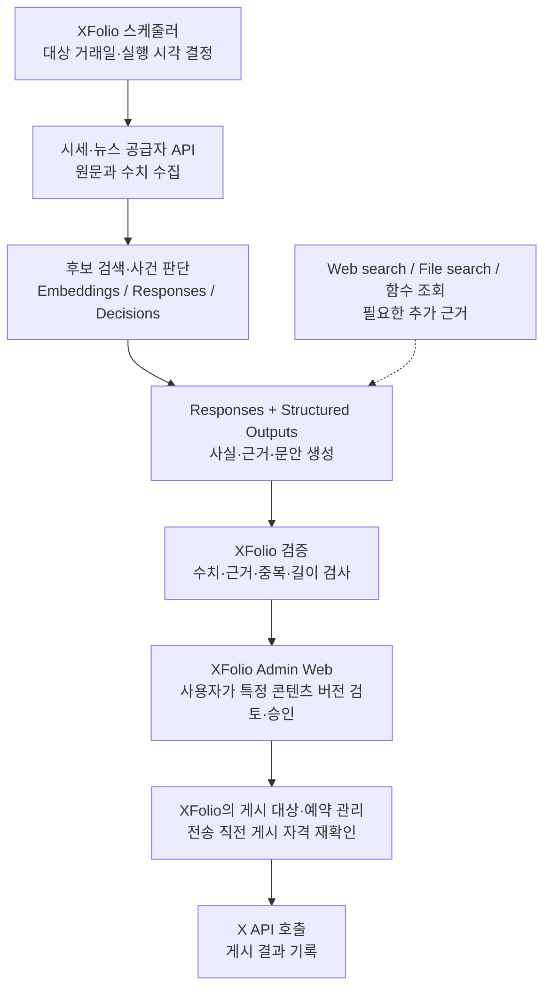

# XFolio 개발자를 위한 OpenAI API 기능 가이드

조사 기준일: **2026-10-17**. 대상 독자: OpenAI API를 처음 사용하며 XFolio의 시장 분석·콘텐츠 생성 기능을 만들려는 개발자.

과금 정보 확인일: **2026-10-17**. 기능별 과금 방식·단가·계산 예시는 [7. 기능별 과금과 비용·처리 속도 관리](#cost)에 정리했다.

이 문서는 앞서 조사한 기능을 초보자 관점에서 다시 설명한 연구 자료다. **공식 문서에서 확인한 기능**과 **XFolio에 적용하는 제안**을 구분한다. 도입 순서와 예시 구조는 설계 제안이며, 프로젝트의 확정된 요구사항이나 구현 결과를 뜻하지 않는다. 원문이 참조한 `agit/CONTEXT.md`는 이 저장소에 없으며, 현재 프로젝트의 용어와 운영 정의는 [운영 정책](../운영_정책.md)을 따른다.

OpenAI의 모든 기업용 제품을 열거하는 대신, XFolio의 수집 → 분석 → 콘텐츠 생성 → 검토·승인 → 게시 과정에 관련된 API, 도구, SDK, 운영 기능을 다룬다. 기능 지원은 **모델·API 종류·SDK 버전·계정 권한**에 따라 다르며, 문서에 소개됐다는 사실만으로 현재 계정에서 모두 사용할 수 있는 것은 아니다. 구현할 때는 각 기능 문서와 [모델 목록](https://developers.openai.com/api/docs/models), [종료 공지](https://developers.openai.com/api/docs/deprecations)를 다시 확인한다.

## 목차

1. [처음에는 무엇부터 쓰면 되는가](#start)
2. [API·모델·도구·SDK의 차이](#concepts)
3. [분석과 문안 작성의 핵심 기능](#core)
4. [자료 검색·파일 읽기·계산](#research)
5. [여러 단계를 수행하는 에이전트](#agents)
6. [오래 걸리는 작업과 대화 상태 관리](#operations)
7. [기능별 과금과 비용·처리 속도 관리](#cost)
8. [품질 평가·기록·유해 콘텐츠 분류](#quality)
9. [이미지·음성·채팅 화면으로 확장](#media)
10. [오래된 튜토리얼에서 주의할 기능](#legacy)
11. [XFolio에서 연결하는 전체 예시](#example)
12. [권장 도입 순서와 학습 경로](#roadmap)
13. [자주 헷갈리는 질문과 용어](#faq)

<a id="start"></a>

## 1. 처음에는 무엇부터 쓰면 되는가

**첫 구현은 OpenAI SDK로 Responses API를 호출하고, Structured Outputs로 결과 형식을 고정하는 구성을 제안한다.** OpenAI도 새 프로젝트에는 Responses API를 권장한다. [공식 Responses 전환 안내](https://developers.openai.com/api/docs/guides/migrate-to-responses)

| 먼저 배울 기능 | 쉽게 말하면 | XFolio에서 만드는 것 |
| --- | --- | --- |
| OpenAI SDK | Python 등의 코드에서 API를 쉽게 호출하는 라이브러리 | AI 분석을 요청하는 코드 |
| Responses API | 자료와 지시를 보내 분석·생성 결과를 받는 창구 | 사건별 요약, 시장 브리핑, X 게시 문안 |
| Structured Outputs | 결과를 정해진 양식으로 받는 기능 | 사건·수치·근거·문안을 필드별로 저장할 수 있는 데이터 |
| Function calling | AI가 필요한 외부 기능의 실행을 요청하는 방법 | 추가 기사 검색, 기존 사건 조회 등 |

이 네 가지를 모두 동시에 도입할 필요는 없다. 정해진 시장 데이터를 매일 가져오는 작업은 일반 코드로 작성하고, 확보한 자료의 분석과 문안 작성부터 Responses에 맡길 수 있다. AI가 상황에 따라 추가 자료를 골라 조회해야 할 때 Function calling을 붙이면 된다.

**OpenAI가 제공하는 부분과 XFolio가 구현할 부분을 나눠 생각하면 선택이 쉬워진다.**

| 책임 | OpenAI 기능의 활용 | XFolio 애플리케이션의 역할 |
| --- | --- | --- |
| 자료 확보 | Web search, File search, 함수 호출 요청 | 시장 데이터·뉴스 공급자 연결, 원문·수집 시각 보관 |
| 분석·작성 | 사건 후보 판단, 사실 추출, 요약, 문안 생성 | 입력 대상 고정, 결과와 콘텐츠 버전 저장 |
| 검증·승인 | 의미상 오류 탐지 보조 | 수치·근거·길이 검사, 사용자의 특정 버전 승인 기록 |
| 예약·게시 | 필요하면 문안 생성에 사용 | 거래일·시간대·예약 관리, 게시 직전 자격 확인, X API 호출과 결과 기록 |

이 표는 역할을 이해하기 위한 제안이다. 예를 들어 AI가 “게시 가능”이라고 답했다고 해서 사용자 승인이 생기는 것은 아니다. XFolio의 승인 대상은 **특정 콘텐츠 버전**이며, 수정된 문안은 새 버전으로 검토한다. [운영 정의](../운영_정책.md)

<a id="concepts"></a>

## 2. API·모델·도구·SDK의 차이

식당에 비유하면 모델은 요리사, API는 주문 창구, 도구는 요리에 필요한 장비, SDK는 주문서를 쉽게 작성해 주는 프로그램에 가깝다. 실제 구현에서는 다음처럼 구분한다.

| 용어 | 의미 | XFolio 예시 |
| --- | --- | --- |
| **모델(Model)** | 입력을 이해하고 결과를 만드는 AI | 기사를 읽고 사건별 요약을 작성하는 모델 |
| **API** | 프로그램끼리 요청과 결과를 주고받는 인터페이스 | XFolio 서버가 Responses API에 분석 요청 |
| **요청(Request)·응답(Response)** | API에 보내는 작업과 돌려받는 결과 | 기사 본문·지시를 보내고 요약·호출 정보를 받기 |
| **프롬프트(Prompt)** | 모델에 주는 지시와 작업 맥락 | “제공한 근거만 사용하고 확인되지 않은 인과관계는 단정하지 말 것” |
| **도구(Tool)** | 모델이 작업 중 이용할 수 있도록 제공한 기능 | 웹 검색, Python 실행, 기존 사건 조회 |
| **SDK** | API 호출과 결과 처리를 돕는 개발 라이브러리 | Python 코드에서 OpenAI API 사용 |
| **토큰(Token)** | 모델이 입력·출력을 처리하는 단위 | 기사 본문·지시·생성 문안의 처리량과 과금 계산에 사용 |
| **컨텍스트(Context)** | 현재 모델에 제공된 지시·자료·이전 대화 | 분석 대상 기사와 연결된 공식 발표 자료 |
| **에이전트(Agent)** | 모델이 도구를 사용하며 여러 단계를 진행하는 프로그램 | 근거를 추가 검색한 뒤 요약을 다시 작성하는 흐름 |
| **스키마(Schema)** | 데이터의 필드·자료형·허용값을 정의한 규칙 | 중요도는 정수, 근거 ID는 문자열 목록으로 받기 |

SDK는 API 자체가 아니다. SDK 없이 HTTP 요청으로 API를 호출할 수도 있지만, 처음에는 공식 SDK를 쓰는 편이 요청 작성과 응답 처리를 이해하기 쉽다. 공식 SDK와 CLI는 [SDK 안내](https://developers.openai.com/api/docs/libraries)에서 확인한다. 토큰은 글자 수와 일치하지 않으므로 한글 문서의 비용을 글자 수만으로 정확히 계산할 수는 없다. [토큰 계산 안내](https://developers.openai.com/api/docs/guides/token-counting)

### OpenAI SDK, Agents SDK, Agents API, Codex는 어떻게 다른가

| 이름 | 중심 역할 | XFolio에서의 위치 |
| --- | --- | --- |
| **OpenAI SDK** | Responses 등 개별 API 호출 | 분석·작성 요청을 보내는 기본 연결 수단 |
| **Agents SDK** | 내 애플리케이션에서 에이전트의 반복 실행·도구 사용·역할 연결을 구성 | 조사 흐름이 복잡해질 때 실행 로직 구성 |
| **Agents API** | OpenAI가 관리하는 에이전트 실행 서비스 | 세션·맥락·복구가 필요한 긴 작업 위임 |
| **Codex / Codex SDK** | 코딩 작업을 수행하는 에이전트와 이를 코드에서 제어하는 수단 | XFolio 소스 작성·수정·테스트 등의 개발 자동화 |

OpenAI SDK는 API 접근, Agents SDK는 애플리케이션 안의 실행 흐름, Agents API는 관리형 실행에 초점이 있다. Agents API는 Codex의 실행 체계를 API로 제공하지만, 그 서비스를 사용한다고 XFolio의 게시 승인·DB·스케줄러가 자동 완성되는 것은 아니다. Codex SDK를 통한 코딩 자동화 역시 별도의 선택지다. [OpenAI SDK](https://developers.openai.com/api/docs/libraries), [Agents SDK](https://developers.openai.com/api/docs/guides/agents/sdk), [Agents API](https://developers.openai.com/api/docs/guides/agents-api/overview), [Codex SDK](https://learn.chatgpt.com/docs/codex-sdk)

<a id="core"></a>

## 3. 분석과 문안 작성의 핵심 기능

### 3.1 Responses API: 자료를 주고 결과를 받는 기본 창구

Responses는 텍스트·이미지 입력, 답변 생성, 도구 사용 등을 하나의 인터페이스로 다룬다. 모델·지시·입력 자료·사용할 도구를 지정하면 생성 결과와 관련 호출 정보를 받는다. [Responses 소개](https://developers.openai.com/api/docs/guides/migrate-to-responses)

XFolio에서는 다음과 같은 요청을 만들 수 있다.

> “이 기사들과 공식 발표를 읽고, 사건의 핵심 사실을 추출해 줘. 각 사실의 근거 ID를 기록하고, 확인된 사실만 사용해 한국어 문안을 작성해 줘.”

이때 기사 본문이나 검색 도구를 주지 않고 “어제 시장을 분석해 줘”라고만 요청하면, 원하는 거래일의 자료와 근거가 확보됐다고 볼 수 없다. **어떤 자료를 기준으로 무엇을 작성할지 명시하는 설계**를 권한다. 시장의 종가와 등락률은 외부 데이터 공급자의 값을 기준으로 계산하고, 모델에는 그 결과와 출처를 제공하는 방식이 적합하다.

### 3.2 Structured Outputs: 결과를 정해진 데이터 양식으로 받기

자유로운 문장은 사람이 읽기에는 편하지만 DB에 넣고 자동 검사하기 어렵다. Structured Outputs는 지원하는 JSON Schema에 맞춰 결과를 생성하도록 하는 기능이다. “JSON으로 답해 줘”라는 지시만 주는 것보다 필수 필드와 자료형을 명확하게 다룰 수 있다. [Structured Outputs](https://developers.openai.com/api/docs/guides/structured-outputs)

다음은 **형태를 이해하기 위한 가상 결과**다. 실제 OpenAI 요청 형식이나 XFolio의 확정 DB 스키마는 아니다.

```json
{
  "event_type": "earnings",
  "subject": "가상기업 A",
  "facts": [
    {
      "statement": "이번 분기 매출은 전년 동기 대비 10% 증가했다.",
      "source_ids": ["official-release-001", "article-002"]
    }
  ],
  "draft_text": "가상기업 A가 분기 실적을 발표했습니다. 매출은 전년 동기 대비 10% 증가했습니다.",
  "needs_review": []
}
```

예시의 필드명은 개발자가 정한다. 중요한 것은 **필드가 존재하는지**와 **필드에 적힌 내용이 사실인지**를 별도로 다루는 것이다. 정상 완료된 구조화 결과도 사실 오류가 있을 수 있으며, 모델의 거절이나 출력 한도 등으로 인한 미완료도 처리해야 한다. [제약과 거절 처리](https://developers.openai.com/api/docs/guides/structured-outputs)

XFolio에서는 근거 ID가 실제 입력에 있는지, `10%`가 원문과 일치하는지, 본문이 검사 기준을 통과하는지를 코드와 검토 과정에서 확인하는 구성을 제안한다.

### 3.3 Function calling: 필요한 외부 기능을 요청하게 하기

Function calling은 모델에 사용할 수 있는 함수의 이름·설명·입력 양식을 알려 주는 기능이다. 모델은 필요한 함수와 인자를 요청하고, **XFolio 코드가 실제 함수를 실행한 뒤 결과를 돌려준다.** [Function calling](https://developers.openai.com/api/docs/guides/function-calling)

예를 들어 `find_related_events(company, date_range)`라는 조회 기능을 제공하면 다음 흐름을 만들 수 있다.

1. 모델이 기사에서 기업과 발생 시점을 읽는다.
2. 모델이 관련 사건 조회를 요청한다.
3. XFolio가 DB를 조회해 후보 사건을 반환한다.
4. 모델이 후보와 기사를 비교해 동일 사건인지, 연관된 별개 사건인지 판단한다.
5. XFolio가 판단 결과를 검사하고 저장한다.

이는 모델이 DB 접속 비밀번호를 알고 임의로 SQL을 실행하는 구조와 다르다. 제공할 기능과 실제 실행 범위는 개발자가 정한다. 매번 실행해야 하는 고정 수집 작업까지 모델의 선택에 맡길 필요는 없다.

**Structured Outputs는 결과의 양식을 정하고, Function calling은 외부 작업의 호출을 요청한다.** 둘은 함께 쓸 수 있다. 추가 자료 조회를 함수로 처리한 뒤 최종 분석을 구조화된 결과로 받는 식이다. [두 기능의 구분](https://developers.openai.com/api/docs/guides/structured-outputs)

### 3.4 Reasoning: 복잡한 판단에 쓰는 추론 설정

추론 모델은 답변 전에 내부 추론을 사용해 여러 가능성과 단계를 검토한다. 지원 모델에서는 reasoning effort 등의 설정으로 추론에 할당하는 노력을 조절할 수 있다. 높은 설정이 항상 더 좋은 결과를 보장하는 것은 아니며 지연·비용과 함께 평가해야 한다. [Reasoning 안내](https://developers.openai.com/api/docs/guides/reasoning)

XFolio 적용 제안은 다음과 같다.

- 단순 기사 유형 분류: 낮은 비용과 짧은 처리 시간을 우선 비교한다.
- 여러 보도의 수치가 서로 다를 때: 더 깊은 추론과 원문 비교를 사용한다.
- 여러 사건의 시장 영향을 설명할 때: 사실·해석·불확실성을 나눠 출력하도록 요청한다.

“왜 중요하다고 판단했는지 근거를 설명해 달라”는 요청은 유용하다. 다만 모델의 설명 자체를 사실 검증의 증거로 삼기보다는, 연결된 원자료와 함께 확인한다.

### 3.5 Decisions API: 정해진 종류의 판단을 빠르게 받기

Decisions는 자유로운 장문 생성보다 **조건 판단·선택지 분류·단계별 점수 산출**에 초점을 둔다. 조사일 기준 **공개 베타이며 `gpt-6-luna`만 지원**한다. [Decisions 공식 안내](https://developers.openai.com/api/docs/guides/decisions)

| 질문 유형 | 쉽게 말하면 | XFolio 예시 |
| --- | --- | --- |
| Predicate | 어떤 조건이 참일 가능성 평가 | “이 기사가 주식시장과 관련 있는가?” |
| Choice | 미리 정한 선택지 중 하나 선택 | “실적·금리·인수합병·기타 중 어느 유형인가?” |
| Score | 정해진 평가 단계에 따른 점수 | “사건의 중요도가 어느 단계에 가까운가?” |

점수는 제공한 단계의 확률을 반영해 계산될 수 있어 항상 정수 등급인 것은 아니다. 확률·점수를 실제 정확도나 수익 가능성으로 해석해서는 안 된다. [결과 유형 설명](https://developers.openai.com/api/docs/guides/decisions)

XFolio에서는 Responses로 먼저 같은 판단을 구현해 보고, 분류량이 커졌을 때 Decisions와 정확도·비용·속도를 비교하는 방법을 제안한다. 문안, 근거 설명, 여러 필드의 자유로운 추출은 Responses와 Structured Outputs가 더 자연스럽다.

<a id="research"></a>

## 4. 자료 검색·파일 읽기·계산

### 4.1 Web search: 인터넷의 최신 자료 찾기

Web search는 모델이 웹에서 정보를 찾아 출처를 포함한 답변을 만드는 도구다. XFolio에서는 기업의 공식 실적 발표, 정책 발표, 사건 관련 보도의 근거를 보충하는 데 사용할 수 있다. [Web search](https://developers.openai.com/api/docs/guides/tools-web-search)

**검색 결과가 최신이라는 것과 XFolio의 대상 거래일에 맞는다는 것은 별개다.** 발표 시각·사건 발생일·수정 여부를 확인하고, 기사와 공식 발표의 URL을 저장하는 구성을 제안한다. 정확한 종가·거래량을 반복 수집하는 용도로는 정해진 시장 데이터 API를 기준으로 두는 편이 좋다.

### 4.2 File inputs와 Vision: 파일·이미지 내용을 읽기

| 기능 | 하는 일 | XFolio 예시 |
| --- | --- | --- |
| **File inputs** | 지원 문서·PDF·스프레드시트 등을 요청에 입력 | 실적 발표 PDF, 데이터 CSV 읽기 |
| **Vision** | 이미지의 글자·표·그림 등 시각적 내용 이해 | 발표 슬라이드와 이미지 차트 설명 |

파일 형식마다 처리 방식이 다르다. Responses의 PDF는 지원 모델에서 텍스트와 페이지 이미지를 함께 사용하고, 일반 문서 파일은 주로 추출한 텍스트를 사용하며, 스프레드시트는 별도의 처리 흐름을 거친다. 따라서 “파일을 넣으면 모든 시트·그림·숫자가 원형 그대로 읽힌다”고 가정하면 안 된다. [File inputs](https://developers.openai.com/api/docs/guides/file-inputs), [Vision](https://developers.openai.com/api/docs/guides/images-vision)

제안: 표의 정확한 계산이 필요하면 CSV·스프레드시트를 코드로 파싱하고, Vision은 문맥과 시각적 의미를 이해하는 보조 수단으로 사용한다.

### 4.3 File search·Retrieval·Vector stores·Embeddings의 차이

이 기능들은 이름이 비슷하지만 제공하는 수준이 다르다.

| 기능 | 역할 | 어떤 때 선택하는가 |
| --- | --- | --- |
| **File search** | 모델이 업로드한 자료에서 의미·키워드 검색을 사용하는 관리형 도구 | “과거 보고서를 찾아 이번 사건과 비교해 줘”처럼 모델의 검색과 답변을 연결할 때 |
| **Retrieval** | 애플리케이션이 관련 자료를 직접 검색하는 API | 검색 결과를 화면에 보여 주거나 모델 입력을 직접 구성할 때 |
| **Vector store** | 검색에 사용할 자료와 색인을 관리하는 저장소 | File search나 Retrieval이 검색할 지식 자료를 마련할 때 |
| **Embeddings API** | 텍스트를 의미 비교에 사용할 숫자 벡터로 변환 | 자체 DB에서 유사 기사 검색·중복 후보 탐지를 만들 때 |

File search는 OpenAI가 검색 실행을 관리하며, 사전에 vector store에 파일을 준비해야 한다. Retrieval은 그 저장소를 직접 검색할 수 있게 해 준다. Embeddings는 숫자 표현을 만들 뿐이므로, 자체 검색을 택하면 저장·색인·후보 조회는 별도로 구성한다. [File search](https://developers.openai.com/api/docs/guides/tools-file-search), [Retrieval·Vector stores](https://developers.openai.com/api/docs/guides/retrieval), [Embeddings](https://developers.openai.com/api/docs/guides/embeddings)

XFolio에서는 **Embeddings로 비슷한 사건 후보를 찾고, 근거와 시점을 비교해 동일 사건 여부를 판단**하는 방식을 제안한다. “A사가 B사를 인수한다고 발표했다”와 “당국이 A사의 B사 인수를 승인했다”는 문장이 비슷하지만 서로 다른 사건이다. 유사도만으로 합치지 않도록 한다. [현재 사건 처리 기준](../운영_정책.md)

검색한 자료를 모델에 제공해 답변을 생성하는 방식을 흔히 **RAG**라고 부른다. 모델에 새 지식을 학습시키는 작업과는 구분된다. XFolio에서는 필요한 근거만 찾아 입력에 넣는 방식으로 이해하면 충분하다.

### 4.4 Code Interpreter: 분석용 Python을 작성하고 실행하기

Code Interpreter는 격리된 환경에서 모델이 Python 코드를 작성·실행하는 도구다. 데이터 분석, 계산, 차트·파일 생성 등에 사용할 수 있다. [Code Interpreter](https://developers.openai.com/api/docs/guides/tools-code-interpreter)

XFolio 활용 예는 “업종별 수익률을 계산하고 비교 차트를 만들어 줘” 또는 “이 CSV의 이상치를 조사해 줘”다. 매일 동일하게 수행하는 수익률 계산은 일반 코드로 고정하고, 새로운 분석을 탐색할 때 Code Interpreter를 활용하는 구성을 제안한다. 생성한 계산 코드와 사용 데이터도 함께 확인해야 한다.

### 4.5 심층 조사: 여러 도구를 연결하는 사용 방식

“이번 주 반도체 업종의 주요 사건을 조사하고 서로 다른 설명을 비교해 줘”처럼 여러 자료가 필요한 요청에는 Responses, Web search, File search, MCP 등을 조합할 수 있다. 조사 시간이 길면 Background mode도 함께 검토한다. [심층 조사 전환 안내](https://developers.openai.com/api/docs/guides/deep-research), [웹 검색의 조사 방식](https://developers.openai.com/api/docs/guides/tools-web-search)

과거의 `o3-deep-research`, `o4-mini-deep-research` 예제가 공식 문서에 남아 있지만 두 모델은 2026-07-23에 종료됐다. 새 구현에서는 지원 모델과 도구 구성을 다시 확인해야 한다. 모델 이름만 교체하면 이전 동작이 그대로 유지된다고 가정하지 않는다. [심층 조사 문서의 종료·이전 안내](https://developers.openai.com/api/docs/guides/deep-research)

<a id="agents"></a>

## 5. 여러 단계를 수행하는 에이전트

### 5.1 일반 코드, Agents SDK, Agents API 중 무엇을 고를까

| 선택 | 실행 흐름을 누가 관리하는가 | XFolio 적용 제안 |
| --- | --- | --- |
| **일반 코드 + OpenAI SDK** | XFolio 코드가 단계와 API 호출을 관리 | 수집 → 분석 → 검증처럼 순서가 분명한 첫 구현 |
| **Agents SDK** | XFolio 서버 안에서 SDK가 에이전트 실행을 돕고, 서버가 배포·도구·저장·승인을 관리 | 자료에 따라 조사 경로가 달라지고 여러 도구를 반복 사용할 때 |
| **Agents API** | OpenAI가 세션·작업 진행·맥락 압축·복구를 관리하고 앱이 도구·환경을 연결 | 긴 조사와 파일 작업을 관리형 실행 서비스에 맡길 때 |

Agents SDK와 Agents API는 서로 다른 실행 선택지다. Agents API는 조사일 기준 베타 인터페이스를 사용하므로 실제 계정의 접근 가능 여부와 지원 환경을 확인한다. [Agents SDK](https://developers.openai.com/api/docs/guides/agents/sdk), [Agents API](https://developers.openai.com/api/docs/guides/agents-api/overview), [Agents API 시작 안내](https://developers.openai.com/api/docs/guides/agents-api/quickstart)

여러 에이전트를 사용하는 구성은 선택 사항이다. “수집 담당·분석 담당·검증 담당”으로 나누면 역할은 이해하기 쉽지만, 같은 자료를 반복 전달하고 호출하는 비용도 생긴다. 첫 구현에서는 한 단계의 입력·출력과 실패 처리를 명확히 만든 뒤 역할 분리를 검토하는 것을 권한다.

### 5.2 외부 기능을 연결하고 재사용하는 도구

| 기능 | 쉬운 설명 | XFolio 활용 제안 |
| --- | --- | --- |
| **[MCP](https://developers.openai.com/api/docs/guides/tools-connectors-mcp)** | 외부 도구를 공통 규격으로 연결 | 시장 데이터·문서 조회 기능을 여러 에이전트에 제공 |
| **[Secure MCP Tunnel](https://developers.openai.com/api/docs/guides/secure-mcp-tunnels)** | 외부에 직접 공개하지 않은 로컬·사설 MCP 서버 연결 | 개인 서버의 조회 기능을 연결 |
| **[Skills](https://developers.openai.com/api/docs/guides/tools-skills)** | 작업 지침과 보조 파일을 재사용 가능한 묶음으로 제공 | 사건 요약 규칙, 문체, 자료 확인 절차를 재사용 |
| **[Tool search](https://developers.openai.com/api/docs/guides/tools-tool-search)** | 많은 도구 중 필요한 정의를 검색해 불러오기 | 데이터 공급자·조회 함수가 많아졌을 때 입력 크기 절감 |

MCP도 서버와 인증·도구 구현이 필요하다. 간단한 조회 함수 몇 개만 있다면 Function calling으로 시작할 수 있다. Skills는 Responses의 shell 환경이나 Agents API의 sandbox 등 지원 실행 환경에서 사용한다. 로컬 저장소에 `SKILL.md`를 작성했다고 모든 API 요청에 자동 적용되는 것은 아니다. [MCP 연결](https://developers.openai.com/api/docs/guides/tools-connectors-mcp), [Skills 적용 방식](https://developers.openai.com/api/docs/guides/tools-skills)

### 5.3 많은 도구 호출·실행 환경이 필요할 때

| 기능 | 하는 일 | XFolio 활용 제안 |
| --- | --- | --- |
| **[Programmatic Tool Calling](https://developers.openai.com/api/docs/guides/tools-programmatic-tool-calling)** | 모델이 JavaScript로 도구 호출의 반복·병렬 실행·조건 처리를 구성 | 여러 기업 자료를 조회하고 필요한 결과만 모아 반환 |
| **[Async tool calling](https://developers.openai.com/api/docs/guides/async-tool-calling)** | 느린 도구 결과를 기다리는 동안 독립적인 작업을 진행 | 보고서 조회 중 확보된 시세 자료를 분석 |
| **[Shell](https://developers.openai.com/api/docs/guides/tools-shell)** | 호스팅 또는 직접 운영하는 환경에서 명령 실행 | 파일 변환, 분석 프로그램 실행 |
| **[Computer use](https://developers.openai.com/api/docs/guides/tools-computer-use)** | 브라우저·데스크톱 화면을 읽고 조작 | API가 없는 자료 화면 탐색 |
| **[Apply Patch](https://developers.openai.com/api/docs/guides/tools-apply-patch)** | 파일 수정 사항을 구조화된 패치로 생성 | 개발 보조 에이전트의 코드·테스트 수정 |

Programmatic Tool Calling의 JavaScript 실행 환경은 일반 Node.js 서버가 아니다. 외부 접근은 제공된 도구를 통해 이뤄진다. Async tool calling도 XFolio의 작업 큐나 worker를 대신 운영해 주는 기능은 아니며, 애플리케이션이 실제 도구를 실행하고 결과를 연결해야 한다. [Programmatic 실행 환경](https://developers.openai.com/api/docs/guides/tools-programmatic-tool-calling), [Async 도구의 실행 책임](https://developers.openai.com/api/docs/guides/async-tool-calling)

XFolio의 정기 수집과 X 게시에는 먼저 데이터 공급자 API·X API를 연결하는 구성을 제안한다. Shell·Computer use·Apply Patch는 해당 실행 능력이 실제로 필요한 작업에 추가하면 된다.

<a id="operations"></a>

## 6. 오래 걸리는 작업과 대화 상태 관리

| 기능 | 쉽게 말하면 | XFolio 활용 예 |
| --- | --- | --- |
| **[Conversation state / Conversations API](https://developers.openai.com/api/docs/guides/conversation-state)** | 이전 입력·답변·도구 결과를 다음 요청에 연결 | 생성한 문안을 “더 짧게”, “이 근거를 추가해서” 수정 |
| **[Compaction](https://developers.openai.com/api/docs/guides/compaction)** | 긴 작업의 맥락을 압축해 후속 작업에 사용 | 자료를 많이 읽는 장시간 조사의 입력 크기 관리 |
| **[Background mode](https://developers.openai.com/api/docs/guides/background)** | 응답 생성을 비동기로 시작하고 나중에 상태·결과 조회 | 수분 걸리는 분석의 실행 ID를 저장하고 진행 표시 |
| **[Webhooks](https://developers.openai.com/api/docs/guides/webhooks)** | OpenAI가 작업 완료 등의 이벤트를 우리 서버에 통지 | 분석 완료 후 결과 조회·검증 작업 시작 |
| **[Streaming](https://developers.openai.com/api/docs/guides/streaming-responses)** | 결과가 생성되는 동안 일부를 순차적으로 전달 | XFolio Admin Web에 생성 중인 문장 표시 |
| **[WebSocket mode](https://developers.openai.com/api/docs/guides/websocket-mode)** | 연결을 유지하며 반복 요청·도구 결과를 주고받기 | 도구 호출이 많은 대화형 조사에서 통신 지연 감소 |

예를 들어 사용자가 분석 버튼을 누르면 XFolio가 작업을 저장하고 Background 요청을 시작할 수 있다. 완료 여부는 상태 조회 또는 Webhook으로 확인하고, 최종 결과를 DB에 저장한 뒤 자동 검증을 진행한다. 이 흐름은 구현 제안이며, 화면의 연결 여부와 무관하게 작업 상태를 관리하는 방식이 필요하다.

다음 구분을 기억하면 기능을 잘못 사용하는 일을 줄일 수 있다.

- **Background mode는 지금 시작한 작업의 비동기 실행**이다. 매일 아침 시작하는 예약 스케줄러는 XFolio가 운영한다.
- **Streaming은 진행 중인 결과 표시**다. 완성·검증 전의 문장을 게시 대상으로 확정하지 않는다.
- **Conversations는 모델의 작업 맥락 관리**다. 사용자 승인과 게시 이력의 기준 저장소는 XFolio DB로 둔다.
- **Compaction은 후속 작업을 위한 맥락 압축**이다. 원문과 검증 근거를 보관하는 업무 저장소를 대신하지 않는다.
- **Webhooks는 이벤트 통지**다. 통지를 받는 서버에서 서명을 확인하고 중복 수신을 처리하도록 구현한다. [Webhook 수신 안내](https://developers.openai.com/api/docs/guides/webhooks)

<a id="cost"></a>

## 7. 기능별 과금과 비용·처리 속도 관리

이 절의 금액은 **2026-10-17 확인한 OpenAI 직접 API의 미국 달러(USD) 단가**다. 별도 표시가 없으면 Standard 처리 기준이며, **100만 토큰(1M), 도구 호출 횟수, GB·일, 분**을 구분한다. 세금·환율·계약 할인은 계산 예시에 포함하지 않았다. 실제 사용 시 [공식 가격표](https://developers.openai.com/api/docs/pricing)를 다시 확인한다.

### 7.1 비용은 무엇으로 구성되는가

Responses라는 API 이름 자체에 별도 고정 호출료를 더하는 방식이 아니라, 선택한 모델의 처리량과 사용하는 도구 등에 따라 요금이 달라진다. 일반적인 텍스트 작업은 입력·출력 등 토큰 사용량을 중심으로 보고, 검색·파일 저장·컨테이너·이미지·음성 등은 해당 과금 항목을 함께 확인한다. [공식 API 가격표](https://developers.openai.com/api/docs/pricing)

XFolio의 예상 비용은 아래 항목으로 나눠 계산하는 것을 제안한다.

```text
하루 비용 ≈ 기사·지시 입력 비용
          + 추론·요약·문안 생성 비용
          + 검색·임베딩·파일 저장·실행 환경 비용
          + 실패 재시도·문안 수정에 드는 비용
```

이는 산정 항목을 설명하는 개념식이다. 실제 금액은 모델별 단가와 과금 규칙을 적용해야 한다. 정기적으로 처리하는 기사 수, 기사 길이, 사건당 생성 횟수를 기록하면 “가장 저렴한 모델”보다 **검증을 통과한 콘텐츠 한 건당 비용**을 비교하기 쉬워진다.

### 7.2 분석·문안 작성 모델의 단가

12절에서 소개한 세 모델의 **Standard, 요청 입력 272,000토큰 이하** 단가다. 각 열은 **해당 종류의 토큰 100만 개당 USD**이며, 같은 입력 토큰에 입력·캐시 읽기·캐시 쓰기 요금을 모두 더하는 방식은 아니다.

| 모델 | 일반 입력 | 캐시 읽기 | 캐시 쓰기 | 출력 |
| --- | ---: | ---: | ---: | ---: |
| [gpt-6-luna](https://developers.openai.com/api/docs/models/gpt-6-luna) | $0.10 | $0.01 | $0.125 | $0.50 |
| [gpt-6.1-sol](https://developers.openai.com/api/docs/models/gpt-6.1-sol) | $2.00 | $0.10 | $2.50 | $10.00 |
| [gpt-6-astra](https://developers.openai.com/api/docs/models/gpt-6-astra) | $10.00 | $1.00 | $12.50 | $50.00 |

입력이 **272,000토큰을 넘으면 초과분만이 아니라 요청 전체**에 장문 단가가 적용된다. 위 모델은 일반 입력·캐시 읽기·캐시 쓰기가 각각 표의 **2배**, 출력이 **1.5배**다. 지역 처리(data residency)를 선택하면 해당 지원 조건의 **10% 할증**도 확인한다. [장문·지역 과금 규칙](https://developers.openai.com/api/docs/models/gpt-6.1-sol)

캐시에 쓰는 토큰은 일반 입력 단가의 **1.25배로 대체 과금**되고, 재사용에 성공한 토큰은 캐시 읽기 단가를 적용한다. 입력 토큰 전체에 일반 단가를 곱한 뒤 캐시 비용을 다시 더하면 중복 계산이다. `usage`의 `cached_tokens`와 `cache_write_tokens`를 나눠 기록한다. [캐시 비용 계산](https://developers.openai.com/api/docs/guides/prompt-caching)

### 7.3 기능별 과금 방식

도구 요금이 있으면 모델 토큰 요금과 함께 계산한다. 공식 문서에서 별도 단가를 찾지 못한 기능은 **별도 단가 미확인**으로 표시했으며, 무료를 뜻하지 않는다.

먼저 호출·저장·실행에 별도 단가 또는 명시적 무료 규정이 있는 항목이다.

| 기능 | 과금 기준·단가 | 계산할 때 구분할 점과 근거 |
| --- | --- | --- |
| **Decisions API** | gpt-6-luna 입력 **$0.10 / 100만 토큰**. 출력·캐시 읽기·캐시 쓰기 요금 없음 | **/v1/decisions 전용** 규칙이다. 지역 처리 할증과 장문 입력 배율은 적용된다. [Decisions 가격](https://developers.openai.com/api/docs/guides/decisions#pricing-and-availability) |
| **Web search** | **$10 / 1,000회 + 검색 내용의 모델 입력 토큰 비용** | 검색 도구 호출료와 답변 생성 비용을 함께 계산한다. preview 변형에는 다른 규칙이 있으므로 사용 도구명을 확인한다. [도구 가격](https://developers.openai.com/api/docs/pricing#built-in-tools), [검색 호출](https://developers.openai.com/api/docs/guides/tools-web-search) |
| **File search** | Responses의 도구 호출 **$2.50 / 1,000회** | 검색 저장소 비용과 모델 토큰 비용은 추가된다. 이 호출료를 Retrieval 직접 검색에 그대로 적용하지 않는다. [도구 가격·적용 API](https://developers.openai.com/api/docs/pricing#built-in-tools) |
| **Retrieval / Vector stores** | 전체 저장소 합계 **첫 1 GB 무료**, 초과분 **$0.10 / GB·일** | 원본 파일 용량이 아니라 파싱한 청크와 임베딩의 저장량 기준이다. Retrieval의 직접 검색 호출별 별도 단가는 확인하지 못했다. [저장 요금·만료 정책](https://developers.openai.com/api/docs/guides/retrieval#pricing) |
| **Embeddings API** | 입력 100만 토큰당 **text-embedding-3-small $0.02**, **text-embedding-3-large $0.13** | 벡터 생성 비용이다. 자체 DB 저장·검색 비용은 별도로 산정한다. [입력 토큰 과금](https://developers.openai.com/api/docs/guides/embeddings), [small 가격](https://developers.openai.com/api/docs/models/text-embedding-3-small), [large 가격](https://developers.openai.com/api/docs/models/text-embedding-3-large) |
| **Code Interpreter / Hosted Shell** | 컨테이너당 20분 세션: **1 GB $0.03 / 4 GB $0.12 / 16 GB $0.48 / 64 GB $1.92** | 적용 대상 세션은 **분 단위, 최소 5분**으로 청구된다. 모델 토큰은 별도다. [컨테이너 요금](https://developers.openai.com/api/docs/pricing#built-in-tools) |
| **Agents API / OpenAI 호스팅 Sandbox** | 선택 모델 요금 + 사용 도구의 표준 요금 + 위 **컨테이너 요금** | 하위 에이전트·재시도를 포함해 합산한다. 자체 호스팅 환경은 운영 자원 비용을 따로 산정한다. 세션 연결 전 pre-warming은 무료이고, 연결 후에는 컨테이너 요금이 적용된다. [Agents API 가격](https://developers.openai.com/api/docs/guides/agents-api/overview#pricing), [사용량](https://developers.openai.com/api/docs/guides/agents-api/observability), [pre-warming](https://developers.openai.com/api/docs/guides/agents-api/environments/prewarmed#pricing) |
| **MCP 도구** | 도구 정의를 불러오고 호출할 때 사용한 **모델 토큰 비용**, OpenAI의 도구 호출별 추가요금 없음 | 연결된 외부 서비스·MCP 서버의 요금은 별도 확인한다. 이 규칙만으로 Secure MCP Tunnel까지 무료라고 판단하지 않는다. [MCP 과금](https://developers.openai.com/api/docs/guides/tools-connectors-mcp#how-it-works) |
| **Moderation endpoint** | **무료** | 별도 모델로 사실 검증이나 문안 재작성을 요청하면 그 모델 호출의 비용을 계산한다. [Moderation](https://developers.openai.com/api/docs/guides/moderation) |

나머지 기능은 모델에 전달하거나 생성하는 내용, 반복 호출, 실행 환경을 중심으로 비용을 살핀다.

| 기능 | 비용에 반영할 내용 | 별도 기능 요금의 확인 범위·근거 |
| --- | --- | --- |
| **Responses / Structured Outputs / Function calling** | 모델 입력·출력 토큰. 함수 정의는 입력 토큰에 포함되고, 외부 함수 실행은 앱이 담당 | Responses 자체의 추가요금은 없다. 구조화 출력·함수 사용을 무료 모델 호출로 해석하면 안 된다. [Responses 가격](https://developers.openai.com/api/docs/pricing), [Structured Outputs](https://developers.openai.com/api/docs/guides/structured-outputs), [함수 정의 토큰](https://developers.openai.com/api/docs/guides/function-calling#token-usage) |
| **Reasoning** | 보이지 않는 **추론 토큰도 출력 토큰으로 과금** | 눈에 보이는 답변이 짧아도 추론 비용이 발생한다. 출력 제한으로 답변이 완성되지 않은 경우도 비용이 생길 수 있다. [Reasoning 비용](https://developers.openai.com/api/docs/guides/reasoning#controlling-costs) |
| **File inputs / Vision** | 추출한 텍스트와 이미지의 입력 토큰 + 모델 출력 | PDF는 텍스트와 페이지 이미지가 함께 입력될 수 있다. 이미지 토큰은 모델·크기·detail 설정에 따라 달라진다. [파일 입력](https://developers.openai.com/api/docs/guides/file-inputs), [Vision 비용](https://developers.openai.com/api/docs/guides/images-vision#calculating-costs) |
| **OpenAI SDK / Agents SDK / Codex SDK** | 실제 API 호출과 도구·서버 사용량. Codex SDK를 **API 키로 인증하면 API 요금** 적용 | SDK 자체의 별도 단가는 확인하지 못했다. ChatGPT 로그인으로 이용하는 Codex 구독 사용량과 API 비용을 구분한다. [Agents SDK 실행 구조](https://developers.openai.com/api/docs/guides/agents/sdk), [Codex 인증별 가격](https://learn.chatgpt.com/docs/pricing) |
| **Tool search / Programmatic Tool Calling / Async tool calling** | 도구 정의·결과와 프로그램이 사용한 모델 토큰, 실제 호출한 도구의 요금 | **별도 단가 미확인.** 호출 수·반환 데이터 절감 여부를 측정한다. PTC는 별도 V8 실행 환경이므로 Hosted Shell의 컨테이너 요금을 자동 적용하지 않는다. [Tool search](https://developers.openai.com/api/docs/guides/tools-tool-search), [PTC 실행 환경](https://developers.openai.com/api/docs/guides/tools-programmatic-tool-calling), [Async](https://developers.openai.com/api/docs/guides/async-tool-calling) |
| **Skills / Secure MCP Tunnel** | 읽은 지침·도구 결과의 모델 사용량, 연결한 shell·sandbox·사설 서버 운영 비용 | **별도 단가 미확인.** Skills를 호스팅 환경에서 실행하면 해당 환경의 과금 규칙을 함께 적용한다. [Skills 환경](https://developers.openai.com/api/docs/guides/tools-skills), [Tunnel 운영 구조](https://developers.openai.com/api/docs/guides/secure-mcp-tunnels) |
| **로컬 Shell / Computer use / Apply Patch** | 모델 호출과 직접 운영하는 실행 환경. Computer use의 스크린샷은 이미지 입력 | **별도 단가 미확인.** Computer use 문서는 모델 토큰과 별도 호스팅 환경 비용을 확인하도록 안내한다. [Shell](https://developers.openai.com/api/docs/guides/tools-shell), [Computer use 비용](https://developers.openai.com/api/docs/guides/tools-computer-use#check-model-access-cost-and-data), [Apply Patch](https://developers.openai.com/api/docs/guides/tools-apply-patch) |
| **Background / Webhooks / Streaming / WebSocket mode** | 비동기·스트리밍으로 실행해도 실제 응답 생성과 도구 사용량을 계산 | 이 기능들의 **별도 단가 미확인**. Background를 Batch의 할인 처리와 혼동하지 않는다. [Background](https://developers.openai.com/api/docs/guides/background), [Webhooks](https://developers.openai.com/api/docs/guides/webhooks), [Streaming](https://developers.openai.com/api/docs/guides/streaming-responses), [WebSocket](https://developers.openai.com/api/docs/guides/websocket-mode) |
| **Conversations / Compaction** | 다음 호출에 사용되는 과거 맥락도 입력 비용에 반영. 압축은 후속 입력량을 줄이는 기능 | previous_response_id를 사용해도 이전 입력은 과금된다. 저장·압축 기능의 별도 단가와 압축 자체의 구체적 청구 규칙은 해당 안내에서 확인하지 못했다. [대화의 토큰 과금](https://developers.openai.com/api/docs/guides/conversation-state), [Compaction](https://developers.openai.com/api/docs/guides/compaction) |
| **Tracing / Evals·Promptfoo** | 평가 중 수행한 모델 호출 비용과 앱의 실행 자원 | Tracing의 별도 단가는 확인하지 못했다. 평가는 실행 사례·모델 호출 수에 따라 API 비용이 생긴다. 종료 예정 Evals 서비스의 상태는 10절을 따른다. [Tracing](https://developers.openai.com/api/docs/guides/agents/integrations-observability), [평가의 API 비용](https://developers.openai.com/api/docs/guides/promptfoo-codex) |

### 7.4 이미지·음성·ChatKit의 과금

아래 모델은 과금 방식을 설명하기 위한 예시다. **토큰 단가는 100만 토큰당 USD**이고, 전사·GPT-Live·저장은 각 행에 적힌 단위를 사용한다.

| 기능·예시 모델 | 과금 기준·단가 | 함께 계산할 항목·근거 |
| --- | --- | --- |
| **이미지 생성·편집 / gpt-image-2.5-flare** | 텍스트 입력 **$5**, 캐시 입력 **$1.25**. 이미지 입력 **$8**, 캐시 입력 **$2**, 이미지 출력 **$30** | 이미지 장당 고정가가 아니다. 모델·품질·크기에 따라 토큰 사용량이 달라진다. [모델 가격](https://developers.openai.com/api/docs/models/gpt-image-2.5-flare), [이미지 비용](https://developers.openai.com/api/docs/guides/image-generation#cost-and-latency) |
| **Transcription / gpt-transcribe** | 입력 오디오 **$0.0045 / 분** | 60분 파일의 전사만 계산하면 **$0.27**. 전사문 분석·요약은 별도 모델 비용이다. [전사 모델 가격](https://developers.openai.com/api/docs/models/gpt-transcribe) |
| **Text to speech / gpt-4o-mini-tts** | 텍스트 입력 **$0.60**, 음성 출력 **$12** | 입력 문장과 생성 음성 토큰을 각각 계산한다. 이 모델 계열은 종료 예정이므로 아래 일정도 확인한다. [TTS 모델 가격](https://developers.openai.com/api/docs/models/gpt-4o-mini-tts) |
| **Realtime / gpt-realtime-2.1-mini** | 음성 입력 **$10**, 캐시 입력 **$0.30**, 음성 출력 **$20**. 텍스트 입력 **$0.60**, 캐시 입력 **$0.06**, 출력 **$2.40** | 사용한 입력·출력 종류를 각각 합산한다. 이미지 입력은 **$0.80**, 캐시 입력은 **$0.08**이다. [Realtime 모델 가격](https://developers.openai.com/api/docs/models/gpt-realtime-2.1-mini) |
| **GPT-Live / gpt-live-1** | 음성 세션 **$0.05 / 분**, **초 단위 과금**, 분 올림 없음 | 조사 등을 위임받은 백엔드 모델·도구 요금은 추가된다. [GPT-Live 가격](https://developers.openai.com/api/docs/models/gpt-live-1) |
| **ChatKit** | OpenAI의 파일·이미지 업로드 저장소는 **계정별 월 무료 1 GB 초과분 $0.10 / GB·일** | 백엔드의 모델·도구 비용은 별도다. 자체 서버 연동은 서버·저장소 운영비도 따로 계산한다. UI 삽입 자체의 별도 단가는 확인하지 못했다. [저장 요금](https://developers.openai.com/api/docs/pricing), [자체 서버 연동](https://developers.openai.com/api/docs/guides/chatkit) |

이미지 생성의 캐시 입력 할인은 **Responses API의 이미지 생성 도구**에 적용되며, 직접 호출하는 Images API에는 적용되지 않는다. Responses에서 이미지 생성 도구를 사용하면 **상위 모델의 토큰 비용도 추가**된다. [이미지 생성의 캐시·추가 비용](https://developers.openai.com/api/docs/guides/image-generation#cached-input-pricing)

TTS 표는 기존 연동의 비용을 읽기 위한 예시다. `tts-1`, `tts-1-hd`, `gpt-4o-mini-tts`의 공지된 스냅샷은 **2027-01-06 종료 예정**이며, 공식 대체 모델은 `gpt-realtime-2.1-mini`다. 전환 시 API 방식과 과금 단위도 함께 바뀌는지 확인한다. [TTS 종료·대체 안내](https://developers.openai.com/api/docs/deprecations#2026-10-01-text-to-speech-models)

### 7.5 절감·속도 조절 기능

| 기능 | 동작·과금 | XFolio에 맞는 사용처 |
| --- | --- | --- |
| **[Batch API](https://developers.openai.com/api/docs/guides/batch)** | 다수 요청을 비동기로 처리하며 동기 처리 대비 50% 할인, 24시간 처리 창 제공 | 과거 기사 재분류, 대량 임베딩, 평가 사례 처리 |
| **[Prompt caching](https://developers.openai.com/api/docs/guides/prompt-caching)** | 같은 입력 앞부분을 재사용. 위 모델의 쓰기는 일반 입력의 1.25배, 읽기는 Luna·Astra 10%, Sol 5% | 반복되는 편집 지침·스키마·공통 자료의 입력 비용 감소 |
| **[Flex processing](https://developers.openai.com/api/docs/guides/flex-processing)** | 느린 응답·일시적 자원 부족을 허용. 위 모델은 Standard의 **50%**인 Batch 단가 적용 | 마감이 느슨한 과거 자료 정리·평가 |
| **[Fast mode](https://developers.openai.com/api/docs/guides/fast-mode)** | 빠른 처리 등급. 위 모델은 해당 Standard 토큰 단가의 **2배** | 사람이 기다리는 문안 재작성 |
| **[Ultrafast mode](https://developers.openai.com/api/docs/guides/ultrafast-mode)** | Astra·Sol의 더 빠른 처리 등급. 해당 Standard 토큰 단가의 **6배** | 지연이 중요한 대화형 분석 |
| **[Token counting](https://developers.openai.com/api/docs/guides/token-counting)** | 요청 전 입력 토큰 수 계산. 별도 단가는 해당 가이드에서 확인하지 못함 | 기사 묶음의 입력 크기 확인·분할 |

배율은 7.2의 세 모델과 현재 지원 처리 등급을 기준으로 한다. **모델 토큰의 할인율을 검색 호출료·저장료·컨테이너 비용에 일괄 적용하지 않는다.** 처리 등급마다 모델·장문·캐시 단가를 확인한다. [처리 등급별 가격표](https://developers.openai.com/api/docs/pricing)

Batch는 모든 요청의 성공을 보장하지 않는다. 처리 창이 만료되면 미완료 요청이 취소될 수 있으므로 성공·실패·미완료를 나눠 처리해야 한다. 아침 게시 마감에 필요한 분석에는 시간 조건을 먼저 검토한다. [Batch 상태와 만료](https://developers.openai.com/api/docs/guides/batch)

Prompt caching은 동일한 프롬프트 앞부분의 계산 재사용이며, 어제의 답변을 오늘 그대로 반환하는 기능이 아니다. 공통 지침을 앞에 두고 매일 달라지는 기사를 뒤에 배치하는 구성을 검토할 수 있다. [Prompt caching](https://developers.openai.com/api/docs/guides/prompt-caching)

Flex는 조사일 기준 베타이며 지원 모델이 제한된다. Fast·Ultrafast도 모델별 지원과 요금을 확인해야 한다. 특히 현재 Ultrafast는 `gpt-6-astra`, `gpt-6.1-sol`을 대상으로 안내된다. [Flex](https://developers.openai.com/api/docs/guides/flex-processing), [Ultrafast](https://developers.openai.com/api/docs/guides/ultrafast-mode)

### 7.6 비용 한도·권한·호출량

**Spend alerts**는 설정 금액에 도달했을 때 알림을 보내고, **hard spend limits**는 추적된 사용액이 한도에 도달하면 해당 요청을 차단한다. 다만 차단이 즉시 반영되는 것은 아니어서 소폭 초과될 수 있다. [Spend limits](https://developers.openai.com/api/docs/guides/spend-limits)

**Admin APIs**는 프로젝트·키·사용자·비용 한도 등의 관리를 자동화하는 기능이다. 일반 분석용 API 키와 관리용 키의 역할이 다르므로, 첫 개인용 구현에서는 관리 화면에서 프로젝트와 한도를 설정하는 정도로 시작할 수 있다. [Admin APIs](https://developers.openai.com/api/docs/guides/admin-apis)

XFolio 적용 제안: 모델 호출 횟수·토큰·실패·재시도를 기록하고, 작업별 최대 재시도와 비용 범위를 정한다. API 키는 서버의 환경변수나 비밀 저장소로 관리하며, 브라우저 코드나 문서에 값을 넣지 않는다. 계정별 호출량 제한도 확인한다. [공식 SDK 시작 안내](https://developers.openai.com/api/docs/libraries), [Rate limits](https://developers.openai.com/api/docs/guides/rate-limits)

### 7.7 XFolio 작업 비용 계산 예시

다음은 **실측이나 월 예산 견적이 아닌 가상 계산**이다. 한 번의 분석 작업에서 발생한 모든 모델 호출을 합쳐 아래 사용량이 나왔다고 가정한다. 모델은 `gpt-6.1-sol`의 Standard이며, 각 요청은 장문 할증 기준 이하이고 지역 할증은 없다.

| 항목 | 가정한 사용량 | 계산 | 비용 |
| --- | ---: | --- | ---: |
| 일반 입력 | 20,000토큰 | 20,000 ÷ 1,000,000 × $2 | $0.0400 |
| 캐시 읽기 | 5,000토큰 | 5,000 ÷ 1,000,000 × $0.10 | $0.0005 |
| 캐시 쓰기 | 5,000토큰 | 5,000 ÷ 1,000,000 × $2.50 | $0.0125 |
| 출력 전체 | 2,000토큰 | 2,000 ÷ 1,000,000 × $10 | $0.0200 |
| Web search 호출료 | 3회 | 3 ÷ 1,000 × $10 | $0.0300 |
| **합계** | **작업 1회** | | **$0.1030** |

입력 합계 30,000토큰에는 검색 결과·지시·도구 정의·이전 맥락을, 출력에는 추론·도구 호출 등을 포함한 전체 과금 토큰을 이미 반영한 가정이다. 따라서 검색 내용의 입력 토큰 비용이나 추론 비용을 다시 더하지 않는다. 적용 단가는 [Sol 모델 가격](https://developers.openai.com/api/docs/models/gpt-6.1-sol), [캐시 계산 규칙](https://developers.openai.com/api/docs/guides/prompt-caching), [검색 도구 가격](https://developers.openai.com/api/docs/pricing)을 따른다.

같은 사용량으로 월 22회 실행하면 **$2.2660, 약 $2.27**다. 재시도·문안 수정·추가 모델 호출, 임베딩·파일 저장·컨테이너·이미지·음성은 이 예시에 포함하지 않았다. 실제로 사용한 항목을 추가해야 한다. 특히 저장료는 분석 실행일 수가 아니라 **저장한 기간**으로 계산한다. 예를 들어 과금 대상 저장량 합계가 한 달 내내 3 GB라면 무료 1 GB를 뺀 2 GB × $0.10 × 30일 = **$6**가 별도로 발생한다. [Vector store 저장 요금](https://developers.openai.com/api/docs/guides/retrieval#pricing)

XFolio 전체 운영비를 구하려면 위 OpenAI 비용에 **시세·뉴스 공급자, X API, 서버·DB·스케줄러 등 외부 서비스 비용**을 더해 별도로 산정한다. 이는 XFolio의 예산 산정 제안이며, 외부 서비스 단가는 이 문서에서 조사하지 않았다.

<a id="quality"></a>

## 8. 품질 평가·기록·유해 콘텐츠 분류

| 기능 | 무엇을 확인하는가 | XFolio 활용 예 |
| --- | --- | --- |
| **[Tracing](https://developers.openai.com/api/docs/guides/agents/integrations-observability)** | 에이전트 실행 중 모델·도구·역할 연결 과정 | 어떤 검색과 입력에서 잘못된 요약이 나왔는지 추적 |
| **[평가 / Promptfoo](https://developers.openai.com/api/docs/guides/promptfoo-codex)** | 테스트 사례로 프롬프트·모델·작업 결과 비교 | 모델 변경 전 사건 구분·숫자 보존·문체의 품질 비교 |
| **[Moderation](https://developers.openai.com/api/docs/guides/moderation)** | 텍스트·이미지의 유해 콘텐츠 범주 분류 | 외부 입력이나 문안의 유해 표현 점검 |

Tracing은 실행을 관찰하는 수단이고, 평가는 정해진 사례에서 성능을 측정하는 과정이다. Moderation은 콘텐츠 유해성 분류이며 **금융 수치·기사 사실·수익 전망의 정확성을 검증하는 기능은 아니다.** [Moderation의 분류 범위](https://developers.openai.com/api/docs/guides/moderation)

XFolio의 첫 평가 사례로는 다음을 제안한다.

- 같은 사건을 다룬 두 기사를 별도 사건으로 중복 생성하지 않는가.
- 인수 발표와 규제 승인을 서로 다른 사건으로 구분하는가.
- 정정 기사에 나온 최신 수치를 반영하고 과거 수치를 섞지 않는가.
- 원문에 없는 인과관계나 전망을 사실처럼 추가하지 않는가.
- 사건별 요약에 근거 ID가 있고 문안의 숫자·단위·대상이 일치하는가.

숫자 일치와 필드 존재처럼 명확한 항목은 코드로 검사하고, 사건 경계나 표현의 충실성은 사람이 작성한 기대 결과와 비교한다. AI의 재검토를 추가할 수 있지만, 그 결과만으로 사용자 승인까지 대체하는 구성은 제안하지 않는다.

<a id="media"></a>

## 9. 이미지·음성·채팅 화면으로 확장

| 기능 | 쉽게 말하면 | XFolio 확장 예 |
| --- | --- | --- |
| **[Images API / 이미지 생성 도구](https://developers.openai.com/api/docs/guides/image-generation)** | 설명에 맞는 이미지 생성·기존 이미지 편집 | 시장 브리핑 표지, 게시용 일러스트 |
| **[Transcription](https://developers.openai.com/api/docs/guides/transcription)** | 녹음 또는 들어오는 음성을 텍스트로 변환 | 실적 발표·인터뷰의 발언을 자료로 활용 |
| **[Text to speech](https://developers.openai.com/api/docs/guides/text-to-speech)** | 문장을 음성으로 읽어 주는 기능 | 시장 브리핑 오디오 제작 |
| **[Realtime API](https://developers.openai.com/api/docs/guides/realtime)** | 음성을 직접 주고받으며 도구를 사용하는 대화 | 시장 현황을 음성으로 질문하고 답변 받기 |
| **[GPT-Live](https://developers.openai.com/api/docs/guides/live)** | 음성 대화를 유지하면서 별도 백엔드에 조사 위임 | 조사 중 추가 질문을 받으며 계속 대화 |
| **[ChatKit](https://developers.openai.com/api/docs/guides/chatkit)** | 에이전트 채팅 화면을 구성하는 UI 도구. React 지원 | XFolio Admin Web에 자료 질문·문안 수정용 대화창 추가 |

Vision은 이미지를 **읽는** 기능이고, Images는 이미지를 **만드는** 기능이다. 정확한 가격·등락률을 보여 주는 차트는 검증된 데이터로 일반 차트 라이브러리에서 그리는 구성을 제안한다. 생성 이미지는 표지·삽화처럼 표현 중심의 용도에 적합하다.

Realtime는 직접적인 음성 대화에, GPT-Live는 대화와 별도 조사 실행을 연결하는 흐름에 초점이 있다. 오디오 파일 하나를 만드는 목적이라면 실시간 대화 시스템 전체를 만들 필요는 없다. [Realtime](https://developers.openai.com/api/docs/guides/realtime), [GPT-Live](https://developers.openai.com/api/docs/guides/live)

ChatKit의 기본 UI는 **웹 컴포넌트(Web Component)**이며, HTML + JavaScript로 삽입하거나 **React용 래퍼**로 사용할 수 있다. React에서는 `@openai/chatkit-react` 패키지를 설치하고 `useChatKit()` 훅과 `<ChatKit />` 컴포넌트로 채팅창을 구성한다. XFolio Admin Web을 React로 구현한다면 원하는 위치에 채팅창을 배치할 수 있으며, 실제 대화를 처리할 백엔드 연결 설정은 별도로 필요하다. [ChatKit 설치·연동](https://developers.openai.com/api/docs/guides/chatkit), [웹 컴포넌트·자체 서버 연동](https://developers.openai.com/api/docs/guides/custom-chatkit)

ChatKit은 계속 제공되지만 Agent Builder를 이용하는 오래된 연결 예제는 종료 일정을 고려해야 한다. 새 구현은 자체 서버의 에이전트와 연결하는 경로를 확인한다. 음성 모델도 과거 TTS·Whisper 예제를 그대로 선택하기 전에 현재 지원 모델을 확인한다. [ChatKit의 현재 통합 경로](https://developers.openai.com/api/docs/guides/chatkit), [모델 종료 공지](https://developers.openai.com/api/docs/deprecations)

<a id="legacy"></a>

## 10. 오래된 튜토리얼에서 주의할 기능

아래 상태는 **2026-10-17 기준**이다. 기능 소개 페이지에 예제가 남아 있는 경우에도 종료 일정과 계정 이용 조건을 함께 확인해야 한다.

| 기능 | 제공 상태 | 새 XFolio 구현에서의 선택 |
| --- | --- | --- |
| **Chat Completions API** | 계속 지원 | 새 구현은 Responses 우선 검토 |
| **Assistants API** | 2026-08-26 종료 | Responses·Conversations 사용 |
| **Agent Builder** | 2026-11-30 종료 예정 | 일반 코드 또는 Agents SDK/API 검토 |
| **Evals 플랫폼·API** | 2026-10-31 읽기 전용 전환, 2026-11-30 종료 예정 | Promptfoo 등으로 평가 구성 |
| **저장형 프롬프트 객체** | `v1/prompts`와 재사용 프롬프트 객체가 2026-11-30 종료 예정 | 프롬프트 내용을 코드·Git에서 관리 |
| **Fine-tuning** | 처음 사용하는 조직은 새 학습 불가. 계속 이용 가능한 기존 고객도 2027-01-06부터 새 학습 작업 생성 종료 | 초기 도입 대상으로 잡지 않음 |
| **Sora 2 / Videos API** | 2026-09-24 종료 | 신규 도입 대상으로 잡지 않음 |

Chat Completions 지원 상태는 [Responses 전환 문서](https://developers.openai.com/api/docs/guides/migrate-to-responses), 나머지는 [공식 Deprecations](https://developers.openai.com/api/docs/deprecations)를 기준으로 정리했다. Fine-tuning은 예제 데이터로 모델을 추가 학습하는 기능이며, 기존 맞춤 모델의 추론은 기반 모델의 종료 일정에 영향을 받는다. **파일을 검색해 답변에 사용하는 RAG와는 다른 기능**이다.

프롬프트 객체의 종료가 프롬프트 작성 자체의 종료를 의미하지는 않는다. 코드에서 지시와 예시를 전달하는 방식은 계속 사용할 수 있다. 마찬가지로 Evals 제품의 종료와 모델 품질 평가라는 개발 활동은 구분한다.

<a id="example"></a>

## 11. XFolio에서 연결하는 전체 예시

아래는 API 역할을 설명하기 위한 **개념적 구성 제안**이다. 실제 작업 주기·News 선택 방식·게시 묶음 정책을 확정하는 설계가 아니다.



가상기업 A의 분기 실적 발표를 세 매체가 보도했다고 가정해 보자.

1. **수집:** XFolio가 기사 세 건과 공식 발표를 저장한다. 매체가 다르므로 기사(Article)는 각각 따로 보관한다.
2. **후보 탐색:** Embeddings 등으로 기존 사건 중 비슷한 후보를 찾는다. 이 단계는 같은 사건인지 확인할 대상을 줄이는 과정이다.
3. **사건 판단:** Responses가 주체·발표 시점·분기를 비교한다. 같은 분기의 실적 발표면 하나의 사건(Event)에 여러 근거를 연결하는 결과를 제안할 수 있다.
4. **사실 추출:** Structured Outputs로 매출 변화·기간·단위·근거 ID를 받는다. 공식 발표와 보도 수치가 다르면 추가 확인 항목에 남긴다.
5. **문안 생성:** 확인된 사실을 바탕으로 게시 문안을 만든다. “실적 발표 뒤 주가가 하락했다”와 “실적 때문에 주가가 하락했다”를 구분하도록 지시한다.
6. **검증·저장:** XFolio 코드가 근거 ID·수치·길이를 검사하고 특정 콘텐츠 버전과 검증 결과를 저장한다.
7. **사용자 승인:** 사용자가 XFolio Admin Web에서 그 버전을 승인한다. 이후 문장을 수정하면 새 버전을 만들고 이전 승인을 자동 승계하지 않는다.
8. **게시:** 정해진 게시 절차에서 대상과 자격을 확인하고 X API를 호출한 뒤 결과를 기록한다. 모델 응답 완료나 Webhook 수신 자체가 게시 명령은 아니다.

여기서 기사·사건·콘텐츠 버전·검증·승인의 의미는 [현재 운영 정의](../운영_정책.md)를 따른다. API 연결 방식과 후보 탐색 방법은 이 문서의 제안이다.

<a id="roadmap"></a>

## 12. 권장 도입 순서와 학습 경로

### 12.1 단계별 도입 제안

| 단계 | 도입 기능 | 확인할 결과 |
| --- | --- | --- |
| **1. 작은 입력으로 분석·작성** | OpenAI SDK + Responses + Structured Outputs | 고정한 입력으로 근거가 있는 문안을 만들고 필드별 저장 가능 |
| **2. 검증·승인·기록** | 코드 검증, 실행 기록, 소규모 평가 사례, 비용 한도 | 검증 실패와 승인 대기를 구분하고 특정 버전을 추적 가능 |
| **3. 사건 처리 개선** | Embeddings, 필요 시 Decisions | 동일 사건 중복과 연관 사건의 잘못된 병합 감소 |
| **4. 근거·실행 개선** | Web search, Function calling, 필요 시 File search·Background·Webhooks | 추가 근거 조회와 긴 작업 상태 관리 가능 |
| **5. 규모와 작업 복잡도에 대응** | Batch, caching, Agents SDK/API, MCP | 실제 병목에 맞춰 비용·실행 구조 개선 |
| **6. 콘텐츠·사용 방식 확장** | 이미지, 음성, ChatKit | 핵심 텍스트 운영이 안정된 뒤 새로운 사용 경험 추가 |

### 12.2 모델은 어떻게 고를까

공식 배포 가이드는 반복적인 작업에 `gpt-6-luna`, 복잡한 코딩·전문 작업에 `gpt-6.1-sol`, 높은 역량이 필요한 작업에 `gpt-6-astra`를 비교하도록 안내한다. 이것은 모든 XFolio 단계에 같은 모델을 써야 한다는 뜻은 아니다. [공식 모델 선택 안내](https://developers.openai.com/api/docs/guides/deployment-checklist#choose-a-model-for-the-workload)

XFolio에서는 동일한 기사 사례로 **사건 구분 정확도, 근거 충실도, 숫자 보존, 문안 품질, 처리 시간, 성공 건당 비용**을 비교하는 것을 제안한다. 저렴한 모델로 초안을 만들고 특정 실패 사례만 다른 모델로 재검토하는 구성도 평가해 볼 수 있다. 이 문서에서는 실제 모델 도입을 확정하지 않는다.

### 12.3 공식 문서를 읽는 순서

1. [SDKs and CLI](https://developers.openai.com/api/docs/libraries): API를 코드에서 호출하는 방법을 익힌다.
2. [Responses API 소개](https://developers.openai.com/api/docs/guides/migrate-to-responses): 입력·응답·도구의 관계를 이해한다.
3. [Structured Outputs](https://developers.openai.com/api/docs/guides/structured-outputs): 저장 가능한 결과와 거절·미완료 처리를 설계한다.
4. [Function calling](https://developers.openai.com/api/docs/guides/function-calling): 실제 조회 기능과 모델을 연결한다.
5. [가격표](https://developers.openai.com/api/docs/pricing)와 [Spend limits](https://developers.openai.com/api/docs/guides/spend-limits): 실험 비용을 관리한다.
6. [Promptfoo](https://developers.openai.com/api/docs/guides/promptfoo-codex): 모델·프롬프트 변경 전 품질을 비교한다.

그다음 필요한 기능의 표에 연결된 공식 문서를 읽으면 된다. 처음부터 모든 고급 도구를 익히는 것보다 작은 기사 묶음으로 분석·검증·승인의 흐름을 완성하는 것을 권한다.

<a id="faq"></a>

## 13. 자주 헷갈리는 질문과 용어

| 질문 | 답 |
| --- | --- |
| Responses를 쓰면 Web search도 자동으로 되는가? | 필요한 도구를 요청에 설정해야 한다. 도구를 제공한 경우에도 사용 여부와 호출 방식을 설계·확인한다. |
| JSON으로 받으면 사실도 정확한가? | 형식 준수와 사실성은 별개다. 수치·출처·대상·시점을 검증한다. |
| Embeddings가 같은 사건인지 결정해 주는가? | 의미가 비슷한 후보를 찾는 재료다. 동일 사건 여부에는 주체·시점·발생 사실의 비교가 필요하다. |
| 파일 업로드는 모델 학습인가? | 입력·검색용 파일 제공과 Fine-tuning은 다른 작업이다. |
| Agents API가 있으면 XFolio 서버가 없어도 되는가? | 게시 승인·업무 데이터·외부 서비스 연결·제품 화면 등 애플리케이션 책임은 남는다. |
| Background mode가 매일 실행 예약도 해 주는가? | 요청한 응답 생성을 비동기로 실행한다. 정기 실행은 별도 스케줄러가 담당한다. |
| WebSocket mode와 Realtime API는 같은가? | WebSocket은 연결 방식이고, Realtime API는 음성 대화 등을 위한 API다. Responses에도 별도의 WebSocket mode가 있다. |
| AI 검증을 통과하면 바로 게시해도 되는가? | XFolio에서 자동 검증과 사용자의 특정 콘텐츠 버전 승인은 별개다. |

위 구분은 각각 [Web search](https://developers.openai.com/api/docs/guides/tools-web-search), [Structured Outputs](https://developers.openai.com/api/docs/guides/structured-outputs), [Embeddings](https://developers.openai.com/api/docs/guides/embeddings), [File inputs](https://developers.openai.com/api/docs/guides/file-inputs), [Agents API](https://developers.openai.com/api/docs/guides/agents-api/overview), [Background](https://developers.openai.com/api/docs/guides/background), [WebSocket](https://developers.openai.com/api/docs/guides/websocket-mode), [Realtime](https://developers.openai.com/api/docs/guides/realtime)과 [현재 운영 정의](../운영_정책.md)를 기준으로 설명했다.

| 추가 용어 | 뜻 |
| --- | --- |
| **비동기** | 요청 직후 완료를 기다리지 않고, 나중에 결과를 확인하는 방식 |
| **Polling** | 작업이 끝났는지 주기적으로 상태를 조회하는 방식 |
| **Webhook** | 이벤트가 생겼을 때 상대 서버가 우리 서버에 보내는 통지 |
| **Sandbox** | 코드·명령 실행을 분리해 관리하는 환경 |
| **Orchestration** | 여러 단계·도구·에이전트의 실행 순서를 조정하는 일 |
| **RAG** | 필요한 자료를 검색해 모델 입력에 넣고 답변을 만드는 방식 |
| **Tracing** | 작업 중 어떤 호출·도구·단계가 실행됐는지 기록·확인하는 기능 |
| **Eval** | 정해진 사례와 기준으로 AI 결과의 품질을 측정하는 평가 |

이 문서는 조사일의 기능 지도를 보존한 자료다. 구현 시점에 모델·가격·제공 상태가 바뀌면 해당 공식 문서와 [Deprecations](https://developers.openai.com/api/docs/deprecations)를 기준으로 갱신한다.
