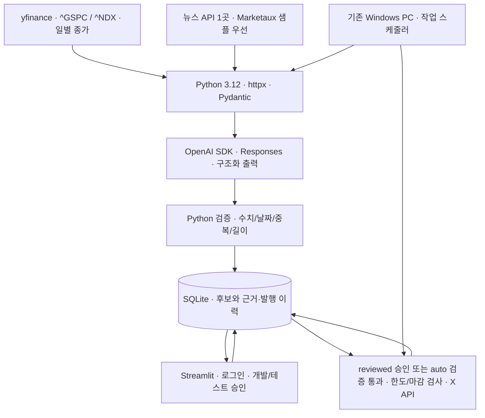

# 3주차 기술·비용 조사

- 확인일: 2026-10-23, Asia/Seoul
- 기준: [조사계획](../../../tasks/week3_research_plan.md)
- 검증 수준: 공식 공개 문서·가격·이용 조건 조사. 계정 인증 API·유료 사용·실제 게시·모델 성능·배포 시험은 미실행

## 항목별 결과

2026-10-23 추가 확인: [FRED의 X 공개 게시 조건과 오전 8시 제공 여부](fred_publication_and_timing.md). 공식 문서상 조건·공개 갱신 표시를 재확인했으며, 개별 허가 취득·인증 API의 최초 도착 시험과는 구분한다.

2026-10-23 사용자가 [yfinance 지수 수집](yfinance_index_collection.md)을 확정했다. S&P 500 `^GSPC`·Nasdaq-100 `^NDX` 일별 종가 조회와 등락률 계산을 구현 기준으로 삼는다. 기존 검색·FRED 우선 후보는 비교 이력으로 유지한다. [게시 모드](../../market_search_and_publishing_modes.md)의 관리자 승인은 개발·테스트 전용이고 안정화 후 자동 게시한다. yfinance 설치·실제 응답·오전 자료 도착·공개 이용 조건 검증은 미완료다.

공개 이용 권한은 [별도 권한 점검](public_usage_rights.md)에 모았다. 지수·뉴스의 공식 근거, Nasdaq EOD 성과의 제한적 예외, AI·보관 조건, 발송 전 문의 초안을 포함한다. 권한 취득과 문의 발송은 아직 하지 않았다.

남은 확인을 추가로 조사한 [후속 검증 현황](follow_up_verification.md)에 공개 자료와 실제 로컬 실험 결과, 계정 없이는 확인할 수 없는 부분을 정리했다. 각 항목 문서에도 후속 결과를 추가했다.

조사 후 사용자가 선택한 현재 기준은 [초기 비용 절감 구성](../../minimum_cost_configuration.md)이다. 로컬 Windows·SQLite·Streamlit·작업 스케줄러와 기업 하루 1회/1개 글·아침 링크 통합을 적용한다. 아래 VM·기업 2회 비용은 조사 당시 비교 이력으로 읽는다.

| 계획 | 문서 | 핵심 결과 |
| --- | --- | --- |
| R1 | [주가지수 API](market_data_api.md) · [yfinance 채택](yfinance_index_collection.md) | yfinance로 두 지수 수집 확정. 이전 API 비교는 이력이며 실제 연동·아침 도착·공개 게시 조건은 후속 검증 |
| R2 | [뉴스 제공처](news_sources.md) | Marketaux 무료 샘플 우선 후보. 충분한 근거와 공개 요약·AI 전송·보관 권한 미확인 |
| R3 | [관찰 기업 후보](watchlist_candidates.md) | 공식 자료의 날짜를 명시해 10회사 후보 작성. 당일 편입과 뉴스 응답 검증은 미완료 |
| R4 | [OpenAI 활용](openai_usage.md) | Python SDK·Responses·Pydantic 적용안, Mini/Terra 비교와 구조화 출력 예시. 품질 실측 전 |
| R5 | [X 게시 API](x_publishing_api.md) | 사용자 인증·답글 스레드·가중 글자 수·URL 게시 과금 확인 |
| R6 | [저장·관리자 사이트](storage_admin.md) | SQLite+같은 서버의 Streamlit 우선, Supabase 비교. 실제 로그인·복원 시험 필요 |
| R7 | [예약 실행·배포](scheduling_deployment.md) | 단일 VM+OS timer 우선 후보, Actions 지연·영속 기록 제약 확인 |
| R8 | [월 비용](monthly_cost.md) | 가정 편성에서 데이터 권한 비용 제외 약 4.8만 원, 환율 여유·세금 가정 포함 약 5.8만 원 |

## 기술 구성 추천

후속 [비용 절감 대안](cost_reduction.md) 중 아침 출처 글 통합·기존 PC·기업 뉴스 하루1건 조합을 사용자가 채택했다. 가정 부분 견적은 약 2.1만 원이다. 아래 구성도는 현재 채택한 Windows 로컬 실행에 맞춰 갱신했다.

아래는 조사 결과로 제안하는 후보 구성이다. 기존 구현·배포가 완료됐거나 기술 선택을 확정한 그림이 아니다.

Python·uv·httpx·Pydantic·pytest·Ruff는 저장소의 현재 선택을 설명한다. 단일 서버·SQLite는 별도 서비스와 공통 저장소 연결을 줄이는 추천이며 성능·운영 난이도는 아직 시험하지 않았다. GitHub Actions는 정적 검사·시험에 활용하되 현재 예약 시각 목표의 운영 게시에는 우선 추천하지 않는다.

## 조사로 확인한 주요 제약

1. 무료 조회는 지수·뉴스의 공개 게시 권한을 뜻하지 않는다. 현재 예산 안에서 필수 권한까지 확인한 제공처는 없다. 각 문서에 근거와 확인 한계를 적었다.
2. X 공식 단가는 URL 포함 글 $0.200/요청, 일반 글 $0.015/요청이다. URL 포함 5개/일을 22일 게시하면 해당 글만 $22다. [X 가격](https://docs.x.com/x-api/getting-started/pricing)
3. Mini의 구조화 출력 지원은 한국어 요약·근거 검증 품질 보장이 아니다. 같은 허용 샘플로 품질·지연·토큰을 시험해야 한다. [AI 조사](openai_usage.md)
4. 현재 사용량 가정에서는 월 3만 원이 초과된다. 실제 저빈도 편성의 비용은 다르므로 예산 또는 편성 변경을 자동 확정하지 않는다. [비용 산식](monthly_cost.md)

## 4주차로 넘길 확인

- 지수 표시·재배포 허가와 07:30/08:00 도착 가능성, 뉴스의 충분한 근거·AI 입력·요약·보관 조건
- 계정에서 X 앱·실제 과금·권한 확인과 승인된 소규모 게시 시험
- 공식 최신 구성기업 확인, 뉴스 샘플 확보와 모델 비교
- 1GB 서버 메모리·예약 지연·OIDC·DB 동시 처리·백업 복원 시험
- 실제 사용량과 비용에 맞춘 기술 선택·개발 시간 재산정

위는 수행할 후속 작업이다. 이번 조사에서 가입·결제·대외 문의·실제 게시를 수행하지 않았다. 조사 결과를 [발표 초안](../../../tasks/progress/2026-10-21.md)에 연결했다.
