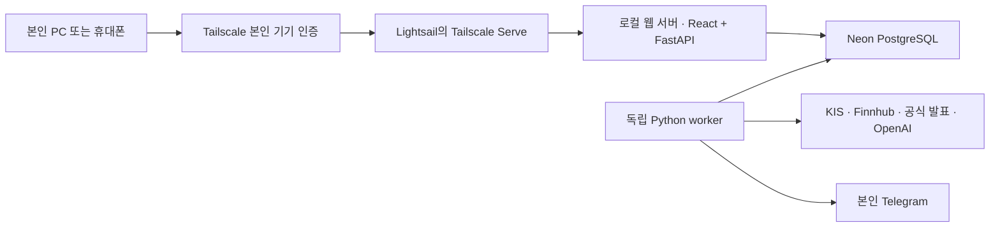

# 본인 전용 관리자 · AWS 비공개 배포

- 확인·결정일: 2026-11-02, Asia/Seoul.
- 사용자 선택: **AWS Lightsail + Tailscale**, 본인 PC·휴대폰 접근. 실제 설치·배포·방화벽 변경은 아직 하지 않았다.
- 기존 기술 선택 중 Lightsail·React/FastAPI·Neon은 유지한다. 공개 웹 진입 대신 사설 네트워크 진입을 추가한다.

## 확정 구성과 접속 흐름

쉽게 말하면 AWS에 개인 업무용 컴퓨터를 켜 두고, 관리자 화면으로 들어가는 통로를 본인 기기에만 연결하는 방식이다. PC나 휴대폰에서 Tailscale을 연결한 뒤 전용 주소로 접속한다. 관리자 화면을 닫아도 서버의 worker는 예정된 수집/발송을 수행한다.

[Tailscale Serve](https://tailscale.com/docs/features/tailscale-serve)는 tailnet 내부에서 로컬 웹 서비스를 제공하고 접근 규칙을 적용한다. **Serve를 사용하고 인터넷 공개용 Funnel은 비활성화**한다. HTTPS 인증서를 설정한다. 본인 Google 로그인·서버 세션/CSRF도 유지하며 전용 주소에서 OAuth callback·쿠키 동작을 인수한다.

접근 규칙은 본인 사용자·승인 기기에서 관리자 서비스로만 허용한다. [기본 tailnet 정책](https://tailscale.com/docs/features/access-control/acls)은 모든 소속 기기 사이의 연결을 허용할 수 있으므로 기본값을 그대로 본인 전용이라고 가정하지 않는다. 사용자/기기 공유를 하지 않고 계정 MFA·분실 기기 해제 절차를 마련한다.

## 네트워크·자료 경계

- [Lightsail 방화벽](https://docs.aws.amazon.com/lightsail/latest/userguide/understanding-firewall-and-port-mappings-in-amazon-lightsail.html)은 공인 IP로 들어오는 트래픽을 통제한다. IPv4·IPv6를 각각 확인하고 관리자 HTTP/HTTPS·API·DB 포트를 인터넷에 열지 않는다. 초기 접속/복구 경로 확보 후 SSH 공개 허용도 정리한다.
- 호스트 웹 진입은 loopback에 바인딩하고 Docker가 API 포트를 모든 인터페이스에 공개하지 않게 한다. Lightsail 방화벽만으로 사설 IP 경유까지 차단된다고 가정하지 않는다. API·정적 화면·로그인 callback·문서 화면을 같은 비공개 경계로 묶는다.
- [Tailscale 연결 안내](https://tailscale.com/docs/reference/faq/firewall-ports)에 따르면 일반적으로 별도 수신 포트 개방 없이 동작하며 직접 연결이 어려우면 암호화 relay를 사용한다. 외부 API·Tailscale 연결에 필요한 송신 네트워크는 유지한다.
- Telegram 자동 전송은 서버의 외부 HTTPS 요청으로 수행할 수 있으므로 공개 webhook이 필요하지 않다. 본인 chat 등록은 서버 설정으로 제한한다.
- 이는 **관리자 웹 접근을 비공개로 만드는 설계**다. 공인 IP 없는 AWS private subnet, 모든 데이터의 AWS 내부 보관과 같은 의미가 아니다. Neon·OpenAI·Telegram 등 외부 사업자 처리도 남는다. KIS 약관·뉴스 자료 권한은 비공개 접속과 별도로 확인한다.
- 이용권의 실제 해결 순서는 [출처별 실행 방법](데이터_이용_조건.md#비공개-접속과-별도로-이용권을-해결하는-실행-순서)을 따른다. 명시된 기관 재사용 조건을 적용하고, 일반 뉴스 제목·링크 제공처를 인수하며, KIS 외부 처리/보관·개인 전달 용도를 확인한다. 미확인과 금지를 구분한다.

## 대안과 비용

| 방법 | 접속 방식·장단점 | 결정 |
| --- | --- | --- |
| Lightsail + Tailscale | PC·휴대폰 클라이언트, 기존 서버 목표 유지. 개인 비상업 용도는 [Personal 무료 플랜](https://tailscale.com/pricing) 대상이나 서버/DB/AI 비용은 별도 | 사용자 채택 |
| EC2 + AWS Systems Manager | IAM 권한으로 CLI 터널을 열어 localhost에서 관리자 사용. 별도 VPN 계정 없이 AWS 중심으로 구성, PC 위주 접속 | 미채택 대안 |

[Session Manager](https://docs.aws.amazon.com/systems-manager/latest/userguide/session-manager.html)는 인바운드 포트 없이 접근할 수 있다. [포트 전달](https://docs.aws.amazon.com/systems-manager/latest/userguide/session-manager-working-with-sessions-start.html)에는 SSM Agent·인스턴스/IAM 권한·로컬 CLI plugin·통신 경로가 필요하다. 이를 기존 Lightsail에 설정 없이 적용할 수 있다고 간주하지 않는다. 포트 전달 내용은 Session Manager 세션 로그에 기록되지 않으므로 앱 감사가 필요하다.

EC2의 공인 IP 없는 private subnet 구성도 가능하지만 [SSM endpoint 또는 외부 통신 경로](https://docs.aws.amazon.com/systems-manager/latest/userguide/setup-create-vpc.html), 외부 뉴스/KIS/Telegram용 egress를 함께 설계해야 한다. NAT/endpoint 비용을 0원으로 가정하지 않는다. 현 월5만원 목표에서 이 대안으로 바꾸지 않는다.

## 운영 인수 기준

본인 PC·휴대폰 허용, 타 계정/미등록 기기·인터넷 직접 접근 거절, 로그인/CSRF, IPv6/API 우회, 재부팅 후 Serve·worker 복구, 기기 폐기와 백업 복원을 확인한다. 구체 시험은 구현 단계의 `tasks/verification/integration/` 계약에 둔다. 현재는 문서 근거에 따른 설계 결정이며 실제 접근 차단을 시험한 상태가 아니다.

[기술 구성](../기술_구성.md) · [데이터 이용 조건](데이터_이용_조건.md) · [선택 기록](../../tasks/discussions/2026-11-02_공식_발표와_비공개_관리자.md)
