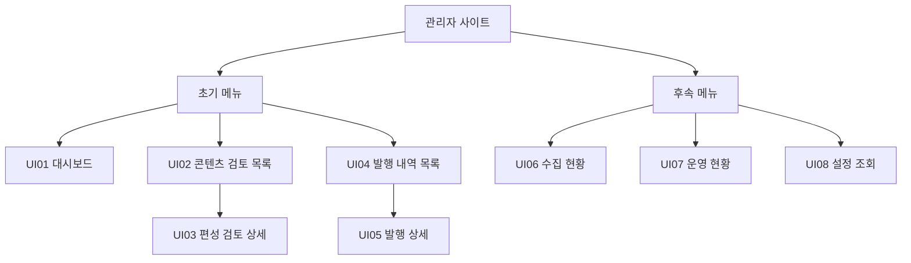

# 관리자 화면 구조와 와이어프레임

> 입력·편성의 단일 기준은 [현재 요구사항](../요구사항.md)이다. 현재 목표는 AM 최대 4글이며 기존 코드·OpenAPI·PM 이력/시험과 구분한다.
- 기준: 2026-10-31, Asia/Seoul. [4주차 확정 기획](../../tasks/presentations/4주차_개발_계획.md)의 관리자 구성을 상세화한다.
- 상태: 초기 3메뉴의 제품 목표 정의. 검토 목록/상세·로그인/승인은 초기 구현되어 있으나 아래 전체 화면 구성·4글 승인·외부 연동은 완료하지 않았다.
- 검토: 2026-10-29 사용자 와이어프레임 검토 완료. 이후 입력 책임 구체화와 2026-10-30 Exa·BLS·세 ETF 핵심과 후속 공식 자료 범위는 아래 목표에 반영한다. 기존 시연 HTML에는 새 출처/공시 필드·세 ETF·승인 체크박스가 아직 반영되지 않았다.
- 범위: [개발 범위·단계](../planning/개발_범위와_단계.md) · [WBS](../planning/작업_분해_WBS.md) · [공식 발표와 공시 수집 설계](공식_발표와_공시_수집_설계.md)
- 시각 자료: [클릭 가능한 와이어프레임](assets/관리자_와이어프레임.html). **2026-10-29 이전 범위의 가상 화면 예시**이며 최신 데이터 계약의 완성 화면이 아니다. 외부 자원·API를 호출하지 않으며 모든 값과 문안은 가상이다.
- 정적 미리보기: [대시보드](assets/대시보드_와이어프레임.png) · [검토 상세](assets/검토_상세_와이어프레임.png) · [모바일 검토](assets/모바일_검토_와이어프레임.png)

## 목적과 초기 범위

단일 운영자가 Google로 로그인해 **오늘 아침 편성의 근거를 검토하고 정확한 버전을 승인한 뒤 발행 결과를 확인**하는 비공개 React 관리자다. 대상은 단일 X 계정이며 공개 독자용 화면·다중 역할 관리는 범위 밖이다.

- 초기 메뉴는 **대시보드·콘텐츠 검토·발행 내역** 3개다. 목록/상세를 구분하면 업무 화면 5개이며 로그인은 별도 진입 화면이다.
- 현재 입력은 **yfinance SPY·QQQ·DIA + Exa + BLS CPI**, 편성은 **08:00 ETF 1글+뉴스 0~3글, 하루 최대 4글**이다. ETF는 USD 가격과 가격 등락률로 표시한다.
- 화면은 조회·검토·승인/보류를 맡고 FastAPI는 인증·권한·버전·검사를, worker는 수집·생성·예약 전송을 맡는다. 브라우저를 닫아도 예약 작업은 worker가 담당하는 목표다.
- 여기서 ‘초기’는 A02/A03의 제품 범위다. 수집·운영·설정 상세는 B01 후속이며 Fed·BEA·SEC 자동 수집도 별도 후속이다. 화면의 세부 배치는 아래 설계안, 경로는 제안이며 신규 기능의 구현 완료를 뜻하지 않는다.

## IA와 단계

로그인은 메뉴 계층 밖의 진입 화면이다. 업무 이동은 `로그인 → UI01 → UI02 → UI03 → 승인/보류`, 전송 시작 후 `UI03 → UI05 → UI04`다. 메뉴 계층의 부모/자식 관계와 실제 업무 순서를 구분한다.

### 화면·요구사항·API 연결

현행은 `#/`의 요약 카드 포함 검토 목록과 `#/drafts/:id` 상세다. 위 표의 `/reviews` 등은 목표 경로 제안이며 구현된 라우트가 아니다. hash 유지/라우터 도입의 기술 선택은 화면 기능 확정과 별개다.

| 화면 ID | 요구사항 | 연결 API·현재 상태 | WBS |
| --- | --- | --- | --- |
| UI01 | FR-04,FR-07,NFR-01,NFR-04 | operations/summary 기존, 대상일·Exa/ETF 요약 확장 필요 | A02 |
| UI02,UI03 | FR-02~07,NFR-01~03 | drafts 목록/상세·decision 기존, 근거·review_checks·4글 확장 필요 | A01,A02,A04 |
| UI04,UI05 | FR-07,FR-08,NFR-03,NFR-04 | publications 목록/상세 신규 목표 | A03,A06 |
| UI06 | FR-10,NFR-01 | collections 목록/상세 B01 목표; Fed/BEA/SEC는 FR-09 별도 후속 | B01 |
| UI07 | FR-10,NFR-04 | summary 기존 일부, 상세 endpoint는 요구 확정 후 별도 명세 | B01 |
| UI08 | FR-10,NFR-02 | settings 읽기 B01 목표 | B01 |

[요구사항 ID·수용 조건](../요구사항.md#요구사항-목록과-수용-조건) · [API 현행/목표](API_명세서.md) · [WBS 추적](../planning/작업_분해_WBS.md#요구사항과-검증-추적)

상위 6메뉴와 목록/상세 화면을 구분한다. 1단계 제품에는 구현된 3메뉴만 노출한다. 와이어프레임은 전체 구성을 검토하기 위해 후속 메뉴도 보여 주고 단계 표시를 붙인다. 로그인은 기존 흐름을 재사용한다. 설정 변경·직접 게시·재생성·웹 편집 버튼은 1/2단계 기본 범위에 없다.

| 화면 ID | 메뉴·경로 제안 | 단계 | 정보·동작 | 데이터 경계 |
| --- | --- | --- | --- | --- |
| UI01 | 대시보드 `/` | 1 | 오늘 AM 단계, ETF·Exa/BLS 상태·목표/마감·승인 대기·비용 | 기존 summary 확장, 미연결과 정상 0건 구분 |
| UI02 | 콘텐츠 검토 `/reviews` | 1 | 날짜·상태 필터, AM 편성·거래일·버전·뉴스/전체 글 수·검증/보류 사유 | 기존 drafts 목록 확장. 공식 자료의 출처·사건·CIK 필터는 후속 |
| UI03 | 편성 검토 `/reviews/:id` | 1 | 최대 4글 미리보기, Exa/BLS 원문 근거·ETF 값·발행/확보 시각·이용 권한·검토사항, 전체 승인·보류 | 기존 상세/decision API 확장, 정확 버전·revision·멱등 키·review_checks |
| UI04 | 발행 내역 `/publications` | 1 | 상태·전송 시각·글 수, partial/unknown 강조, 상세 이동 | 신규 읽기 API 필요. draft 목록만으로 실제 전송 성공을 추정하지 않음 |
| UI05 | 발행 상세 `/publications/:id` | 1 | 글별 시도·결과·확인된 X ID/링크, 승인/전송 이력, 다음 조치 | posts/jobs/events 결합. 실제 ID가 없으면 링크 없음 |
| UI06 | 수집 현황 `/collections` | 2 | 세 ETF/기관별 발표·SEC 공시 탭, 범위·커서·페이지/기업 완료, no_updates/partial, 근거 상세 | 신규 collections 목록/상세 API. 당시 watchlist_version과 범위로 완주 판단 |
| UI07 | 운영 현황 `/operations` | 2 | 실행·장애/알림·비용 탭, 발생 원인·최근 결과·동일 실행 연결 | events/ledger 조회 추가, 공급자 실시간 청구와 구분 |
| UI08 | 설정 `/settings` | 2 | 모드·편성 시각·한도·세 ETF·지원 자료 종류·SEC 10기업 목록·버전 | 신규 비밀 없는 읽기 API. 목록 수정/기업 추가 버튼 없음 |

경로는 설계안이다. 현재 hash 라우팅에서 확장할 수 있고 router 의존성 추가를 필수로 하지 않는다. 신규 API의 최종 경로·응답은 A01/B01에서 OpenAPI와 함께 정한다. 화면 수 때문에 API 8개를 유지하지도, 미리 불필요한 API를 만들지도 않는다.

## 공통 레이아웃과 이동

- 왼쪽 메뉴: 대시보드 / 콘텐츠 검토 / 발행 내역. 현재 메뉴를 표시하고 후속 메뉴는 초기 제품 탐색에 노출하지 않는다.
- 상단: 대상 KST 날짜·연결된 X 계정·환경·운영 모드·운영자·로그아웃. 각 조회 영역에는 최종 확인 시각과 새로고침을 둔다.
- 본문: 메뉴 제목 → 핵심 상태/조치 필요 → 목록 또는 상세. 상세에서 목록으로 돌아갈 때 날짜·상태 필터를 유지하는 배치를 목표로 한다.
- 초기 조회는 오늘 AM을 기준으로 한다. 과거 PM은 명시적인 이력 조회에서만 읽기 전용으로 제공하며 새 생성·승인·예약·전송 동작을 노출하지 않는다. 서버도 이를 차단해야 한다.

## 핵심 화면 배치

### 대시보드

상단은 대상일·모드·환경·최종 조회 시각, 본문은 아침 진행/승인 대기, 하단은 조치 필요·최근 발행이다. PM 메뉴·예약 카드는 신규 제품에 노출하지 않으며 과거 PM 이력은 조회로만 남긴다. 미조회는 `확인되지 않음`으로 표시한다.

| 영역 | 표시 내용 | 이동·동작 |
| --- | --- | --- |
| 오늘 아침 진행 | 수집 → 초안/검사 → 승인 대기 → 예약 → 전송 결과, 현재 단계와 보류 사유 | 해당 검토 상세 또는 발행 상세 |
| 일정 | 07:30 근거 기준·07:45 검토 준비·07:55 승인 목표·08:00 전송·09:00 마감 | 목표와 강제 마감을 구분해 표시 |
| 입력 상태 | ETF 3종·미국 거래일, Exa/BLS 실행 범위·완료/부분 실패·마지막 확인 | 핵심 요약만 제공, 수집 상세 탐색은 후속 |
| 승인 대기·조치 필요 | 대상 버전·글 수·검증 실패/보류·부분 성공/결과 불명 | 검토 또는 결과 확인 |
| 최근 발행·월 비용 | 실제 글별 결과 요약, 월 예상/예약/확정 금액·상한 | 발행 내역. 비용은 앱 원장이며 공급자 전체 청구가 아님 |

현행 summary의 발행 개수는 전체 기간 집계다. 대상일 계약을 확장하기 전 이를 ‘오늘 발행’으로 표시하지 않는다. 미연결 알림을 장애 0건으로 표시하지 않는다.

가격 영역은 **SPY·QQQ·DIA** ETF 종가(USD)·가격 등락률·미국 완료 거래일을 보여 준다. 현행 두 지수 응답을 ETF 값으로 표시하거나 빈 종목을 가상으로 채우지 않는다. 목표 심볼은 `SPY/QQQ/DIA`다.

뉴스 영역은 Exa 질의/BLS의 마지막 확인·조회 범위·본문 부족·실행 상태를 보여 준다. Exa는 상위N 결과이며 시장 전체를 확인했다는 표현을 피한다. Fed·BEA·SEC는 후속으로 표시한다. SEC는 “관찰10기업 중10기업 확인”처럼 당시 목록 크기를 분모로 쓰고 전체 미국 기업을 수집했다는 표현을 피한다. 명단을 교체해도 이전 실행은 당시 기업 목록 버전을 표시한다. 핵심 완주 요약은1단계 대시보드에, 상세 탐색은2단계 수집 현황에 둔다.

### 콘텐츠 검토 목록

행은 기사 한 건이 아니라 **날짜·계정·AM 편성의 현재 버전**이다. KST 대상일·미국 거래일·버전·전체 글 수/뉴스 수·상태·보류 사유·전송 목표/마감·최종 갱신을 보여 준다. 날짜·상태로 좁혀 상세로 이동한다. 기본 20개/최대 50개와 cursor를 사용하고 필터 변경 시 cursor를 초기화한다. 출처·사건·기업 필터는 API의 공식 자료 확장과 함께 도입할 후속 목표다.

빈 목록은 ‘조회 조건에 해당하는 편성 없음’이다. 수집 성공·적격 뉴스 0건·운영일 아님을 목록 유무로 추정하지 않는다. 필수 수집 완료 후 뉴스가 0건이면 ETF 1글 편성을 검토하며 필수 수집 실패이면 전체 보류 사유를 표시한다.

### 콘텐츠 검토 상세

편성·버전·글 수·목표/마감을 먼저 보여 준다. 게시글 선택 시 대응하는 근거가 보이는 좌우 비교 구성을 사용한다. 수치·단위·기간·원문 위치를 나란히 확인하고, 코드 검사 결과와 운영자가 판단해야 할 의미·관련성·중요성을 분리한다. `검사 통과`를 AI의 사실 보증으로 표현하지 않는다.

| 배치 | 구성 |
| --- | --- |
| 상단 | 계정·KST 대상일·미국 거래일·AM·버전·상태·정보 기준·목표/마감 |
| 왼쪽 미리보기 | 첫 글: SPY/QQQ/DIA 종가 USD·등락률. 다음 글: 중요도순 뉴스 0~3건, 각각 원매체 이름·출처 링크. 글별 가중 길이 검사 |
| 오른쪽 근거 | 선택한 글의 주장·수치·단위·기간 ↔ 허용된 근거 발췌/위치·원문 링크, 출처·발행/확보 시각·권리·코드 검사 결과 |
| 결정 영역 | 운영자 확인 3개, `vN · 전체 N글 승인`, 사유 입력과 `보류`, 결정 후 상태·승인자·시각 |
| 하단 | 현재 버전의 검증·결정 이력, 전송이 시작됐으면 발행 상세로 이동 |

뉴스에 10기업을 우선 적용하되 목록 밖 중요 사건도 허용한다. 목록 밖이라는 이유만으로 승인 불가로 표시하지 않고 선정 이유·현재 관련성·새 사실의 근거를 확인한다.

출처 배지는 Exa/BLS, 원매체 이름은 따로 표시하며 사건 배지는 실적/M&A/정책/경제지표로 표시한다. Fed·BEA·SEC의 공시 전용 필드는 아래 후속 범위에서 관리한다.

시각은 “발행”, “SEC 접수”, “최초 조회 완료”, “사용 가능 확보”, “최근 재확인”을 구분한다. retrieved_at은 해당 버전의 최초 조회 완료 시각으로 고정하고 같은 버전 재확인은 last_checked_at만 갱신한다. available_at은 최초 retrieved_at보다 이르지 않은 사용 가능 확보 시각이다. 원천에 없으면 `확인되지 않음`이며 자정·접수시각을 발행시각으로 대신 표시하지 않는다. `available_at`과 편성 cutoff를 함께 보여 주고 늦게 확보한 자료를 이전 편성의 근거로 소급 사용하지 않는다. source_revision/content_hash는 펼쳐보기에서 확인하며 해당 버전의 수치·대상기간·evidence_refs 위치와 연결한다. source 권한은 별도 상태로 표시하고 수집 성공을 게시 허용으로 표현하지 않는다.

승인은 개별 글이 아니라 현재 편성 전체다. 버튼에는 대상 버전과 글 수를 함께 표시하고 승인 이후에는 예약 상태와 철회 동작을 보여 준다. 보류는 사유를 요구한다. 편집은 후속이므로 잘못된 초안은 보류·생략하고, CLI 새 버전 기능이 도입되기 전에는 수동 DB 수정으로 우회하지 않는다.

입력/검증 책임 확정에 따라 승인 전 **근거 지지·조건 보존·관련성/새 사실**의 3개 확인을 표시하고 [API](API_명세서.md)의 review_checks로 전달한다. 운영자·검토 시각·버전/hash는 서버가 감사 이벤트에 남긴다. 보류에는 체크를 강요하지 않으며 누락/기계 검사 실패 시 승인을 차단한다. 기존 와이어프레임의 전체 레이아웃은 유지한다.

3개 확인은 각각 `evidence_support`, `conditions_preserved`, `relevance_and_novelty`에 대응하며 개별 글 선택용 체크박스가 아니다. 승인 성공은 **예약됨**으로 표시한다. 07:55는 목표이며 승인 허용 마감으로 오인하지 않는다. 08:00 이후 승인도 09:00 전 다음 worker 처리 대상이고 09:00부터 신규 전송은 불가하다. 서버가 반환한 허용 동작과 차단 사유를 사용한다.

요청 중 중복 클릭을 막고 결정 후 상세·목록·summary를 다시 조회한다. 버전/revision 충돌 시 최신 자료를 불러와 다시 검토하며 자동 재승인하지 않는다. timeout은 성공/실패를 추정하지 않고 상태부터 재조회한다. 첫 전송 전에는 승인 철회·보류, 전송 시작 후에는 남은 글 중단을 제공하며 이미 전송한 요청의 취소로 표현하지 않는다.

### 발행 내역 목록

발행을 시도한 편성을 날짜·상태·모의/실제로 조회한다. KST 대상일·AM/과거 PM·원버전·모의/실제·전체/성공/불명/실패 글 수·첫 시도/최종 갱신 시각을 표시하고 상세로 이동한다. 승인만 된 예약은 검토 화면에서 확인한다. 실제 X ID가 없는 모의 결과에는 X 링크를 만들지 않는다. 데이터·필터는 [발행 조회 API](API_명세서.md)의 계약을 따른다.

### 발행 상세

편성 성공 여부와 글별 전송 결과를 나눈다. 일부 성공 또는 결과 불명에서는 확인된 글만 성공으로 표시하고, 첫 글이 성공했다고 전체 성공으로 바꾸지 않는다. 결과 불명에 재게시 버튼을 제공하지 않는다. 원래 버전·예약·비용을 보존한 채 ID·계정·시각을 대조할 다음 조치를 안내한다.

## 후속 화면과 공식 자료 확장

**다음 항목은 초기 3메뉴의 필수 구현이 아니다.** 수집·운영·설정 조회는 B01이며, Fed·BEA·SEC 필드는 각 수집 기능을 도입할 때 연결한다.

### 수집 현황·운영 현황·설정 조회

수집 현황은 기관별 source_id, 사건 유형, SEC CIK, 실행 상태로 좁혀 볼 수 있도록 목표를 둔다. 현재 API 명세의 collections 목록 필터는 source_id/status/date이고 사건·기업 상세 탐색은 선택한 실행의 근거 목록에서 수행한다. 전체 서버 검색이 필요하면 별도 query 계약을 먼저 추가한다. raw 공급자 cursor 대신 완료 구간·페이지 수·기업 완료/누락과 안전한 오류를 보여 준다.

저장/응답 status는 `running|complete|partial|failed`이며 `no_updates`는 `status=complete && new_version_count=0`인 파생 boolean이다. no_updates=true면 “범위 확인 완료·새 자료 없음”, partial은 “수집 일부 미완료”, failed는 “수집 실패”로 표시한다. 별도 no_updates 상태를 DB에 저장하거나 status query에 보내지 않는다. 수집된 후보가 전부 제외돼 선정0건인 경우와 구분한다. `rights_status`와 `eligibility`는 후보별 별도 상태이며 출처에 SEC가 있다는 이유만으로 자동 허용하지 않는다.

설정은 Exa/BLS 활성·실연결·질의·권리 상태를 표시하고, 공식 자료의 지원 설계(Fed FOMC 성명, BLS CPI, BEA PCE, SEC 지정8-K항목의 실적/M&A)를 읽기 전용으로 보여 준다. Fed·BEA·SEC는 후속이다. BLS 고용·BEA GDP는 후속으로 표시한다. 관찰 기업은 10개로 제한하되 공식 법인명·CIK·감시 시작일 미검증이면 `목록 설정 대기`다. 회사명·CIK·ticker·enabled·watchlist_version·적용일을 표시하고 비밀/API키·DB접속 문자열은 반환하지 않는다.

운영 현황은 실행·장애/알림·비용 탭에서 실행 ID에 연결된 기록을 조회한다. 설정 변경·재생성·직접 게시·웹 문안 편집 버튼은 이 조회 확장에도 포함하지 않는다.

SEC 근거에는 회사명·CIK·accession number·form·item·첨부 위치·공식 링크·접수 시각을 추가한다. `8-K 2.02`, `1.01`, `2.01`과 관련 `9.01` 첨부는 검토 단서이며 EX-99.1만으로 실적 확인 완료라고 하지 않는다. 6-K/외국기업은 후속이다. SEC 관찰 10기업 목록과 Exa의 우선 기업 기준은 구분한다.

## 현행 구현과 연결할 작업

| 구분 | 확인한 현행 | 확정 목표에 맞출 작업 |
| --- | --- | --- |
| React | `frontend/src/App.tsx`의 요약 카드 포함 검토 목록과 `#/drafts/:id` 상세 | A02: 독립 대시보드·3메뉴 구성·최대 4글 비교·운영자 확인 3개 |
| API·승인 | 기존 8경로·정확 버전/revision·승인/보류 | A01/A02: AM 4글·PM 신규 처리 차단·summary/근거·review_checks 확장 |
| 발행 조회 | 검토 상세의 제한된 게시 결과 | A03: 발행 목록/상세 API 2개와 화면, 모의/실제·partial/unknown 구분 |
| 화면 시연 | 이전 범위 HTML·PNG | 최신 기획을 반영한 시각 시연은 별도 갱신 필요 |

작업별 시간·주차는 [WBS](../planning/작업_분해_WBS.md), 목표 데이터 계약은 [API 명세](API_명세서.md), 과거 시험과 최신 추가 인수 항목은 [관리자 검증](../../tasks/verification/admin/관리자_화면과_승인_API.md)에서 관리한다. 이 문서 갱신은 코드·migration·OpenAPI 변경이나 제품 시험 통과가 아니다.

## 화면 공통 상태

| 상태 | 표현·가능한 동작 |
| --- | --- |
| 로딩·갱신 중 | 마지막 자료가 있으면 오래된 자료임을 표시. 승인 동작은 최신 상세 확인 전 차단 |
| 빈 목록 | 필터 결과 없음. 수집 성공·정상0건이라고 추정하지 않음 |
| 정상0건 / 운영일 아님 | 실행 근거와 함께 서로 다른 상태로 표시 |
| 새 자료 없음 / 수집 일부 미완료 | 기관별 no_updates와 partial을 구분. 일부 실패를 정상0건으로 합산하지 않음 |
| 권한 검토 대기 / 제한 / 만료 | 수집 상태와 분리해 후보에 표시. 게시 적격·승인을 차단하고 근거 검토로 연결 |
| 조회 오류·세션 만료 | 재조회/로그인 안내, 승인 차단. 보류/승인 성공으로 표시하지 않음 |
| 승인 대기 | 검증/기한/권한 통과한 버전 전체 승인 또는 사유 포함 보류 |
| 예약 | 버전·승인시각·목표/마감, 첫 전송 전 철회 가능 |
| 보류·만료 | 이유·다음 조치, 같은 버전 재승인 금지 |
| 게시 중 | 잔여 글 중단 가능. 이미 보낸 요청 취소를 보장하지 않음 |
| 부분 성공·결과 불명 | 성공 글/불명 글을 분리, 자동 재시도 금지·대조 안내 |
| 모의 / 합성 / 실제 | 서로 다른 표시. 모의 결과를 X 성공으로, 합성을 정상 게시 가능한 자료로 표현하지 않음 |

상태는 색뿐 아니라 문구로 구분한다. 운영 시각은 KST, 미국 거래일은 별도 필드다. 모바일에서는 사이드 메뉴를 줄바꿈하고 미리보기→근거→결정 순으로 세로 배치한다. 키보드 포커스·폼 라벨·오류 안내·텍스트 대비를 유지한다. 별도의 상시 polling은 추가하지 않는다.

## 와이어프레임 사용과 한계

- 메뉴 이동, 검토 목록→상세, 상태 선택, 승인/보류의 화면 변화, 발행 상세, 후속 메뉴의 탭을 확인할 수 있다.
- 시연 입력은 가상의 기관·사건·문안이다. 승인 시연은 브라우저 내부 표시만 바꾸며 로그인·실제 승인·DB·게시와 연결되지 않는다.
- 와이어프레임에서 보이는 기능은 설계이며 구현 완료 근거가 아니다. 1단계/후속 구분은 범위 문서와 WBS가 기준이다.
- 기존 HTML·PNG는 이번에 변경하지 않았다. 기관별 필터·공시 메타데이터·ETF 전환·관찰 기업 10개·새 상태 표시는 최신 문서 목표이며 이전 시연의 검증 결과에 포함되지 않는다.
- 제품의 서버 권한·CSRF·기한/버전 검사·멱등·synthetic 차단은 실제 구현 시 기존 계약을 유지한다.

## 설계 산출물 검증

2026-10-29 headless Edge에서 9개 화면·4개 너비(1440/768/390/320), 총 36개 화면 상태의 레이아웃을 검사했다. 메뉴 이동·필터 빈 결과·승인 시연·사유 필수 보류·만료/조회 실패/결과 불명의 승인 차단·후속 메뉴 탭을 확인했다. JavaScript 오류 0건·외부 요청 0건이며 데스크톱/모바일 스크린샷을 직접 확인했다. 이 검증은 와이어프레임에 한정되고 제품 API·DB·정책 시험 결과가 아니다.
