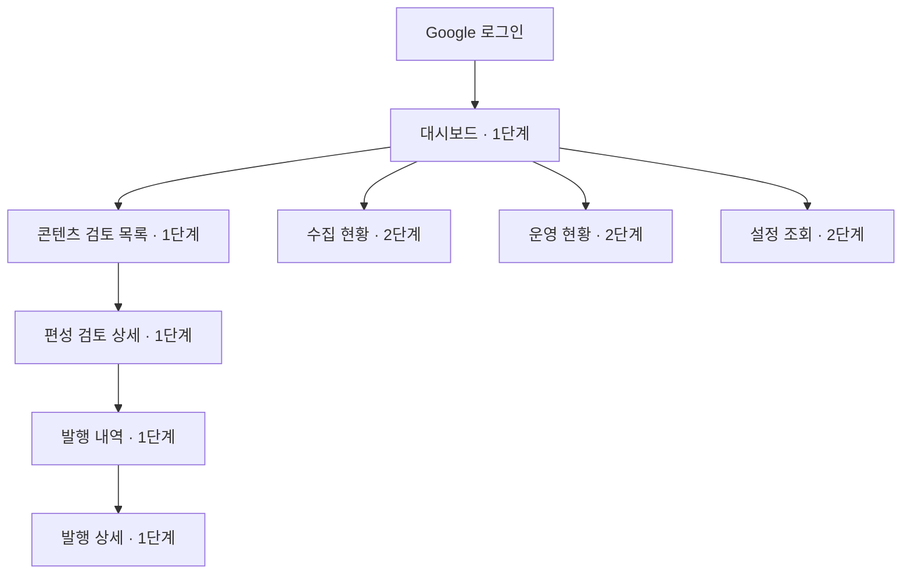

# 관리자 화면 구조와 와이어프레임

> 2026-10-29 일정 정정: 5~6주차30시간은 중간 개발 목표이며 7주차 추가 개발·통합 검증, 8주차 초 기능 마무리를 계획한다. 단계는 기능 범위이고 달력상 2주 마감과 동일하지 않다. 시간·의존성은 [개발 범위·단계](../planning/개발_범위와_단계.md)와 [WBS](../planning/작업_분해_WBS.md)가 기준이다.

- 기준: 2026-10-30, Asia/Seoul
- 상태: 화면 설계·가상 시연. 제품 화면 구현이나 외부 연동 완료가 아니다.
- 검토: 2026-10-29 사용자 와이어프레임 검토 완료. 이후 입력 책임 구체화와 2026-10-30 Fed·BLS·BEA·SEC·세 지수·SEC 관찰 기업 범위는 아래 목표에 반영한다. 기존 시연 HTML에는 새 출처/공시 필드·세 지수·승인 체크박스가 아직 반영되지 않았다.
- 범위: [개발 범위·단계](../planning/개발_범위와_단계.md) · [WBS](../planning/작업_분해_WBS.md) · [공식 발표와 공시 수집 설계](공식_발표와_공시_수집_설계.md)
- 시각 자료: [클릭 가능한 와이어프레임](assets/관리자_와이어프레임.html). **2026-10-29 이전 범위의 가상 화면 예시**이며 최신 데이터 계약의 완성 화면이 아니다. 외부 자원·API를 호출하지 않으며 모든 값과 문안은 가상이다.
- 정적 미리보기: [대시보드](assets/대시보드_와이어프레임.png) · [검토 상세](assets/검토_상세_와이어프레임.png) · [모바일 검토](assets/모바일_검토_와이어프레임.png)

## IA와 단계

상위 6메뉴와 목록/상세 화면을 구분한다. 1단계 제품에는 구현된 3메뉴만 노출한다. 와이어프레임은 전체 구성을 검토하기 위해 후속 메뉴도 보여 주고 단계 표시를 붙인다. 로그인은 기존 흐름을 재사용한다. 설정 변경·직접 게시·재생성·웹 편집 버튼은 1/2단계 기본 범위에 없다.

| 화면 ID | 메뉴·경로 제안 | 단계 | 정보·동작 | 데이터 경계 |
| --- | --- | --- | --- | --- |
| UI01 | 대시보드 `/` | 1 | 오늘 AM/PM 단계, 세 지수 수집·Fed/BLS/BEA/SEC 범위별 완료, 다음 목표/마감, 승인 대기·조치 필요, 비용 요약 | 기존 summary 확장. PM·기관 미연결과 정상0건을 구분 |
| UI02 | 콘텐츠 검토 `/reviews` | 1 | 날짜·편성·상태·출처·사건 유형·기업 필터, 버전·뉴스 수·검증/보류 사유 | 기존 drafts 목록에 source_id/event_type/cik 목표 query 추가 |
| UI03 | 편성 검토 `/reviews/:id` | 1 | 게시 미리보기, 원문 근거·공시 메타데이터·발표/접수/확보 시각·권한·검토사항, 전체 승인·보류 | 기존 상세/decision API 확장, 정확 버전·revision·멱등 키 |
| UI04 | 발행 내역 `/publications` | 1 | 상태·전송 시각·글 수, partial/unknown 강조, 상세 이동 | 신규 읽기 API 필요. draft 목록만으로 실제 전송 성공을 추정하지 않음 |
| UI05 | 발행 상세 `/publications/:id` | 1 | 글별 시도·결과·확인된 X ID/링크, 승인/전송 이력, 다음 조치 | posts/jobs/events 결합. 실제 ID가 없으면 링크 없음 |
| UI06 | 수집 현황 `/collections` | 2 | 세 지수/기관별 발표·SEC 공시 탭, 범위·커서·페이지/기업 완료, no_updates/partial, 근거 상세 | 신규 collections 목록/상세 API. 당시 watchlist_version과 범위로 완주 판단 |
| UI07 | 운영 현황 `/operations` | 2 | 실행·장애/알림·비용 탭, 발생 원인·최근 결과·동일 실행 연결 | events/ledger 조회 추가, 공급자 실시간 청구와 구분 |
| UI08 | 설정 `/settings` | 2 | 모드·편성 시각·한도·세 지수·지원 자료 종류·SEC 10기업 목록·버전 | 신규 비밀 없는 읽기 API. 목록 수정/기업 추가 버튼 없음 |

경로는 설계안이다. 현재 hash 라우팅에서 확장할 수 있고 router 의존성 추가를 필수로 하지 않는다. 신규 API의 최종 경로·응답은 A01/B01에서 OpenAPI와 함께 정한다. 화면 수 때문에 API 8개를 유지하지도, 미리 불필요한 API를 만들지도 않는다.

## 핵심 화면 배치

### 대시보드

상단은 대상일·모드·환경·최종 조회 시각과 새로고침, 본문은 AM/PM 진행과 승인할 편성, 하단은 조치 필요·최근 결과다. 비용은 작은 요약으로 제공하고 운영 상세로 연결한다. 1단계 PM은 후속·미연결로 표시하며 실패나 정상0건으로 표시하지 않는다. 모든 카드의 숫자는 조회된 값으로만 표시하고 미조회는 `확인되지 않음`이다.

지수 영역은 **S&P 500·나스닥100·다우**의 종가·등락률·미국 완료 거래일을 함께 보여 준다. 현행 코드의 두 지수만 조회된 상태에서 다우 값을 가상으로 채우거나 전체 완료로 표시하지 않는다. 목표 심볼은 `^GSPC/^NDX/^DJI`다.

뉴스 영역은 Fed·BLS·BEA·SEC별 마지막 확인·완료 구간·지원 자료 범위·실행 상태를 보여 준다. SEC는 “관찰10기업 중10기업 확인”처럼 당시 목록 크기를 분모로 쓰고 전체 미국 기업을 수집했다는 표현을 피한다. 명단을 교체해도 이전 실행은 당시 기업 목록 버전을 표시한다. 핵심 완주 요약은1단계 대시보드에, 상세 탐색은2단계 수집 현황에 둔다.

### 콘텐츠 검토 상세

편성·버전·글 수·목표/마감을 먼저 보여 준다. 게시글 선택 시 대응하는 근거가 보이는 좌우 비교 구성을 사용한다. 수치·단위·기간·원문 위치를 나란히 확인하고, 코드 검사 결과와 운영자가 판단해야 할 의미·관련성·중요성을 분리한다. `검사 통과`를 AI의 사실 보증으로 표현하지 않는다.

출처 배지는 Fed/BLS/BEA/SEC, 사건 배지는 실적/M&A/정책/경제지표로 표시한다. SEC 근거에는 회사명·CIK·accession number·form·item·첨부 위치·공식 링크를 노출한다. `8-K 2.02`, `1.01`, `2.01`과 관련 `9.01` 첨부는 검토 단서이며, EX-99.1 표시만으로 실적 내용 확인 완료라고 하지 않는다. 6-K/외국기업은 후속 범위로 표시한다.

시각은 “발행”, “SEC 접수”, “최초 조회 완료”, “사용 가능 확보”, “최근 재확인”을 구분한다. retrieved_at은 해당 버전의 최초 조회 완료 시각으로 고정하고 같은 버전 재확인은 last_checked_at만 갱신한다. available_at은 최초 retrieved_at보다 이르지 않은 사용 가능 확보 시각이다. 원천에 없으면 `확인되지 않음`이며 자정·접수시각을 발행시각으로 대신 표시하지 않는다. `available_at`과 편성 cutoff를 함께 보여 주고 늦게 확보한 자료를 이전 편성의 근거로 소급 사용하지 않는다. source_revision/content_hash는 펼쳐보기에서 확인하며 해당 버전의 수치·대상기간·evidence_refs 위치와 연결한다. source 권한은 별도 상태로 표시하고 수집 성공을 게시 허용으로 표현하지 않는다.

승인은 개별 글이 아니라 현재 편성 전체다. 버튼에는 대상 버전과 글 수를 함께 표시하고 승인 이후에는 예약 상태와 철회 동작을 보여 준다. 보류는 사유를 요구한다. 편집은 후속이므로 잘못된 초안은 보류·생략하고, CLI 새 버전 기능이 도입되기 전에는 수동 DB 수정으로 우회하지 않는다.

입력/검증 책임 확정에 따라 승인 전 **근거 지지·조건 보존·관련성/새 사실**의 3개 확인을 표시하고 [API](API_명세서.md)의 review_checks로 전달한다. 운영자·검토 시각·버전/hash는 서버가 감사 이벤트에 남긴다. 보류에는 체크를 강요하지 않으며 누락/기계 검사 실패 시 승인을 차단한다. 기존 와이어프레임의 전체 레이아웃은 유지한다.

### 발행 상세

편성 성공 여부와 글별 전송 결과를 나눈다. 일부 성공 또는 결과 불명에서는 확인된 글만 성공으로 표시하고, 첫 글이 성공했다고 전체 성공으로 바꾸지 않는다. 결과 불명에 재게시 버튼을 제공하지 않는다. 원래 버전·예약·비용을 보존한 채 ID·계정·시각을 대조할 다음 조치를 안내한다.

### 수집 현황·설정 조회

수집 현황은 기관별 source_id, 사건 유형, SEC CIK, 실행 상태로 좁혀 볼 수 있도록 목표를 둔다. 현재 API 명세의 collections 목록 필터는 source_id/status/date이고 사건·기업 상세 탐색은 선택한 실행의 근거 목록에서 수행한다. 전체 서버 검색이 필요하면 별도 query 계약을 먼저 추가한다. raw 공급자 cursor 대신 완료 구간·페이지 수·기업 완료/누락과 안전한 오류를 보여 준다.

저장/응답 status는 `running|complete|partial|failed`이며 `no_updates`는 `status=complete && new_version_count=0`인 파생 boolean이다. no_updates=true면 “범위 확인 완료·새 자료 없음”, partial은 “수집 일부 미완료”, failed는 “수집 실패”로 표시한다. 별도 no_updates 상태를 DB에 저장하거나 status query에 보내지 않는다. 수집된 후보가 전부 제외돼 선정0건인 경우와 구분한다. `rights_status`와 `eligibility`는 후보별 별도 상태이며 출처에 SEC가 있다는 이유만으로 자동 허용하지 않는다.

설정은 기관별 활성/실연결 여부와 확정한 초기 지원(Fed FOMC 성명, BLS CPI, BEA PCE, SEC 지정8-K항목의 실적/M&A)를 읽기 전용으로 보여 준다. BLS 고용·BEA GDP는 후속으로 표시한다. 관찰 기업은 10개로 제한하되 공식 법인명·CIK·감시 시작일 미검증이면 `목록 설정 대기`다. 회사명·CIK·ticker·enabled·watchlist_version·적용일을 표시하고 비밀/API키·DB접속 문자열은 반환하지 않는다.

## 화면 공통 상태

| 상태 | 표현·가능한 동작 |
| --- | --- |
| 로딩·갱신 중 | 마지막 자료가 있으면 오래된 자료임을 표시. 승인 동작은 최신 상세 확인 전 차단 |
| 빈 목록 | 필터 결과 없음. 수집 성공·정상0건이라고 추정하지 않음 |
| 정상0건 / 운영일 아님 | 실행 근거와 함께 서로 다른 상태로 표시 |
| 새 자료 없음 / 수집 일부 미완료 | 기관별 no_updates와 partial을 구분. 일부 실패를 정상0건으로 합산하지 않음 |
| 권한 검토 대기 / 제한 / 만료 | 수집 상태와 분리해 후보에 표시. 게시 적격·승인을 차단하고 근거 검토로 연결 |
| 조회 오류·세션 만료 | 재조회/로그인 안내, 승인 차단. 보류/승인 성공으로 표시하지 않음 |
| 승인 대기 | 검증/기한/권한 통과한 버전 전체 승인 또는 사유 포함 보류 |
| 예약 | 버전·승인시각·목표/마감, 첫 전송 전 철회 가능 |
| 보류·만료 | 이유·다음 조치, 같은 버전 재승인 금지 |
| 게시 중 | 잔여 글 중단 가능. 이미 보낸 요청 취소를 보장하지 않음 |
| 부분 성공·결과 불명 | 성공 글/불명 글을 분리, 자동 재시도 금지·대조 안내 |
| 모의 / 합성 / 실제 | 서로 다른 표시. 모의 결과를 X 성공으로, 합성을 정상 게시 가능한 자료로 표현하지 않음 |

상태는 색뿐 아니라 문구로 구분한다. 운영 시각은 KST, 미국 거래일은 별도 필드다. 모바일에서는 사이드 메뉴를 줄바꿈하고 미리보기→근거→결정 순으로 세로 배치한다. 키보드 포커스·폼 라벨·오류 안내·텍스트 대비를 유지한다. 별도의 상시 polling은 추가하지 않는다.

## 와이어프레임 사용과 한계

- 메뉴 이동, 검토 목록→상세, 상태 선택, 승인/보류의 화면 변화, 발행 상세, 후속 메뉴의 탭을 확인할 수 있다.
- 시연 입력은 가상의 기관·사건·문안이다. 승인 시연은 브라우저 내부 표시만 바꾸며 로그인·실제 승인·DB·게시와 연결되지 않는다.
- 와이어프레임에서 보이는 기능은 설계이며 구현 완료 근거가 아니다. 1단계/후속 구분은 범위 문서와 WBS가 기준이다.
- 기존 HTML·PNG는 이번에 변경하지 않았다. 기관별 필터·공시 메타데이터·다우·관찰 기업 10개·새 상태 표시는 최신 문서 목표이며 이전 시연의 검증 결과에 포함되지 않는다.
- 제품의 서버 권한·CSRF·기한/버전 검사·멱등·synthetic 차단은 실제 구현 시 기존 계약을 유지한다.

## 설계 산출물 검증

2026-10-29 headless Edge에서 9개 화면·4개 너비(1440/768/390/320), 총 36개 화면 상태의 레이아웃을 검사했다. 메뉴 이동·필터 빈 결과·승인 시연·사유 필수 보류·만료/조회 실패/결과 불명의 승인 차단·후속 메뉴 탭을 확인했다. JavaScript 오류 0건·외부 요청 0건이며 데스크톱/모바일 스크린샷을 직접 확인했다. 이 검증은 와이어프레임에 한정되고 제품 API·DB·정책 시험 결과가 아니다.
