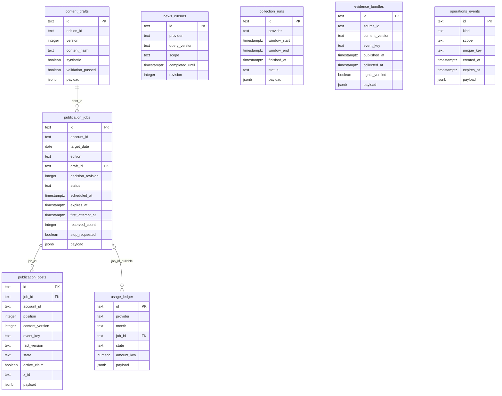
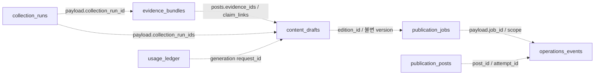
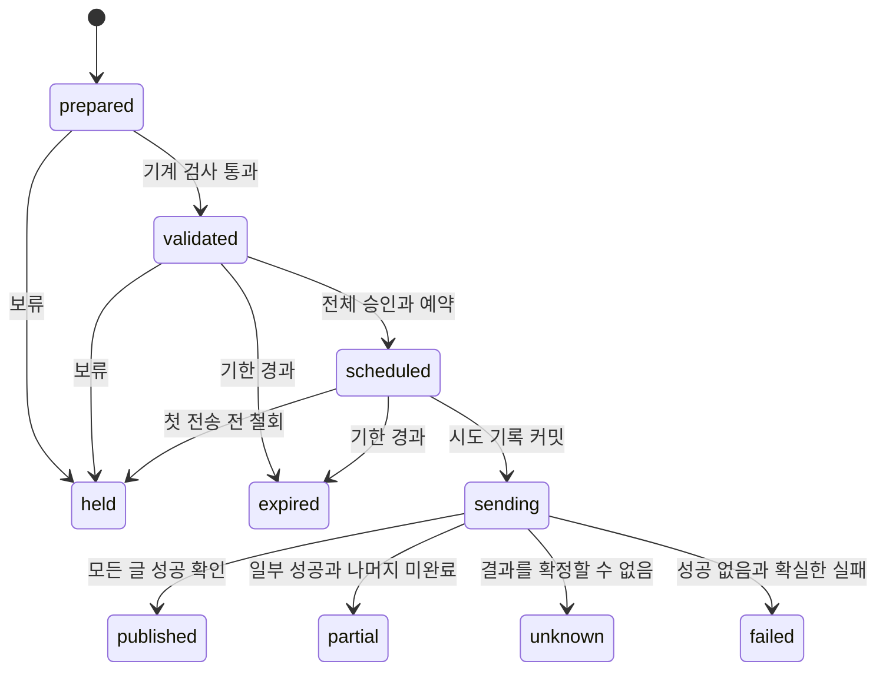

# 데이터 모델과 ERD

> 입력·편성의 단일 기준은 [현재 요구사항](../요구사항.md)이다. 현재 목표는 AM 최대 4글이며 기존 코드·OpenAPI·PM 이력/시험과 구분한다.
- 기준: 2026-10-31, Asia/Seoul
- 상태: **현행 물리 모델 대조 + 1단계 논리 계약**. 운영 DB에 migration을 적용한 결과가 아니다.
- 기준 소스: [schema.py](../../src/xfolio/db/schema.py) · [0001 migration](../../migrations/versions/0001_operational_schema.py) · [API store](../../src/xfolio/api/store.py)
- 연결: [API](API_명세서.md) · [뉴스 입력/검증](뉴스_입력과_검증_책임.md) · [WBS](../planning/작업_분해_WBS.md)

## 읽는 순서와 상태

현행 물리 ERD → 컬럼·제약 → 논리 참조 → 목표 payload → 상태·전환 순으로 읽는다. 실선 FK 3개와 점선 JSON 참조를 구분하며 목표 키가 현재 DB에 저장된다고 가정하지 않는다. 핵심 요구사항은 FR-01~08,NFR-01~04, 후속은 FR-09~10,NFR-05다. 공통 프로필/Exa 세부 타입은 [미결정 계약](뉴스_입력과_검증_책임.md#미결정-계약과-결정-조건)을 따른다.

## 목표 입력 경계

2026-10-30 핵심은 **Exa 뉴스+BLS CPI+세 ETF**다.10기업 우선+목록 밖 중요 사건을 허용하며 Fed·BEA·SEC 자동 수집은 후속이다. 아래 실제8테이블은 변경하지 않았다. Exa 검색 조건·시각 정밀도·절단·원매체·비용 필드와 뉴스/BLS 공통 프로필은 N02/N08/N09에서 typed payload 계약으로 확정한다.

아래 `official_news_reviewed_v1`·`am_official_reviewed_v1`과 SEC 전용 필드는 공식 자료의 목표 설계를 보존한 것이다. Exa에 이름만 바꿔 적용하지 않는다. [입력 책임](뉴스_입력과_검증_책임.md) · [요구사항](../요구사항.md)

## 현행 물리 ERD · 8개 테이블

실선은 **실제 SQL foreign key**다. 아래 3개 관계 외의 사건·근거·수집·감사 연결은 현재 JSON/text 기반 참조이며 DB가 참조 무결성을 보장하지 않는다. TEXT ID는 불투명 문자열이며 모두 UUID 타입인 것은 아니다. `jsonb payload` 안의 필드는 별도 물리 컬럼으로 그리지 않는다.

### 현행 컬럼·제약

아래 NULL 허용 목록에 없는 컬럼은 NOT NULL이다. 기본값 표기는 DB server default이며 나머지는 호출자가 값을 넣는다.

| 테이블 | NULL 허용 | 유일성·CHECK·기본값 |
| --- | --- | --- |
| news_cursors | completed_until | UNIQUE(provider,query_version,scope), revision 기본0 |
| collection_runs | 없음 | status complete/partial/failed, window_start < window_end ≤ finished_at |
| evidence_bundles | published_at | UNIQUE(source_id,content_version), rights_verified 기본false |
| content_drafts | 없음 | UNIQUE(edition_id,version), version>0, synthetic 기본true, validation_passed 기본false |
| publication_jobs | first_attempt_at | UNIQUE(account_id,target_date,edition), edition AM/PM, scheduled_at<expires_at, decision_revision≥0, reserved_count 0~3, status 기본prepared, revision/reserved_count 기본0, stop_requested 기본false |
| publication_posts | event_key,fact_version,x_id | UNIQUE(job_id,content_version,position), position 1~3, active_claim이면 event/fact 필수, active_claim 기본false |
| usage_ledger | job_id | amount_krw NUMERIC(14,4)≥0, state estimated/reserved/confirmed/released |
| operations_events | scope,unique_key,expires_at | UNIQUE(kind,scope,unique_key). NULL 조합은 이 제약만으로 중복 억제를 보장하지 않음 |

모든 테이블에 `id` PK가 있다. 추가 부분 유일 인덱스 `uq_active_event_claim(account_id,event_key,fact_version) WHERE active_claim IS TRUE`는 예약·송신·불명 사건의 중복 claim을 막는 기반이다. 실제 active_claim 전이는 애플리케이션이 관리한다. DB CHECK만으로 게시 상태 전이·아침 4글/뉴스 3건 정책·근거 완주를 보장하지 않는다. 아래 현행 reserved_count 0~3은 목표와 달라 신규 migration이 필요하다.

0001 migration은 content_drafts의 **UPDATE를 거절하는 trigger**를 만든다. DELETE까지 차단하는 trigger는 현재 없다. API/worker 역할에서 삭제 권한을 주지 않고 과거 버전을 보존하는 것이 목표이며 운영 DB 역할 분리는 아직 별도 검증 대상이다. FK의 ON DELETE CASCADE는 설정돼 있지 않다.

`publication_jobs.draft_id`에는 UNIQUE가 없으므로 물리적으로 한 초안이 여러 job에 연결될 수 있다. 제품 계약은 초안의 edition_id와 해당 job.id를 맞추며 하나의 계정/날짜/편성에 하나의 job을 유지한다. 현행 DDL보다 강한 이 규칙은 저장 트랜잭션에서 검증해야 한다.

## ID와 버전 관계

- `content_drafts.id`: 한 불변 내용 버전의 물리 ID. 단일 생성 초안도 포함되며 job 없이 존재할 수 있다.
- `content_drafts.edition_id`: 조합된 편성에서는 `publication_jobs.id`와 논리적으로 같고, 조합 전 생성 초안은 현행 `unassembled:<id>`다. SQL FK가 아니다.
- API `/drafts/{id}`와 `/publications/{id}`의 id는 **publication_jobs.id**다. 공개 URI를 버전별 content_drafts.id로 교체하지 않는다.
- `content_drafts.version`은 내용 변경 때 증가하고 `publication_jobs.decision_revision`은 승인/보류 때 증가한다. 둘을 하나로 합치지 않는다.
- `publication_posts.content_version`은 승인 당시 `content_drafts.version` 숫자다. 이름이 같아도 `evidence_bundles.content_version`의 SHA256 문자열과 의미가 다르다.
- evidence `content_version`은 근거 텍스트 해시, event_key는 사건 정체성, fact_version은 사건의 사실 묶음 버전이다. URL/기사ID/사건ID를 동일시하지 않는다.

## 논리 참조 · JSON 기반

점선은 탐색 방향이며 FK 방향을 뜻하지 않는다. current/target JSON 키의 차이는 아래 표를 따른다. 단일 run과 여러 run의 연결을 혼용하지 않고 1단계 AM 목표에서는 ETF·뉴스 run을 함께 참조한다.

## 1단계 payload 계약 · 목표

**첫 통합에서는 8개 테이블을 유지하고 타입을 가진 payload 계약을 추가**한다. 아래 신규 키는 미구현이다. 핵심 Exa/BLS와 후속 Fed·BEA·SEC의 수집·근거·사건은 기존 runs/evidence/edition 경계에 대응하므로 기관별 테이블을 바로 추가할 필요는 없다. 테이블 수가 영구 제한은 아니며 후속 필요 시 분리할 수 있다. 구조화되지 않은 dict를 임의 저장하는 방식으로 목표 계약을 대체하지 않는다.

| 저장 위치 | 현행 주요 내용 | 1단계 추가/정리 |
| --- | --- | --- |
| collection_runs.payload | 제공처별 수집 상세, BLS 단일 조회 기록 | schema_version, source_id, query_version/scope, Exa 질의·기간·상한·필수 요청/본문 확보 결과, 공식 자료의 해당 페이지/기업 완료, cursor_before/after, watchlist_version·대상CIK 집합, data_origin, fixture 범위. status와 완료 근거 일치 |
| evidence_bundles.payload | source/url/text_scope/permitted_excerpt/claims/fact_version/period/collection_run_id/permission_review | 아래 공통 source/event 필드, evidence_text와 보존 기한, input_review·index_relation·event identity, claim_id/position, data_origin |
| content_drafts.payload | posts, rights_verified/collection_complete, validation, generation, assembly_profile, max_cost_krw 등 | schema_version, 공통 assembly/validation profile(식별자 미정; 기존 official 이름은 공식 자료 보존안), ETF·Exa/BLS collection_run_ids, `SPY/QQQ/DIA` 동일 완료 거래일 snapshot, watchlist_version, 선정 결과/이유, claim_links, source 버전 참조, generation_mode |
| publication_jobs.payload | hold_reason, assembly_profile | transport_mode, 최신 결정 event_id, 검증기 버전, lease_token/lease_until(점유). 송신 시작 후 transport_mode/내용 참조 교체 금지 |
| publication_posts.payload | version | kind, latest_attempt_id, updated_at, safe_error_code, 결과 대조 메타데이터. 전체 외부 응답은 저장하지 않음 |
| usage_ledger.payload | purpose/model/price_basis·decision_key 등 | request_id/attempt_id, 단가 기준·상한·generation_mode/transport_mode. 송신 실패를 임의 무과금으로 단정하지 않음 |
| operations_events.payload | session/oidc/decision/generation_failure별 내용 | 아래 이벤트별 typed payload. 인증과 업무 감사의 노출/보존 정책 분리 |

여기서 source 버전 참조는 각 evidence_id와 evidence content_version을 함께 뜻한다. 내용 해시는 해당 payload의 정렬된 JSON·UTF-8·공백 없는 separators로 계산하고 동일 규칙을 승인 시 재검증한다. `validation_passed`는 기계 통과만 의미하며 사람의 승인 여부를 넣지 않는다.

근거·원문 발행 시각·claim 사실·입력 검토는 버전별 불변으로 취급한다. 이용 권한 취소/보존 기한 도래와 삭제 tombstone은 별도 메타데이터로 기록하며, 이를 근거 텍스트의 무기록 덮어쓰기로 처리하지 않는다. 만료·삭제된 근거로 신규 승인/송신을 허용하지 않는다.

### source/event·관찰 목록의 목표 저장 규칙

| 논리 필드 | 저장·검증 규칙 |
| --- | --- |
| source_id | 목표 payload/API에서 핵심 `exa|bls`, 후속 `fed|bea|sec`. 현행 evidence_bundles.source_id 물리 컬럼과 의미를 구분 |
| source_record_id | 기관 내 안정 레코드 ID. SEC는 accession과 문서/첨부 식별자를 함께 써서 한 공시의 복수 문서를 구분 |
| published_at / accepted_at | 원천 발행 / SEC 접수의 nullable UTC 시각. 서로 대체하지 않음. 확인되지 않은 시각을 날짜 자정 등으로 생성하지 않음 |
| retrieved_at / available_at | 해당 근거 버전의 최초 조회 완료 / 사용 가능 확보의 최초 UTC 시각. 둘은 같은 버전 재확인으로 덮어쓰지 않으며 available_at은 최초 retrieved_at보다 이르지 않음 |
| last_checked_at | 같은 근거 버전의 마지막 재확인 UTC 시각. 최초 조회·사용 가능 확보 시각과 별도 갱신 메타데이터 |
| content_hash / source_revision | 근거 내용 해시 / 원천 개정 ID. 원천 개정 ID가 없으면 hash 기반 내부 버전임을 기록 |
| event_type | `earnings|merger_acquisition|policy|economic_indicator` |
| cik / accession_number / form / item | SEC 공시 메타데이터. CIK는 앞자리0을 보존하는10자리 문자열. 비SEC는 null |
| target_period | 주장 대상 기간. 기간이 없는 정책/M&A는 null이며 발행일과 구분 |
| evidence_refs | evidence_id·claim_id·표/문단/첨부 locator·source_revision의 배열 |
| rights_status | `permitted|pending_review|restricted|expired`, 검토 근거·시각·범위를 permission_review에 연결 |
| watchlist_version | SEC 대상 10기업 집합의 불변 버전. run과 draft에서 당시 버전·대상CIK를 참조 |

현행 `UNIQUE(evidence_bundles.source_id,content_version)`에서 source_id를 단순히 `sec`로 바꾸면 서로 다른 공시가 같은 내용일 때 충돌할 수 있다. **목표 물리 source_id는 `기관:source_record_id` 합성키**, payload.source_id는 기관 enum으로 저장한다. content_version은 해당 근거 content_hash와 대응시키고 그 매핑을 저장/조회 adapter에서 검증한다. 기존 저장 자료는 legacy 버전으로 읽으며 이름만 바꿔 의미를 소급 변경하지 않는다.

현행 evidence의 `published_at` 컬럼은 실제 발표 시각이 확인될 때만 쓰고, SEC accepted_at은 payload에 따로 둔다. 현행 collected_at은 실제 확보 시각으로 유지하며 payload.retrieved_at과의 대응을 명시한다. 목표 cutoff는 payload.available_at을 검사한다. 이 필드 없는 legacy 근거가 시각 검증을 통과한 것으로 간주되지 않도록 profile별 호환 검사를 둔다. published_at과 accepted_at 모두 신뢰할 수 없으면 후보를 보류한다. Exa의 원매체·기사/보도자료·발행 시각 정밀도·절단·요청 비용의 세부 타입은 N02/N08/N09에서 확정한다.

event_key는 기관 레코드 ID가 아니라 동일 사건의 식별자다. 동일 실적의8-K 본문과 EX-99.1은 서로 다른 source_record_id일 수 있으나 한 event_key에 연결한다. source_revision은 문서 버전, fact_version은 검토된 사실 묶음 버전이다. 수정공시·정정발표는 원본을 덮어쓰지 않고 새 근거 버전으로 기록하고 재검토한다.

`news_cursors.provider`에는 기관 이름공간을, `scope`에는 고정된 feed/dataset·CIK(해당 시)·watchlist_version·adapter_version을 넣는다. 회차별 window_start/window_end는 collection_run의 조회 범위이며 커서의 고정 scope 키에 포함하지 않는다. Exa 커서는 설정 질의·조회창·결과 상한을 기준으로 하며 기관별 페이지/기업 완주와 혼용하지 않는다. 한 제공처의 커서 성공이 다른 제공처나 다른 기업 목록 버전의 성공을 의미하지 않는다. 완주한 범위에서만 completed_until/revision을 원자적으로 진행시키고 partial/failed는 끝까지 수집했다고 커서를 앞당기지 않는다. 원시 페이지 token 등 복구 정보는 typed run payload에 보관하되 비밀 값과 혼합하지 않는다.

`collection_runs.status` 목표는 `running|complete|partial|failed`다. `no_updates`는 `status=complete && new_version_count=0`에서 계산하는 조회 boolean이며 별도 저장 상태가 아니다. 설정된 필수 요청 범위를 확인했지만 새 버전이 없는 실행으로 선정0건과 다르다. 권한·근거 부족으로 게시할 수 없는 자료는 별도 `eligibility`와 사유에 남기고 수집 실패로 바꾸지 않는다. 기관 미연결/미실행은 실행 행을 성공으로 조작하지 않고 API summary의 not_connected/not_observed로 표현한다. 현행 collection_runs는 완료 행의 status CHECK와 finished_at NOT NULL을 갖고 있으므로 running 행 저장을 도입할 때 완료시각 null 허용·상태별 제약의 별도 migration이 필요하다. 이번에 적용한 변경은 아니다.

공식 자료의 지원 설계는 핵심 BLS CPI와 후속 Fed FOMC·BEA PCE·SEC8-K의2.02·1.01·2.01과 관련9.01 첨부를 통한 실적/M&A 검토다. item/form만으로 실적/M&A를 확정하지 않으며 EX-99.1도 실제 내용을 확인한다. 고용·GDP·6-K/외국기업은 후속 범위이며 현재 지원 완료가 아니다.

관찰 목록 변경 이력은 우선 `operations_events(kind=watchlist_revision, scope=sec_watchlist, unique_key=version)`의 typed payload에 `version, effective_at, companies[{cik,name,tickers,issuer_type,selection_reason,reference_url,verified_at,enabled}]`를 append-only로 기록할 수 있다. run/draft의 watchlist_version은 이 version을 참조한다. 이는 목표 설계이며 현재 이벤트 저장 코드에 해당 종류가 구현된 것은 아니다. 원천자료별 관계 검색·다중 운영자 편집·대규모 공시 검색이 필요해지면 `source_records/events/watchlists` 정규화 테이블과 인덱스를 별도 migration으로 검토한다. 이번 범위에서는 기존 JSON 연결의 검증 책임을 감수하는 최소 설계를 택하며 DB FK가 있다고 표현하지 않는다.

### 운영 이벤트 종류

| kind | scope / unique_key | payload·보존 |
| --- | --- | --- |
| oidc | auth / 해시 state | nonce/flow, 10분 만료·소비. API 이력에 노출 금지 |
| session | auth / 해시 session token | email/display_name/csrf_token/last_seen, 절대12시간·유휴30분. 현재 갱신/로그아웃 소비 허용 |
| decision | operator:job_id / Idempotency-Key | 현행 request_hash/result. 목표 action/operator/job_id/version/content_hash/decision_revision/review_checks/reason/transport_mode 추가, created_at은 서버 시각 |
| input_review | source_id:content_version / review_id | 목표 운영자/검토시각·fact_version·관련성·근거 참조. AI가 생성한 reviewed flag와 구분 |
| publication_attempt_started | post_id / attempt_id | 목표 job_id/버전/position/transport_mode/시작시각/lease_token, **외부 호출 전 커밋** |
| publication_attempt_result | post_id / 같은 attempt_id | 목표 outcome/finished_at/x_id|null/안전한 error_code. 동일 시도의 결과는 유일하게 기록 |
| publication_reconciliation | post_id / 대조 ID | 후속 수동 대조 근거·운영자·이전 상태/새 상태. 기존 unknown 이벤트를 수정하지 않음 |
| generation_failure | request_id / 이벤트 ID | 현행 실패 코드. 예약 비용 보존/정산과 연결 |

업무 감사/시도 이벤트는 append-only를 목표로 한다. 세션/일회성 OIDC까지 무조건 append-only로 바꾸지 않는다. 조회 API는 종류 allowlist와 편성/게시물 귀속을 검증해 정해진 필드만 반환한다. event.scope 문자열 prefix 검색만으로 세션 payload를 반환하지 않는다.

`publication_attempt_result`에는 결과를 확인할 수 없으면 unknown을 남긴다. 나중에 결과를 확인하면 별도 reconciliation 이벤트와 집계 상태를 갱신한다. 같은 시도의 history를 UPDATE로 덮어쓰지 않는다. 시작만 남은 시도는 재시작 시 불명으로 분류해 무조건 재송신하지 않는다.

## 트랜잭션 경계와 상태

1. **편성 생성:** 세 ETF와 기관별 뉴스 수집 참조·허용 근거·선정 결과·기계 검사·불변 초안과 job을 같은 트랜잭션으로 저장한다. 뉴스0건이라도 AM 세 ETF 글이 있고 필수 기관별 범위가 complete로 완주돼야 한다(no_updates=true인 완료 포함). partial/failed를 정상0건으로 대체하지 않는다.
2. **승인:** 현행 잠금 규칙 아래 현재 버전·profile·권한·근거·사람 확인·시간을 대조한다. job scheduled, posts reserved/active claim, 비용 reserved, 결정 이벤트를 함께 커밋한다. 외부 X 호출은 이 트랜잭션 안에서 하지 않는다.
3. **전송 전 점유:** worker가 job/posts 잠금으로 승인 철회·다른 worker와 경쟁한다. 첫 시도 시각·sending·유일 attempt_started를 커밋한 뒤 호출한다. 모든 글마다 기한/중단/근거 유효성을 다시 확인한다.
4. **결과 저장:** 같은 attempt_id 결과·글 상태·집계 job 상태·예약/실비를 원자적으로 기록한다. timeout/DB 기록 실패는 자동 재송신이 아니라 불명 대조 대상이다.
5. **보류:** 처음 송신 전이면 확실한 미전송 예약을 해제한다. 시작 후에는 잔여 중단만 표시하고 원버전·불명 예약을 유지한다.

도식은 목표 요약이다. 현행 approve는 approved 상태에 머물지 않고 같은 트랜잭션에서 scheduled가 된다. DB status TEXT에는 모든 상태를 제한하는 CHECK가 없으므로 서버 전이 검사가 필요하다. 같은 held 버전 재승인은 허용하지 않는다. 후속 새 버전 수정은 첫 전송 전만 가능하다.

job에 글 하나라도 unknown이면 집계도 unknown을 우선한다. 일부만 성공하고 나머지는 확실히 미전송/실패면 partial, 모두 성공이면 published다. mock 성공도 저장 상태는 published를 사용하되 transport_mode=mock과 함께 조회·표시하여 실제 X 성공과 구분한다. 현재 아침 비운영일은 실행 결과이며 이 상태 도식 밖이다. PM은 과거 이력 조회로만 보존한다.

## 조회·인덱스와 보존

- 현행 물리 FK3개와 PK/UNIQUE/부분 인덱스 외에 별도 발행 이력 인덱스가 구현됐다고 가정하지 않는다.
- A03 목표: jobs `(target_date DESC,edition,id)` 목록 인덱스와 events `(scope,created_at,id)` 이력 인덱스. 이미 UNIQUE가 커버하는 posts(job_id,content_version,position)는 중복 인덱스를 추가하지 않는다. 실제 쿼리 계획/데이터량으로 확인한다.
- 1단계에는 새 테이블/컬럼이 필수는 아니다. 신규 인덱스/권한/제약은 별도 migration으로 작성한다. 기존 0001은 현재 metadata를 import하므로 이후 변경 시 기존 revision과 신규 revision이 같은 index를 중복 생성하지 않도록 고정 DDL 기준을 점검한다. 이번 작업에서 migration을 바꾸지 않는다.
- JSON 관계의 누락/다른 사건 버전·잘못된 수집 ID는 저장·승인·송신 직전에 검증한다. DB FK가 없는 관계를 다이어그램만으로 보장됐다고 설명하지 않는다.
- 출처/권한/사건/승인/게시 최소 메타데이터는 운영 기간 보존한다. 허용 발췌·요약과 상세 실행 로그는 기존 30일 목표 및 더 엄격한 제공처 조건을 적용한다. 원문과 승인 요청 전체를 감사 로그에 복사하지 않는다.
- evidence 텍스트가 만료돼 없어지면 hash만으로 내용을 복원할 수 없다. 과거 결과/근거 만료 상태만 조회하고 재사용은 차단한다. DB 백업도 같은 삭제/접근/보존 조건을 적용하며 실제 백업/복원은 B05다.

## 현행과 목표의 검증 경계

현행 SQLAlchemy metadata·migration source와 표/ERD를 대조했다. 실제 운영 DB의 테이블·역할·데이터를 조회하거나 변경하지 않는다. 신규 claim/검토/시도 이벤트와 인덱스는 설계이며 저장 코드·마이그레이션·동시성 시험을 통과해야 구현 완료가 된다.

## 4글 편성의 제약 변경

현행 reserved_count BETWEEN 0 AND 3을 0~4로, publication_posts.position BETWEEN 1 AND 3을 1~4로 확장하는 신규 migration과 AM 전용 승인/한도 검사가 필요하다. 기존 0001의 metadata 참조 방식과 적용 이력을 먼저 대조하고 과거 migration을 무기록 변경하지 않는다. AM/PM enum을 즉시 삭제하여 과거 PM 이력을 깨뜨리지 않으며, 새 PM 생성·승인·전송은 애플리케이션에서 차단한다. A01에서 두 제약을 함께 변경하고 4번째 글 저장·5번째 글 거절·과거 PM 조회를 검증한다. running 수집 행 도입의 finished_at/status 제약 변경은 별도이며 위 공통 계약과 함께 결정한다. 코드·운영 DB는 이번 문서 작업에서 변경하지 않았다.
