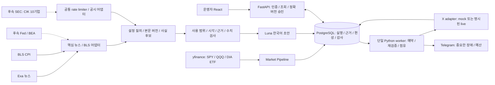
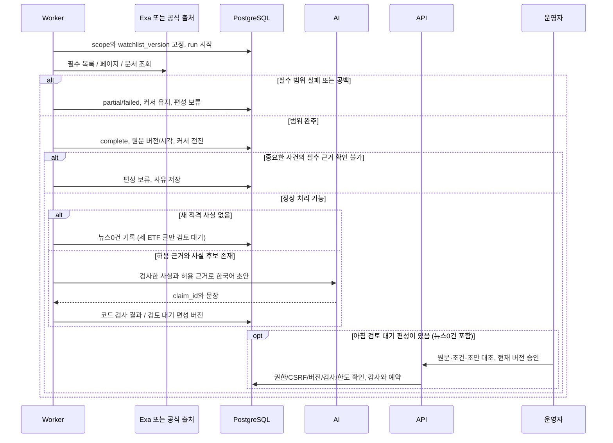
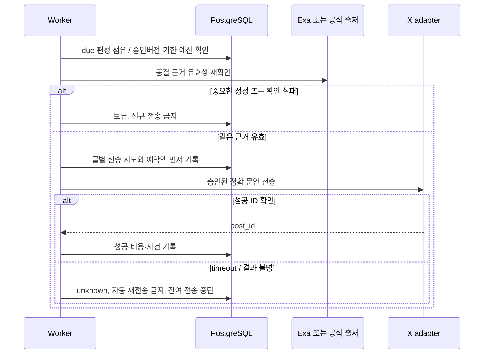

# 시스템 구성과 주요 시퀀스

> 입력·편성의 단일 기준은 [현재 요구사항](../요구사항.md)이다. 현재 목표는 AM 최대 4글이며 기존 코드·OpenAPI·PM 이력/시험과 구분한다.
- 기준: 2026-10-30. **목표 설계**, 실제 배포/연동 완료 그림이 아니다.
- [수집 계약](공식_발표와_공시_수집_설계.md) · [API](API_명세서.md) · [ERD](데이터_모델_ERD.md) · [운영 정책](../운영_정책.md)

## 시스템 구성

목표 배포는 Lightsail의 web/api/worker와 외부 PostgreSQL이다. 브라우저는 공급자·DB·봇 비밀에 접근하지 않는다. 수집/AI/게시를 API 요청 내부에서 실행하지 않는다. worker 단일 프로세스 설정과 별개로 DB 점유·사건키·버전 검증이 중복을 막는다. 현재 worker와 Exa/BLS AM 통합은 미구현이다. Exa 공개 이용 조건 확인과 N02의 계약 확장이 필요하며 Fed·BEA·SEC·Telegram·실제 배포는 후속이다.

## 수집→초안→검토

## 승인→전송과 실패

모의 전송 성공과 실제 X 성공은 다른 인수다. 실제 게시에는 명시적 요청이 필요하다. 부분 성공·unknown은 기록을 보존하고 결과 대조 후 복구하며 새 편성 버전으로 중복 전송하지 않는다. 정정은 새 원문/사실 버전을 만들고 첫 전송 전 승인을 무효화한다. 이미 게시한 사실 오류는 운영 정책의 별도 정정 절차를 따른다.
