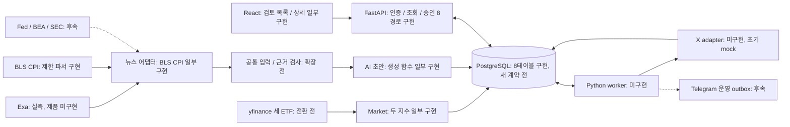
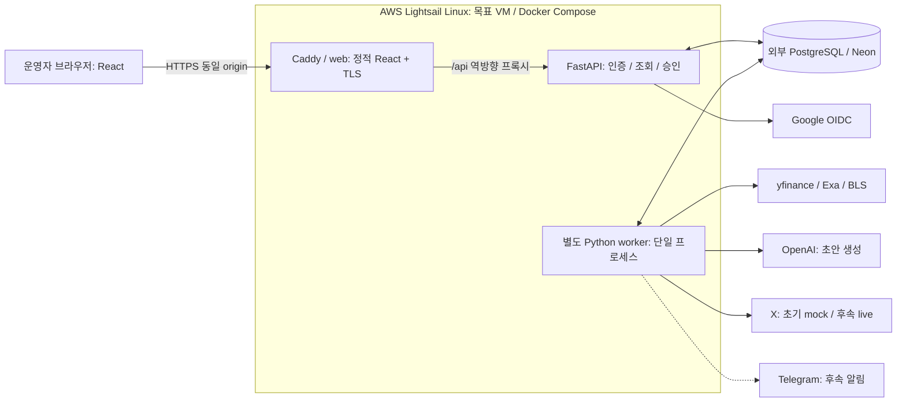
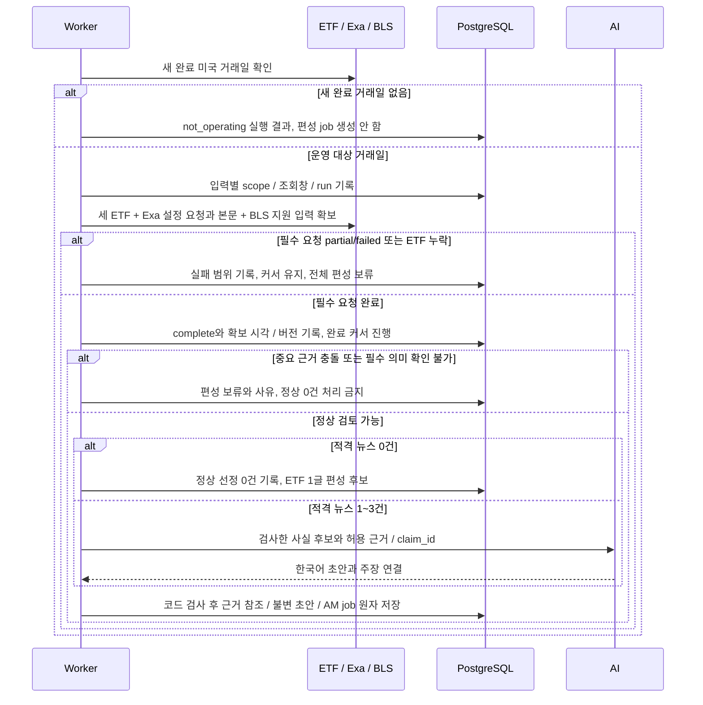
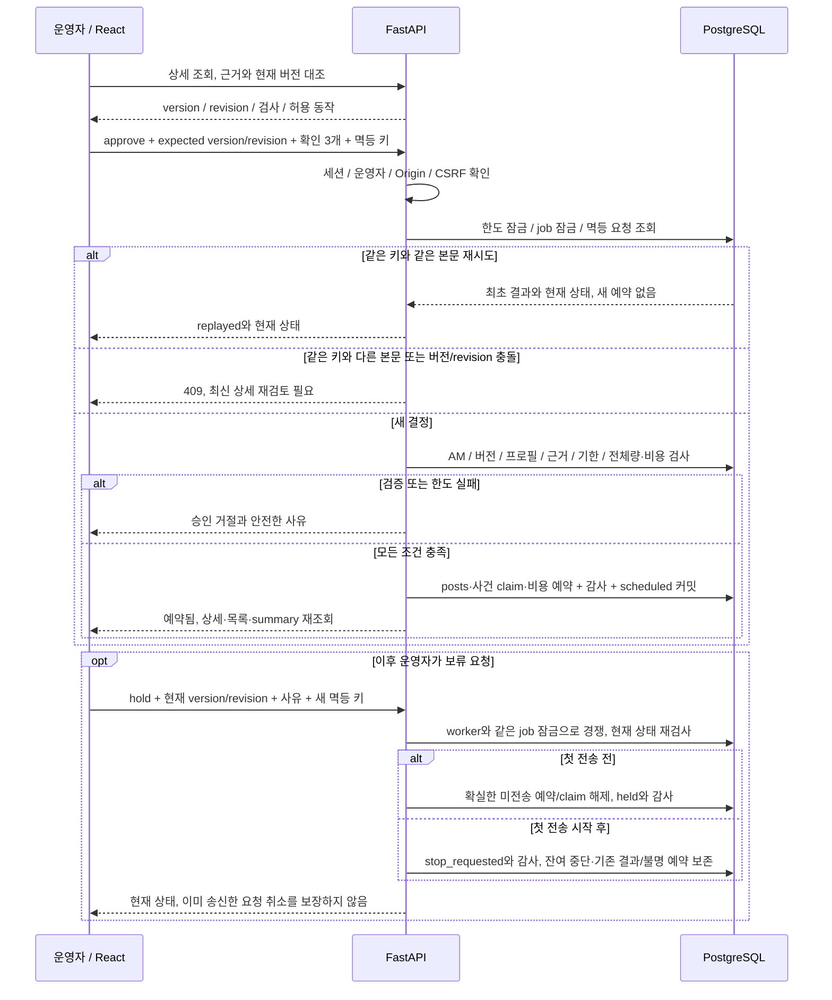
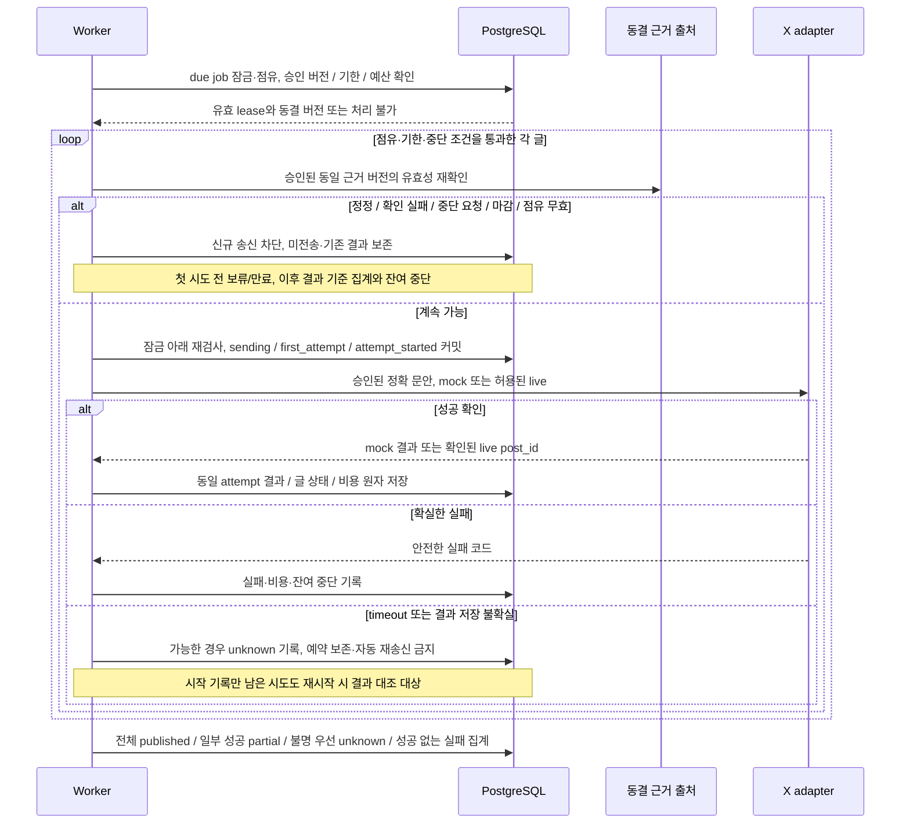

# 시스템 구성과 주요 시퀀스

- 목적: 처리 책임·배포 경계와 수집/승인/전송 흐름을 개발·발표에서 함께 설명한다.
- 기준: 2026-10-31, Asia/Seoul. 목표 설계이며 구성요소별 현행 상태를 함께 표시한다.
- 관련: [요구사항](../요구사항.md) · [WBS 추적](../planning/작업_분해_WBS.md#요구사항과-검증-추적) · [입력 책임](뉴스_입력과_검증_책임.md) · [API](API_명세서.md) · [ERD](데이터_모델_ERD.md) · [운영 정책](../운영_정책.md)

## 시스템 구성

실선은 목표 데이터/호출 흐름이며 구현 완료 표시가 아니다. 각 노드의 상태를 따른다. 초기 범위는 Exa/BLS·세 ETF·운영자 검토·AM 모의 전송이다.

기존 로그인·CPI·승인 시험은 FR-01~08 전체의 인수가 아니다. A01~A07에서 세 ETF·공통 입력·4글·PM 차단·worker를 연결한다. 브라우저는 공급자·DB·봇 비밀에 접근하지 않으며 수집/AI/전송은 HTTP 요청 안에서 실행하지 않는다. 공통 입력 프로필은 [결정 조건](뉴스_입력과_검증_책임.md#미결정-계약과-결정-조건)에 따라 확정한다.

## 목표 배포 구성

B05/B06 후속 목표이며 현재 Caddy/Compose/Lightsail 운영 배포를 확인한 결과가 아니다.

web/api/worker는 책임 경계다. 단일 VM·worker replica=1과 별개로 DB 점유·사건 claim·정확 버전 재검증이 필요하다. 외부 PostgreSQL에는 API/worker만 연결하고 Windows는 개발용이다. HTTPS callback·재시작·백업/복원은 NFR-02/03/05 인수에 포함한다.

## 1. 수집·검사·초안 저장

FR-01~05,NFR-01/04 · N02/N03/N08/N09/M01/A04/A07. Exa 완료는 설정된 질의·조회창·결과 상한·필수 본문 요청의 완료이며 시장 전체 포괄이나 기관별 페이지/기업 완주가 아니다. running 행 저장은 별도 DB 제약 변경 후의 목표다.

07:30까지 실제 확보한 버전만 사용한다. 개별 후보의 권리/본문 부족은 제외·보류로 기록하고 필수 요청 실패와 구분한다. 기계 검사 통과는 사람의 의미 검토나 공개 이용 허가가 아니다.

## 2. 전체 승인·버전 충돌·예약

FR-05~07,NFR-02/03 · A01/A02/A04/A05/A07. 현행 승인 기반 위에 새 프로필·review_checks·4글 검사가 추가될 목표다. DB 트랜잭션 안에서 외부 X를 호출하지 않는다.

POST timeout은 성공으로 추정하지 않고 상세부터 재조회한다. 보류에는 확인 3개를 요구하지 않는다. 상세 허용 동작과 오류 형식은 API를 따른다.

## 3. worker 점유·글별 전송·결과 저장

FR-08,NFR-03/04 · A03/A05/A06/A07. 초기 인수는 mock이며 후속 live는 명시 요청 범위에서 검증한다. 아래 loop는 글마다 계속 조건을 만족할 때만 다음 글로 진행한다.

unknown이 하나라도 있으면 편성 집계도 unknown을 우선한다. 일부 성공과 확실한 미전송/실패는 partial, 전체 확인 성공만 published다. 첫 전송 후에는 버전 교체·재승인으로 우회하지 않는다. 모의 결과에는 실제 X ID/링크를 만들지 않는다. 정정·복구 절차는 운영 정책과 B04를 따른다.

## 검증 근거와 미완료 경계

현행 범위는 [관리자 검증](../../tasks/verification/admin/관리자_화면과_승인_API.md)과 [CPI 연결 기록](../../tasks/logs/2026-10-29_실자료_검사와_관리자_승인_연결.md)을 참조한다. 세 도식의 정상/0건/실패·충돌·철회·재시작·partial/unknown 경로는 A07 통합 인수 대상이며 이번 문서 보완으로 제품 시험 통과가 되지 않는다.
