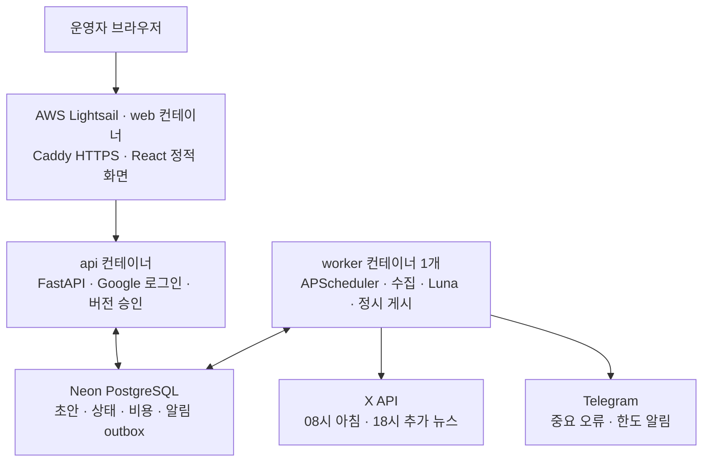

# 기술 구성 · React/FastAPI·AWS MVP

- 기준: 2026-10-28, Asia/Seoul · [사용자 확정](../tasks/discussions/2026-10-28_풀스택_MVP와_18시_뉴스_편성.md)
- 목표: **React·TypeScript + FastAPI + PostgreSQL + Docker + AWS**, 운영 장애는 Telegram
- 상태: 아래는 새 제품의 선택이다. 기존 Python/Neon·Streamlit 시험과 새 구성의 구현 완료를 구분한다.

## 선택과 현재 상태

| 역할 | 2주 MVP 기술 | 현재 상태 |
| --- | --- | --- |
| 관리자 | React·TypeScript·Vite, 최소 Tailwind UI, TanStack Query | 새 프론트 미구현. 목록/상세 2화면으로 제한 |
| API·인증 | FastAPI·Pydantic, Google OIDC·서버 검증 세션, 단일 운영자 | API 8개·인증 이전 미구현. 기존 Streamlit 로그인은 재사용 가능한 설정/시험 근거 |
| 저장 | PostgreSQL: 기존 Neon Free, SQLAlchemy Core·Alembic 계획 | 가상 `preview_drafts` 왕복만 검증. 운영 8개 저장 단위와 migration은 후속 |
| 지수 | yfinance `^GSPC`·`^NDX`, pandas-market-calendars | 실제 조회·완료 거래일·등락률 계산 구현. 오전 도착·공개 이용 조건 후속 |
| 뉴스 | httpx·Marketaux 단일 경로, 공통 출처/근거/사건 모델 | 개발 수집기·SQLite 커서 구현. 두 지수 질의·권한·실제 선정 품질 미검증 |
| AI | OpenAI Python SDK·Responses API·**gpt-6-luna**, Pydantic 구조화 출력 | Luna 동일 가상 6건 기계 검사 6/6. 실기사 생성·선정 자동 연결 전 |
| 예약·작업 | 별도 Python worker의 APScheduler 3.x, 단일 프로세스·replica=1 | 새 worker 미구현. API 프로세스 안에 스케줄러를 넣지 않음 |
| 게시 | X API adapter·DB 상태 점유·글별 결과 기록 | 정책/가상 미리보기만 존재. `publish.py` 실제 전송 미구현 |
| 운영 알림 | Telegram Bot API `sendMessage`, httpx·PostgreSQL outbox | 봇·키·전송·중복 억제 미구현. 발신 전용·개인 chat 1개 |
| 배포·검사 | Docker Compose·AWS Lightsail Linux, GitHub Actions CI·pytest/Ruff·TypeScript build·핵심 Playwright | 기존 GCP smoke Dockerfile은 새 제품 배포가 아님. 새 Compose/AWS·프론트 검사 미구현 |

2주에는 별도 Node 서버·Next.js SSR·Django·RDS/ECS·ALB·S3/CloudFront·Terraform·Redis/Celery를 추가하지 않는다. HTTP API와 worker를 논리적으로 분리하고 같은 이미지/도메인 코드를 재사용한다.

## 실행과 관리자 화면의 경계

Lightsail Linux VM 한 대에서 `web/api/worker`를 Docker Compose로 실행한다. 프론트 빌드는 CI 또는 개발 환경에서 수행하고 VM에서는 정적 파일을 제공한다. Caddy가 `/api`를 내부 API로 전달해 같은 origin을 유지한다. DB는 VM 로컬 파일에 두지 않는다.

1GB·IPv4 $7/월 플랜은 **초기 배포 시험값**이다. API·worker를 단일 프로세스로 시작하고 수집 병렬도를 제한해 메모리와 실행 시간을 측정한다. 부적합하면 자동 증설하지 않고 2GB 비용과 범위/예산을 재검토한다. 도메인·HTTPS·DNS·계정 결제·방화벽·역할·허용 데이터 백업은 배포 전 점검한다. [AWS 번들](https://docs.aws.amazon.com/lightsail/latest/userguide/amazon-lightsail-bundles.html)

단일 VM은 단일 장애 지점이다. Compose 재시작·상태 복구·수동 이미지 태그 복귀를 시험하되 무중단·다중 AZ를 제공한다고 설명하지 않는다. RDS나 ECS 사용 자체보다 승인 경쟁·멱등 발행·오류 처리와 실제 검증 근거를 포트폴리오에 남긴다.

## 자동화 에이전트의 확정 방식

API는 후보 조회·정확한 버전의 승인/보류·결과 조회만 담당한다. 수집·LLM·X 호출은 worker가 실행한다. LLM은 게시 모드·한도·승인·X 전송 도구를 변경하지 못한다. OpenAI의 JSON 형식 성공을 사실 검증 합격으로 사용하지 않는다.

worker가 중복 기동돼도 PostgreSQL의 편성 키·사건 키·원자적 점유로 발행을 막는다. 스케줄러의 단일 프로세스 설정만으로 중복 방지를 완료 처리하지 않는다. [APScheduler 주의](https://apscheduler.readthedocs.io/en/3.x/faq.html)

## 뉴스 파이프라인의 현재 설계

Marketaux 후보→시각/두 지수 관련성/동일 사건 필터→허용 근거·중요도→Luna 초안→Python 검증→AM 또는18시 PM 버전 동결→모드·예산·한도 확인 순서다. 낮 감시는 즉시 게시하지 않는다. 질의 재현율·근거·권한·Free 완전 수집은 아직 미충족이며, partial은 해당 편성 발행을 보류한다. [뉴스 조사](research/뉴스_수집.md) · [시간·상태 계약](../tasks/verification/2주_MVP_구현_계약.md)

## 코드와 실행 안내

- 예정: `frontend/` React, `src/xfolio/api/` FastAPI, `src/xfolio/jobs/` 실행 조정/예약, `deploy/aws/` Compose·배포 설정. 아직 해당 제품 코드가 생성된 것은 아니다.
- 기존 `src/xfolio/`의 수집·Pydantic·분석·미리보기·커서를 재사용한다. `dashboard/`와 `deploy/cloud/`는 **이전 Streamlit·가상 클라우드 시험용**으로 유지한다.
- Streamlit 비공개 배포·Google 로그인·Neon 가상 자료·중복 방지는 기존 실제 성과다. 새 React 관리자·AWS worker·Telegram 완료로 표시하지 않는다. [이전 결과](../tasks/logs/2026-10-25_클라우드_전환_준비.md)
- BLS/SEC 구현·비교는 기술 시험 이력이며 현재 Marketaux 단일 뉴스 경로의 필수 기능에 추가하지 않는다.

[구현 계약·8API/8저장](../tasks/verification/2주_MVP_구현_계약.md) · [운영 정책](운영_정책.md) · [개발 우선순위](../tasks/plans/개발_우선순위.md) · [AWS 전환 계획](../tasks/plans/클라우드_전환.md) · [비용](research/월_비용.md)
