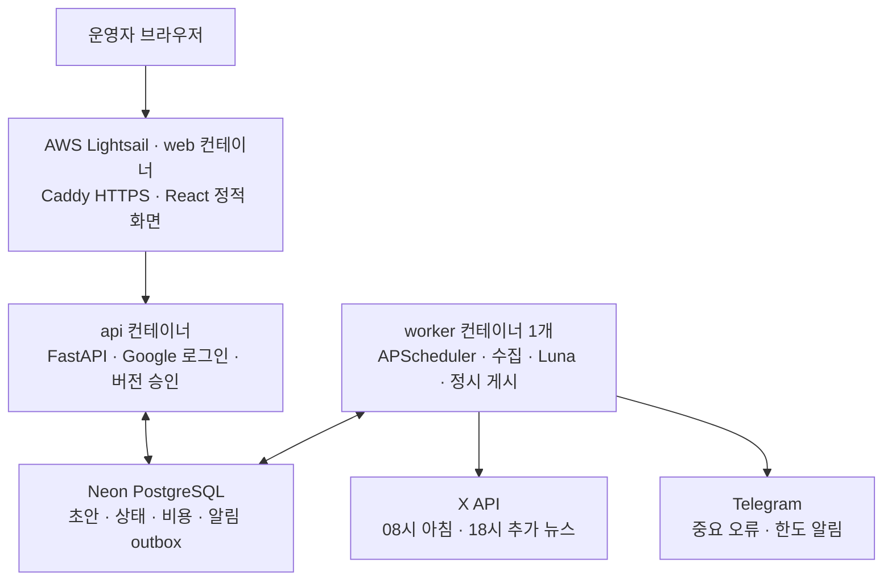

# 기술 구성 · React/FastAPI·AWS MVP

> 2026-10-29 일정 정정: 5~6주차30시간은 중간 개발 목표이며 7주차 추가 개발·통합 검증, 8주차 초 기능 마무리를 계획한다. 단계는 기능 범위이고 달력상 2주 마감과 동일하지 않다. 시간·의존성은 [개발 범위·단계](planning/개발_범위와_단계.md)와 [WBS](planning/작업_분해_WBS.md)가 기준이다.

- 기준: 2026-10-30, Asia/Seoul · [사용자 확정](../tasks/discussions/2026-10-28_풀스택_MVP와_18시_뉴스_편성.md)
- 목표: **React·TypeScript + FastAPI + PostgreSQL + Docker + AWS**, 운영 장애는 Telegram
- 상태: 아래는 새 제품의 선택이다. 기존 Python/Neon·Streamlit 시험과 새 구성의 구현 완료를 구분한다.

## 선택과 현재 상태

| 역할 | 제품 목표 기술 | 현재 상태 |
| --- | --- | --- |
| 관리자 | React·TypeScript·Vite, CSS·TanStack Query | 목록/상세 2화면·build·실제 API/격리 DB 통합, 로컬 실제 Google 인증 확인. 실기사 승인 정상 흐름·운영 배포는 후속 |
| API·인증 | FastAPI·Pydantic, Google OIDC·서버 검증 세션, 단일 운영자 | 8API·인증·조회/결정 코드와 OpenAPI 작성. 10/29 로컬 HTTPS에서 실제 Google 로그인·새로고침 세션 유지·로그아웃 검증. 운영 도메인/AWS는 후속 |
| 저장 | PostgreSQL: 기존 Neon Free, SQLAlchemy Core·Alembic | 운영 8개 저장 단위·migration·승인 트랜잭션 작성. 로컬 격리 PostgreSQL에서 migration/동시 승인/멱등·예산 시험 통과. 운영 Neon 역할·백업/복원은 후속 |
| 지수 | yfinance `^GSPC`·`^NDX`·`^DJI`, pandas-market-calendars | 기존 두 지수 조회·계산 구현. 다우 추가·세 지수 검증/길이는 미구현. 오전 도착·공개 이용 조건 후속 |
| 공식 발표·공시 | httpx·Fed/BLS/BEA/SEC 개별 어댑터→공통 출처/사실/사건 모델, SEC 10기업 고정 | BLS CPI 제한 파서·SEC 사전작성 사실 카드 실험만 재사용 가능. Fed/BLS/BEA/SEC 제품 수집·정정/공통커서 미구현 |
| AI | OpenAI Python SDK·Responses API·**gpt-6-luna**, Pydantic 구조화 출력 | 기존 Luna 가상6건·권한/예산/SDK 연결. BLS 실자료·모의 생성·CPI 전용 의미/길이·PM 편성·실제 PG/API 승인·브라우저 시험 확인. 신규 유료 호출·공식 자료/세 지수 AM 통합·범용 의미 검사는 후속 |
| 예약·작업 | 별도 Python worker의 APScheduler 3.x, 단일 프로세스·replica=1 | 새 worker 미구현. API 프로세스 안에 스케줄러를 넣지 않음 |
| 게시 | X API adapter·DB 상태 점유·글별 결과 기록 | 정책/가상 미리보기만 존재. `publish.py` 실제 전송 미구현 |
| 운영 알림 | Telegram Bot API `sendMessage`, httpx·PostgreSQL outbox | 봇·키·전송·중복 억제 미구현. 발신 전용·개인 chat 1개 |
| 배포·검사 | Docker Compose·AWS Lightsail Linux, GitHub Actions CI·pytest/Ruff·TypeScript build·핵심 Playwright | 프론트 build/격리 Playwright 시험·CI 정의 작성. CI 원격 실행·새 Compose/AWS 배포는 미검증 |

초기 제품에는 별도 Node 서버·Next.js SSR·Django·RDS/ECS·ALB·S3/CloudFront·Terraform·Redis/Celery를 추가하지 않는다. HTTP API와 worker를 논리적으로 분리하고 같은 이미지/도메인 코드를 재사용한다.

## 실행과 관리자 화면의 경계

Lightsail Linux VM 한 대에서 `web/api/worker`를 Docker Compose로 실행한다. 프론트 빌드는 CI 또는 개발 환경에서 수행하고 VM에서는 정적 파일을 제공한다. Caddy가 `/api`를 내부 API로 전달해 같은 origin을 유지한다. DB는 VM 로컬 파일에 두지 않는다.

1GB·IPv4 $7/월 플랜은 **초기 배포 시험값**이다. API·worker를 단일 프로세스로 시작하고 수집 병렬도를 제한해 메모리와 실행 시간을 측정한다. 부적합하면 자동 증설하지 않고 2GB 비용과 범위/예산을 재검토한다. 도메인·HTTPS·DNS·계정 결제·방화벽·역할·허용 데이터 백업은 배포 전 점검한다. [AWS 번들](https://docs.aws.amazon.com/lightsail/latest/userguide/amazon-lightsail-bundles.html)

단일 VM은 단일 장애 지점이다. Compose 재시작·상태 복구·수동 이미지 태그 복귀를 시험하되 무중단·다중 AZ를 제공한다고 설명하지 않는다. RDS나 ECS 사용 자체보다 승인 경쟁·멱등 발행·오류 처리와 실제 검증 근거를 포트폴리오에 남긴다.

## 자동화 에이전트의 확정 방식

API는 후보 조회·정확한 버전의 승인/보류·결과 조회만 담당한다. 수집·LLM·X 호출은 worker가 실행한다. LLM은 게시 모드·한도·승인·X 전송 도구를 변경하지 못한다. OpenAI의 JSON 형식 성공을 사실 검증 합격으로 사용하지 않는다.

worker가 중복 기동돼도 PostgreSQL의 편성 키·사건 키·원자적 점유로 발행을 막는다. 스케줄러의 단일 프로세스 설정만으로 중복 방지를 완료 처리하지 않는다. [APScheduler 주의](https://apscheduler.readthedocs.io/en/3.x/faq.html)

## 뉴스 파이프라인의 현재 설계

Fed/BLS/BEA/SEC 후보→기관/CIK별 수집 완주→원문 시각·버전·사용 범위→지원 유형의 사실 후보·조건/근거→Python 검사·Luna 초안→운영자 의미 확인→AM/PM 편성 승인→예약 처리 순서다. 실적·인수합병·정책·주요지표를 지원하며 필수 scope partial은 편성을 보류한다. 세부 계약은 [공식 수집 설계](specifications/공식_발표와_공시_수집_설계.md)와 [시스템/시퀀스](specifications/시스템_구성과_주요_시퀀스.md)를 따른다. [뉴스 조사](research/뉴스_수집.md) · [시간·상태 계약](../tasks/verification/integration/2주_MVP_구현_계약.md)

## 코드와 실행 안내

- 현재/목표의 상세 기준: [뉴스 입력·검증 책임](specifications/뉴스_입력과_검증_책임.md), [API 명세](specifications/API_명세서.md), [ERD](specifications/데이터_모델_ERD.md). 1단계는 허용 fixture로 연결한 뒤 지원 어댑터의 실제 입력과 사람 승인을 인수한다. 현행 8API→1단계 목표 10API, 수집/설정 조회를 포함한 확장 목표 13API다. 기존 8테이블의 typed payload·감사/시도 이벤트 확장과 running 수집 상태를 위한 제약 migration이 필요하다. 새 검증 profile·API·저장 코드는 아직 구현하지 않았다.

- 초기 구현: `frontend/` React, `src/xfolio/api/` FastAPI, `src/xfolio/db/`·`migrations/` 운영 저장 계약, `contracts/openapi.json`. 실행·설정은 [README](../README.md), 범위와 실제 검증은 [초기 구현 결과](../tasks/logs/2026-10-28_뉴스_선정과_관리자_초기_구현.md)를 따른다.
- 후속 목표(아직 생성하지 않음): `src/xfolio/jobs/` 실행 조정/예약, `deploy/aws/` Compose·배포 설정, 실제 worker/게시/알림 연결.
- [10/28 통합 결과](../tasks/logs/2026-10-28_통합_검증과_실자료_연결.md)에 이어 [10/29 실제 Google 검증](../tasks/logs/2026-10-29_Google_callback과_로그인_검증.md)에서 callback 불일치를 해소하고 허용 운영자의 실제 로그인·세션·로그아웃을 로컬에서 확인했다.
- 기존 `src/xfolio/`의 수집·Pydantic·분석·미리보기·커서를 재사용한다. `dashboard/`와 `deploy/cloud/`는 **이전 Streamlit·가상 클라우드 시험용**으로 유지한다.
- Streamlit 비공개 배포·Google 로그인·Neon 가상 자료·중복 방지는 기존 실제 성과다. 새 React 관리자·AWS worker·Telegram 완료로 표시하지 않는다. [이전 결과](../tasks/logs/2026-10-25_클라우드_전환_준비.md)
- BLS/SEC 시험은 새 공식 수집 경로의 재사용 근거다. 자동 발견·원문 추출·정정·기업 10개 완주·권리 검증까지 완료한 것은 아니다. Marketaux 수집기와 관련 probe는 이전 실험 자산으로 보존한다.

[구현 계약·8API/8저장](../tasks/verification/integration/2주_MVP_구현_계약.md) · [운영 정책](운영_정책.md) · [개발 우선순위](../tasks/plans/개발_우선순위.md) · [AWS 전환 계획](../tasks/plans/클라우드_전환.md) · [비용](research/월_비용.md)
