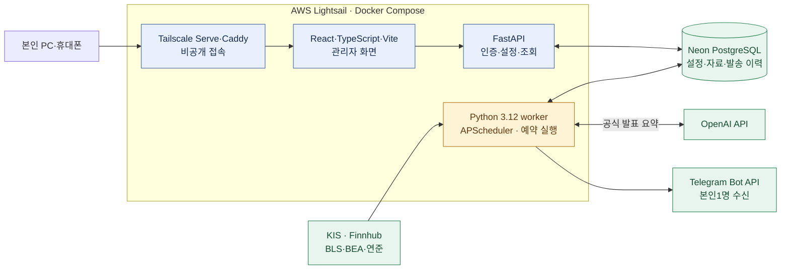
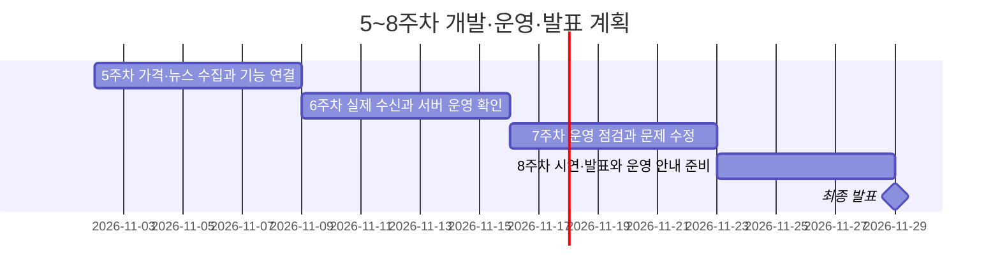

# XFolio 프로젝트 기획서

**국내 상장 해외 ETF 가격과 미국 시장 소식을 한국 거래일 아침 본인 Telegram으로 받는 개인용 뉴스레터**

기준: 2026-11-04, Asia/Seoul. 아래는 제품 목표이며 구현 완료 상태와 구분한다.

## 1. 개요 및 서비스 정의

여러 사이트를 확인하는 대신 **월~금 중 한국 거래일 08:00 알림 한 번으로 관심 ETF와 미국 시장 흐름을 확인**한다. 사용자는 본인 1명이며 매회 승인 없이 자동 전송한다.

| 항목 | 핵심 범위 |
| --- | --- |
| 기본 종목 | TIGER 미국S&P500 `360750` · KODEX 미국나스닥100 `379810` · TIGER 미국배당다우존스 `458730` |
| 종목 관리 | 관리자에서 국내 상장 해외 ETF 검색·추가, 활성 최대10종목 |
| 아침 알림 | 최근 완료 한국 거래일의 원화 종가·등락률 + 일반 뉴스/공식 발표 합계0~3건 |
| 선택 알림 | 한국 거래일14:00 장중 가격·16:00 당일 종가. **둘 다 기본 꺼짐** |
| 이용 범위 | 본인1:1 Telegram·비공개 관리자. 공개 배포·타인 구독·주문·매매 추천 제외 |
| 운영 예산 | 월50,000원 상한, 실제 구성 비용은 배포 전 확인 |

한국 휴장 평일과 주말에는 가격·뉴스 알림을 모두 발송하지 않는다. 다음 한국 거래일 아침에 최근 완료 거래일의 가격과 선정 뉴스를 전달한다.

## 2. 핵심 기능 명세서 · User Flow / Wireframe

| 기능 | 사용자에게 제공하는 결과 |
| --- | --- |
| Market pipeline | 관심 ETF의 가격·등락률·가격 기준일·출처 |
| News pipeline | 미국 관련성·최신성·중복·링크를 검사한 뉴스 최대3건 |
| 일반 뉴스 | Finnhub의 원제·매체·발행시각·개별 원문 링크. 본문 수집·AI 요약/번역 제외 |
| 공식 발표 | BLS·BEA·연준 이사회 자체 발표를 직접 수집하고 근거를 확인한 한국어 AI 요약 |
| 자동 전달 | 가격과 뉴스를 묶어 Telegram 전송, 성공·실패 이력 저장 |
| 관리자 | 관심 종목·알림 설정·전체 일시 중지·뉴스레터와 발송 이력 조회 |

**사용 흐름:** 본인 기기로 접속 → Google 로그인 → 종목·알림 설정 → 아침 Telegram 수신 → 필요할 때 이력 확인.

[기존 HTML 와이어프레임](specifications/assets/관리자_와이어프레임.html)을 활용한다. 대시보드·뉴스레터·발송 이력·관심 종목·알림 설정의5메뉴이며 현재 HTML은 가상 데이터 시연이다.

**Telegram 메시지 예시 — 가격·뉴스 모두 가상**

```text
☀️ XFolio | 11.04(수) 08:00
국내 ETF 종가 · 11.03 정규장 기준
TIGER 미국S&P500 30,300원 | +1.00%
KODEX 미국나스닥100 19,900원 | -0.50%
TIGER 미국배당다우존스 10,020원 | +0.20%

📰 일반 뉴스
1. Example: U.S. market headline
매체명 · 발행시각 KST · 개별 기사 링크

📌 공식 발표 · AI 요약
2. BLS 물가 발표: 전월 대비 0.2% 상승 [가상 수치]
대상 기간·발표시각 · 공식 발표 링크

가격 출처 KIS(예정) · 조회 07:50 KST
```

적격 뉴스가 없으면0건도 정상이다. 수집 실패는 별도 안내하며 오후 선택 알림은 가격만 보낸다.

## 3. 기술 스택 및 인프라

다음은 **목표 구조**다. 화면은 설정·조회, Python worker는 예약 수집·정리·전송을 맡는다.



관리자는 Tailscale·Google 로그인으로 본인만 접근하고 비밀 키는 서버에 둔다. 상세 수집 시각·worker 로직·실패 처리는 [기술 구성](기술_구성.md)과 [운영 정책](운영_정책.md)에서 관리한다.

## 4. 일정 및 마일스톤 · Gantt Chart

**5주차에 기능을 만들고 연결 → 6주차에 실제 서버에서 받아보기 → 7주차에 문제 수정 → 8주차에 시연·발표** 순서로 진행한다. 최종 발표 목표는 **11/29**다.

| 구간 | 무엇을 할 것인가 | 주말에 보여줄 목표 | 발표 |
| --- | --- | --- | --- |
| 5주차 · 11/2~8 | ETF 가격과 뉴스를 모아 아침 뉴스레터로 만드는 기능을 개발한다. 관리자 화면·DB·예약 전송을 연결하고 개발 환경에서 시험한다. | 가격·뉴스 수집 → 뉴스레터 준비 → 모의 전송까지 이어지는 흐름 | 11/8 |
| 6주차 · 11/9~15 | 본인 Telegram으로 오전 8시 수신을 확인하고 AWS 서버·운영 DB에 연결한다. 본인 전용 관리자 접속과 선택 오후 알림도 시험한다. | 실제로 받은 뉴스레터와 PC·휴대폰의 관리자 화면 | 11/15 |
| 7주차 · 11/16~22 | 여러 날의 발송 결과를 살펴보며 누락·중복·수집 실패를 점검한다. 서버 재시작 등 문제가 생기는 상황을 시험하고 수정한다. | 운영 중 발견한 문제와 수정·재시험 결과 | 11/22 |
| 8주차 · 11/23~29 | 종목 설정부터 뉴스레터 수신까지 시연을 준비한다. 발표 자료와 서비스 시작·중지·장애 확인·복구 방법을 정리한다. | 최종 시연·발표 자료·운영 안내 | 11/29 |

**5주차에는 뉴스레터를 만드는 흐름을 조립한다.**

- **가격 수집:** KIS에서 관심 ETF의 종가를 가져오고, 거래일과 비교 기준을 확인해 등락률을 계산한다.
- **뉴스 수집·요약:** Finnhub의 일반 뉴스 제목·링크와 BLS·BEA·연준의 공식 발표를 모은다. 공식 발표만 근거를 확인해 AI로 요약하고, 중복·오래된 후보를 걸러 두 경로를 합쳐 최대 3건을 고른다.
- **뉴스레터 구성:** 가격 요약과 선정 뉴스를 묶고, 누락·오류를 검사한 뒤 개발용 DB에 내용과 상태를 저장한다.
- **관리자·자동 실행:** 화면에서 종목·알림을 설정하고 이력을 볼 수 있게 한다. 정해진 시각에 수집·전송하는 프로그램을 연결하고 모의 전송으로 시험한다.

**6주차에는 실제 수신과 서버 운영을 확인한다.** `07:50 수집 → 07:58까지 내용 준비 → 08:00 Telegram 발송 → 결과 저장` 흐름을 실제 자료로 점검한다. AWS와 운영 DB를 연결해 개인 PC가 꺼져도 실행되도록 하고, 본인 PC·휴대폰에서만 관리자에 접속할 수 있게 한다. 백업 복원·보관 기한 삭제·월 예산도 확인한다. 한국 거래일 14시·16시 가격 알림은 각각 시험하되 기본값은 모두 꺼짐으로 둔다.

**7주차에는 안정적으로 돌아가는지 확인하고, 8주차에는 운영과 발표를 마무리한다.** 뉴스가 없는 날, 외부 API가 실패한 날, 전송 결과를 알 수 없는 상황에서의 처리를 점검한다. 필요한 수정을 마친 뒤 11/27까지 발표 자료와 운영 안내를 준비하고, 11/28 보완을 거쳐 11/29에 최종 시연한다.



간트는 주차별 진행 기간을 나타낸다. 아침 실제 수신·오후 알림 시험은 준비가 끝난 한국 거래일에 진행하며, 휴장일에는 발송하지 않는지도 확인한다. 문제가 생기면 수정 후 다시 확인한다. 작업별 공수와 세부 날짜는 [WBS](planning/작업_분해_WBS.md), 주차별 발표일은 [스터디 일정](스터디_일정.md)을 따른다.

## 5. 테스트 및 QA / 배포·운영 계획

| 대상 | 완료 기준 |
| --- | --- |
| 가격·뉴스 | 거래일·등락률·출처/시각·중복·원문 링크·공식 수치 대조·뉴스0건/장애 구분 |
| 관리자·전송 | 최대10종목·한국 거래일08시 기본/오후 꺼짐·휴장 평일/주말 발송 없음·일시 중지·단일 수신자·중복/재시작/부분 실패 검증 |
| 배포·운영 | 비공개 접근·비밀 보호·월 예산·기한 삭제·백업 복원·본인 수신 확인 |

외부 API 없는 시험 → 실자료 확인 → 모의 통합 → 본인 실제 수신 → 비공개 운영 순서로 검증한다. 개인 이용 범위를 유지하고 제공처 조건에 맞춰 보관·삭제한다.

**현재:** T01 인증/개인 이용·T02 국내 시세/거래일·종목/가격90일 DB에 이어11/4 T03 Finnhub·BLS CPI/BEA GDP/PCE/Board FOMC·근거 요약 연결·전체0~3건·기발송 DB를 구현/격리 검증했다. 무료 조회/공식 원문 파싱과 유료 AI 요약의 모의 검증을 구분한다. T04 가격+뉴스 편성·발송 직전 검사·0005 저장도 구현·격리 검증했다. 실제 유료 요약·정시 실행·새 관리자·worker·실제 전송·비공개 배포는 후속 인수 대상이다.

## 6. 예상 운영 예산 및 비용 관리

**월 예상 운영비는 약 33,000원이며, 예산 상한은 50,000원이다.** 본인 1명·월 22거래일·아침 1회 발송 기준으로, 환율 1달러=2,000원과 부가세 10%를 가정한다.

| 항목 | 월 예상액 |
| --- | ---: |
| AWS 서버 · Lightsail 2GB | 26,400원 |
| 백업 | 2,200원 |
| AI 제목 번역·공식 발표 요약 | 1,000원 |
| Telegram·DB·비공개 접속 | 무료 범위 내 0원 |
| 예비비 · 10% | 2,960원 |
| **합계** | **32,560원 · 약 33,000원** |

본인 Telegram 일반 발송은 무료다. DB·시세·뉴스는 무료 이용을 가정하며, KIS 계정별 요금은 배포 전에 확인한다. 무료 한도 초과·서버 증설·백업 증가 시 예산을 다시 계산한다.

**월 40,000원부터 경고하고, 50,000원 초과 예상 시 새 유료 작업·플랜 확대를 보류한다.** 상세 산식과 요금 근거는 [월 비용과 예산](research/월_비용.md)을 따른다. 단가 확인일: 2026-11-06.

## 7. 부록 및 참고 문서

- 제품·화면: [요구사항](요구사항.md) · [관리자 구조](specifications/관리자_화면_구조.md) · [HTML 시연](specifications/assets/관리자_와이어프레임.html).
- 설계·일정: [기술 구성](기술_구성.md) · [운영 정책](운영_정책.md) · [WBS](planning/작업_분해_WBS.md) · [스터디 일정](스터디_일정.md).
- 제공처·근거: [데이터 이용 조건](research/데이터_이용_조건.md) · [국내 ETF 시세](research/국내_ETF_시세.md) · [Finnhub 검증](../tasks/verification/news/Finnhub_시장뉴스_표본과_개인_전달.md).
- 작업 진행: [개인용 뉴스레터 전환](../tasks/plans/개인용_뉴스레터_전환.md) · [수행 기록](../tasks/logs/README.md).
