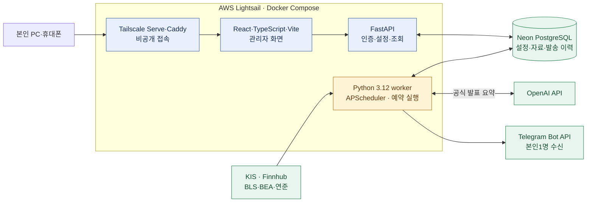
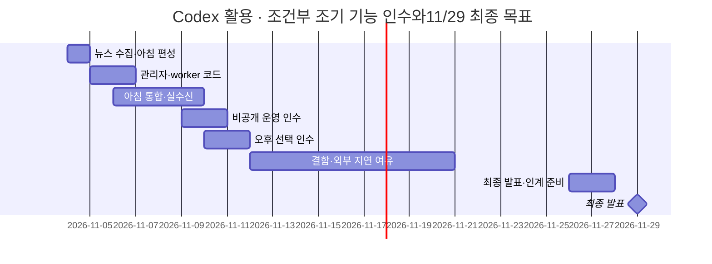

# XFolio 프로젝트 기획서

**국내 상장 해외 ETF 가격과 미국 시장 소식을 매일 아침 본인 Telegram으로 받는 개인용 뉴스레터**

기준: 2026-11-03, Asia/Seoul. 아래는 제품 목표이며 구현 완료 상태와 구분한다.

## 1. 개요 및 서비스 정의

여러 사이트를 확인하는 대신 **월~금 08:00 알림 한 번으로 관심 ETF와 미국 시장 흐름을 확인**한다. 사용자는 본인 1명이며 매회 승인 없이 자동 전송한다.

| 항목 | 핵심 범위 |
| --- | --- |
| 기본 종목 | TIGER 미국S&P500 `360750` · KODEX 미국나스닥100 `379810` · TIGER 미국배당다우존스 `458730` |
| 종목 관리 | 관리자에서 국내 상장 해외 ETF 검색·추가, 활성 최대10종목 |
| 아침 알림 | 최근 완료 한국 거래일의 원화 종가·등락률 + 일반 뉴스/공식 발표 합계0~3건 |
| 선택 알림 | 한국 거래일14:00 장중 가격·16:00 당일 종가. **둘 다 기본 꺼짐** |
| 이용 범위 | 본인1:1 Telegram·비공개 관리자. 공개 배포·타인 구독·주문·매매 추천 제외 |
| 운영 예산 | 월50,000원 상한, 실제 구성 비용은 배포 전 확인 |

한국 휴장 평일에도 아침 알림은 최근 가격의 기준일을 표시해 보낸다. 주말에는 발송하지 않는다.

## 2. 핵심 기능 명세서 · User Flow / Wireframe

| 기능 | 사용자에게 제공하는 결과 |
| --- | --- |
| Market pipeline | 관심 ETF의 가격·등락률·가격 기준일·출처 |
| News pipeline | 미국 관련성·최신성·중복·링크를 검사한 뉴스 최대3건 |
| 일반 뉴스 | Finnhub의 원제·매체·발행시각·개별 원문 링크. 본문 수집·AI 요약/번역 제외 |
| 공식 발표 | BLS·BEA·연준 이사회 자체 발표를 직접 수집하고 근거를 확인한 한국어 AI 요약 |
| 자동 전달 | 가격과 뉴스를 묶어 Telegram 전송, 성공·실패 이력 저장 |
| 관리자 | 관심 종목·알림 설정·전체 일시 중지·뉴스레터와 발송 이력 조회 |

**사용 흐름:** 본인 기기로 접속 → Google 로그인 → 종목·알림 설정 → 아침 Telegram 수신 → 필요할 때 이력 확인.

[기존 HTML 와이어프레임](specifications/assets/관리자_와이어프레임.html)을 활용한다. 대시보드·뉴스레터·발송 이력·관심 종목·알림 설정의5메뉴이며 현재 HTML은 가상 데이터 시연이다.

**Telegram 메시지 예시 — 가격·뉴스 모두 가상**

```text
☀️ XFolio | 11.04(수) 08:00
국내 ETF 종가 · 11.03 정규장 기준
TIGER 미국S&P500 30,300원 | +1.00%
KODEX 미국나스닥100 19,900원 | -0.50%
TIGER 미국배당다우존스 10,020원 | +0.20%

📰 일반 뉴스
1. Example: U.S. market headline
매체명 · 발행시각 KST · 개별 기사 링크

📌 공식 발표 · AI 요약
2. BLS 물가 발표: 전월 대비 0.2% 상승 [가상 수치]
대상 기간·발표시각 · 공식 발표 링크

가격 출처 KIS(예정) · 조회 07:50 KST
```

적격 뉴스가 없으면0건도 정상이다. 수집 실패는 별도 안내하며 오후 선택 알림은 가격만 보낸다.

## 3. 기술 스택 및 인프라

다음은 **목표 구조**다. 화면은 설정·조회, Python worker는 예약 수집·정리·전송을 맡는다.



관리자는 Tailscale·Google 로그인으로 본인만 접근하고 비밀 키는 서버에 둔다. 상세 수집 시각·worker 로직·실패 처리는 [기술 구성](기술_구성.md)과 [운영 정책](운영_정책.md)에서 관리한다.

## 4. 일정 및 마일스톤 · Gantt Chart

**T01~T03 완료 이후 Codex 활용 잔여22h = 에이전트17.5h + 사용자 확인/설정4.5h**로 계획한다. 에이전트 범위11.5~27.5h, 사용자4.5h를 고정하면 합계16~32h이며 실측값이 아니다. T03 실제 세션 기록은 WBS에 분리하며 다른 작업의 공수를 일괄 축소하지 않는다. 단일 에이전트·기존 코드/시험 재사용을 가정하고 일별 협업 배정은5h 이하로 둔다. 정시 관측/외부 처리 대기는 시간 합계와 분리한다.

| 구간 | 목표 | 잔여 A+B | 발표 |
| --- | --- | ---: | --- |
| 5주차11/2~8 | T01~T03 완료·아침 편성/관리자/worker 코드·로컬 시험·수신 준비 | 9.5h | 11/8 |
| 6주차11/9~15 | 실제 아침 수신·비공개 운영·선택 오후 인수, 결함 대응 일부 | 9.5h | 11/15 |
| 7주차11/16~22 | 운영 안정화·필요한 재인수 여유 | 1.25h | 11/22 |
| 8주차11/23~29 | 최종 자료/운영 인계·전체 완료 확인 | 1.75h | 11/29 |



간트는 대기를 포함한 달력 구간이며 막대 길이가 능동 공수는 아니다. 기능 인수11/11은 준비/사용자 설정·실제 송신 승인·정시/거래일 조건이 충족된 경우의 목표다. 전체 완료/발표11/29는 유지한다. 기존95h/잔여82h안은 이력으로 대체했고, 작업별 범위·A/B/C 구분·일일 배치·변경 근거는 [WBS](planning/작업_분해_WBS.md)와 [스터디 일정](스터디_일정.md)을 따른다. 인수 조건은 축소하지 않는다.

## 5. 테스트 및 QA / 배포·운영 계획

| 대상 | 완료 기준 |
| --- | --- |
| 가격·뉴스 | 거래일·등락률·출처/시각·중복·원문 링크·공식 수치 대조·뉴스0건/장애 구분 |
| 관리자·전송 | 최대10종목·08시 기본/오후 꺼짐·일시 중지·단일 수신자·중복/재시작/부분 실패 검증 |
| 배포·운영 | 비공개 접근·비밀 보호·월 예산·기한 삭제·백업 복원·본인 수신 확인 |

외부 API 없는 시험 → 실자료 확인 → 모의 통합 → 본인 실제 수신 → 비공개 운영 순서로 검증한다. 개인 이용 범위를 유지하고 제공처 조건에 맞춰 보관·삭제한다.

**현재:** T01 인증/개인 이용·T02 국내 시세/거래일·종목/가격90일 DB에 이어11/4 T03 Finnhub·BLS CPI/BEA GDP/PCE/Board FOMC·근거 요약 연결·전체0~3건·기발송 DB를 구현/격리 검증했다. 무료 조회/공식 원문 파싱과 유료 AI 요약의 모의 검증을 구분한다. T04 가격+뉴스 편성·발송 직전 검사·0005 저장도 구현·격리 검증했다. 실제 유료 요약·정시 실행·새 관리자·worker·실제 전송·비공개 배포는 후속 인수 대상이다.

## 6. 부록 및 참고 문서

- 제품·화면: [요구사항](요구사항.md) · [관리자 구조](specifications/관리자_화면_구조.md) · [HTML 시연](specifications/assets/관리자_와이어프레임.html).
- 설계·일정: [기술 구성](기술_구성.md) · [운영 정책](운영_정책.md) · [WBS](planning/작업_분해_WBS.md) · [스터디 일정](스터디_일정.md).
- 제공처·근거: [데이터 이용 조건](research/데이터_이용_조건.md) · [국내 ETF 시세](research/국내_ETF_시세.md) · [Finnhub 검증](../tasks/verification/news/Finnhub_시장뉴스_표본과_개인_전달.md).
- 작업 진행: [개인용 뉴스레터 전환](../tasks/plans/개인용_뉴스레터_전환.md) · [수행 기록](../tasks/logs/README.md).
