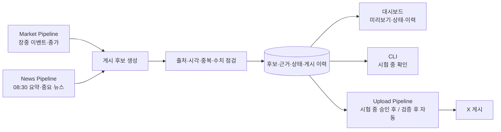

# 2주차 요구사항과 XFolio 에이전트 구상

- 세션 ID: `2026-10-12_week2_requirements`
- 시작: 2026-10-12 16:27:15 +09:00
- 최근 갱신: 2026-10-13 17:04:29 +09:00
- 상태: 진행 중

## 제안과 대안

- `docs/overview.md`의 공통 구성인 시장 수집, 뉴스 수집, AI 분석·콘텐츠 생성, X 게시를 기본 골격으로 삼는다. 확정된 장중 시장·종가·경제 뉴스 포스트에 맞춰 `Market Pipeline`과 `News Pipeline`의 흐름을 분리하는 방안을 구체화한다.
- 종가 포스트에는 확인 가능한 시장 수치와 시장 마감 요약을, 경제 뉴스 포스트에는 선정한 뉴스의 핵심 내용과 출처를 담는 방안을 제안한다. 이전에 제안한 시장 수치·뉴스를 한 게시물에 합치는 방식은 현재 사용자 결정과 맞지 않는다.
- 앞서 제안한 08:30 뉴스·18:30 종가만 게시하는 일정은 시장 시세의 시의성을 충분히 반영하지 못한다는 사용자 지적에 따라 재검토한다. 장중 시장 시세를 가능한 짧은 지연으로 수집하고, 큰 등락이나 급격한 방향 전환 때 장중 시장 포스트를 발행하며, 종가 포스트는 하루의 마감 기록으로 유지한다. 수집 지연·발행 기준값은 아직 미정이다. `News Pipeline`의 게시 흐름은 별도로 유지한다.
- 큰 등락·급격한 방향 전환의 수치 기준은 3주차 데이터 특성과 오탐 가능성을 살펴 정하는 방안을 제안한다. 아직 사용자 결정은 아니다.
- `News Pipeline`은 정기적으로 뉴스를 수집·중복 제거하고, 기본 08:30 요약 외에 게시할 가치가 높은 새 소식이 확인되면 추가 포스트를 발행한다. 일정 간격마다 무조건 게시하는 대안은 중요하지 않은 소식도 반복 발행할 수 있다. 정확한 수집 간격, 게시 기준, 추가 포스트 횟수는 아직 미정이다.
- 검토 방식 제안: 생성 후보에 출처·발행/기준 시각·본문을 묶어 보관하고, 수치/출처/중복/게시 시각을 자동 점검한다. 개발·시험 중에는 사람이 후보를 미리보고, 운영 단계에는 통과한 후보를 자동 게시하며 실패·보류·성공 결과를 대시보드에 기록한다.
- 대시보드와 파이프라인을 함께 구현할 때 게시 후보, 수집 근거, 점검 결과, 게시 이력을 하나의 저장소에 남기고 CLI와 대시보드가 같은 기록을 읽는 구성을 제안한다. 첫 대시보드 범위는 후보 미리보기, 출처·시각 확인, 대기/보류/성공/실패 상태와 실행 이력으로 제한하고, 차트나 복잡한 관리 기능은 나중에 검토하는 방안을 제안한다. 이는 구현 제안이며 대시보드 세부 화면은 아직 미확정이다.
- 오전 경제 뉴스 2~3건을 각 기사 링크·발행 시각과 함께 요약하면 일반 X 포스트의 280자 제한에 걸릴 수 있다. 오전 뉴스는 1개 주제로 묶인 스레드로 발행하고 각 뉴스마다 짧은 요약·출처를 담는 형식을 잠정 선택했다. 추가 중요 뉴스는 단일 포스트로 유지한다. 실제 구현에서 길이·게시 방식 검증 후 조정할 수 있다. 참고: [X 게시물 유형](https://help.x.com/en/using-x/types-of-posts), [X 게시 방법](https://help.x.com/en/using-x/how-to-post).
- KRX 공개 OPEN API 목록은 일별 시세 중심이고, KRX는 실시간·지연 시세의 재배포나 수익사업에는 별도 계약이 필요하다고 안내한다. 한국투자증권 공식 샘플에는 국내지수 실시간 WebSocket 구독 예제가 있으나, XFolio 공개 게시에 사용할 수 있는 권한과 실제 지연은 3주차에 확인해야 한다. 참고: [KRX OPEN API 목록](https://openapi.krx.co.kr/contents/OPP/INFO/service/OPPINFO004.cmd), [KRX 데이터 수신방법](https://openapi.krx.co.kr/contents/OPP/DATA/OPPDATA003.jsp), [한국투자증권 실시간 지수 샘플](https://github.com/koreainvestment/open-trading-api/blob/main/examples_user/domestic_stock/domestic_stock_functions_ws.py).
- 2주차 발표는 대상 독자, 제공할 정보, 콘텐츠 예시, 이용 흐름, 포함·제외 범위를 중심으로 구성하고 파이프라인 흐름을 다이어그램으로 보여주는 방안을 제안한다.
- 데이터 API, 라이브러리, 배포 방식은 `docs/weekly_schedule.md`에 따라 3~4주차 조사·계획 대상으로 남기는 방안을 제안한다.
- 국내 시장은 한국어 원문과 한국 장 종료 후 발행 흐름으로 시작하기 쉬우며, KRX 일별 시세 API와 Open DART 공시 API가 있다. 다만 KRX OPEN API 약관은 제공받은 정보를 제3자에게 제공할 수 없다고 명시하므로, 공개 게시·수익화에 쓸 데이터는 별도 이용 조건 확인이 필요하다. 참고: [KRX 서비스 목록](https://openapi.krx.co.kr/contents/OPP/INFO/service/OPPINFO004.cmd), [KRX 이용약관](https://openapi.krx.co.kr/contents/OPP/INFO/OPPINFO002.jsp), [Open DART 소개](https://opendart.fss.or.kr/intro/main.do).
- 미국 시장은 한국어 독자에게 전일 미국 장 요약을 제공하는 방향으로 차별화를 시도할 수 있다. SEC EDGAR 공시 API는 인증키 없이 이용할 수 있지만, 시세 공급자별 상업 이용·재배포 조건, 영문 뉴스 해석, 시차·서머타임, 환율 표시가 추가 과제다. 참고: [SEC EDGAR API](https://www.sec.gov/search-filings/edgar-application-programming-interfaces), [Alpha Vantage 이용약관](https://www.alphavantage.co/terms_of_service/).
- 수익화 가능성은 아직 가설이다. 단기간 완성 가능성을 우선하면 국내 시장, 향후 한국어 미국시장 해설을 통한 차별화 검증을 우선하면 미국 시장을 추천한다. X 자체 수익화는 별도 자격 요건이 있어 초기 수익 모델로 전제하지 않는다. 참고: [X 수익화 기준](https://help.x.com/en/rules-and-policies/content-monetization-standards).

### 대시보드 병행 설계 초안

- 첫 대시보드 화면 제안: 오늘의 `KOSPI`·`KOSDAQ` 정보와 기준 시각, 뉴스 수집 상태, 게시 후보 원문·출처 링크, 자동 점검 결과, 게시 대기/보류/성공/실패 이력을 보여준다. 조회·미리보기 중심으로 만들고 게시 승인 조작은 초기에는 CLI에 둔다. 표시할 세부 항목은 구현 계획에서 조정할 수 있다.
- 구현 흐름 제안: 파이프라인과 공통 기록 구조를 만들 때 대시보드 조회도 함께 연결하고, 8주차에는 마무리·개선에 집중한다. 저장 기술과 배포 방식은 3~4주차에 결정한다.

## 사용자가 확정한 사항

- 주 독자: 매일 시장을 확인하는 개인 투자자. 선택 이유는 사용자가 아직 별도로 설명하지 않았다. 앞서 제시한 추천 근거는 매일 시장의 움직임과 관련 뉴스를 한 게시물에서 연결하기 쉬워 기능 범위와 예시를 정하기 좋다는 점이었다.
- 대상 시장: 11월까지의 프로젝트 범위는 한국 주식시장으로 한정한다. 선택 이유: 11월까지 프로젝트를 진행하므로 범위를 줄여 완성 가능성을 우선한다.
- 확장 후보: 시간이 남으면 미국 주식시장을 추가로 검토한다. 선택 이유: 현재 일정 안에서는 한국 시장을 먼저 구현하고, 추가 여력이 있을 때만 범위를 넓히기 위해서다. 미국 시장 추가는 필수 요구사항으로 확정하지 않았다.
- 게시물 종류: 한국 시장 장중 이벤트 포스트와 종가 포스트, 주요 경제 뉴스 포스트를 구분한다. 선택 이유: 사용자가 가격 정보의 시의성을 강조해 장중 게시를 추가하고, 시장과 뉴스 흐름을 분리할 것을 명시했다. 뉴스·종가 포스트의 게시 빈도는 아직 미정이다.
- 파이프라인 경계: `Market Pipeline`과 `News Pipeline`을 분리한다. 선택 이유: 사용자가 시장 관련 정보와 경제 뉴스를 구분해 다룰 것을 명시했다. 두 파이프라인의 구체적인 입출력과 게시 흐름은 추후 정한다.
- 종가 포스트 내용: `KOSPI`·`KOSDAQ` 종가와 등락률, 시장 흐름을 설명하는 한두 문장을 담는다. 선택 이유: 사용자가 앞서 제시한 범위안을 수용했다. 당시 추천 근거는 개별 종목 분석을 제외해 두 포스트의 역할을 구분하고 범위를 관리하기 쉽다는 점이었다.
- 경제 뉴스 포스트 내용: 한국 증시에 영향을 줄 수 있는 국내외 경제·정책 뉴스 2~3건을 선정해 요약하고, 개별 기업 뉴스는 우선 제외한다. 선택 이유: 사용자가 앞서 제시한 범위안을 수용했다. 당시 추천 근거는 시장 수치를 반복하지 않으면서 뉴스 선정 기준을 명확히 할 수 있다는 점이었다.
- 시장 시세의 시의성: 가격 정보가 핵심이며 종가 포스트 한 번만으로는 실효성이 부족하다는 문제를 제기했다. 선택 이유: 시장 변화가 일어나는 동안 정보를 제공해야 독자에게 유용하다는 판단이다.
- 장중 포스트 발행 방식: `KOSPI`·`KOSDAQ`의 큰 등락이나 급격한 방향 전환을 감지하면 장중 시장 포스트를 발행한다. 선택 이유: 사용자가 시세의 시의성을 위해 앞서 제안한 이벤트 기반 발행 방식을 선택했다. 수치 기준은 아직 미정이다.
- 장중 포스트 발행 범위: `KOSPI` 또는 `KOSDAQ` 중 한 지수만 조건을 충족해도 발행한다. 선택 이유: 사용자가 추천안을 수용했다. 추천 근거는 한 지수에서 발생한 변화도 독자에게 알릴 가치가 있다는 점이었다.
- 장중 포스트 횟수: 같은 움직임으로 중복 게시하지 않고 하루 최대 2회까지만 발행한다. 종가 포스트는 이 횟수에 포함하지 않는다. 선택 이유: 사용자가 추천안을 수용했다. 추천 근거는 장중 알림의 반복을 줄이면서도 마감 요약을 제공할 수 있다는 점이었다.
- 정기 게시 시각: 한국 시장 거래일의 08:30 KST에 경제 뉴스 요약, 18:30 KST에 종가 포스트를 발행한다. 선택 이유: 사용자가 오전 뉴스·저녁 종가 일정 추천안을 수용했다. 추가 뉴스 포스트는 별도 이벤트 흐름으로 발행한다.
- 자동화 단계: 개발·시험 중에는 게시 후보 미리보기를 사람이 확인하고, 검증을 마친 뒤 자동 게시한다. 선택 이유: 사용자가 단계적 자동화 방식을 수용했다. 자동 점검의 기본 보류 조건은 아래에서 별도 확정했다.
- 뉴스 추가 게시 방식: 뉴스는 약 30분 간격으로 수집하는 것을 출발점으로 삼고, 중요한 새 뉴스가 확인될 때만 추가 게시한다. 정확한 수집 간격은 3주차 제공처 조사에 맞춰 조정한다. 선택 이유: 사용자가 Q5 추천안을 수용했다. 당시 추천 근거는 수집할 때마다 무조건 게시하면 중요도가 낮은 글이 늘어날 수 있다는 점이었다.
- 추가 경제 뉴스 포스트: 거래일 하루 최대 1회만 발행하고, 금리·물가·환율·주요 정책 등 한국 증시에 영향을 줄 만한 새 소식을 우선한다. 선택 이유: 사용자가 Q7 추천안을 수용했다. 추천 근거는 중요도가 낮은 뉴스의 반복 게시를 줄이고 나머지는 다음 오전 요약에 담기 위해서다. 세부 선정 기준은 아직 미정이다.
- 휴장일 운영: 정기 뉴스·종가 포스트를 발행하지 않고, 수집한 경제 뉴스는 다음 거래일 오전 요약 후보로 넘긴다. 선택 이유: 사용자가 Q8 추천안을 수용했다. 추천 근거는 11월까지 거래일 운영에 범위를 집중하기 위해서다.
- 개발·시험 중 사람 검토: CLI에서 게시 후보를 미리보고 확인한다. 선택 이유: 사용자가 Q9 추천안을 수용했다. 출처·본문을 확인하기 위한 초기 인터페이스다.
- 대시보드 구현 시점: 파이프라인과 대시보드를 함께 구현하는 방식으로 설계한다. 선택 이유: 사용자가 대시보드를 한꺼번에 구현하길 요청했다. 기존 `docs/weekly_schedule.md`의 8주차 대시보드 일정은 현재 요청보다 우선하지 않으며, 첫 화면의 역할은 아래에서 별도 확정했다.
- 첫 대시보드의 역할: 게시 후보의 조회·미리보기와 상태·이력을 보여주고, 개발·시험 중 게시 승인은 CLI에서 한다. 선택 이유: 사용자가 Q10 추천안을 수용했다. 당시 추천 근거는 첫 구현에서 승인 권한·중복 실행 처리를 늘리지 않고 게시 흐름을 먼저 검증하기 위해서다.
- 자동 게시 보류 조건: 출처 또는 기준·발행 시각이 없거나, 수치가 원본과 다르거나, 이미 게시한 내용이면 게시하지 않는다. 보류 이유는 대시보드에 남긴다. 선택 이유: 사용자가 Q11 추천안을 수용했다. 당시 추천 근거는 근거 없는 정보와 중복 게시를 막기 위해서다.
- 정기 뉴스가 없을 때: 08:30에 선정 기준을 통과한 뉴스가 없으면 그날의 정기 뉴스 포스트를 생략하고 다음 수집에서 새 소식을 확인한다. 선택 이유: 사용자가 Q12 추천안을 수용했다. 당시 추천 근거는 기준에 맞지 않는 내용으로 게시물을 채우지 않기 위해서다.
- 장중 시장 포스트 표현: 확인된 수치와 변화를 중심으로 쓰고, 원인이 확인되지 않으면 추정하지 않는다. 선택 이유: 사용자가 Q13 추천안을 수용했다. 당시 추천 근거는 근거 없는 원인 해석이 실제 시세 정보처럼 전달되는 것을 막기 위해서다.
- 경제 뉴스 포스트 출처: 기사 원문 링크와 발행 시각을 게시물에 표시한다. 선택 이유: 사용자가 Q14 추천안을 수용했다. 당시 추천 근거는 독자가 요약의 근거와 정보의 시점을 확인할 수 있다는 점이었다.
- 오전 뉴스 형식(잠정): 첫 글에 2~3건의 주제를 소개하고 이어지는 글에서 기사별 요약·발행 시각·출처 링크를 제공하는 X 스레드로 한다. 추가 중요 뉴스는 단일 글로 한다. 선택 이유: 사용자가 Q15 추천안에 "일단 예"라고 답해 임시 방향으로 채택했다. 추천 근거는 일반 글의 길이 제한 안에서 출처별 근거를 보여주기 위해서다. 구현 검증 후 형식 조정 가능성을 남긴다.

## 발표용 요구사항 초안

- **누구에게:** 매일 한국 시장을 확인하는 개인 투자자에게 제공한다.
- **무엇을:** `Market Pipeline`은 `KOSPI`·`KOSDAQ`의 장중 큰 등락·급격한 방향 전환과 종가를 다룬다. `News Pipeline`은 한국 증시에 영향을 줄 국내외 경제·정책 뉴스를 다룬다. 두 파이프라인의 포스트는 구분한다.
- **언제:** 거래일 08:30 KST에 경제 뉴스 2~3건을 스레드로 요약하는 형식을 잠정 적용하고, 18:30 KST에 종가를 요약한다. 장중 시장 이벤트는 조건 발생 시 하루 최대 2회, 중요한 추가 경제 뉴스는 하루 최대 1회 게시한다. 뉴스는 약 30분 간격으로 수집하는 것을 출발점으로 삼는다.
- **어떻게 확인하나:** 출처·시각·수치·중복을 점검한다. 개발·시험 중에는 CLI로 후보를 확인하고, 검증 후 통과한 후보를 자동 게시한다. 대시보드는 파이프라인과 함께 구현해 후보·상태·이력을 보여준다.
- **어떻게 표현하나:** 장중 시장 포스트에는 확인된 변화만 적고 근거 없는 원인 추정은 하지 않는다. 뉴스 포스트에는 원문 링크와 발행 시각을 표시한다.
- **범위 밖/추후 검토:** 개별 기업 뉴스와 미국 시장은 11월까지의 핵심 범위에서 제외하거나 선택적 확장으로 둔다. 실시간 시세 제공처·이용 권한과 장중 이벤트 수치 기준은 3~4주차 조사·설계에서 결정한다.

발표 다이어그램은 `Market Pipeline → 장중/종가 후보`, `News Pipeline → 오전/추가 뉴스 후보`의 두 갈래가 `점검 → 미리보기·이력 → X 게시`로 연결되는 모습을 보여준다.

### 게시물 예시 초안

아래 중괄호는 실제 수집 결과로 채우는 자리이며, 아직 확정된 문구는 아니다.

- 장중 시장: `[장중 시장 · {KST 기준 시각}] KOSPI {지수값} ({전일 대비 등락률}), KOSDAQ {지수값} ({전일 대비 등락률}). {확인된 변화 한 문장}`
- 시장 종가: `[오늘의 종가 · {거래일}] KOSPI {종가} ({등락률}), KOSDAQ {종가} ({등락률}). {시장 흐름 한 문장}`
- 오전 경제 뉴스: `[오전 경제 뉴스 · {거래일}] 오늘 확인할 경제 뉴스 {2~3건}` 다음에 각 기사 `{핵심 사실 한 문장} · {발행 시각} · {매체명} {원문 링크}`를 붙이는 스레드 안을 제안한다.
- 추가 중요 뉴스: `[경제 뉴스 · {발행 시각}] {기사 핵심 사실 한 문장}. 출처: {매체명} {원문 링크}`

## 반영 결과

- 2026-10-13: 확정 사항과 잠정·미결정 사항을 구분해 [2주차 요구사항 발표 초안](../progress/2026-10-18.md)에 반영했다. 발표 예정일은 2026-10-18이며 최종 요구사항 문서와 구현은 아직 완료되지 않았다.

## 미결정 질문

- 게시물과 발표 다이어그램은 어떤 모습을 목표로 하는가?
- 큰 등락·급격한 방향 전환의 수치 기준과 같은 움직임의 중복 판정은 어떻게 정할 것인가?
- 장중 시장 시세를 어느 정도의 지연으로 수집할 수 있고 공개 게시할 수 있는가?
- 추가 경제 뉴스 포스트의 세부 선정 기준과 같은 사건의 중복 판정은 무엇인가?
- 오전 경제 뉴스 스레드의 길이·게시 방식이 구현 검증 후에도 적절한가?
- 발표용 게시물 예시 형식과 다이어그램 구성을 이 초안으로 삼을 것인가?

## 다음에 확인할 일

- 발표용 전체 구상에 대한 사용자 확인을 받고, 시세 제공처·장중 기준값·스레드 게시 검증 등 기술 조사로 넘길 미정 사항을 정리한다.
