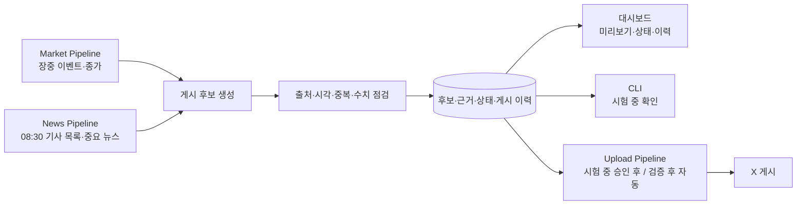

# 2주차 요구사항과 XFolio 에이전트 구상

- 세션 ID: `2026-10-12_week2_requirements`
- 시작: 2026-10-12 16:27:15 +09:00
- 최근 갱신: 2026-10-14, Asia/Seoul
- 상태: 종료 — 이번 제품 범위 확정. 제공처·상품·운영값은 후속 조사 대상.

## 2026-10-14 grill-me 후속 확인과 2주차 마무리

- **사용자가 확정한 사항:** 첫 운영은 비상업적 공개 계정으로 한다. 휴장일에는 정기 글을 쉬고 중요한 새 공식 공지만 하루 한 번 확인한다. 휴장일 게시 여부까지 확정한 답은 아니다.
- **제안과 대안:** 첫 버전 관찰 ETF를 S&P500·NASDAQ100 각 1개(총 2개)로 시작하면 자료·공지 수집과 한 게시물의 길이 검증 대상이 줄어든다. 각 2개(총 4개)로 시작하면 같은 지수의 두 상품을 함께 관찰할 수 있지만 자료 확인 범위가 넓어진다. 이는 개수의 예시이며 어떤 상품도 선정하지 않았다.
- **미결정 질문:** 처음부터 2개 또는 4개를 관찰할지, 구체적인 상품·제공처·게시 시각과 휴장일 공지 게시·이월 기준은 3주차 기술·자료 조사 후 결정한다. 기존에 확정한 각 지수 1~2개, 총 2~4개라는 범위는 유지한다.
- **다음에 확인할 일:** [3주차 일정](../../docs/weekly_schedule.md)에 따라 상품·시세·뉴스·공식 공지의 이용 조건과 자료 도착 시점을 조사한다. 2주차 발표에서는 기능·범위와 에이전트 흐름까지만 설명한다.
- **반영 결과:** 확정한 계정·휴장일 원칙과 미정 개수를 [자동 게시 설계](../../docs/isa_etf_publishing_design.md) 및 [2주차 발표](../progress/2026-10-18.md)에 반영했다.

## 2026-10-14 최종 제품 범위 결정

- **사용자가 확정한 사항:** 국내 중개형 ISA ETF 투자자를 위한 **국내 상장 S&P500·NASDAQ100 ETF 정보 자동 게시 봇**으로 만든다. 두 지수를 추종하는 국내 상장 일반 지수형 ETF를 각 1~2개, 총 2~4개 관찰하고 KOSPI·KOSDAQ 개장 후 현황과 확정 종가를 유지한다. 모든 독자에게 같은 공개 정보를 전달한다.
- **전달 정보:** 관찰 ETF의 확정 종가·전일 대비 가격 등락률, 오전 관련 기사 최대 2건의 제목·원문 링크를 담은 단일 게시물, 확인된 새 분배금·보수·상품 정책 공지를 전달한다. 기사별 요약·스레드와 교육·비교 정기 게시를 두지 않는다. 가격 등락률은 분배금을 포함한 투자수익률과 구분한다.
- **수집·게시 원칙:** 시장은 개장 후와 종가 게시 전에 각 한 작업씩 수집하고 종가 자료를 지수·ETF 게시물에서 재사용한다. API 요청 횟수는 작업 횟수와 구분한다. 뉴스·공지는 약 30분 간격으로 확인하되 매번 게시하지 않는다. 장중 1분 가격 감시는 하지 않는다. 정기 최대 4건·중요 새 정보 최대 2건은 운영 초안이며 게시 수를 채우기 위한 중복 게시를 하지 않는다. 08:30·09:10·18:30·19:00은 미확정 편성안이다.
- **정확성과 자동화:** 수치·날짜·링크는 원본으로 채우고 AI는 관련성·중요도, 제목 축약과 필요한 짧은 설명에 쓴다. 출처·발행·기준·수집 시각, 거래일·시간대를 남긴다. 누락·오래된 시세·중복·실패·성공 여부 불명확 상태를 설계한다. CLI 미리보기·시험 실행 후 검증을 통과한 후보를 운영 단계에 자동 게시하고, 대시보드는 후보·상태·이력을 같은 기록에서 읽는다.
- **범위와 이유:** 댓글·DM 응답, 계좌 연결, 개인화 추천, 자동 매매, 11:30 `오늘의 ETF`, 14:00 `ETF 비교·기초 정보`와 자료 제작은 제외한다. [프로젝트 개요](../../docs/overview.md)의 전체 흐름을 11/2~11/15의 2주 개발 기간과 현재 골격 상태에 맞춰 완성하기 위해 관찰 범위를 좁혔다. 포괄적 ETF 추천과 다른 ETF 그룹은 첫 흐름 완성 뒤 확장한다.
- **미정:** 실제 ETF·제공처, 공식 공지 수집·공개 게시 허용 조건, 시세 제공 시점, 휴장일의 새 공지 게시·이월과 허용 지연·중복·재시도 운영값, X 권한·비용·배포·저장 방식은 조사 후 결정한다. 앞선 추천을 상품·제공처의 확정으로 해석하지 않는다.

아래 2026-10-14 이전 논의와 추천은 **결정 이력**이다. 현재 요구사항과 충돌하는 약 10개 관찰, 포괄적 추천 우선, 장중 이벤트 감시, 정기 ETF 소개·비교, 하루 6~8건 목표는 이번 최종 결정으로 대체한다.

## 2026-10-14 프로젝트 규모·기간에 따른 범위 추천 (당시 제안)

- 사용자 확인: S&P500·NASDAQ100 아이디어는 국내 상장 ETF를 뜻한다. 대상은 국내 중개형 ISA ETF 투자자로 유지한다. 포괄적인 ETF 추천과 두 지수 추종 ETF 중심 관찰 중 어느 방향으로 갈지는 고민 중이다.
- 요청 근거 확인: [프로젝트 개요](../../docs/overview.md)는 개인별 시장·뉴스 수집 → AI 분석·콘텐츠 생성 → 예약 X 게시 → 테스트·배포의 전 과정 완성을 목표로 한다. [일정](../../docs/weekly_schedule.md)의 개발 집중 기간은 11/2~11/15의 2주다. 실제 파이프라인·입출력 파일은 아직 역할 설명만 있는 골격이었다.
- 추천안: 국내 상장 S&P500·NASDAQ100 일반 지수 추종 ETF를 각 1~2개, 총 2~4개 관찰하는 정보 알림봇을 먼저 완성한다. 지수·ETF 마감 현황, 관련 기사 제목·링크, 확인된 분배금·상품 변경 공지를 자동 전달한다. KOSPI·KOSDAQ 유지와 정기 소개·비교 제외 조건을 따른다.
- 비교 판단: 포괄적 ETF 추천은 규칙 기반으로도 가능하지만, 여러 자산군의 후보 선정·비교 기준과 추천 사유 검증이 추가된다. 좁은 관찰안은 반복 가능한 입력·출력과 검증 기준을 먼저 완성하기에 적합하다는 판단이다. 이는 개발 범위에 대한 추천이며 특정 ETF의 투자 성과나 매수 우열 판단이 아니다.
- 구현 계획 제안: 3~4주차에는 제공처·공개 게시 조건·목록·형식·중복 규칙을 정하고, 5주차 수집·기록·대시보드 조회, 6주차 AI 후보·검증·게시·예약 실행·결과 기록을 연결한다. 7~8주차에는 장애·중복·누락 검증과 배포·시연을 진행한다. 완료된 작업으로 기록하지 않는다.
- 확장안: 관찰 목록을 설정으로 관리해 첫 흐름 완성 후 다른 ETF 그룹을 추가하고, 포괄적인 추천은 별도 선정·검증 규칙을 갖춰 확장한다. 관찰 범위를 좁힌다고 게시량이 자동으로 늘어난다는 가정은 두지 않는다.
- 반영: [설계 초안](../../docs/isa_etf_publishing_design.md)에 규모·일정 비교와 추천안을 추가했다. [발표](../progress/2026-10-18.md)에는 확정된 독자와 아이디어의 의미를 바로잡고 관찰 대상 선택은 미확정으로 표시했다.

## 2026-10-14 정기 소개·비교 제외와 지수 중심 아이디어

- 사용자 확정: 11:30 `오늘의 ETF`와 14:00 `ETF 비교·기초 정보`는 현재 수준에서 과하므로 제외한다. 자동 게시·정보 전달 목적과 KOSPI·KOSDAQ 유지 조건을 따른다.
- 반영: 두 정기 글, 교육·비교 자료를 미리 만드는 작업, 관련 다이어그램 입력과 30일 반복 방지 규칙을 현재 설계에서 제거했다. 남은 편성은 정기 최대 4건과 추가 정보 최대 2건이며, 이전 하루 6~8건 목표는 철회했다. 실제 발행량은 유효한 후보에 따라 달라진다.
- 사용자 아이디어: S&P500·NASDAQ100 종목 중심 알림봇. 사용자가 가벼운 아이디어라고 명시했으므로 대상 전환을 확정하지 않는다.
- 확인 질문: 국내 상장 S&P500·NASDAQ100 ETF인지 미국 지수 구성 개별 주식인지 구분한다. 기존 ISA·ETF 범위와 이어지는 국내 상장 ETF 중심을 추천한다.
- 미확정 대안: 국내 상장 ETF를 뜻한다면 관찰 상품을 2~4개로 좁히고 관련 뉴스·ETF 마감 수치·분배금·상품 변경 공지를 전달할 수 있다. 미국 개별 주식을 뜻한다면 기업별 뉴스·실적·공시와 미국 장의 기준일·시간대 설계가 추가로 필요하다. 두 대안 모두 KOSPI·KOSDAQ 정보 유지 요청은 유효하다.
- [설계 초안](../../docs/isa_etf_publishing_design.md)과 [발표 문서](../progress/2026-10-18.md)를 수정하고 [유사 사례 조사](../../docs/research/similar_service_research.md)의 이전 편성 제안을 이력으로 표시했다. 소개·비교 제외는 확정 변경이며 새 관찰 대상은 아직 검토 중이다.

## 2026-10-14 유사 사이트·X 봇 조사

- 사용자 요청: 설계에 참고할 유사 사이트와 트위터 봇을 검색한다.
- 조사 결과: ETF CHECK·FunETF·K-ETF·ETF.com의 콘텐츠·비교 항목과 Ubiq ETF Bot의 보도에 인용된 과거 게시 형식, ibex35_bot의 공개 README를 확인했다.
- 확인 범위: 사이트 기능 설명과 공개 문서를 조사했다. X 직접 조회 제한으로 계정의 최신 운영과 게시 빈도를 검증하지 못했으며, 외부 봇 코드를 실행하지 않았다. 동일한 국내 ISA·ETF 자동 게시 봇이 있다고 단정하지 않는다.
- [조사 문서](../../docs/research/similar_service_research.md)에 근거 링크·적용 제안·미확인 항목을 남기고 [설계 초안](../../docs/isa_etf_publishing_design.md)과 작업 목록에서 연결했다. 새 콘텐츠나 데이터 제공처의 채택은 확정하지 않았다.

## 2026-10-14 게시 편성 확대 (이전 추천안)

- 사용자 피드백: 하루 게시물이 4개뿐이면 적어 보인다. 자동 정보 전달 목적과 KOSPI·KOSDAQ 유지 조건은 계속 적용한다. 사용자가 특정 게시량을 최종 확정한 것은 아니다.
- 추천안: 오전 뉴스, 장 시작 지수, ETF 한 종목 소개, ETF 비교·기초 정보, 종가 지수, ETF 마감 현황의 정기 편성 6건과 중요 정보 최대 2건으로 하루 6~8건을 목표로 제안한다. 유효한 기사·데이터·검증된 자료가 없는 슬롯은 생략한다.
- 시각 제안: 08:30 뉴스, 09:10 장 시작, 11:30 ETF 소개, 14:00 ETF 비교·기초 정보, 18:30 시장 종가, 19:00 ETF 마감 현황. 시장·ETF 데이터의 공개 시점과 실제 운영 시각은 제공처 조사 후 확정한다.
- 수집·준비: 개장 후 지수 조회 작업과 장 마감 후 지수·ETF 일별 수집 작업을 각 한 번 편성한다. ETF 마감 글은 종가 수집 자료를 재사용하며 제공처에 따라 여러 API 요청이 필요할 수 있다. 소개·비교용 상품자료는 별도로 갱신·검증하고 주간 편성표로 예약한다. 뉴스·공지 약 30분 확인을 유지하며 장중 가격 감시는 추가하지 않는다.
- 중복·정확성: 같은 핵심 소개·비교 내용은 30일 동안 재게시하지 않는 안이다. 비교 자료는 같은 비용 정의·기준 기간을 확인한다. ETF 당일 가격 등락률은 분배금을 포함한 투자수익률로 표현하지 않는다.
- [자동 게시 설계](../../docs/isa_etf_publishing_design.md)와 [2주차 발표](../progress/2026-10-18.md)를 위 추천안으로 갱신했다. 아래 3건 정기+1건 추가, 주간 비교를 확장으로 두었던 내용은 이전 제안 이력이다.

## 2026-10-14 자동 게시·정보 전달 목적 재설계 (이전 편성안)

- 사용자 확정: 목적은 X에 정보를 자동 게시해 전달하는 것이다. 독자와의 소통을 중심으로 기능을 설계하지 않는다. KOSPI·KOSDAQ 정보 유지 요청도 유효하다.
- 변경 이유: 앞선 제안은 독자의 질문과 개인 관심 정보에 무게를 두었다. 이번 설계는 모든 독자가 같은 공개 게시물을 읽는 운영 흐름과 게시 콘텐츠·선정 조건을 중심으로 구체화한다.
- 현재 제안: ISA·ETF 관련 제목·링크를 오전 한 게시물로 전달하고, 장 시작과 종가 지수 글을 각 한 번 게시한다. 중요한 ETF 공지·ISA 변경·관련 경제 발표는 하나의 추가 게시 한도로 합쳐 하루 최대 한 번 게시하는 안이다. 시각·관찰 목록·새 선정 규칙은 미확정이다.
- 수집 제안: 시장은 거래일 개장 후와 종가 게시 전에 조회하고, 뉴스·운용사 공지는 거래일 08:00~18:00 약 30분 간격으로 확인한다. 휴장일은 게시를 쉬고 하루 한 번 수집해 다음 거래일 유효한 후보를 남긴다. 기존 휴장일 수집·게시 규칙은 이 안으로 재검토한다.
- 범위 제안: 초기에는 고정 ETF 관찰 목록과 정해진 콘텐츠 형식으로 운영한다. 댓글·DM 응답, 계좌 연결, 개인별 요청 처리와 자동 매매는 초기 범위에 넣지 않는다. 주간 ETF 비교·교육 콘텐츠는 확장 후보로 둔다.
- [자동 게시 설계 초안](../../docs/isa_etf_publishing_design.md)에 입력·출력, 수집 주기, 게시 조건, 오류·중복 처리를 정리하고 [2주차 발표](../progress/2026-10-18.md)에 구현 전 제안임을 표시했다. 아래 이전 대안과 독자 선택 질문은 논의 이력으로 보관하며, 현재 작업의 선행 조건으로 요구하지 않는다.

## 2026-10-14 ISA·ETF 독자 제안 (대상·콘텐츠 미확정)

- 사용자 제안: 독자를 ISA 계좌 투자자로 좁히고 ETF 중심으로 정보를 전달한다. 사용자 명시 요청에 따라 KOSPI·KOSDAQ 지수 전달은 유지한다. ISA·ETF 대상 전환은 검토 제안이며 아직 최종 확정으로 기록하지 않는다.
- 추천 독자: 중개형 ISA에서 국내 상장 ETF를 직접 골라 적립식으로 투자하는 개인. 봇의 쓰임은 `ETF 선택에 필요한 비교 정보와 보유 중 확인할 상품 변화·일정을 짧게 전달`하는 것으로 제안한다. 사용자 수요와 반복 이용 여부는 실제 콘텐츠 반응으로 검증한다.
- 범위 제안: 국내 대표지수형, 국내 상장 해외 대표지수형, 채권형, 배당형 중 관찰 대상 약 10개부터 검토한다. 국내 상장과 국내 자산 투자는 다른 구분이다. 국내에 상장된 해외지수 ETF를 포함할 경우 기존 한국 시장 중심 범위와의 관계를 별도로 확정한다. 계좌별 실제 매수 가능 여부는 증권사 정보를 확인한다. 참고: [삼성증권 중개형 ISA 투자 가능 상품 안내](https://blog.onestopsamsungpop.co.kr/brokerage-isa-investment-products), [Kodex ISA 안내](https://www.samsungfund.com/etf/isa.do).
- 시장 콘텐츠: KOSPI·KOSDAQ 지수는 유지하고, 개장 후·종가 각 1회 추천안과 실행 시각의 미확정 상태를 유지한다. ETF 수익률과 다른 지수의 등락률을 같은 성과인 것처럼 연결하지 않는다.
- 뉴스 콘텐츠: 오전에는 ISA·관찰 ETF와 관련 있는 기사 제목·링크 2건을 한 게시물로 제공하는 안을 제안한다. 기존 경제 뉴스 범위를 좁히는 변경이므로 확정 전에는 발표 요구사항에 옮기지 않는다. 약 30분 간격 수집은 제공처 조건에 따라 검토한다.
- 추가 가치 제안: 운용사의 분배금 지급 공지에서 기준일·지급일·금액을 구분해 전달하고, 보수·기초지수·분배 정책 변경은 원문과 변경 전후를 보여준다. 확인된 공식 공지만 게시 후보로 만들며, 분배금 수취를 위한 매수 시점은 거래 일정과 권리 조건을 확인하기 전 단정하지 않는다.
- 주간 비교 제안: 같은 기초지수 상품끼리 비교하되 공시된 총보수·비용의 정의와 기준 기간, 순자산, 거래량·스프레드, 분배 방식, 환헤지 여부를 확인한다. 비용 수치 하나나 분배율만으로 상품의 우열을 결정하지 않는다. 세제 콘텐츠는 계좌·상품 유형과 기준일을 명시하고 최신 공식 자료를 확인한 범위에서 설명한다.
- 확인할 질문: 첫 독자를 `ETF를 처음 고르는 ISA 투자자`와 `이미 ETF를 보유하고 변화를 확인하려는 ISA 투자자` 중 어디에 둘까? 첫 구현은 ETF 선택·비교를 중심에 두고, 보유 중 확인할 공지를 함께 제공하는 방향을 추천한다.
- KOSPI·KOSDAQ 유지 요청만 확정 사항으로 기록했으며, 대상·관찰 목록·콘텐츠·게시 횟수는 아직 제안이다. 이 단계에서는 브레인스토밍 기록을 갱신한다.

## 2026-10-14 사용 가치 재검토 (미확정)

- 사용자 문제 제기: 개장·마감 지수와 뉴스 제목을 정해진 시각에 올리는 구성만으로는 사람들이 많이 사용할 이유가 와닿지 않는다. 시장 게시 횟수보다 봇의 고유한 쓰임을 먼저 정할 필요가 있다.
- 선택지 A — 관심 종목의 중요 공시 풀이: 주요 기업군의 신규 공시에서 투자자가 확인할 변화를 골라 `확인된 사실 → 투자자가 확인할 질문 → 원문`으로 짧게 전달한다. 추천 이유는 보유·관심 종목에 직접 연결되는 질문을 다룰 수 있고, OpenDART가 공시 검색과 원문 접근 기능을 제공하기 때문이다. 다만 개별 기업 정보가 기존 우선 제외 범위였으므로 사용자 결정이 필요하다. 공시의 시장 영향이나 주가 방향은 근거 없이 단정하지 않는다.
- 선택지 B — 하루 시장 변화의 근거 요약: 종가·등락률을 넘어 오늘 확인된 정책·경제 발표·공시와 시장 수치를 함께 보여준다. 기존 범위와 가깝지만 가격 변화의 원인을 특정 기사로 단정하기 어렵고, 유사한 시장 요약과 구별될 만한 정보 설계가 필요하다.
- 선택지 C — 다음 거래일 확인할 일정: 경제 발표와 공식 일정의 시각·원문·확인할 지표를 안내한다. 시세의 실시간 수집 부담은 작지만 일정 데이터의 안정적 확보와 사용자 수요 검증이 필요하다.
- 당시 추천은 A를 좁은 종목군과 중요 공시 유형으로 시험하고, 반응이 있는 공시만 게시하는 방향이었다. 이후 위 ISA·ETF 대상 제안으로 논의를 이어간다. 기업 공시 중심안은 채택된 요구사항이 아니며, 현재는 대안 이력으로 남긴다.
- 확인할 질문: 이 봇의 첫 번째 쓰임을 `관심 종목의 중요 공시 풀이`, `시장의 하루 변화 요약`, `다음 거래일 일정 안내` 중 어디에 둘까?

## 2026-10-14 시장 게시 방식 재검토 (추천안·미확정)

- 사용자 의견: 뉴스는 30분 간격으로 감시하고 있으므로 시장 시세까지 1분 간격으로 감시하는 것은 부담이 크다. 시장 글은 개장 후 1회와 마감 후 1회만 게시하는 방안을 제안했다.
- 추천안: 거래일 개장 후 첫 유효 시세를 확인해 `장 시작 현황` 1회, 확정 종가를 확인해 `시장 종가` 1회를 게시한다. 장중 시세의 주기적 조회와 급등락·방향 전환 알림은 첫 구현 범위에서 제외한다. 뉴스 수집은 별도 흐름으로 약 30분 간격을 검토하되, 실제 간격은 제공처 조건을 확인해 정한다.
- 개장 후 09:10 KST는 검토용 시각이다. 이때의 값은 개장 시가가 아닌 해당 시각의 시세로 표시한다. 마감 글은 확정 종가를 확보한 뒤 게시하며, 기존 18:30 KST 유지 여부는 제공처의 데이터 공개 시각을 확인해 정한다.
- 뉴스 기사가 모든 급등락을 포착하거나 설명한다고 보장할 수 없다. 따라서 이 추천안을 택하면 장중 가격 변동 자체에 대한 즉시 알림은 제공하지 않는다고 발표에서 명시한다.
- 아래에 기록된 장중 이벤트 게시·1분 간격 조회 관련 이전 결정과 제안은 **재검토 중인 이력**이다. 현재 발표용 문서에는 두 번의 시장 조회·게시 추천안을 미확정으로 표시한다.

## 제안과 대안

- `docs/overview.md`의 공통 구성인 시장 수집, 뉴스 수집, AI 분석·콘텐츠 생성, X 게시를 기본 골격으로 삼는다. 확정된 장중 시장·종가·경제 뉴스 포스트에 맞춰 `Market Pipeline`과 `News Pipeline`의 흐름을 분리하는 방안을 구체화한다.
- 종가 포스트에는 확인 가능한 시장 수치와 시장 마감 요약을, 오전 경제 뉴스에는 선정한 기사의 제목·링크를, 추가 중요 뉴스에는 핵심 사실과 출처를 담는다. 이전에 제안한 시장 수치·뉴스를 한 게시물에 합치는 방식은 현재 사용자 결정과 맞지 않는다.
- 앞서 제안한 08:30 뉴스·18:30 종가만 게시하는 일정은 시장 시세의 시의성을 충분히 반영하지 못한다는 사용자 지적에 따라 재검토한다. 장중 시장 시세를 가능한 짧은 지연으로 수집하고, 큰 등락이나 급격한 방향 전환 때 장중 시장 포스트를 발행하며, 종가 포스트는 하루의 마감 기록으로 유지한다. 수집 지연·발행 기준값은 아직 미정이다. `News Pipeline`의 게시 흐름은 별도로 유지한다.
- 큰 등락·급격한 방향 전환의 수치 기준은 3주차 데이터 특성과 오탐 가능성을 살펴 정하는 방안을 제안한다. 아직 사용자 결정은 아니다.
- 장중 시장 감시안: 거래일 장중 KOSPI·KOSDAQ 값을 출처·기준 시각과 함께 주기적으로 받아 전일 종가 대비 등락률과 최근 고점·저점에서의 반대 방향 움직임을 계산한다. 초기에는 1분 간격 조회를 제안하지만, 제공처의 실제 갱신 주기·지연·호출 제한·공개 게시 권한에 맞춰 조정한다. 조건을 새로 충족할 때만 후보를 만들고 같은 움직임은 다시 알리지 않는다. 임계값, 관측 구간, 중복 판정 방식은 미정이다.
- `News Pipeline`은 정기적으로 뉴스를 수집·중복 제거하고, 기본 08:30 선정 기사 외에 게시할 가치가 높은 새 소식이 확인되면 추가 포스트를 발행한다. 일정 간격마다 무조건 게시하는 대안은 중요하지 않은 소식도 반복 발행할 수 있다. 정확한 수집 간격, 게시 기준, 추가 포스트 횟수는 아직 미정이다.
- 검토 방식 제안: 생성 후보에 출처·발행/기준 시각·본문을 묶어 보관하고, 수치/출처/중복/게시 시각을 자동 점검한다. 개발·시험 중에는 사람이 후보를 미리보고, 운영 단계에는 통과한 후보를 자동 게시하며 실패·보류·성공 결과를 대시보드에 기록한다.
- 대시보드와 파이프라인을 함께 구현할 때 게시 후보, 수집 근거, 점검 결과, 게시 이력을 하나의 저장소에 남기고 CLI와 대시보드가 같은 기록을 읽는 구성을 제안한다. 첫 대시보드 범위는 후보 미리보기, 출처·시각 확인, 대기/보류/성공/실패 상태와 실행 이력으로 제한하고, 차트나 복잡한 관리 기능은 나중에 검토하는 방안을 제안한다. 이는 구현 제안이며 대시보드 세부 화면은 아직 미확정이다.
- 오전 경제 뉴스는 기사별 요약을 잇는 스레드를 잠정 선택했으나, 2026-10-14 사용자 피드백에 따라 기사 제목과 원문 링크를 한 게시물에 모으는 형식으로 바꾼다. 우선 2건을 담고 3건까지 가능한지는 실제 제목·링크의 길이로 검증한다. 기사 발행 시각은 게시 후보의 근거와 이력에 보관한다. 추가 중요 뉴스는 단일 포스트로 유지한다. 참고: [X 게시 방법](https://help.x.com/en/using-x/how-to-post).
- KRX 공개 OPEN API 목록은 일별 시세 중심이고, KRX는 실시간·지연 시세의 재배포나 수익사업에는 별도 계약이 필요하다고 안내한다. 한국투자증권 공식 샘플에는 국내지수 실시간 WebSocket 구독 예제가 있으나, XFolio 공개 게시에 사용할 수 있는 권한과 실제 지연은 3주차에 확인해야 한다. 참고: [KRX OPEN API 목록](https://openapi.krx.co.kr/contents/OPP/INFO/service/OPPINFO004.cmd), [KRX 데이터 수신방법](https://openapi.krx.co.kr/contents/OPP/DATA/OPPDATA003.jsp), [한국투자증권 실시간 지수 샘플](https://github.com/koreainvestment/open-trading-api/blob/main/examples_user/domestic_stock/domestic_stock_functions_ws.py).
- 2주차 발표는 대상 독자, 제공할 정보, 콘텐츠 예시, 이용 흐름, 포함·제외 범위를 중심으로 구성하고 파이프라인 흐름을 다이어그램으로 보여주는 방안을 제안한다.
- 데이터 API, 라이브러리, 배포 방식은 `docs/weekly_schedule.md`에 따라 3~4주차 조사·계획 대상으로 남기는 방안을 제안한다.
- 국내 시장은 한국어 원문과 한국 장 종료 후 발행 흐름으로 시작하기 쉬우며, KRX 일별 시세 API와 Open DART 공시 API가 있다. 다만 KRX OPEN API 약관은 제공받은 정보를 제3자에게 제공할 수 없다고 명시하므로, 공개 게시·수익화에 쓸 데이터는 별도 이용 조건 확인이 필요하다. 참고: [KRX 서비스 목록](https://openapi.krx.co.kr/contents/OPP/INFO/service/OPPINFO004.cmd), [KRX 이용약관](https://openapi.krx.co.kr/contents/OPP/INFO/OPPINFO002.jsp), [Open DART 소개](https://opendart.fss.or.kr/intro/main.do).
- 미국 시장은 한국어 독자에게 전일 미국 장 요약을 제공하는 방향으로 차별화를 시도할 수 있다. SEC EDGAR 공시 API는 인증키 없이 이용할 수 있지만, 시세 공급자별 상업 이용·재배포 조건, 영문 뉴스 해석, 시차·서머타임, 환율 표시가 추가 과제다. 참고: [SEC EDGAR API](https://www.sec.gov/search-filings/edgar-application-programming-interfaces), [Alpha Vantage 이용약관](https://www.alphavantage.co/terms_of_service/).
- 수익화 가능성은 아직 가설이다. 단기간 완성 가능성을 우선하면 국내 시장, 향후 한국어 미국시장 해설을 통한 차별화 검증을 우선하면 미국 시장을 추천한다. X 자체 수익화는 별도 자격 요건이 있어 초기 수익 모델로 전제하지 않는다. 참고: [X 수익화 기준](https://help.x.com/en/rules-and-policies/content-monetization-standards).

### 대시보드 병행 설계 초안

- 첫 대시보드 화면 제안: 오늘의 `KOSPI`·`KOSDAQ` 정보와 기준 시각, 뉴스 수집 상태, 게시 후보 원문·출처 링크, 자동 점검 결과, 게시 대기/보류/성공/실패 이력을 보여준다. 조회·미리보기 중심으로 만들고 게시 승인 조작은 초기에는 CLI에 둔다. 표시할 세부 항목은 구현 계획에서 조정할 수 있다.
- 구현 흐름 제안: 파이프라인과 공통 기록 구조를 만들 때 대시보드 조회도 함께 연결하고, 8주차에는 마무리·개선에 집중한다. 저장 기술과 배포 방식은 3~4주차에 결정한다.

## 이전에 사용자가 확정한 사항 (최종 범위와 충돌하는 항목은 위 결정으로 대체)

- 현재 독자와 아이디어 의미: 국내 중개형 ISA ETF 투자자를 대상으로 유지한다. S&P500·NASDAQ100은 국내 상장 ETF 관찰 아이디어다. 선택 이유: 사용자가 2026-10-14 명시적으로 확인했다. 두 지수 중심으로 초기 범위를 좁힐지 포괄적 ETF 추천으로 갈지는 미정이다.
- 정기 콘텐츠 제외: `오늘의 ETF`와 `ETF 비교·기초 정보`는 초기 범위에서 제외한다. 선택 이유: 사용자가 현재 수준에서 과하다고 판단해 2026-10-14 명시했다. S&P500·NASDAQ100 대상 전환은 가벼운 아이디어이며 최종 결정이 아니다.
- 현재 목적: X 자동 게시를 통한 정보 전달. 선택 이유: 사용자가 2026-10-14 재설계를 요청하며 목적을 명시했다. 독자와의 소통은 초기 설계의 중심 기능으로 다루지 않는다.
- 지수 유지: ISA·ETF 중심안을 검토하면서도 KOSPI·KOSDAQ 정보 전달을 유지한다. 선택 이유: 사용자가 2026-10-14 명시했다.

아래는 앞서 정한 사항의 이력이다. 게시 일정·장중 감시·뉴스 범위 관련 항목은 위 재설계 제안과 함께 재검토하며, 세부값이 최종 확정된 것으로 다루지 않는다.

- 주 독자: 매일 시장을 확인하는 개인 투자자. 선택 이유는 사용자가 아직 별도로 설명하지 않았다. 앞서 제시한 추천 근거는 매일 시장의 움직임과 관련 뉴스를 한 게시물에서 연결하기 쉬워 기능 범위와 예시를 정하기 좋다는 점이었다.
- 대상 시장: 11월까지의 프로젝트 범위는 한국 주식시장으로 한정한다. 선택 이유: 11월까지 프로젝트를 진행하므로 범위를 줄여 완성 가능성을 우선한다.
- 확장 후보: 시간이 남으면 미국 주식시장을 추가로 검토한다. 선택 이유: 현재 일정 안에서는 한국 시장을 먼저 구현하고, 추가 여력이 있을 때만 범위를 넓히기 위해서다. 미국 시장 추가는 필수 요구사항으로 확정하지 않았다.
- 게시물 종류: 한국 시장 장중 이벤트 포스트와 종가 포스트, 주요 경제 뉴스 포스트를 구분한다. 선택 이유: 사용자가 가격 정보의 시의성을 강조해 장중 게시를 추가하고, 시장과 뉴스 흐름을 분리할 것을 명시했다. 뉴스·종가 포스트의 게시 빈도는 아직 미정이다.
- 파이프라인 경계: `Market Pipeline`과 `News Pipeline`을 분리한다. 선택 이유: 사용자가 시장 관련 정보와 경제 뉴스를 구분해 다룰 것을 명시했다. 두 파이프라인의 구체적인 입출력과 게시 흐름은 추후 정한다.
- 종가 포스트 내용: `KOSPI`·`KOSDAQ` 종가와 등락률, 시장 흐름을 설명하는 한두 문장을 담는다. 선택 이유: 사용자가 앞서 제시한 범위안을 수용했다. 당시 추천 근거는 개별 종목 분석을 제외해 두 포스트의 역할을 구분하고 범위를 관리하기 쉽다는 점이었다.
- 경제 뉴스 포스트 내용: 한국 증시에 영향을 줄 수 있는 국내외 경제·정책 뉴스를 선정하고 개별 기업 뉴스는 우선 제외한다. 오전 게시물은 기사 2건의 제목·원문 링크를 한 글에 담는다. 선택 이유: 사용자가 앞서 제시한 뉴스 범위를 수용했고, 2026-10-14에는 요약 대신 제목·링크 형식을 선호한다고 밝혔다. 3건 수용 여부는 글자 수 검증 후 결정한다.
- 시장 시세의 시의성: 가격 정보가 핵심이며 종가 포스트 한 번만으로는 실효성이 부족하다는 문제를 제기했다. 선택 이유: 시장 변화가 일어나는 동안 정보를 제공해야 독자에게 유용하다는 판단이다.
- 장중 포스트 발행 방식: `KOSPI`·`KOSDAQ`의 큰 등락이나 급격한 방향 전환을 감지하면 장중 시장 포스트를 발행한다. 선택 이유: 사용자가 시세의 시의성을 위해 앞서 제안한 이벤트 기반 발행 방식을 선택했다. 수치 기준은 아직 미정이다.
- 장중 포스트 발행 범위: `KOSPI` 또는 `KOSDAQ` 중 한 지수만 조건을 충족해도 발행한다. 선택 이유: 사용자가 추천안을 수용했다. 추천 근거는 한 지수에서 발생한 변화도 독자에게 알릴 가치가 있다는 점이었다.
- 장중 포스트 횟수: 같은 움직임으로 중복 게시하지 않고 하루 최대 2회까지만 발행한다. 종가 포스트는 이 횟수에 포함하지 않는다. 선택 이유: 사용자가 추천안을 수용했다. 추천 근거는 장중 알림의 반복을 줄이면서도 마감 요약을 제공할 수 있다는 점이었다.
- 정기 게시 시각: 한국 시장 거래일의 08:30 KST에 경제 뉴스 제목·링크, 18:30 KST에 종가 포스트를 발행한다. 선택 이유: 사용자가 오전 뉴스·저녁 종가 일정 추천안을 수용했다. 추가 뉴스 포스트는 별도 이벤트 흐름으로 발행한다.
- 자동화 단계: 개발·시험 중에는 게시 후보 미리보기를 사람이 확인하고, 검증을 마친 뒤 자동 게시한다. 선택 이유: 사용자가 단계적 자동화 방식을 수용했다. 자동 점검의 기본 보류 조건은 아래에서 별도 확정했다.
- 뉴스 추가 게시 방식: 뉴스는 약 30분 간격으로 수집하는 것을 출발점으로 삼고, 중요한 새 뉴스가 확인될 때만 추가 게시한다. 정확한 수집 간격은 3주차 제공처 조사에 맞춰 조정한다. 선택 이유: 사용자가 Q5 추천안을 수용했다. 당시 추천 근거는 수집할 때마다 무조건 게시하면 중요도가 낮은 글이 늘어날 수 있다는 점이었다.
- 추가 경제 뉴스 포스트: 거래일 하루 최대 1회만 발행하고, 금리·물가·환율·주요 정책 등 한국 증시에 영향을 줄 만한 새 소식을 우선한다. 선택 이유: 사용자가 Q7 추천안을 수용했다. 추천 근거는 중요도가 낮은 뉴스의 반복 게시를 줄이고 나머지는 다음 오전 뉴스 후보에 담기 위해서다. 세부 선정 기준은 아직 미정이다.
- 휴장일 운영: 정기 뉴스·종가 포스트를 발행하지 않고, 수집한 경제 뉴스는 다음 거래일 오전 뉴스 후보로 넘긴다. 선택 이유: 사용자가 Q8 추천안을 수용했다. 추천 근거는 11월까지 거래일 운영에 범위를 집중하기 위해서다.
- 개발·시험 중 사람 검토: CLI에서 게시 후보를 미리보고 확인한다. 선택 이유: 사용자가 Q9 추천안을 수용했다. 출처·본문을 확인하기 위한 초기 인터페이스다.
- 대시보드 구현 시점: 파이프라인과 대시보드를 함께 구현하는 방식으로 설계한다. 선택 이유: 사용자가 대시보드를 한꺼번에 구현하길 요청했다. 기존 `docs/weekly_schedule.md`의 8주차 대시보드 일정은 현재 요청보다 우선하지 않으며, 첫 화면의 역할은 아래에서 별도 확정했다.
- 첫 대시보드의 역할: 게시 후보의 조회·미리보기와 상태·이력을 보여주고, 개발·시험 중 게시 승인은 CLI에서 한다. 선택 이유: 사용자가 Q10 추천안을 수용했다. 당시 추천 근거는 첫 구현에서 승인 권한·중복 실행 처리를 늘리지 않고 게시 흐름을 먼저 검증하기 위해서다.
- 자동 게시 보류 조건: 출처 또는 기준·발행 시각이 없거나, 수치가 원본과 다르거나, 이미 게시한 내용이면 게시하지 않는다. 보류 이유는 대시보드에 남긴다. 선택 이유: 사용자가 Q11 추천안을 수용했다. 당시 추천 근거는 근거 없는 정보와 중복 게시를 막기 위해서다.
- 정기 뉴스가 없을 때: 08:30에 선정 기준을 통과한 뉴스가 없으면 그날의 정기 뉴스 포스트를 생략하고 다음 수집에서 새 소식을 확인한다. 선택 이유: 사용자가 Q12 추천안을 수용했다. 당시 추천 근거는 기준에 맞지 않는 내용으로 게시물을 채우지 않기 위해서다.
- 장중 시장 포스트 표현: 확인된 수치와 변화를 중심으로 쓰고, 원인이 확인되지 않으면 추정하지 않는다. 선택 이유: 사용자가 Q13 추천안을 수용했다. 당시 추천 근거는 근거 없는 원인 해석이 실제 시세 정보처럼 전달되는 것을 막기 위해서다.
- 경제 뉴스 포스트 출처: 기사 원문 링크와 발행 시각을 확인 가능하게 한다. 선택 이유: 사용자가 Q14 추천안을 수용했다. 2026-10-14 오전 뉴스 형식 수정에 따라 오전 게시물에는 제목·원문 링크를 싣고 발행 시각은 후보의 근거·이력에 남긴다. 추가 중요 뉴스의 발행 시각 표시는 기존안을 유지한다.
- 오전 뉴스 형식: 기사 제목과 원문 링크를 한 X 게시물에 모은다. 우선 기사 2건을 담고, 스레드와 기사별 요약은 사용하지 않는다. 선택 이유: 사용자가 2026-10-14 피드백에서 단일 게시물 형식을 선호한다고 명시했다. 이전의 스레드 형식은 잠정안이었으며 이번 결정으로 대체한다. 3건 수용 여부와 긴 제목 처리 방식은 실제 글자 수 검증 후 정한다.

## 발표용 요구사항 초안

이 절은 자동 게시 목적 재설계 이전의 초안이다. 현재 발표안은 [2주차 발표](../progress/2026-10-18.md)와 [자동 게시 설계](../../docs/isa_etf_publishing_design.md)를 기준으로 확인한다.

- **누구에게:** 매일 한국 시장을 확인하는 개인 투자자에게 제공한다.
- **무엇을:** `Market Pipeline`은 `KOSPI`·`KOSDAQ`의 장중 큰 등락·급격한 방향 전환과 종가를 다룬다. `News Pipeline`은 한국 증시에 영향을 줄 국내외 경제·정책 뉴스를 다룬다. 두 파이프라인의 포스트는 구분한다.
- **언제:** 거래일 08:30 KST에 경제 뉴스 기사 제목·링크를 한 게시물에 모아 올리고, 18:30 KST에 종가를 요약한다. 장중 시장 이벤트는 조건 발생 시 하루 최대 2회, 중요한 추가 경제 뉴스는 하루 최대 1회 게시한다. 뉴스는 약 30분 간격으로 수집하는 것을 출발점으로 삼는다.
- **어떻게 확인하나:** 출처·시각·수치·중복을 점검한다. 개발·시험 중에는 CLI로 후보를 확인하고, 검증 후 통과한 후보를 자동 게시한다. 대시보드는 파이프라인과 함께 구현해 후보·상태·이력을 보여준다.
- **어떻게 표현하나:** 장중 시장 포스트에는 확인된 변화만 적고 근거 없는 원인 추정은 하지 않는다. 오전 뉴스 게시물에는 기사 제목·원문 링크를 표시하고 발행 시각은 근거·이력에 남긴다. 추가 중요 뉴스 게시물에는 원문 링크와 발행 시각을 표시한다.
- **범위 밖/추후 검토:** 개별 기업 뉴스와 미국 시장은 11월까지의 핵심 범위에서 제외하거나 선택적 확장으로 둔다. 실시간 시세 제공처·이용 권한과 장중 이벤트 수치 기준은 3~4주차 조사·설계에서 결정한다.

발표 다이어그램은 `Market Pipeline → 장중/종가 후보`, `News Pipeline → 오전/추가 뉴스 후보`의 두 갈래가 `점검 → 미리보기·이력 → X 게시`로 연결되는 모습을 보여준다.

### 게시물 예시 초안

아래 중괄호는 실제 수집 결과로 채우는 자리이며, 아직 확정된 문구는 아니다.

- 장중 시장: `[장중 시장 · {KST 기준 시각}] KOSPI {지수값} ({전일 대비 등락률}), KOSDAQ {지수값} ({전일 대비 등락률}). {확인된 변화 한 문장}`
- 시장 종가: `[오늘의 종가 · {거래일}] KOSPI {종가} ({등락률}), KOSDAQ {종가} ({등락률}). {시장 흐름 한 문장}`
- 오전 경제 뉴스: `[오전 경제 뉴스 · 08:30 KST] 오늘 확인할 경제 뉴스 2건: ① {기사 제목} {원문 링크} ② {기사 제목} {원문 링크}` 형식의 단일 게시물로 한다.
- 추가 중요 뉴스: `[경제 뉴스 · {발행 시각}] {기사 핵심 사실 한 문장}. 출처: {매체명} {원문 링크}`

## 반영 결과

- 2026-10-14 최종 범위 확정: [자동 게시 설계](../../docs/isa_etf_publishing_design.md), [프로젝트 개요](../../docs/overview.md), [기술 스택](../../docs/project_structure_and_tech_stack.md), [2주차 발표](../progress/2026-10-18.md), [참고 사례](../../docs/research/similar_service_research.md)에 확정 범위와 미정값을 구분해 반영했다. [주차별 일정](../../docs/weekly_schedule.md)의 대시보드 마무리 표현을 실제 병행 설계와 맞췄다. 코드 구현과 게시 실행은 하지 않았다.

- 2026-10-14 정기 소개·비교 제외: [설계](../../docs/isa_etf_publishing_design.md)·[발표](../progress/2026-10-18.md)에서 두 게시 슬롯과 자료 준비 작업을 제거했다. [조사 문서](../../docs/research/similar_service_research.md)의 이전 편성 목표를 이력으로 표시했다. S&P500·NASDAQ100 중심안은 검토 대안으로 남겼다.
- 2026-10-14 게시량 피드백: [설계](../../docs/isa_etf_publishing_design.md)와 [발표](../progress/2026-10-18.md)에 6건 정기+최대 2건 추가 편성 추천안을 반영했다. ETF 일별 데이터·상품자료 준비가 새로 필요함을 기록했다. 사용자 확정 게시량이나 구현 결과로 표시하지 않았다.
- 2026-10-14 자동 게시 목적 재설계: [설계 초안](../../docs/isa_etf_publishing_design.md)을 작성하고 [2주차 발표](../progress/2026-10-18.md)를 갱신했다. 확정된 목적·지수 유지와 미확정 세부 운영값을 구분했다. 구현과 외부 게시는 수행하지 않았다.
- 2026-10-13: 확정 사항과 잠정·미결정 사항을 구분해 [2주차 요구사항 발표 초안](../progress/2026-10-18.md)에 반영했다. 발표 예정일은 2026-10-18이며 최종 요구사항 문서와 구현은 아직 완료되지 않았다.
- 2026-10-14: 장중 시장 감시 설계안을 설명하고, 오전 뉴스의 제목·링크 단일 게시물 형식을 [2주차 발표 문서](../progress/2026-10-18.md)에 반영했다. 감시 임계값과 데이터 제공처는 미정이다.

## 미결정 질문

현재 조사 대상은 자동 게시 설계의 제공처·관찰 ETF 2~4개, 공식 공지 수집 및 X 공개 게시 권한, 실제 게시 시각·휴장일·시세 허용 지연·중요도·중복·재시도 규칙이다. 아래 질문은 **이전 논의 이력**이며 장중 감시 구현이나 독자 응답 기능의 요구사항으로 사용하지 않는다.

- 게시물과 발표 다이어그램은 어떤 모습을 목표로 하는가?
- 큰 등락·급격한 방향 전환의 수치 기준과 같은 움직임의 중복 판정은 어떻게 정할 것인가?
- 장중 시장 시세를 어느 정도의 지연으로 수집할 수 있고 공개 게시할 수 있는가?
- 추가 경제 뉴스 포스트의 세부 선정 기준과 같은 사건의 중복 판정은 무엇인가?
- 오전 경제 뉴스 제목·링크 2건이 일반 X 게시물의 글자 수 제한에 들어가는가? 3건 수용 여부와 긴 제목 처리 방식은 어떻게 정할 것인가?
- 발표용 게시물 예시 형식과 다이어그램 구성을 이 초안으로 삼을 것인가?

## 다음에 확인할 일

- [자동 게시 설계](../../docs/isa_etf_publishing_design.md)에 따라 제공처의 공개 게시 권한·확정 시세 제공 시점, ETF 관찰 목록과 공식 공지 수집 방법, 제목·링크 글자 수, 휴장일·중요도·중복·재시도 기준을 조사한다.
