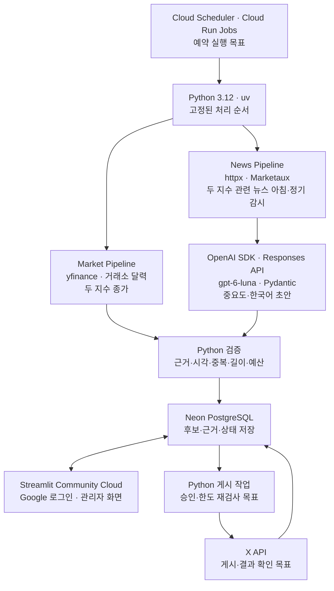

# 3주차 기술 조사 | XFolio 기술 스택과 월 비용

- 발표 주차: 2026-10-19~10-25 · 갱신일: 2026-10-25

> **XFolio:** 미국 지수와 중요한 뉴스를 한국어로 요약하고, 근거를 검증한 뒤 X에 게시하는 에이전트

## ❶ 무엇을 보여줄까? · 하루 최대 5글

| 편성 | 독자가 보는 내용 | 최대치 |
| --- | --- | ---: |
| 아침 지수 | S&P 500 + Nasdaq-100 종가·등락률을 **한 글**로 요약 | 1글 |
| 아침 뉴스 | Marketaux에서 찾은 **두 지수 관련** 중요 변화·원문 링크 | 2글 |
| 이후 추가 뉴스 | 정기 감시에서 새로 확인한 **두 지수 관련** 중요 변화 | 2글/일 |

**적격 뉴스가 없으면 채우지 않는다.** 아침·이후 뉴스는 한 Marketaux 흐름을 공유하고 같은 사건을 반복 게시하지 않는다. 반복 AI 총평은 생략한다.

**관리자 화면 역할:** 후보·근거·초안 확인 → 승인/보류 → 게시 결과 조회. **현재 검증:** 비공개 로그인·가상 초안 저장/조회. **남은 구현:** 실제 후보·승인·게시 결과 연결. 관리자 화면이 예약 작업을 실행하지는 않는다.

**예약 실행 상태:** 아래 Cloud Scheduler·Cloud Run Jobs와 비용표는 현재 문서의 **배포 목표 가정**이다. GitHub Actions 간소화안은 검토 중이며 아직 변경 결정이나 배포 결과가 아니다.

## ❷ 어떤 기술을 어디에 쓸까?

| 적용 위치 | 핵심 기술 | 현재 상태 |
| --- | --- | --- |
| 지수 | `yfinance` · `pandas-market-calendars` | 두 지수 조회·거래일 판정 구현 |
| 뉴스 | `httpx` · **Marketaux 한 곳** | 개발 수집기 구현; 두 지수 관련 질의·정기 감시 미검증 |
| AI·검증 | OpenAI Python SDK · Responses API · **`gpt-6-luna`** · Pydantic | 가상 6건 기계 검사 6/6; 실기사 품질·권한 미검증 |
| DB | Neon PostgreSQL | 가상 저장·중복 방지 확인; 실뉴스 상태 이전 전 |
| 관리자 | Streamlit Community Cloud · Google 로그인 | GitHub 기반 비공개 앱 배포·가상 조회 확인; 실제 승인 기능 전 |
| 예약 | Cloud Scheduler | 목표 구성, 등록 전 |
| 실행 | Cloud Run Jobs | Python 작업 컨테이너·Job 배포 전 |
| 게시 | X API | 실제 게시·결과 확인 전 |

**뉴스의 현재 결정:** Marketaux에서 S&P 500·Nasdaq-100 관련 후보 수집 → 같은 사건 묶기 → 관련성·중요도·근거 검사 → **아침 최대 2건 + 이후 하루 최대 2건**. 이후 **60분 감시는 시험 추천값**이다. 고정 5개 기업 감시는 제외한다. **실제 첫 페이지 표본:** 지수명 검색 아침 62건·21페이지 추산, 이후 17건; 무관·의견성 기사가 섞이고 지수명 검색의 거시 뉴스 누락 위험을 확인했다. **Free 범위·충분한 근거·공개/외부 AI 이용 권한은 합격 전**이다. [시험](../verification/news/두_지수_뉴스_질의와_감시_비용.md)

## ❸ 월 5만 원으로 운영할 수 있을까?

**확정 예산 상한: 50,000원/월.** 아래는 2번의 **Cloud Scheduler·Cloud Run Jobs 목표 구성**, 월 22일·최대 5글/일·60분 감시·후보 30건/일·Job마다 **2분 실행**을 가정한 부분 견적이다. $1=1,815원 계획 환산이며 실제 청구액은 아니다.

| 2번 기술 스택 | 월 예상 | 산정 기준 |
| --- | ---: | --- |
| `yfinance`·거래소 달력, Python 라이브러리 | **0원 가정** | 별도 유료 API 구독 없음. 실행 자원은 Cloud Run에 포함 |
| Marketaux Free | **0원 조건부** | 하루 100요청·요청당 3기사. 충분한 수집·이용 권한 미검증 |
| OpenAI `gpt-6-luna` | **약 319원** | 후보 30건/일·선정 최대 4건/일의 기존 토큰 가정, 월 $0.176 |
| Neon PostgreSQL | **0원 조건부** | Free 저장 1GB·연산 100 CU-hours/월 등 한도 내 |
| Streamlit Community Cloud·Google 로그인 | **0원 조건부** | 비공개 관리자 앱 1개 무료 범위 내; 장시간 무접속 시 절전 |
| Cloud Scheduler | **0원 조건부** | 결제 계정의 무료 예약 3개 이내 |
| Cloud Run Jobs | **약 4,869원** | 월 3,242회·1 vCPU·1GiB·회당 2분, 무료 자원 공제 후 $2.68272 |
| X API 게시·결과 확인 | **약 33,541원** | URL 포함 88글 × $0.20 + 지수 22글 × $0.015 + 결과 조회 110회 × $0.005 = $18.48 |
| **계산된 합계** | **약 38,730원** | **예산까지 약 11,270원** |

Cloud Run은 월 **3,242회 × 120초 = 389,040 vCPU-초**에서 무료 240,000초를 공제한 계산이다. 실행이 모두 **1분이면 합계 약 33,861원**, 모두 **3분이면 약 45,570원**이다. 후보 80건/일의 추가 가정에서 2분/회는 약 **39,049원**이다. 이미지 보관·비밀 조회·로그·외부 전송·백업과 무료 한도 초과분은 **실측 전으로 합계에서 제외**했다. GitHub Actions 간소화안의 비용은 이 표에 섞지 않았다. [월 비용 산식](../../docs/research/월_비용.md) · [클라우드 무료 조건](../../docs/research/저장소와_관리자_화면.md#2026-10-25-무료-클라우드-전환-조사)

> **예산의 관건은 뉴스 품질:** Marketaux Free는 100요청/일·3기사/요청. 새 지수명 검색은 과거 하루 **31~35요청 추산**으로 한도 아래였지만, 실업수당 용어 21기사 중 지수명과 교집합은 4기사뿐이었다. 이는 중요 뉴스 재현율이 아니다. **단순 지수명 필터의 누락과 짧은 발췌의 근거 부족**을 해결해야 한다. Basic 월 $29는 뉴스 구독료만 약 52,635원으로 예산 초과. [Marketaux 가격](https://www.marketaux.com/pricing) · [실측·한계](../verification/news/두_지수_뉴스_질의와_감시_비용.md)
