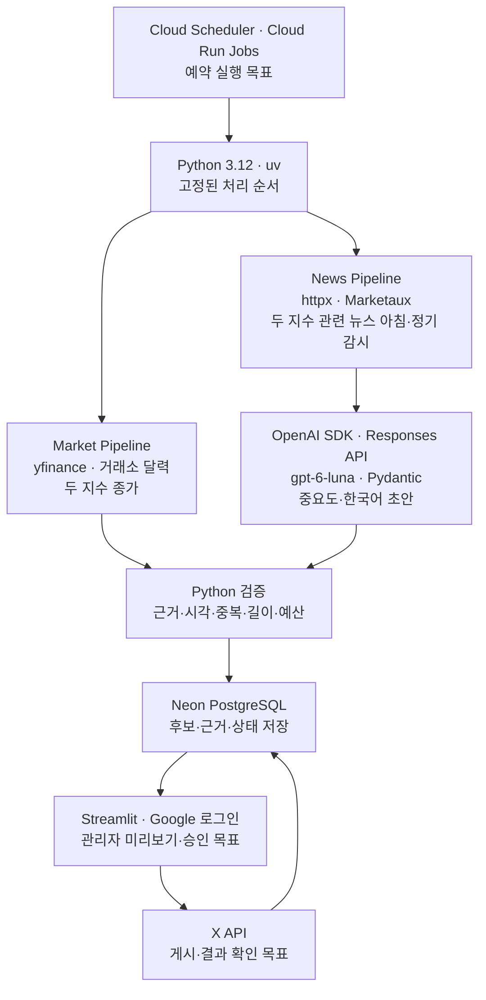

# 3주차 기술 조사 | XFolio 기술 스택과 월 비용

- 발표 주차: 2026-10-19~10-25 · 갱신일: 2026-10-25

> **XFolio:** 미국 지수와 중요한 뉴스를 한국어로 요약하고, 근거를 검증한 뒤 X에 게시하는 에이전트

## ❶ 무엇을 보여줄까? · 하루 최대 5글

| 편성 | 독자가 보는 내용 | 최대치 |
| --- | --- | ---: |
| 아침 지수 | S&P 500 + Nasdaq-100 종가·등락률을 **한 글**로 요약 | 1글 |
| 아침 뉴스 | Marketaux에서 찾은 **두 지수 관련** 중요 변화·원문 링크 | 2글 |
| 이후 추가 뉴스 | 정기 감시에서 새로 확인한 **두 지수 관련** 중요 변화 | 2글/일 |

**적격 뉴스가 없으면 채우지 않는다.** 아침·이후 뉴스는 한 Marketaux 흐름을 공유하고 같은 사건을 반복 게시하지 않는다. 반복 AI 총평은 생략한다.

**관리자 사이트:** Google 로그인 → 후보·보류 목록 → 출처·초안·검증 상세 → 승인/보류 → X 게시 결과·ID 조회. **현재:** 비공개 로그인과 가상 초안의 Neon 저장·조회 확인. **후속:** 실제 승인·게시 결과 연결.

## ❷ 어떤 기술을 어디에 쓸까?

| 적용 위치 | 핵심 기술 | 현재 상태 |
| --- | --- | --- |
| 지수 | `yfinance` · `pandas-market-calendars` | 두 지수 조회·거래일 판정 구현 |
| 뉴스 | `httpx` · **Marketaux 한 곳** | 개발 수집기 구현; 두 지수 관련 질의·정기 감시 미검증 |
| AI·검증 | OpenAI Python SDK · Responses API · **`gpt-6-luna`** · Pydantic | 가상 6건 기계 검사 6/6; 실기사 품질·권한 미검증 |
| DB·관리자 | Neon PostgreSQL · Streamlit · Google 로그인 | 비공개 로그인·가상 저장 확인; 승인 기능 전 |
| 예약·게시 | Cloud Scheduler · Cloud Run Jobs · X API | 배포·실제 게시 전 |

**뉴스의 현재 결정:** Marketaux에서 S&P 500·Nasdaq-100 관련 후보 수집 → 같은 사건 묶기 → 관련성·중요도·근거 검사 → **아침 최대 2건 + 이후 정기 감시에서 하루 최대 2건**. 고정 5개 기업 감시는 제외한다. BLS/SEC 직접 수집은 앞선 기술 시험으로 보존한다. **Marketaux Free의 범위·근거·한국어 X 공개/외부 AI 이용 범위는 아직 합격 전**이다. [현재 기술 구성](../../docs/기술_구성.md) · [뉴스 조사](../../docs/research/뉴스_수집.md)

## ❸ 월 5만 원으로 운영할 수 있을까?

**확정 예산 상한: 50,000원/월** · Marketaux **Free 사용을 전제로 한 조건부 예시**

| Cloud Run Job **각 실행시간** 가정 | 월 합계 | 5만 원까지 |
| --- | ---: | ---: |
| 모두 1분 | **약 33,861원** | 약 16,139원 |
| 모두 2분 | **약 39,420원** | 약 10,580원 |
| 모두 3분 | **약 46,720원** | 약 3,280원 |

월 22일·매일 최대 5글 기준 **X 생성·확인 $18.48 + Luna 약 $0.176**이다. 뉴스 주제가 바뀌어도 **게시 글 수 상한은 같아 X 견적은 같다.** Luna의 후보 30건/일·선정 4건/일과 Cloud Run **월 3,418회**는 기존 가정이며 새 질의·실행시간은 미측정이다. **작업 시간**은 컨테이너가 한 번 시작해 종료할 때까지다. $1=1,815원 계획 환산을 적용했다. [월 비용 산식](../../docs/research/월_비용.md)

> **예산의 관건은 뉴스 수집:** Marketaux Free는 100요청/일·3기사/요청이다. 기존 넓은 아침 검색만 138페이지가 필요하다는 표본 추산이 있어, **기업별 별도 질의를 없애도 무료 운영은 미입증**이다. Basic 월 $29는 뉴스 구독료만 약 52,635원으로 예산을 넘는다. 지수 관련 질의의 관련성·누락·호출량과 공개 이용 조건을 확인해야 한다. [Marketaux 가격](https://www.marketaux.com/pricing) · [이용 조건 조사](../../docs/research/데이터_이용_조건.md)

**다음:** 두 지수 관련 질의·정기 감시의 요청량/근거 샘플 → 이용 조건 확인 → 최대 5글 미리보기·실사용량 검증
