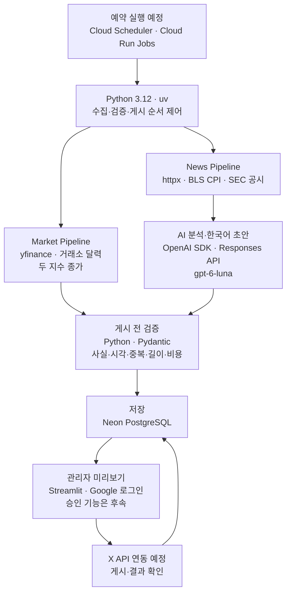

# 3주차 기술 조사 | XFolio 기술 스택과 월 비용

- 발표 주차: 2026-10-19~10-25 · 갱신일: 2026-10-25

> **XFolio:** 미국 시장의 확인된 변화를 한국어로 요약하고, 근거를 검증한 뒤 X에 게시하는 에이전트

## ❶ 무엇을 보여줄까? · 하루 최대 4글

| 편성 | 화면에 보일 결과 | 게시 기준 |
| --- | --- | --- |
| **아침 지수 1글** | S&P 500 + Nasdaq-100 종가·등락률 | 두 지수를 한 글로 요약 |
| **아침 뉴스 최대 1글** | 가장 중요한 변화 1건 + 원문 링크 | 확인된 사건이 있을 때만; 반복 AI 총평 생략 |
| **기업 뉴스 최대 2글** | NVIDIA·Apple·Microsoft 실적 공시부터 | 중요한 사건만, 한 사건당 한 글 |

관리자 화면에서 **근거 → 초안 → 보류 사유 → 게시 결과**를 확인한다. 실제 승인·X 게시 기능은 구현 전이다.

## ❷ 어떤 기술을 어디에 쓸까?

| 현재 상태 | 확인한 범위 |
| --- | --- |
| ✅ **구현·시험** | 지수 조회·BLS CPI 파서; Luna 가상 뉴스 6건 기계 검사 **6/6**; 비공개 관리자 로그인·Neon 가상 저장/조회/중복 방지 |
| ⚠️ **남은 검증** | 기본 주소의 로그인 후 로딩 문제; Luna **실제 SEC 공시** 문안 품질 |
| ⏳ **구현 전·보류** | SEC 자동 조회·실제 승인·X 게시; Cloud Run 배포·예약 실행은 보류 |

**역할 분담:** AI는 관련성을 판단하고 한국어 초안을 만든다. 게시 권한·사실 확인·한도 통제는 Python이 맡는다. 로컬 개발 DB는 SQLite다. [기술 구성](../../docs/기술_구성.md) · [OpenAI 시험](../verification/OpenAI_분석과_제공처_비교.md)

## ❸ 월 3만 원으로 운영할 수 있을까?

**현재 확정 상한 30,000원 → 계획 상한 45,000원으로 변경 제안**

| Cloud Run 작업 시간 가정 | 전체 예상 월액 | 현재 3만 원 상한과 비교 |
| --- | ---: | --- |
| 모두 **1분** | **25,579원** | ✅ 4,421원 여유 |
| 모두 **2분** | **31,138원** | ⚠️ 1,138원 초과 |
| 모두 **3분** | **38,438원** | ⚠️ 8,438원 초과 |

월 **22일·하루 최대 4글·Cloud Run 3,418회** 가정. 기본 게시·분석 비용은 **X API $13.97 + Luna $0.1232**로, X 자동 게시가 대부분을 차지한다. Cloud Run은 실행 시간에 따라 추가된다. **$1=1,815원**은 환율·세금 여유를 포함한 계획 환산이다.

BLS·SEC 자료 구독료는 0원, Neon·Streamlit·Scheduler는 무료 한도 안이라는 **조건부 계산**이다. MarketNewsAPI Pro 가입은 보류했다. 실제 클라우드 실행 시간·X 청구는 미측정이며, **45,000원은 확정 예산이 아닌 변경 제안**이다. [월 비용 산식](../../docs/research/월_비용.md) · [클라우드 가정](../verification/발표용_뉴스_제공처와_예산_가안.md)

**다음:** SEC 자동 조회 → Luna 초안·관리자 승인 연결 → Cloud Run·X 실사용량 측정
