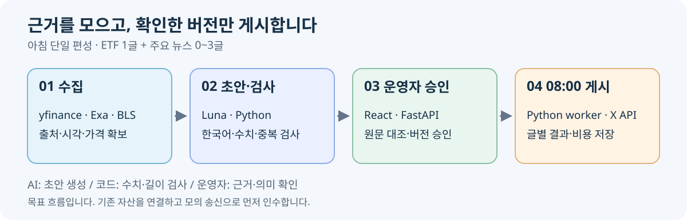
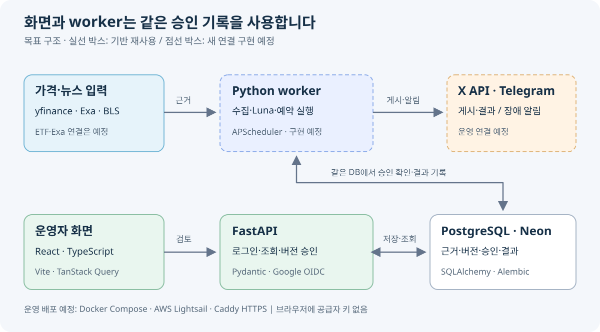

# XFolio · 4주차 개발 계획

**2026.11.01 발표** · 2026.10.31 갱신 · Asia/Seoul

> **미국 시장의 전일 마감과 주요 뉴스를, 아침 8시에 한 번 정리합니다.**

기획 → 서비스 흐름 → 관리자 화면 → 기술스택 → 개발 일정 → 현재 성과 → 준비 현황 → 시행착오 및 느낀점

---

## 01. 독자에게 무엇을 전달하나요?

### 08:00 KST · 하루 최대 4글

| 순서 | 게시할 내용 | 글 수 |
| --- | --- | ---: |
| **먼저** | **SPY · QQQ · DIA** 전일 종가·등락률을 한 번에 | **1글** |
| **이어서** | 미국 시장·업종·기업의 주요 뉴스, 사건별 요약과 출처 링크 | **최대 3글** |

**오후 게시 없이 아침 한 번에 집중합니다.** 적격 뉴스가 없으면 ETF만 게시하고, 필수 수집이 실패하면 보류합니다.

| ETF | 추종하는 지수 | 보여줄 값 |
| --- | --- | --- |
| **SPY** | S&P 500 | 종가 USD · 등락률 % |
| **QQQ** | Nasdaq-100 | 종가 USD · 등락률 % |
| **DIA** | Dow Jones Industrial Average | 종가 USD · 등락률 % |

‘전일’은 **최근 완료 미국 거래일**입니다. ETF 가격을 지수 포인트로 표시하지 않습니다.

---

## 02. 어떻게 게시되나요?

**AI는 초안을 만들고, 코드는 수치·길이·중복을 검사하고, 운영자는 근거를 확인합니다.**

| 07:00 | 07:30 | 07:45 → 07:55 | 08:00 |
| --- | --- | --- | --- |
| 수집 준비 | 근거·정보 기준 고정 | 검토 준비 → 승인 목표 | 예약 게시 시작 |

09:00부터는 신규 전송을 종료합니다. 실제 X 연결 전에는 **모의 송신으로 전체 흐름을 검증**합니다.

---

## 02-1. 관리자 페이지 · 무엇을 보고 승인하나요?

**운영자 1명이 Google로 로그인해 사용하는 비공개 검토 화면입니다.**

| 초기 메뉴 | 화면에서 확인할 것 | 운영자가 할 일 |
| --- | --- | --- |
| **대시보드** | 오늘 아침 진행 단계·SPY/QQQ/DIA·Exa/BLS 수집 상태·승인 대기·최근 발행·월 비용 | 조치할 편성으로 이동 |
| **콘텐츠 검토** | 편성 목록 → 상세: ETF 1글+뉴스 0~3글 미리보기와 원문 근거 비교 | 현재 버전 **전체 승인** 또는 사유를 적어 **보류** |
| **발행 내역** | 발행 목록 → 상세: 글별 전송 결과·확인된 X ID/링크·승인 이력 | 성공·부분 성공·결과 불명 확인 |

### 대시보드 → 검토 목록 → 근거 비교 → 전체 승인 → 발행 결과

검토 상세는 **왼쪽에 최대 4글 미리보기, 오른쪽에 선택한 글의 근거와 검사 결과**를 둡니다. 모바일에서는 세로로 배치합니다.

승인 전 **근거 지지·조건 보존·관련성/새 사실**을 확인합니다. 승인은 해당 버전의 예약이며, **08:00부터 worker가 전송**합니다. 승인과 게시 성공은 별도로 표시합니다.

**수집·운영·설정 상세 조회는 후속**입니다. 웹 문안 편집·설정 변경·직접 게시 버튼은 초기 범위에 포함하지 않습니다.

이 구성은 **제품 목표**입니다. 현재는 검토 목록/상세·로그인/승인 초기 구현이 있으며, 대시보드 분리·발행 조회·4글 승인은 추가 작업입니다. [관리자 화면 상세 정의](../../docs/specifications/관리자_화면_구조.md)

---

## 03-1. 화면과 서버 · 검토하고 승인하기

| 역할 | 사용할 기술 | 선택 이유 |
| --- | --- | --- |
| 관리자 화면 | **React 19 · TypeScript 5.9 · Vite 7 · CSS** | 근거와 초안을 한 화면에서 비교하고 타입으로 응답 관리 |
| 화면 데이터 | **TanStack Query 5** | 조회·로딩·실패·승인 후 재조회 처리 |
| API 서버 | **FastAPI · Uvicorn · Pydantic 2** | HTTP 계약과 입력 검사를 명확하게 정의 |
| 운영자 로그인 | **Google OIDC · Authlib · 서버 세션/CSRF** | 허용된 운영자만 정확한 버전을 승인 |

---

## 03-2. 수집·AI·저장 · 근거를 남기기

| 역할 | 사용할 기술 | 맡는 일 |
| --- | --- | --- |
| 실행 기반 | **Python 3.12 · uv** | 수집·계산·생성 코드와 의존성 관리 |
| ETF 가격 | **yfinance · pandas-market-calendars** | 종가 조회·거래일/휴장 확인, 등락률은 코드 계산 |
| 뉴스·지표 | **Exa API · HTTPX · 기존 BLS CPI 파서** | 뉴스 발견·본문 확보·공식 CPI 근거 확인 |
| 한국어 초안 | **OpenAI SDK · Responses API · Luna** | 구조화 초안 생성·사용량 기록 |
| 공통 저장 | **PostgreSQL(Neon) · SQLAlchemy Core · psycopg · Alembic** | 근거·버전·승인·발행 이력, DB 변경 관리 |

---

## 03-3. 예약·운영 · 같은 글을 두 번 보내지 않기

| 역할 | 목표 기술 | 현재 단계 |
| --- | --- | --- |
| 예약 작업 | **Python worker · APScheduler 3.x** | 구현 예정 |
| 전송·장애 알림 | **X API · Telegram Bot API** | X adapter·운영 알림 연결 예정 |
| 배포 | **Docker Compose · AWS Lightsail · Caddy HTTPS** | 운영 배포 예정 |
| 검증·CI | **pytest/Ruff · Vitest · Playwright · GitHub Actions** | 기존 시험·CI 정의 재사용 |

---

## 03-4. 전체 구조 · 역할을 어떻게 나누나요?

**화면은 검토·승인, worker는 수집·생성·예약 게시를 담당합니다.**

그림은 **목표 구조**이며 실제 운영 연결은 미완료입니다. 세부 버전·구현 상태는 [기술 구성](../../docs/기술_구성.md)에서 확인합니다.

---

## 04. 어떤 순서로 개발하나요?

### 입력 → 초안 → 승인·예약 → 통합 시연

| 주차 | 집중할 작업 | 주차 말에 보여줄 결과 |
| --- | --- | --- |
| **5주차 · 11/2~8** | Exa 어댑터·ETF 전환·입력 계약 | 출처와 시각이 있는 수집 결과 |
| **6주차 · 11/9~15** | BLS·근거 검사·뉴스 3건·4글 계약 | ETF 1글+뉴스 0~3글의 저장된 초안 |
| **7주차 · 11/16~22** | 관리자·발행 조회·worker | 정확한 버전 승인과 예약 처리 |
| **8주차 · 11/23~29** | 모의 송신·통합 검증·최종 발표 | 정상·부분 성공·결과 불명·중복 차단 시연 |

| 개발 시간 | 확정 여부 |
| --- | --- |
| 5~6주차 **30h** | 확정 |
| 7~8주차 **30h** | 가정 |
| 합계 **핵심 56h + 여유 4h = 60h** | 11/15 잔여량 재산정 |

현재 AM 최대 3글·DB 제약을 **4글로 바꾸는 작업**을 포함했습니다. 11/24 기능 동결은 제안입니다. 실제 X·AWS·Telegram 운영과 Fed·BEA·SEC 자동 수집은 후속입니다. [WBS](../../docs/planning/작업_분해_WBS.md)

---

## 05. 지금 어디까지 했나요?

| 영역 | 확인한 성과 | 다음 연결 |
| --- | --- | --- |
| 가격 | 기존 두 지수 조회·거래일 검사 | SPY·QQQ·DIA ETF 전환 |
| 뉴스 | Exa 검색 3회+본문 1회, BLS 제한 검사 | Exa 제품 어댑터·아침 뉴스 3건 |
| 관리자 | 검토·승인, API 8개·DB 8테이블, 로컬 Google 로그인 | 대시보드·발행 조회·4글 승인 |
| 발행 | 기존 가상 미리보기·승인 기반 | worker·모의 송신·X 실제 연동 |

**10/29 시험 기록: Python 419건 · UI 10건 · Playwright 2건 통과.**

기존 구현·모의 조건의 결과이며 새 ETF·뉴스 3건·실제 X 성공을 뜻하지 않습니다. 이번 문서 수정에서 제품 시험을 재실행한 수치도 아닙니다.

**시행착오:** 로그인 callback·로컬 HTTPS 지연을 해결했고, AI 형식 검사와 운영자의 사실 확인을 분리했습니다. [구현 근거](../logs/2026-10-29_실자료_검사와_관리자_승인_연결.md)

---

## 06. 비용과 준비 현황

| 월 22일·최대 4글 기준 | 부분 견적 |
| --- | ---: |
| X 게시·결과 확인 | **$13.97** |
| X + AI $2 + 서버 $7 + 예비액 10% | **약 45,860원** |
| 월 50,000원까지 남는 금액 | **약 4,140원** |

무료 Exa·Neon, ETF 글은 출처명만 쓰는 가정입니다. 도메인·백업 등은 미포함이며 ETF 글에도 URL을 넣으면 약 53,985원입니다. [계산 조건](../../docs/research/월_비용.md)

## ⭐ 11월 1일까지 준비할 것

| 구분 | 확인한 것 |
| --- | --- |
| 계정·연결 | GitHub 읽기·X 키 로딩·Telegram 테스트 수신 |
| 데이터·관리자 | Exa 표본·Neon·로컬 Google 로그인 |
| 비용·인프라 | 개발용 비용 계획·AWS 계정 선택 |

**차주 첫 작업: Exa·ETF 입력 계약을 확인하고 수집 경로를 연결합니다.**

[발표 대본·예상 질문](4주차_발표_대본.md) · [준비 체크리스트](../plans/11월_1일_발표와_서비스_준비.md) · [요구사항](../../docs/요구사항.md)

---

## 07. 시행착오 및 느낀점

### API 탐색 · 검색 키워드를 도움받고 직접 찾아보기

뉴스 수집 API를 찾는 데 예상보다 많은 시간이 들었습니다. 에이전트와 GPT에 원하는 조건을 설명하며 추천받았지만, 원하는 답을 얻기가 어려웠습니다. 오히려 **직접 구글링했을 때 원하는 API를 빠르게 찾았습니다.**

앞으로는 **GPT로 원하는 API의 조건과 검색 키워드를 정리하고, 직접 검색해 확인하는 방식**이 더 효율적일 것 같습니다.

### 개발의 주도권 · 큰 그림과 판단은 내가

AI의 추천을 따라 계속 진행하다 보니, 어느 순간 주객이 전도되어 **제가 AI에 끌려가는 느낌**이 들었습니다.

추천안을 계속 받아들이기보다 **먼저 내가 만들고 싶은 서비스의 큰 그림을 그리고, 필요한 기능과 우선순위를 직접 판단해야겠다**고 느꼈습니다.

### 작업 방식 · 계획과 실행 나누기

| 단계 | 사용 모델 |
| --- | --- |
| **계획 모드** | **6-astra** |
| **계획 실행** | **6.1-sol** |
