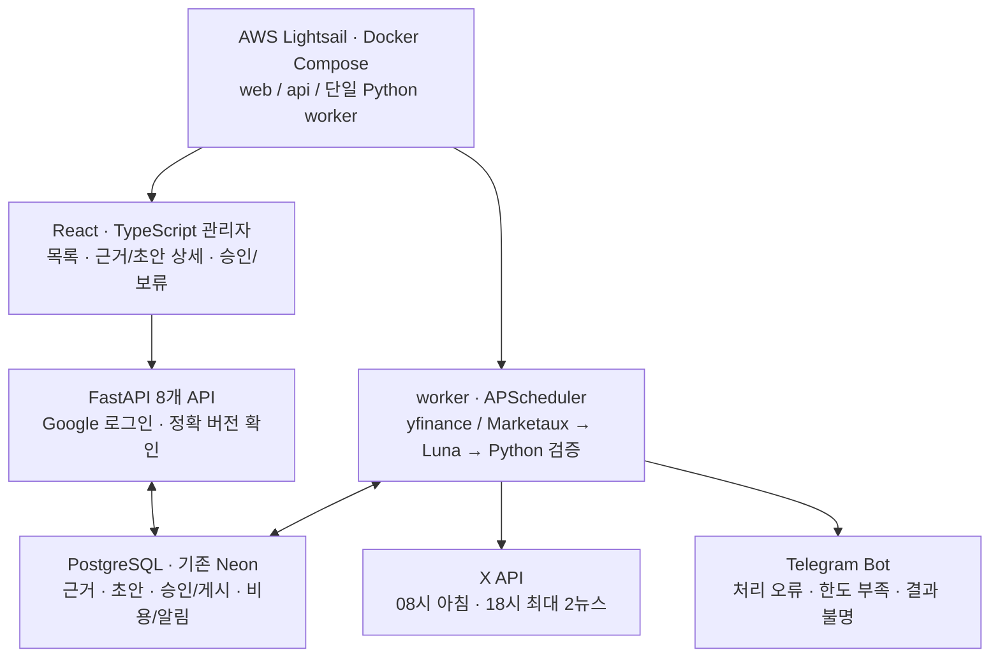

# 4주차 발표 | 풀스택 포트폴리오 · 2주 MVP

- 기간: 10/26~11/1 · 갱신: 2026-10-28, Asia/Seoul

> **미국 시장 수집부터 검토·승인·정시 발행·장애 알림까지 운영하는 풀스택 서비스**

## ❶ 확정 기획 · 하루 두 번 발행

| 편성 | 독자가 보는 내용 | 최대량 |
| --- | --- | ---: |
| **08시 아침** | S&P 500·Nasdaq-100 종가/등락률 1글 + 중요 뉴스·원문 링크 | 최대 3글 |
| **18시 추가 뉴스** | 낮 감시에서 모은 새 중요 사건을 선별해 일괄 발행 | 최대 2글 |

**하루 최대 5글 · 적격 뉴스가 없으면 생략 · 같은 사건/AI 총평 반복 제외**

낮에는 09:00~17:00 매시간과 17:30에 후보를 수집한다. 17:45까지 마지막 수집·근거·후보를 동결해 **18:00에 최대 2건**을 발행한다. 발견 즉시 게시하지 않는다. 저녁 신규 전송 마감 **18:10**은 MVP 설계값이다.

| 역할 | 선택 | 선택 이유 |
| --- | --- | --- |
| 프론트 | **React·TypeScript·Vite** | 검토 업무와 로딩·오류·승인 충돌을 직접 구현 |
| API·DB | **FastAPI·Pydantic·PostgreSQL** | 명확한 계약·버전 승인·트랜잭션·이력 |
| 수집·AI | 기존 Python·yfinance·Marketaux·**gpt-6-luna** | 기존 자산 재사용, 근거·숫자·시각은 코드로 재검증 |
| 배포 | **Docker Compose·AWS Lightsail 1대**, DB는 Neon 유지 | 2주 안에 재현 가능한 배포, 인프라 수 제한 |
| 알림 | **Telegram 발신 전용 bot** | 자동 검증/승인 오류·quota/예산·중요 장애에 조치 요청 |

관리자는 **2화면·8API**, 운영 저장은 8개 단위, worker는 1개로 고정한다. Telegram에서 승인/게시 명령은 받지 않는다. 기존 Streamlit은 가상 시험 이력으로 보존한다.

## ❷ 개발 일정 · 15시간씩 2주

| 주차 | 구체적 작업 | 완료 결과 |
| --- | --- | --- |
| **4주차 · 11/1까지** | X·Telegram·AWS/도메인 준비, 뉴스 이용 조건·시험 입력·API/DB 계약 | 개발 착수 체크리스트 |
| **5주차 · 11/2~11/8 · 15h** | React/FastAPI 2h · DB 3h · 인증/API 3h · 2화면 3h · 아침/AI 3h · 여유 1h | **로그인→아침 0/1/2뉴스 검토→정확한 버전 승인** |
| **6주차 · 11/9~11/15 · 15h** | worker/18시 3h · X/비용 3h · Telegram 2h · AWS/CI 3h · 통합/E2E 3h · 여유 1h | **reviewed MVP 배포·정시 발행/중복/실패/알림 시험** |
| 7주차 | 최소 5미국 거래일의 실제 예약·검토, 장애·누락 시험 | auto 활성화 판단 |
| 8주차 | 결함·운영 절차·시연·포트폴리오 근거 정리 | 최종 결과 |

**2주에서 제외:** RDS/ECS·Redis/Celery·Terraform·완전 자동 CD·고급 차트·다중 역할·문안 편집·Telegram 대화형 기능. 핵심은 승인 경쟁·중복 발행 방지·응답 불명 보류·한도 차단·장애 알림이다.

**예산 상한 5만 원:** 1GB AWS VM과 기존 최대 X+AI 가정의 소계는 약 **46,566원**. 도메인/백업·메모리는 미검증이며 2GB가 필요하면 약 **55,641원**으로 초과한다. [비용 조건](../../docs/research/월_비용.md)

## ❸ 현재 상태 · 재사용과 새 구현을 구분

| 재사용할 실제 자산 | 2주 동안 새로 연결 |
| --- | --- |
| 두 지수 조회·거래일/등락률 계산 | 아침/18시 제품 worker |
| Marketaux 개발 수집기·근거 모델·SQLite 커서 | 새 질의·권한 확인·PostgreSQL 운영 상태 |
| Luna 가상 6건 기계 검사 6/6·가상 미리보기 | 실제 후보 모델·0/1/2뉴스 구성·버전 검증 |
| Neon 가상 저장·기존 Streamlit 로그인 시험 | React·FastAPI 인증/승인·X·Telegram·AWS |

**시행착오 반영:** 지수명 검색만으로 뉴스 품질을 보장하지 않음 → 고정 사례·근거 대조. 기존 예약 관측 지연/누락 → 실제 시각·미완료를 기록. 모델 형식 성공 → 사실 검토와 분리.

**MVP 완료 ≠ 무인 운영 합격.** 기본은 dry_run→reviewed이고 auto는 5거래일·장애 시험 후다. Marketaux/지수 공개·AI 이용 조건과 X 인증이 미충족이면 허용 fixture·모의 전송으로 연결하고 실제 운영 성공과 구분한다.

## ⭐ 개발 전 준비

- **기존 사용 근거 있음:** GitHub·OpenAI·Marketaux·Neon·Google 로그인. 새 구성의 키/권한 유효성은 재확인
- **준비 확인 필요:** X 계정/게시용 인증, Telegram bot token·개인 chat, AWS 계정/결제·도메인/DNS
- **차주 첫 작업:** API·DB 계약 → React/FastAPI 골격 → 인증된 아침 검토 흐름

[확정 요구사항](../../docs/요구사항.md) · [2주 우선순위](../plans/개발_우선순위.md) · [API·저장·시험 계약](../verification/2주_MVP_구현_계약.md) · [발표 대본·예상 질문](4주차_발표_대본.md)
