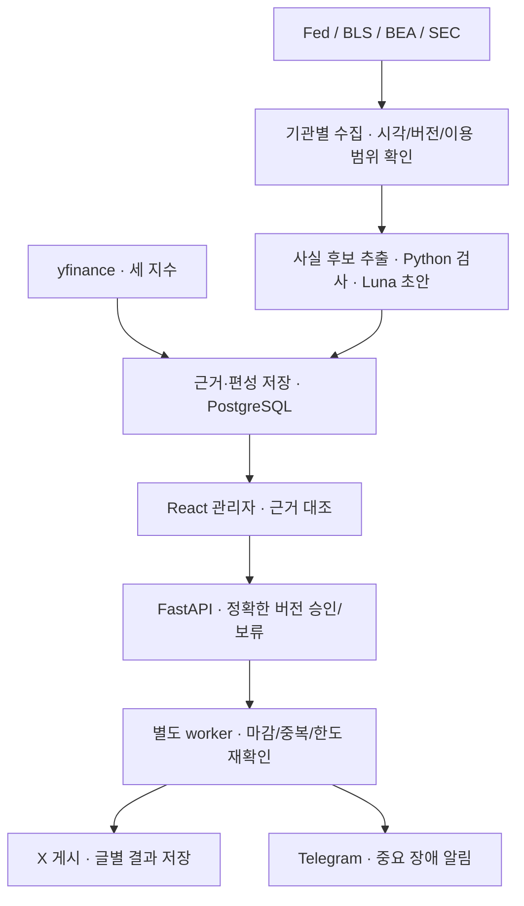

# 4주차 발표 | 공식 자료 범위 확정과 개발 계획

- 현재: **4주차 작업 중 · 10/26~11/1**
- 갱신: 2026-10-30, Asia/Seoul · 발표일: 미정

> **세 지수와 공식 발표·공시를 수집해, 근거를 확인하고 승인한 한국어 요약을 X에 게시하는 서비스**

이번 주는 수집 범위와 구현 계획을 구체화하는 단계다. 초기 관리자·인증·CPI 검증 성과는 있고, 전체 수집·게시 서비스는 개발 예정이다.

## ❶ 기획 확정 · 무엇을 수집하고 요약하나

| 구분 | 확정 범위 |
| --- | --- |
| 시장 | **S&P 500·Nasdaq-100·다우존스 산업평균지수** |
| 공식 발표 | **Fed·BLS·BEA**의 정책·주요 경제지표 |
| 기업 공시 | **SEC 주요 기업 10개로 시작**, 같은 구조로 20개까지 확장 |
| 요약 대상 | **실적·인수합병·정책·주요 경제지표** |

**변경 이유:** 기존 뉴스 API의 요약 근거·이용 조건·수집 범위 문제가 남아, 공식 발표와 공시 중심으로 범위를 확정했다. Marketaux는 이전 실험 자산으로 보존한다.

| 구현 추천안 · 세부 확정 전 | 초기 지원 | 후속 확장 |
| --- | --- | --- |
| Fed | FOMC 정책 성명 | 연설·의사록 |
| BLS / BEA | CPI / PCE | 고용 / GDP |
| SEC | 미국 국내 발행인 8-K의 실적·M&A와 관련 첨부 | 외국 발행인·범용 공시/표 해석 |

기업 **10개 명단·CIK는 미정**이다. 매일 수집 확인은 가능하지만 발표가 매일 생기는 것은 아니므로, 정상 수집 후 적격 뉴스가 0건일 수 있다. 공식 사이트 공개와 모든 기업 첨부물의 자유로운 AI 이용은 구분한다.

## ❷ 제품 흐름 · 수집→근거→검토→게시

**목표 구성도**다. 4기관 수집·다우·worker·X·Telegram·AWS 제품 배포는 아직 완성하지 않았다.

| 편성 | 독자가 보는 내용 | 한도 |
| --- | --- | ---: |
| **08시 아침** | 세 지수 종가·등락률 **1글** + 중요 발표·공시와 원문 링크 | 최대 3글 |
| **18시 추가 뉴스** | 낮에 확인한 새 중요 사건 | 최대 2글 |

하루 최대 5글이다. 아침은 새 완료 미국 거래일 기준, 저녁은 KST 날짜가 미국 거래일인 날에 운영한다. 정상 뉴스 0건이면 아침은 지수 글만, 저녁은 게시하지 않는다. **수집 실패를 정상 0건으로 처리하지 않는다.**

| 검토·게시 원칙 | 목표 동작 |
| --- | --- |
| 근거 | 발표/접수·최초 확보 시각과 원문 버전을 보존, 정정 시 재검토 |
| 승인 | 아침·저녁 각각 편성 전체의 정확한 버전을 승인 |
| 수정 | 전체 보류→기존 근거 내 CLI 수정→새 버전 검사·재승인, 첫 전송 전만 허용 |
| 저녁 | 17:30 공개 기준·17:45 근거 동결·18:00 목표·18:10 신규 전송 마감 |
| 결과 불명 | 자동 재전송을 멈추고 결과 대조·중복 방지 |

기본은 **dry_run→reviewed**다. auto 전환은 별도 최소 5미국 거래일·장애 시험 이후 판단한다.

## ❸ 4주차에 정리한 설계와 실제 진행

| 항목 | 현재 상태 | 남은 작업 |
| --- | --- | --- |
| 개발 문서 | 요구사항·WBS·API·ERD·IA·입력 책임·시스템/시퀀스 정리 | 구현하면서 계약과 실제 동작 대조 |
| 관리자 | React/FastAPI 초기 목록·상세·승인 구현 | 대시보드·발행 내역·새 출처/근거 표시 확장 |
| 인증 | **로컬 HTTPS에서 실제 Google 로그인·세션 유지·로그아웃 검증** | 운영 도메인·배포 환경 검증 |
| BLS | **CPI의 제한된 두 주장 검사·PM 편성·관리자 승인 연결** | 4기관 공통 입력과 AM 편성으로 확장 |
| 지수 | S&P 500·Nasdaq-100 실제 조회·거래일/등락률 계산 | 다우 추가·같은 거래일·세 지수 글 길이 검사 |
| 제품 운영 | 설계 단계 | 실제 수집 어댑터·worker·X·Telegram·AWS |

**시험 범위:** 10/29 기록의 pytest 419건·UI 10건·Playwright 2건 통과. 실제 BLS 1회 조회는 모의 생성·격리 DB/API로 확인했으며 마감 후 입력은 차단됐다. 정상 승인 E2E는 고정 자료·모의 모델·통제 시각·Google 대역을 사용했다. 실제 Google 로그인 시험은 별도다. 새 실제 Luna 품질·X 게시 성공을 뜻하지 않는다.

[실자료·승인 검증 근거](../logs/2026-10-29_실자료_검사와_관리자_승인_연결.md) · [실제 로그인 근거](../logs/2026-10-29_Google_callback과_로그인_검증.md)

관리자는 **6개 상위 메뉴를 설계**했다. 우선 대시보드·콘텐츠 검토·발행 내역 3메뉴를 연결하고, 수집 현황·운영 현황·설정 조회는 후속으로 둔다. 현행 8API→1단계 목표 10API→확장 목표 13API이며, 2화면으로 고정하지 않는다. 기존 와이어프레임은 검토 완료했으나 새 출처·다우·승인 필드는 아직 HTML 예시에 반영하지 않았다.

**선택 기술:** React·TypeScript·Vite / FastAPI·Pydantic / PostgreSQL·기존 Neon / Python·Luna / 별도 worker·APScheduler / Docker Compose·AWS Lightsail. Streamlit은 이전 시험 자산으로 보존한다.

## ❹ 이후 개발 계획 · 30시간은 중간 목표

**현재는 4주차다. 아래 5~8주차 내용은 앞으로의 계획이다.**

| 시점 | 시간 | 우선 작업·주차 말 목표 |
| --- | ---: | --- |
| **4주차 남은 기간** | 별도 | SEC 10개 명단·최소 지원 유형·허용 표본 확인, 설계와 발표 정리 |
| **5주차 · 11/2~11/8** | **15h 확정** | 공통 계약·BLS/Fed·기업 목록·다우. 어댑터와 세 지수 입력 기반 |
| **6주차 · 11/9~11/15** | **15h 확정** | BEA/SEC·20기업 확장 시험·AM 편성 연결 시작 |
| **7주차 · 11/16~11/22** | 15h 가정 | AM 연결·검토/승인·발행 조회·worker·결함 수정 |
| **8주차 초 · 11/23~11/24** | 8h 가정 | 모의 전송·실패 처리·핵심 인수 시작, 기능 동결 추천 |
| **8주차 후반 · 11/25~11/29** | 7h 가정 | 통합 인수·회귀·결함 수정·최종 발표 |

| 작업량과 가용 시간 | 해석 |
| --- | --- |
| 전체 잔여 작업 **기준 79h · 예상 79~126h** | 공식 4기관·다우 추가를 반영한 추정, 완료 보장 아님 |
| 확정 30h + 추가 30h 확보 가정 = **60h** | 7~8주차 시간은 아직 확정하지 않음 |
| 추천 배치 **핵심 59h + 여유 1h** | 공식 자료→AM 검토·승인→모의 전송·인수 우선 |
| 나머지 확장/운영 작업 **20h** | PM·나머지 메뉴·Telegram·CLI 편의·AWS·실제 연동 인수 |

전체 목표를 같은 마감에 넣으려면 가용 60시간 가정보다 **최소 19시간 추가**가 필요하다. 후속 기능을 취소한 것은 아니며, 실제 진척과 추가 시간에 따라 조정한다. 세부 배정·의존성은 [WBS](../../docs/planning/작업_분해_WBS.md)에서 관리한다.

## ❺ 시행착오와 다음 작업

| 배운 점 | 이번 계획에 반영한 내용 |
| --- | --- |
| 뉴스 API 선택만으로 근거·이용 조건이 해결되지 않음 | 공식 자료 중심으로 범위 확정, 출처별 사용 범위 확인 |
| JSON 형식 성공은 사실 정확성을 보장하지 않음 | 수치·기간·조건 검사와 운영자의 의미 검토 분리 |
| 정상 0건과 수집 실패는 다름 | 기관·기업별 완료 범위/커서 기록, 부분 실패 시 보류 |
| 기능 확장 후 기존 30h 계획은 맞지 않음 | 재사용 자산을 빼고 잔여 작업 재산정, 8주차 초까지 개발 계획 |

**월 예산 상한은 5만 원**이다. 이전 약 46,566원은 비교용 부분 견적이며, 새 4기관·SEC 자료량과 AI 토큰·VM 메모리·도메인/백업을 반영한 확정 총액이 아니다. [비용 가정과 미확인 항목](../../docs/research/월_비용.md)

다음은 **① SEC 기업 10개·CIK와 최소 지원 유형 대조 → ② 기관별 허용 표본 확보 → ③ 공통 입력 계약·BLS 재사용 구현** 순서다. X 인증·Telegram·AWS/도메인은 해당 실제 연동 전에 준비하며 실제 외부 게시는 명시적 승인 범위에서 수행한다.

[요구사항](../../docs/요구사항.md) · [수집 설계](../../docs/specifications/공식_발표와_공시_수집_설계.md) · [API·ERD·IA·시스템 설계](../../docs/specifications/README.md) · [발표 대본·예상 질문](4주차_발표_대본.md)
