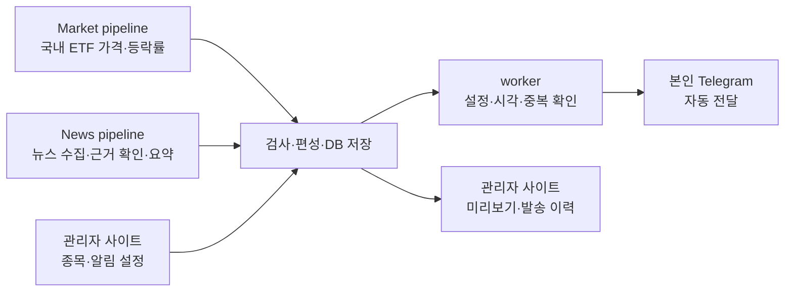

# XFolio · 5주차 개인용 뉴스레터 전환

**초안 · 발표일 미확정(5주차: 2026.11.02~11.08)**

작성·갱신: **2026.11.01 · Asia/Seoul**

> **내가 관심 있는 국내 상장 해외 ETF와 주요 뉴스를, Telegram으로 정해진 시간에 받아봅니다.**

기획 변경 → 새 서비스 흐름 → 종목·알림·관리자 → 확인한 결과 → 남은 작업

이 초안의 성과는 **11/1까지 확인한 내용**입니다. 5주차 개발 결과는 발표 전에 실제 수행 근거로 갱신합니다.

---

## 01. 왜 기획을 변경했나요?

**공개 게시에 필요한 기사·시세 이용 조건을 검토하면서, 우선 제가 직접 사용할 수 있는 개인용 뉴스레터로 범위를 바꿨습니다.**

| 항목 | 기존 기획 | 변경한 기획 |
| --- | --- | --- |
| 목적 | 미국 시장 정보를 공개 공유 | 내 관심 ETF와 뉴스를 정기 확인 |
| 전달 | X 공개 게시 | 본인과 봇의 1:1 Telegram 대화 |
| 가격 대상 | 미국 상장 SPY·QQQ·DIA | 한국 상장 해외 ETF 기본 3종목 |
| 시각 | 아침 08:00 한 번 | 08:00·14:00 기본, 16:00 선택 |
| 전송 | 운영자 검토·버전 승인 | 검사 통과 후 자동 전송 |
| 관리자 | 초안 검토·승인 중심 | 종목·알림 설정과 결과 확인 중심 |

개인용 전환도 제공처·원매체의 수집·AI 입력·저장·전달 조건 확인은 필요합니다. **개인용이면 저작권 문제가 모두 해결된다는 뜻은 아닙니다.**

---

## 02. 서비스는 어떻게 동작하나요?

**수집·검사·정리 흐름을 활용하면서, 국내 시세와 Telegram 전달을 연결합니다.**

그림은 **목표 흐름**입니다. 국내 가격 연결·새 관리자 기능·예약 worker·Telegram 운영 전송은 구현 전입니다.

| 흐름 | 맡는 일 | 활용할 기반 |
| --- | --- | --- |
| **Market** | 종가·장중 가격 수집, 한국 거래일 확인, 코드로 등락률 계산 | KIS 조건부 채택·기존 가격 검사 경험 |
| **News** | 관련 뉴스 발견, 근거·중복 확인, 한국어 요약 | Exa·기존 BLS CPI·AI 생성/검사 자산 |
| **공통 전송** | 편성 저장, 예약 실행, 중복 방지, 결과 기록 | Python worker·APScheduler·PostgreSQL·Telegram 목표 |

APScheduler는 **작업 시간을 맞추는 알람**, worker는 **실제 작업을 수행하는 Python 프로그램**입니다. Telegram에서는 뉴스를 받고, 설정과 이력은 관리자 사이트에서 확인합니다. 매회 승인 절차는 두지 않습니다.

---

## 03. 어떤 종목을 받아보나요?

### 기본 3종목 · 활성 종목 최대 10개

| 종목 | 코드 | 표시할 가격 |
| --- | --- | --- |
| TIGER 미국S&P500 | `360750` | 원화 ETF 시장가격 |
| KODEX 미국나스닥100 | `379810` | 원화 ETF 시장가격 |
| TIGER 미국배당다우존스 | `458730` | 원화 ETF 시장가격 |

관리자 화면에서 종목을 검색·확인해 추가하고, 알림 포함 여부와 표시 순서를 바꾸는 기능을 만들 계획입니다. **현재 3개를 포함해 총 10개**이며 중복 등록과 한도 초과는 서버에서 막습니다.

뉴스는 종목 수와 관계없이 **전체 최대 3건**입니다. 미국 시장·업종·주요 기업·경제지표 중 관심 ETF와 관련 있는 사건을 선정합니다. BLS는 물가 관련 뉴스의 **공식 CPI 근거**로 활용합니다.

---

## 04. 언제 무엇을 보내나요?

| 시각 KST | 내용 | 발송 기준 |
| --- | --- | --- |
| **08:00 고정** | 최근 완료 한국 거래일 종가·등락률 + 새 뉴스 0~3건 | 월~금 |
| **14:00 기본 켜짐** | 장중 가격·전 거래일 종가 대비 등락률 | 한국 거래일 |
| **16:00 선택·기본 꺼짐** | 당일 확정 정규장 종가·등락률 | 한국 거래일 |

**오전 8시의 가격은 국내 ETF의 최근 완료 거래일 종가입니다.** 그날 새벽 끝난 미국장 가격과 같은 시점으로 설명하지 않습니다. 가격 기준일과 뉴스 발행 시각을 따로 보여줍니다.

한국 휴장일의 평일 아침에는 가격 기준일·휴장 안내와 새 뉴스를 전달하고, 오후 가격 알림과 주말 발송은 중지합니다. 늦거나 시각을 확인할 수 없는 가격은 현재가로 보내지 않습니다.

---

## 05. 관리자는 무엇을 하나요?

### 종목 설정 → 알림 설정 → 자동 실행 → 결과 확인

| 메뉴 | 할 일 |
| --- | --- |
| 대시보드 | 다음 알림·수집 상태·지연·최근 장애 확인 |
| 뉴스레터 | 가격·요약 미리보기, 출처와 제외 사유 확인 |
| 발송 이력 | 실제/모의 구분, 성공·실패·부분 성공·결과 불명 확인 |
| 관심 종목 | 종목 검색·추가·활성/비활성·순서 변경 |
| 알림 설정 | 14시·16시 켜기/끄기, 전체 자동 발송 일시 중지 |

기존 Google 로그인과 관리자 기반을 활용합니다. 새 화면·API는 구현 예정이며, 공급자 키·봇 토큰은 서버에서만 관리합니다.

---

## 06. 지금 어디까지 확인했나요?

### 11/1 기준 · 확정한 기획과 실제 검증을 구분합니다

| 항목 | 현재 결과 |
| --- | --- |
| 기획·정책 | 국내 ETF·총 10종목·알림 시간·자동 전송 확정, 기준 문서 반영 |
| 종목 식별 | **KIS 공개 마스터에서 3종목의 코드·명칭·ISIN 일치 확인** |
| 증권 API | 한국투자증권 계좌 있음, **Open API 신청 필요** |
| 실제 가격 | 인증 종가·장중 시세·기준시각·분배락 표본 **검증 대기** |
| 이용 조건 | 개인 Telegram 전달·AI 입력·보관 범위 **확인 대기** |
| 제품 연결 | 국내 시세·종목/알림 관리·worker·Telegram 운영 전송 **구현 전** |

**11/1 회귀 시험: Python 571건 통과 · 48건 건너뜀.** 새 공개 마스터 검사 3건이 포함되며, 건너뛴 PostgreSQL 시험은 DB 인수 완료를 뜻하지 않습니다. 이번 발표 초안 작성에서 제품 시험을 다시 실행한 수치는 아닙니다.

종목 마스터는 **어떤 종목인지 확인하는 자료**입니다. 이를 조회했다고 실제 가격이나 Telegram 발송까지 성공한 것은 아닙니다.

[실제 표본 검증](../verification/market/국내_ETF_API_표본_검증.md) · [11/1 수행 기록](../logs/2026-11-01_개인용_뉴스레터_전환.md)

---

## 07. 다음에는 무엇을 개발하나요?

| 주차 | pipeline 중심 개발 방향 |
| --- | --- |
| **5주차 · 11/2~8** | Market의 KIS 실제 시세·국내 종목 계약, News의 이용 조건·선정 기준 확인 |
| **6주차 · 11/9~15** | 국내 종가·장중 가격과 뉴스 최대 3건을 시간대별 편성으로 저장 |
| **7주차 · 11/16~22** | 관리자 종목·알림·이력과 자동 발송 worker 연결 |
| **8주차 · 11/23~29** | Telegram 모의 송신·장애/중복 검증 후 허용된 실제 수신·운영 인수 |

5주차는 **15시간**을 확보했습니다. 우선 Open API 신청 후 세 ETF의 종가·장중 시각을 검증합니다. 계정·조건 확인을 기다리는 동안 입력 계약과 무통신 시험은 진행하되 실제 시세 검증을 완료한 것으로 보지 않습니다.

기존 X 공개 게시·승인·PM 차단 코드와 시험은 이력으로 보존하고, 새 국내 시간대·자동 전송 계약으로 이행합니다. 세부 시간·의존성은 [WBS](../../docs/planning/작업_분해_WBS.md)를 따릅니다.

---

## 발표 전 갱신할 항목

- [ ] 실제 발표일과 5주차에 수행한 작업을 반영하기
- [ ] Open API 신청·종가/장중 표본·이용 조건의 완료/대기 상태 갱신하기
- [ ] 실제 만든 화면·응답·모의 전송 결과만 시연 자료로 추가하기

[요구사항](../../docs/요구사항.md) · [운영 정책](../../docs/운영_정책.md) · [관리자 화면](../../docs/specifications/관리자_화면_구조.md) · [변경 결정](../discussions/2026-11-01_개인용_Telegram_뉴스레터_전환.md)
