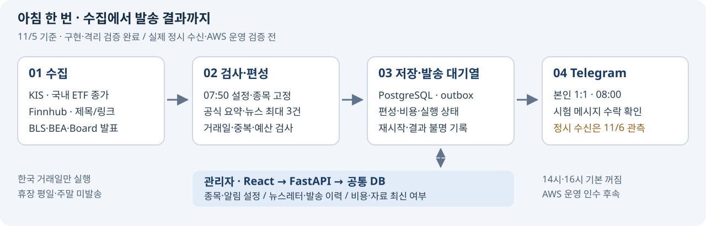

# XFolio · 5주차 아침 뉴스레터 구현

**2026.11.08(일) 발표 · 5주차 11/2~11/8 · 성과 기준 11/5, Asia/Seoul**

작성: 2026.11.01 · 갱신: **2026.11.05** · [5분 발표 대본](5주차_발표_대본.md)

> **국내 ETF 가격과 뉴스를 모아, 관리자 설정에 따라 본인 Telegram으로 보내는 흐름을 구현했습니다.**

**구현·격리 시험 완료 → 실제 API·유료 요약 소량 확인 → 11/6 정시 수신 관측 예정 → AWS 운영 인수 후속**

서비스 → 이번 주 구현 → 뉴스 선정 → 관리자 → 검증 → 다음 단계

---

## 01. 무엇을 만드는 프로젝트인가요?

**관심 있는 국내 상장 해외 ETF와 미국 주요 뉴스를, 한국 거래일 아침 8시에 받아보는 개인 뉴스레터입니다.**

| 항목 | 현재 범위 |
| --- | --- |
| 가격 | 국내 상장 해외 ETF 기본 3종목 · 활성 총 10종목까지 |
| 뉴스 | 일반 뉴스 제목·직접 링크 + 공식 발표 AI 요약 · 합계 최대 3건 |
| 전달 | 본인과 봇의 1:1 Telegram 대화 · 검사 통과 후 자동 전송 |
| 시각 | 월~금 중 **한국 거래일 08:00** · 한국 휴장 평일·주말은 가격과 뉴스 모두 미발송 |
| 선택 기능 | 14:00·16:00 모두 기본 꺼짐 · 실제 오후 시세 인수는 후속 |

| 기본 종목 | 코드 |
| --- | --- |
| TIGER 미국S&P500 | `360750` |
| KODEX 미국나스닥100 | `379810` |
| TIGER 미국배당다우존스 | `458730` |

08시 가격은 **최근 완료 한국 거래일의 원화 종가**입니다. 가격 기준일·조회시각과 뉴스 발행시각을 따로 남깁니다.

공개 X 게시에서 개인 Telegram으로 범위를 정리했습니다. KIS·Finnhub의 본인 개인 이용 채택은 공급자 별도 명시 허가 취득과 구분합니다.

---

## 02. 이번 주에 어떤 흐름을 연결했나요?

**가격·뉴스 수집 → 검사·편성 → DB와 발송 대기열 → Telegram 전송까지 연결했습니다.**

| 구현 단위 | 이번 주 결과 |
| --- | --- |
| **T01·T02 가격** | KIS 실전 인증 · 기본 3종목 종가 표본 · 한국 거래일 · 종목/가격 DB · 가격 90일 보존 |
| **T03 뉴스** | Finnhub 일반 뉴스 + BLS CPI·BEA GDP/PCE·Federal Reserve Board FOMC 직접 수집·공식 요약 |
| **T04 편성** | 가격+뉴스 0~3건 저장 · 휴장·누락·예산·설정·마감 검사 |
| **T05 관리자** | 5메뉴 · 종목/알림 설정 · 비용·자료 최신 여부·준비/발송 상태를 실제 DB에 연결 |
| **T06 자동 실행** | 07:50 설정 고정·수집/편성 · 08:00 전송 · 중복·재시작·부분 성공·결과 불명 처리 |

위 완료는 **각 작업의 구현·격리 검증 범위**입니다. 실제 아침 정시 수신과 AWS 운영 검증은 남아 있습니다.

| 역할 | 사용 기술 |
| --- | --- |
| 설정·조회 화면 / 인증 API | React·TypeScript·Vite / FastAPI·Google 세션·CSRF |
| 수집·검사·예약 / 공식 요약 | Python worker·APScheduler / OpenAI Responses API·`gpt-6-luna` |
| 공통 저장 / 전달 | PostgreSQL·Alembic / Telegram Bot API·영속 outbox |

outbox는 **무엇을 보낼지와 어디까지 보냈는지 DB에 남기는 발송 대기열**입니다. 화면과 worker는 같은 설정·결과를 사용합니다.

---

## 03. 어떤 뉴스를 먼저 보내나요?

**일반 기사는 제목·링크로, 공식 자체 발표는 검증한 사실의 한국어 요약으로 전달합니다.**

| 입력 | 처리 |
| --- | --- |
| Finnhub · CNBC/Reuters 허용 기사 | 출처·미국 관련성·시각·직접 링크 확인 · 본문 수집과 AI 요약 제외 |
| BLS·BEA·Federal Reserve Board 자체 발표 | 공식 자료 직접 수집 → 사실 추출 → AI 요약 → 출처·수치·기간·비교기준 검사 |

**적격 후보 확인 → 제목 규칙으로 중요도 계산 → 기발송·사건 중복 제외 → 최대 3건**

| 우선순위 예 | 규칙 점수 |
| --- | ---: |
| 금융 시스템 위험 / 통화정책 | 100 / 95 |
| 물가 / 고용 / GDP·성장 | 90 / 85 / 80 |
| 정부·무역정책 / 주요 기업 실적 / 시장 전반 | 75 / 60 / 50 |

공식 자체 발표는 +5점, 최대 100점입니다. 동점이면 공식 발표, 최신 발행시각 순입니다. **AI가 중요도를 정하지 않으며, 점수는 실제 주가 영향의 측정값이 아닙니다.**

적격 뉴스가 없으면 0건도 정상입니다. 출처 장애나 요약 실패는 별도 상태로 기록합니다. 발행 창은 24/96시간 규칙과 직전 성공 발송시각으로 제한하며, 창 안에서는 중요도순으로 선정합니다.

[전체 선정 기준·예시·한계](../../docs/뉴스_중요도_기준.md)

---

## 04. 관리자에서 무엇을 할 수 있나요?

**종목·알림을 설정하고, 실제 DB에 남은 준비·전송 결과를 확인합니다.**

| 메뉴 | 연결한 기능 |
| --- | --- |
| 대시보드 | 가격 최신 여부 · 뉴스 정상 0건/장애 · 준비·송신 상태 · 월 비용 원장 |
| 뉴스레터 | 편성 목록·상세 · 가격 기준일과 뉴스 출처 확인 |
| 발송 이력 | 실제/모의 구분 · 성공·실패·부분 성공·결과 불명 |
| 관심 종목 | 추가·활성/비활성·순서 · 활성 11번째 종목 거절 |
| 알림 설정 | 전체 일시 중지 · 설정 버전 기록 · 오후 기능 인수 전 활성화 제한 |

설정은 **07:50 준비 시작 때 고정**합니다. 이후 전체 발송 중지는 발송 직전에 다시 검사합니다.

화면·API·DB 연결은 브라우저 시험으로 확인했습니다. 실제 계정의 Google 로그인 완료, AWS에서 PC·휴대폰 비공개 접근은 아직 관측 전입니다.

---

## 05. 실제로 어디까지 확인했나요?

### 코드 시험 · 실제 통신 · 정시 운영을 나누어 확인했습니다

| 단계 | 11/5까지 확인한 근거 | 상태 |
| --- | --- | --- |
| 코드·DB | 최신 전체 Python **1,040 passed** · UI **20 passed** · TypeScript/Vite build 통과 | 검증 완료 |
| 브라우저 | 모의 5건 · 뉴스레터 HTTPS/API/격리 DB 1건 · 기존 기능 2건 통과 | 검증 완료 |
| 실제 가격·뉴스 | 11/5 KIS 3종목 수집·저장 · 뉴스 4출처 complete·적격 뉴스 정상 0건 | 수동 조회 확인 |
| 실제 유료 요약 | BLS CPI 공식 자료로 `gpt-6-luna` 1회 · 수치·기간·근거 2건 대조 | 소량 진단 완료 |
| 실제 Telegram | 본인 private chat에 시험 표시 메시지 1회 · API `confirmed` | 통신 확인 |
| 실제 아침 뉴스레터 | **11/6 07:50 준비 → 08:00 전송 → 단말 수신·DB 대조** | 관측 예정 |
| AWS 운영 | Lightsail·Tailscale Serve · 접근 제한·백업/복원·운영 아침 실행 | 인수 전 |

전체 시험 수치는 [11/5 구조 정리 후 검증 기록](../logs/2026-11-05_소스_구조와_중요도_기준_정리.md)의 결과입니다. 이번 발표 문서 편집에서 제품 시험을 다시 실행한 수치는 아닙니다. 브라우저 통합 시험의 외부 인증·제공처·AI·Telegram은 대역입니다.

유료 진단은 **10/14 발표 자료**로 수행했고 당일 뉴스로 선정·발송하지 않았습니다. 원장 비용 추정은 **0.6914원**이며 실제 청구액이나 월 운영비가 아닙니다. Telegram `confirmed`는 API 수락이며 단말 수신·열람 확인과 구분합니다.

[통합·실제 통신 근거](../logs/2026-11-05_아침_뉴스레터_통합_인수.md) · [유료 진단·11/6 예약 근거](../logs/2026-11-05_뉴스_중요도와_로컬_실행.md)

---

## 06. 구현하면서 중요했던 점은 무엇인가요?

| 문제 | 적용한 방법 |
| --- | --- |
| 재시작·동시 실행 때 같은 메시지나 요약을 반복할 수 있음 | DB 고유 키·원자 점유 · 유료 호출 전 비용 예약 · 발송 결과 불명은 자동 재전송 금지 |
| 뉴스가 없는 날과 수집이 실패한 날이 비슷해 보임 | 정상 0건·부분 실패·전체 실패를 구별하고 준비 장애도 표시 |
| AI의 자연스러운 문장만으로 수치 정확성을 판단하기 어려움 | 공식 사실과 출처·수치·기간·비교기준을 코드로 대조 |
| 기능이 늘면서 수정 위치와 영향 범위를 찾기 어려움 | Market·News·AI·편성·worker 경계 정리 · 관리자 메뉴별 파일 분리 · 전체 회귀 |

T04 공통 계약을 먼저 정한 뒤 관리자·worker·배포 준비를 병렬 구현하고 통합 검증했습니다. **빠르게 구현한 결과도 실제 정시 수신과 운영 환경에서 별도로 확인해야 합니다.**

---

## 07. 다음에는 무엇을 확인하나요?

| 우선순위 | 작업 | 완료 판단 |
| --- | --- | --- |
| **1 · 11/6 목표** | 실제 아침 수신 T07 | 07:50 준비·08:00 송신 로그 + DB 편성/outbox + 본인 단말 확인 |
| **2 · 11/9~10 목표** | AWS 비공개 운영 T08 | PC·휴대폰 접근 · 공개 차단 · 백업/복원·90일 만료 · 운영 아침 실행·월 비용 |
| **3 · 11/10~11 목표** | 선택 알림 T09 | 한국 거래일 14시 시세 신선도·16시 확정 종가 실제 검증 · 기본 꺼짐 유지 |

**11/29 최종 발표·전체 완료 목표**를 유지합니다. 정시 관측이나 선행 조건이 실패하면 다음 한국 거래일로 옮겨 재검증합니다.

남은 작업의 기존 기준은 **13.75h = 에이전트 10.5h + 사용자 3.25h**입니다. 부분 수행 후 새로 측정한 잔여 견적이 아니며 정시·외부 대기는 별도입니다. 현재 월 예산 목표는 5만 원 이내이고, **새 서비스 전체 월 비용은 T08에서 재산정**합니다.

[공수·날짜 기준 WBS](../../docs/planning/작업_분해_WBS.md) · [운영 정책](../../docs/운영_정책.md)

---

## 발표 전 최종 확인

- [ ] 11/6 실제 준비·전송·단말 수신 결과와 DB 기록을 대조해 05·07절 갱신
- [ ] 실제 Google 로그인 후 관리자 시연 준비, 뉴스 0건이면 정상 0건 그대로 설명
- [ ] 화면 공유에서 계정 정보·키·토큰·DB 접속정보를 가리고 5분 리허설

[발표 대본·시연 순서·예상 질문](5주차_발표_대본.md) · [요구사항](../../docs/요구사항.md) · [주차 일정](../../docs/스터디_일정.md)
