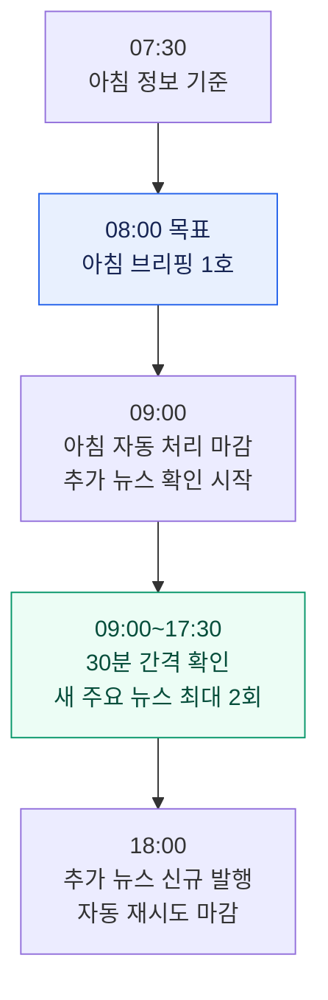
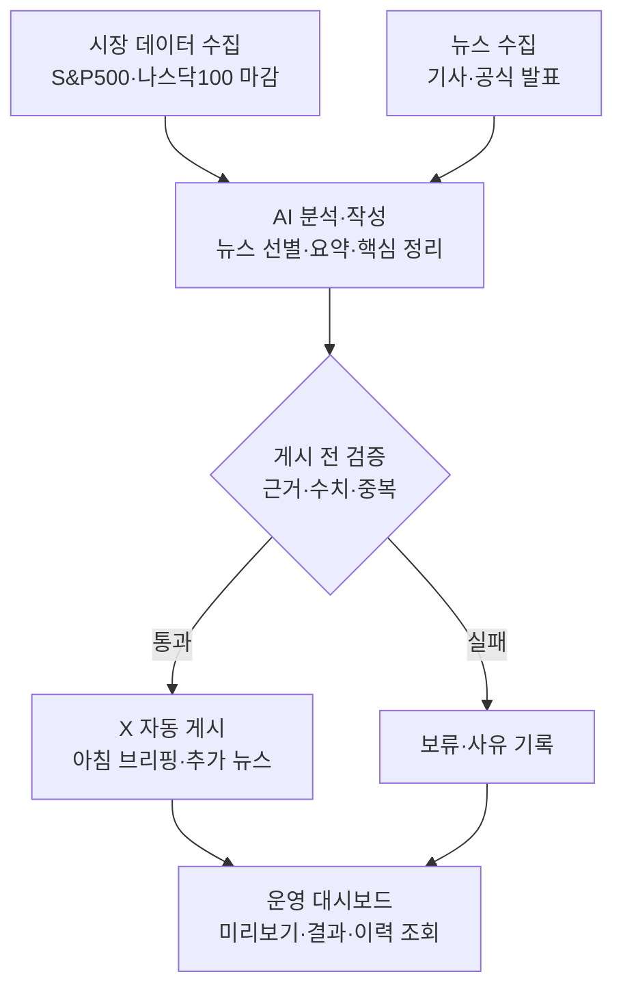

# 2주차 발표 | XFolio 미국 주식 시장 브리핑 AI 에이전트

> 밤사이 미국 주식 시장의 핵심을 모아, 읽기 쉬운 콘텐츠로 X에 자동 게시한다.

**발표일:** 2026-10-18 · **주제:** 요구사항과 에이전트 구상
**현재 상태:** 요구사항·운영 정책 합의 완료, 데이터 연동·자동 게시 구현 전

## 1. 왜 이 주제를 선택했는가

**직접 투자하며 느낀 필요에서 시작했다.** 처음에는 국내 ISA 계좌 투자자를 위해, 내가 투자 중인 S&P500·나스닥100을 추종하는 국내 상장 ETF의 가격을 운용사별(TIGER·KODEX 등)로 모아 보여주고 싶었다. 실제 투자 현황을 확인하는 데 활용할 수 있는 서비스를 만드는 것이 출발점이었다.

**시세를 공개 게시하는 과정에서 이용 조건의 제약을 확인했다.** [국내 ETF 데이터 조사](../../docs/research/etf_market_data_research.md)에서 조회 기능은 확인했지만, 시세를 X에 정기적으로 자동 게시할 권한은 확보하지 못했다. 검토한 제공처에는 제3자 제공·재배포 제한이나 별도 계약 조건이 있었다.

**그래서 두 지수의 시장 흐름을 전달하는 브리핑으로 방향을 바꿨다.** 관심 대상인 S&P500·나스닥100은 유지하고, 개별 ETF 가격 중심에서 시장 마감·경제지표·주요 뉴스를 함께 설명하는 콘텐츠로 범위를 조정했다. 현재안도 데이터의 공개 게시 조건은 별도로 검증 중이다.

## 2. 누구를 위한 서비스인가

**주요 독자:** S&P500·나스닥100에 관심 있는 개인 투자자. ISA에서 관련 ETF에 투자하는 독자도 포함한다.

**독자의 필요:** 지수·경제지표·기사를 일일이 찾아보지 않고, 미국 시장의 변화와 주요 이슈를 빠르게 파악하고 싶다.

**제공 가치:** 시장 수치와 뉴스의 핵심을 한곳에 모으고, 짧은 설명과 원문 링크로 이해와 확인을 돕는다.

## 3. 어떤 정보를 전달하는가

| 독자가 궁금한 것 | 전달할 정보 | 표현 방식 |
| --- | --- | --- |
| 시장이 얼마나 움직였나? | S&P500·나스닥100 종가와 전일 대비 등락률 | 두 지수의 마감 수치 |
| 무슨 일이 있었나? | 두 지수·미국 시장과 관련된 주요 뉴스 최대 3건 | 기사별 1~2문장 요약 + 원문 링크 |
| 무엇을 주목해야 하나? | 확인된 시장 변화와 주요 이슈의 의미 | 근거에 기반한 AI 핵심 정리 2~3문장 |

**2주 개발 범위:** 두 지수 마감과 뉴스 중심의 아침 브리핑·추가 뉴스에 집중한다. 경제 소식은 관련 뉴스로 다루고, CPI·고용·FOMC의 전용 수치 수집·이전 값·수정치 비교는 **8주차 이후 확장**으로 둔다. 가격 예측·매매 지시는 포함하지 않는다.

## 4. 언제, 어떤 형태로 받는가

**아침 브리핑 1호 + 새로운 주요 뉴스 최대 2회**를 X에 발행한다. 모든 시각은 한국 시간 기준이다.

**하루의 발행 흐름** — 아침 브리핑과 추가 뉴스가 모두 운영되는 날의 예시다.

**X에서 보게 될 모습** — 아래는 실제 수치·뉴스가 아닌 구성 예시다. 구획은 내용 순서이며 실제 게시물 분할은 추후 검증한다.

> **아침 브리핑 · {미국 거래일}** — 연결된 X 스레드
>
> **시장 마감**　S&P500 {종가·등락률} / 나스닥100 {종가·등락률}
>
> ↓ **주요 뉴스**　{핵심 사건} — {1~2문장 요약} · {원문 링크} / 최대 3건
>
> ↓ **AI 핵심 정리**　{확인된 시장 변화와 주목할 이슈를 2~3문장으로 설명}
>
> 자료 기준·출처: {시점·출처 링크}

> **추가 뉴스 · 10:30 예시** — 아침 호와 별도로 발행
>
> **대형 기술기업 A, 신규 AI 서비스 발표**
>
> **무슨 일?**　A사가 신규 서비스의 기능과 출시 일정을 공개했다.
>
> **주목할 점**　공개된 기능과 일정은 확인됐지만 매출 효과는 아직 확인되지 않았다.
>
> 출처: {공식 발표 링크}

10:30은 예시 시각이다. 실제 추가 뉴스는 확인·검증을 통과했을 때만 발행하며, 새 소식이 없으면 생략한다. 이미 전달한 사실은 다음 아침 뉴스 목록에서도 반복하지 않는다.

**운영일:** 아침 호는 새 미국 거래일 마감이 있을 때 발행한다. 추가 뉴스는 한국 날짜와 같은 날짜가 미국 거래일인 날만 운영하며, 하루 최대 2회 한도는 한국 날짜 기준이다. 발행 목표의 실현 가능성과 실제 글 수는 후속 조사에서 검증한다.

## 5. 에이전트는 어떻게 동작하는가

- **근거 확인:** 수치·날짜·링크는 원본과 대조하고, 제목만으로 기사 내용을 추측하지 않는다.
- **품질 관리:** 필수 자료 누락이나 검증 실패는 보류한다. 선정한 뉴스 제공처가 정상 수집됐지만 선정 뉴스가 0건이면 그 사실을 표시해 아침 호를 발행한다.
- **게시 관리:** 중복 게시를 막고 성공·실패를 기록한다. 게시 후 오류는 운영자가 확인한 정정문으로 바로잡는다.

## 6. 이번 주에 정한 것과 다음 할 일

| 이번 주 완료 | 다음 조사·검증 |
| --- | --- |
| 주요 독자·콘텐츠·발행 일정 확정 | 수집과 X 공개 게시가 가능한 제공처 선정 |
| 검증·보류·중복·오류 처리 원칙 정리 | 실제 콘텐츠 예시와 X 글자 수 검증 |
| 월 총비용 **3만 원 상한**, 조회용 대시보드 범위 확정 | 예산 내 데이터·AI·X API·배포 구성 검토 |

**현재 과제:** 두 지수의 무료 조회 경로는 조사했지만, 정기 공개 게시가 허용된 제공처는 아직 확보하지 못했다.

**개발 시간 기준:** 5~6주차 주당 15시간, 총 30시간. 제공처·게시 권한은 개발 전에 확인한다.

**범위를 줄인 부분:** 뉴스 제공처는 1곳으로 시작하고, 스레드 중간 실패는 자동 이어쓰기를 멈춘 뒤 운영자가 CLI로 확인·복구한다. 경제지표 전용 연동·부분 게시 자동 복구·복수 뉴스 제공처는 8주차 이후 확장이다.

| 일정 | 확정한 개발 범위 |
| --- | --- |
| 3~4주차 | 제공처·권한·비용·입력 샘플 확인, 실행·저장 방식 선정 |
| 5주차 · 15시간 | 아침 호 연결·검증 13시간 + 여유 2시간 |
| 6주차 · 15시간 | 추가 뉴스·예약·한도·CLI 복구·통합 검증 13시간 + 여유 2시간 |
| 7주차 | 미국 거래일 5일 이상 예약 시험과 장애·품질 검증 |
| 8주차 | 조회 대시보드·README·운영 절차·최종 시연 |

**완료 구분:** 6주차에는 핵심 흐름을 연결하고, 8주차까지 시험·시연을 마친다. 실제 X 게시 확인은 별도 승인 후 수행하며, 경제지표 전용 연동은 그 이후 확장으로 남긴다.

상세 운영 규칙과 결정 근거: [설계서](../../docs/market_briefing_agent_design.md) · [논의 기록](../brain_storm/session_2026-10-15_market_briefing_redesign.md) · [데이터 제공처 조사](../../docs/research/us_index_data_research.md)
