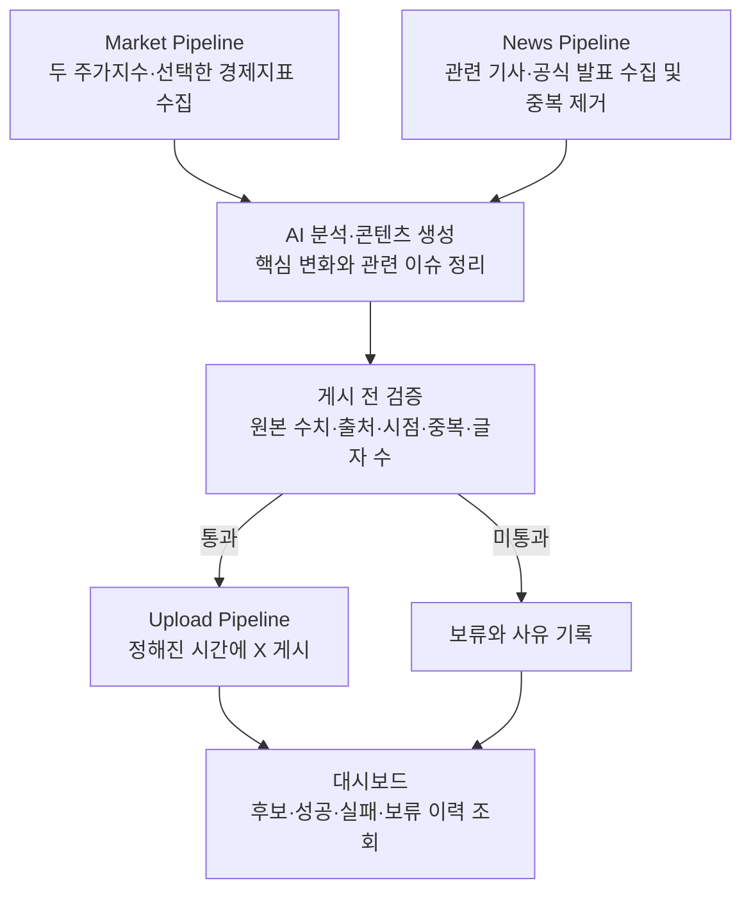

# 2주차 발표 | S&P500·나스닥100 시장 브리핑 에이전트

> S&P500과 나스닥100의 마감 현황, 관련 경제지표와 뉴스를 모아 읽기 쉬운 한국어 콘텐츠로 정리하고, 정해진 시간에 X에 게시하는 AI 에이전트를 만든다.

발표일: 2026-10-18 · 작성 기준: 2026-10-15 · 상태: 프로젝트 재설계 중, 구현 전

## 1. 무엇을 만들고 싶은가

미국 주식시장을 살펴볼 때 지수의 등락, 경제지표 발표, 관련 기사를 각각 찾아봐야 한다. XFolio는 이 정보를 모아 **밤사이 미국 시장에서 확인할 내용을 한 번에 읽을 수 있는 브리핑**을 만든다.

첫 버전은 **S&P500·나스닥100의 마감 결과와 관련 뉴스**에 집중하고, 시장을 이해하는 데 필요한 경제지표를 함께 제공한다. 독자는 **ISA 투자자를 포함해 S&P500·나스닥100에 관심 있는 한국어 개인 투자자**다.

TIGER·KODEX 4개 ETF의 개별 가격 게시와 장중 알림은 후속 단계로 둔다. 나스닥100은 나스닥 종합지수와 구분하며, 지수값을 ETF 가격으로 대신하지 않는다.

## 2. 독자는 무엇을 받는가

| 정보 | 전달할 내용 | 독자가 확인하는 것 |
| --- | --- | --- |
| 주가지수 | S&P500·나스닥100의 해당 미국 거래일 종가와 전일 대비 등락률 | 두 지수가 하루 동안 어떻게 움직였는가 |
| 경제지표 | 선택한 지표의 발표값·이전 값·대상 기간·발표 시각 | 최근 어떤 경제 수치나 정책 결정이 나왔는가 |
| 관련 뉴스 | 두 지수와 미국 주식시장에 관련된 주요 기사 제목·원문 링크 | 함께 살펴볼 이슈는 무엇인가 |
| AI 정리 | 수집한 수치와 자료에 근거한 짧은 한국어 설명 | 여러 자료에서 확인할 핵심은 무엇인가 |

첫 경제지표 범위는 **CPI(물가), 고용보고서, FOMC 금리 결정**으로 확정했다. 지표별 세부 항목은 후속 설계에서 정한다. 새 발표가 있는 날 해당 내용을 포함하고, 과거 수치를 사용할 때는 대상 기간과 발표일을 명시하는 방안을 제안한다.

**아침 브리핑 구성 예시** — 실제 수치·뉴스가 아닌 초안이며, X 글자 수에 맞춘 분할 방식은 추후 정한다.

```text
[미국 시장 브리핑 · {미국 거래일}]

시장 마감
S&P500 {종가} · 전일 대비 {등락률}%
나스닥100 {종가} · 전일 대비 {등락률}%

새 경제지표 발표가 있는 경우
{지표명 / 대상 기간}: {발표값}, 이전 {값}
발표: {날짜·시각}

주요 뉴스
① {기사 제목} {원문 링크}
② {기사 제목} {원문 링크}

핵심 정리
{확인된 변화와 주요 이슈를 설명하는 짧은 문장}

자료 기준·출처: {기준 시점과 출처}
```

첫 운영은 미국 시장 마감 후 자료가 준비되면 **한국 시간 아침에 정기 게시**하는 방향이다. 정확한 시각과 휴장일 편성은 제공처·갱신 시점을 확인한 뒤 정한다. 유효한 자료가 없는 경우에는 게시를 보류한다.

## 3. 에이전트는 어떻게 동작하는가



수치·날짜·링크는 수집한 원본 자료로 채우고, AI는 관련 자료를 골라 한국어로 정리한다. 지수 등락과 뉴스가 함께 나타났다는 이유만으로 인과관계를 만들어 설명하지 않는다.

개발 중에는 미리보기·시험 실행으로 전체 흐름을 확인한다. 운영 단계에서는 검증을 통과한 후보를 자동 게시하고 결과를 기록한다.

## 4. 현재까지 정한 것과 다음 결정

**확정한 방향:** S&P500·나스닥100 관련 주가지수·경제지표·뉴스를 수집·정리해 콘텐츠를 생성하고 X에 게시한다. 첫 버전은 마감 브리핑 중심이며 무료 제공처를 우선 조사한다. 스터디의 수집 → AI 분석·생성 → 예약 게시 → 테스트·배포 흐름을 완성하는 것이 목표다.

**논의 중:** 경제지표별 세부 항목과 표시 방식, 뉴스와 해설의 분량, 게시물 분할 방식, 실행 시각·휴장일 처리.

**구현 전 확인:** 제공처별 수집 방법·갱신 시점·공개 게시 조건. 두 지수의 무료 조회 경로는 확인했으나 정기 X 게시 권한까지 확보한 무료 제공처는 아직 없다. 경제지표와 뉴스도 제공처별 조건을 확인한다. 이 상태를 데이터 연동이나 게시 기능 완료로 표현하지 않는다.

이번 주에는 만들 서비스와 첫 범위를 정리하고, 다음 조사에서 수집·공개 게시가 가능한 제공처를 선정한다. 관찰 범위와 게시 형식을 조정할 필요가 생기면 그 근거와 결정을 남긴다.

관련 문서: [프로젝트 개요](../../docs/overview.md) · [재설계 세션](../brain_storm/session_2026-10-15_market_briefing_redesign.md) · [미국 지수 데이터 조사](../../docs/research/us_index_data_research.md)
