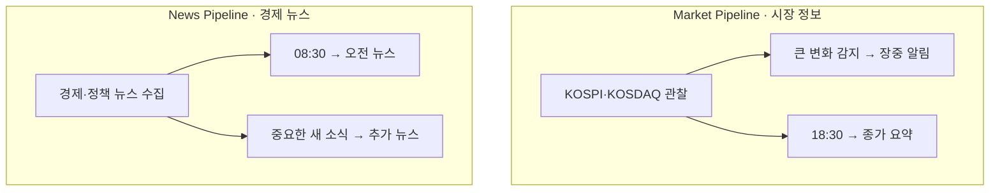
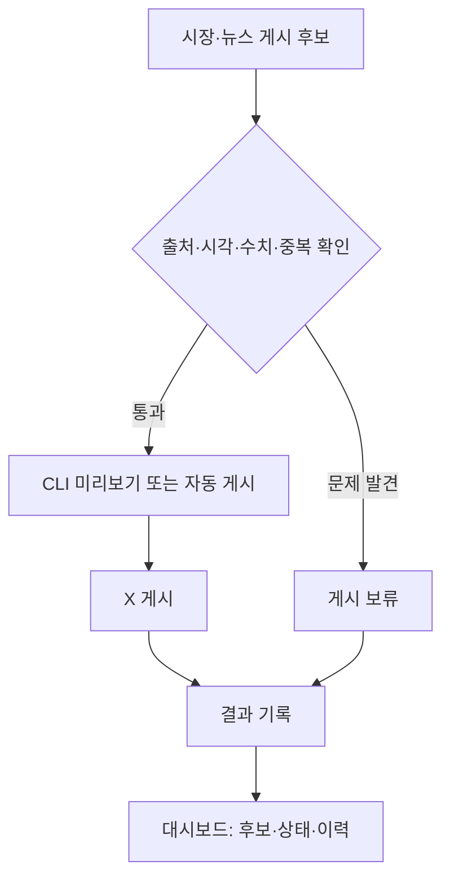

# 2주차 발표 초안 · XFolio 요구사항

- 발표 예정: 2026-10-18 (2주차, 10/12~10/18)
- 작성 기준: 2026-10-13
- 상태: 발표 초안. 아래는 구현 결과가 아니라 만들 기능의 요구사항이다.
- 근거: [브레인스토밍 세션](../brain_storm/session_2026-10-12_week2_requirements.md), [프로젝트 개요](../../docs/overview.md), [주차별 일정](../../docs/weekly_schedule.md)

## 한 문장 소개

XFolio는 매일 한국 주식시장을 확인하는 개인 투자자에게 **장중의 의미 있는 지수 변화, 하루의 종가, 한국 증시에 영향을 줄 경제 뉴스**를 각각 근거와 시각이 보이는 X 게시물로 전달하는 에이전트다.

## 에이전트의 예상 모습

### 1. 어떤 글을 언제 게시하나

두 파이프라인은 **각자 정보를 수집하고 서로 다른 게시물**을 만든다. 장중 알림과 추가 뉴스는 조건이 맞을 때만 게시한다.

### 2. 게시 후보를 어떻게 확인하나

개발·시험 중에는 CLI에서 후보를 미리보고 확인한다. 검증을 마친 뒤에는 점검을 통과한 후보만 자동 게시한다. 대시보드는 후보 원문·출처·기준 시각과 대기·보류·성공·실패 이력을 보여준다.

## 기능과 범위

1. **장중 시장 알림:** 거래일에 KOSPI 또는 KOSDAQ 중 하나라도 큰 등락이나 급격한 방향 전환을 보이면 발행한다. 확인된 지수값·등락률·기준 시각을 담고, 같은 움직임은 다시 게시하지 않는다. 거래일 최대 2회다.
2. **오전 경제 뉴스:** 거래일 08:30 KST에 한국 증시에 영향을 줄 국내외 경제·정책 뉴스 2~3건을 요약한다. 각 기사에 원문 링크와 발행 시각을 붙인다. 적합한 뉴스가 없으면 생략한다.
3. **중요 경제 뉴스:** 금리·물가·환율·주요 정책처럼 영향이 큰 새 소식을 선별해 거래일 최대 1회 추가 게시한다.
4. **시장 종가:** 거래일 18:30 KST에 KOSPI·KOSDAQ 종가와 등락률, 시장 흐름을 설명하는 1~2문장을 게시한다. 장중 알림 횟수와 별도로 계산한다.

뉴스는 약 30분 간격으로 수집하는 것을 출발점으로 삼되, **수집할 때마다 게시하지 않는다**. 오전 뉴스는 첫 글에서 주제를 소개하고 기사별 요약·출처를 잇는 X 스레드 형식을 잠정 적용한다. 중요한 추가 뉴스는 단일 글로 구상한다. 휴장일에는 정기 뉴스·종가를 게시하지 않고, 수집한 뉴스는 다음 거래일 오전 후보로 보낸다.

장중 시장 글은 확인된 수치와 변화만 설명한다. 원인이 확인되지 않으면 추정하지 않는다. 모든 게시 후보에는 출처와 기준·발행 시각을 남긴다.

## 게시 전 확인과 운영

1. 출처 또는 기준·발행 시각이 없거나, 수치가 원본과 다르거나, 이미 게시한 내용이면 **게시 보류**한다.
2. 보류 이유와 게시 성공·실패를 대시보드 이력에 남긴다.
3. 개발·시험 중에는 CLI 미리보기로 사람이 확인한다. 검증 후에는 통과한 후보를 자동 게시한다.

## 게시물 형태 예시

아래 중괄호는 실제 데이터가 들어갈 자리다.

> **장중 시장 · {기준 시각}** KOSPI {지수값} ({등락률}), KOSDAQ {지수값} ({등락률}). {확인된 변화 한 문장}

> **오늘의 종가 · {거래일}** KOSPI {종가} ({등락률}), KOSDAQ {종가} ({등락률}). {시장 흐름 한 문장}

> **오전 경제 뉴스 · {거래일}** 오늘 확인할 경제 뉴스 {2~3건} → 이어지는 글마다 {핵심 사실}, {발행 시각}, {원문 링크}

### 완성형 게시물 예시

다음은 **가상의 거래일·수치·기사·출처 링크로 작성한 시연 문구**다. 실제 시장 사실이나 게시 이력이 아니다. 발행 기준값과 데이터 제공처를 정한 뒤 실제 값으로 바꾼다.

**1. 장중 시장 알림**

> [장중 시장 · 10/12 11:20 KST] KOSPI 2,632.40 (+2.1%), KOSDAQ 854.10 (+0.4%). KOSPI의 상승폭이 오전 10시보다 1.3%p 커졌습니다. 기준 시각: 11:20 KST. 자료: https://example.com/market/2026-10-12

**2. 시장 종가**

> [오늘의 종가 · 10/12] KOSPI 2,625.80 (+1.8%), KOSDAQ 858.20 (+0.9%). 두 지수 모두 상승 마감했고, 장중 확대됐던 KOSPI 상승폭은 마감 전에 일부 줄었습니다. 기준 시각: 15:30 KST. 자료: https://example.com/market/2026-10-12

**3. 오전 경제 뉴스 스레드**

> ① [오전 경제 뉴스 · 10/12] 오늘 확인할 경제 뉴스 2건: 기준금리 결정과 수출 전망입니다. 각 기사에 발행 시각과 원문을 붙였습니다.

> ② 가상 중앙은행이 기준금리를 0.25%p 인상했습니다. 기사 발행: 10/12 07:45 KST. 원문: https://example.com/news/rate-decision

> ③ 가상 연구기관이 올해 수출 증가율 전망을 2.0%에서 2.4%로 높였습니다. 기사 발행: 10/12 08:05 KST. 원문: https://example.com/news/export-outlook

**4. 중요 경제 뉴스 추가 게시**

> [경제 뉴스 · 10/12 13:40 KST] 가상 정부가 환율 변동 대응 방안을 발표했습니다. 한국 시장 관련 후속 내용을 확인 중입니다. 기사 발행: 10/12 13:35 KST. 원문: https://example.com/news/fx-policy

## 이번 프로젝트에서 다루는 경계

- 11월까지 한국 주식시장에 집중한다. 미국 시장은 시간이 남을 때 검토하는 확장 후보이다.
- 개별 기업 뉴스는 우선 제외한다.
- 시세·뉴스 제공처와 이용 권한, 실제 수집 지연, 장중 큰 등락·방향 전환의 수치 기준, 뉴스 중요도·중복 판정, X 스레드 길이와 게시 방식은 3~4주차 조사·설계에서 정한다.
- 파이프라인과 함께 첫 대시보드를 연결하는 방향으로 설계한다. 기존 [주차별 일정](../../docs/weekly_schedule.md)의 8주차는 대시보드 마무리·개선 시점으로 재검토해야 한다.

## 발표할 때 설명할 순서

1. **대상 독자와 목적:** “매일 한국 시장을 보는 개인 투자자가 시장 변화와 관련 경제 뉴스를 제때, 근거와 함께 확인하도록 돕겠습니다.”
2. **그림:** 첫 번째 그림에서 시장·뉴스 게시물과 발행 시점을, 두 번째 그림에서 게시 전 점검과 결과 확인 방식을 설명한다.
3. **하루의 흐름:** 08:30 뉴스, 조건에 맞는 장중 시장 변화, 18:30 종가, 그리고 중요한 새 뉴스가 있을 때만 추가 게시한다.
4. **신뢰와 범위:** 출처·시각·수치·중복을 확인하고, 개발 중에는 사람이 미리본다. 한국 시장을 먼저 완성한다.

## 현재 진행과 다음 작업

- 현재까지 완료: 대상 독자, 한국 시장 범위, 게시물 종류·시각, 자동 게시 보류 조건, 검토 흐름, 대시보드 역할을 세션에서 정리하고 이 발표 초안을 작성했다.
- 아직 미완료: 요구사항 최종 확인, 데이터 제공처 조사, 수치 기준 확정, 파이프라인·대시보드 구현과 실제 X 게시 검증.
- 3주차 조사: 장중 시세와 경제 뉴스 제공처의 이용 조건·지연, 뉴스 수집 방식, X 게시 형식과 API 제약을 확인한다.
