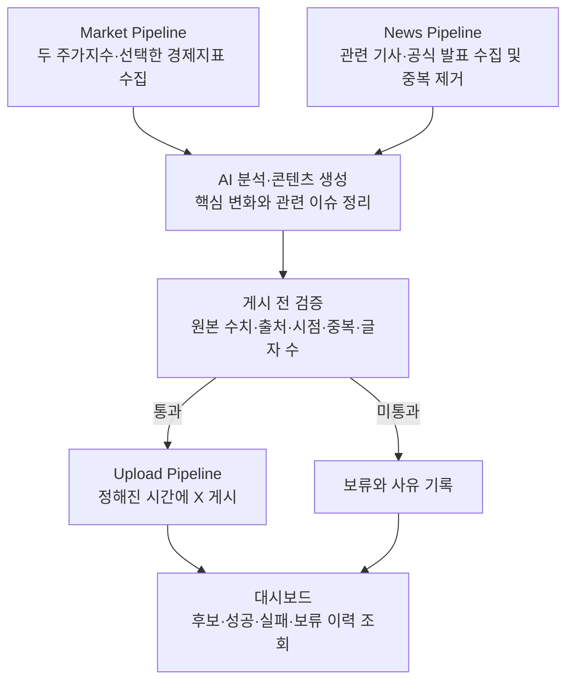

# 2주차 발표 | S&P500·나스닥100 시장 브리핑 에이전트

> 전날의 주요 주식시장 정보를 자동 수집·분석하여 S&P500·나스닥100 중심의 읽기 쉬운 뉴스레터 형식 콘텐츠를 만들고 X에 자동 게시하는 XFolio AI 에이전트를 구축한다.

발표일: 2026-10-18 · 작성 기준: 2026-10-15 · 상태: 요구사항·운영 정책 합의 완료, 기술 검증·구현 전

## 1. 무엇을 만들고 싶은가

미국 주식시장을 살펴볼 때 지수의 등락, 경제지표 발표, 관련 기사를 각각 찾아봐야 한다. XFolio는 이 정보를 모아 **밤사이 미국 시장에서 확인할 내용을 한 번에 읽을 수 있는 브리핑**을 만든다.

첫 버전은 **S&P500·나스닥100의 마감 결과와 관련 뉴스**에 집중하고, 시장을 이해하는 데 필요한 경제지표를 함께 제공한다. 독자는 **ISA 투자자를 포함해 S&P500·나스닥100에 관심 있는 개인 투자자**다.

TIGER·KODEX 4개 ETF의 개별 가격 게시와 장중 알림은 후속 단계로 둔다.
나스닥100은 나스닥 종합지수와 구분하며, 지수값을 ETF 가격으로 대신하지 않는다.

## 2. 독자는 무엇을 받는가

**편성은 아침 브리핑 1호 + 새 주요 뉴스 최대 2회**다. 추가 뉴스는 없으면 생략하며, 이미 전달한 동일 사실은 다음 아침 뉴스 목록에서도 반복하지 않는다.

| 정보 | 전달할 내용 | 독자가 확인하는 것 |
| --- | --- | --- |
| 주가지수 | S&P500·나스닥100의 해당 미국 거래일 종가와 전일 대비 등락률 | 두 지수가 하루 동안 어떻게 움직였는가 |
| 경제지표 | 선택한 지표의 발표값·이전 값·대상 기간·발표 시각 | 최근 어떤 경제 수치나 정책 결정이 나왔는가 |
| 관련 뉴스 | 주요 뉴스 최대 3건의 각 1~2문장 요약·원문 링크. 정상 수집 후 0건이면 선정 뉴스 없음 표시 | 함께 살펴볼 이슈는 무엇인가 |
| AI 정리 | 수집한 수치와 자료에 근거한 2~3문장의 한국어 설명 | 여러 자료에서 확인할 핵심은 무엇인가 |

첫 경제지표 범위는 **CPI(물가), 고용보고서, FOMC 금리 결정**으로 확정했다. CPI는 전체·근원의 전월 대비 및 전년 동월 대비 변화율, 고용은 비농업 고용 증감·실업률, FOMC는 금리 목표 범위·직전 결정 대비 변화를 제공한다.

발표값과 이전 값을 비교하되 대상 기간·단위를 명시한다. 이전 값이 수정되면 수정 사실을 표시하고 기존 수집 원본도 보존한다. 시장 예상치 비교는 첫 버전에서 제외한다.
새 발표가 있는 경우 해당 내용을 포함한다. 과거 값을 배경 설명에 사용할지와 표시 기준은 후속 설계에서 정한다.

**아침 브리핑 구성 예시** — 실제 수치·뉴스가 아닌 초안이다. X 스레드로 발행하며 정확한 글 수·분할 지점은 추후 검증한다. 발행 순서는 시장 마감 → 뉴스 → 새 경제지표 → AI 핵심 정리다.

```text
[미국 시장 브리핑 · {미국 거래일}]

시장 마감
S&P500 {종가} · 전일 대비 {등락률}%
나스닥100 {종가} · 전일 대비 {등락률}%

주요 뉴스
① {기사 제목}: {짧은 요약} {원문 링크}
② {기사 제목}: {짧은 요약} {원문 링크}
③ {기사 제목}: {짧은 요약} {원문 링크}
※ 최대 3건, 각 요약 1~2문장. 정상 수집 후 0건이면 선정 뉴스 없음 표시

새 경제지표 발표가 있는 경우
{지표명 / 대상 기간}: {발표값}, 이전 {값}
발표: {날짜·시각}

핵심 정리
{확인된 변화와 주요 이슈를 설명하는 2~3문장}

자료 기준·출처: {기준 시점과 출처}
```

한국 아침 기준 **가장 최근에 마감한 미국 거래일당 한 번 발행**한다. 새로운 거래일 마감이 없으면 정기 브리핑을 쉰다. 뉴스는 직전 발행 호의 정보 기준 시각 이후부터 이번 호의 **한국 시간 07:30**까지 이어서 확인한다. **08:00 발행 목표, 09:00 신규 발행·자동 재시도 마감**으로 정했다. 실제 제공처·실행 환경 검증 전에는 보장 시각이 아니다. 최초 실행과 장애 복구 시 뉴스 확인 범위는 최근 7일까지다.

07:30 정보 기준과 09:00 자동 처리 마감은 아침 호에 적용한다. 이후 새로 발표된 뉴스·경제지표는 추가 뉴스 또는 다음 아침 호의 후보로 다룬다. 자료 확보 실패로 지연되더라도 아침 호의 정보 기준 시각은 바꾸지 않는다.

두 지수의 유효한 마감 수치는 필수다. **정상 수집 후 선정 뉴스가 0건이면 그 사실을 표시하고 발행**한다. 뉴스 수집 전체 실패는 보류한다. 뉴스가 1~2건이면 확보한 만큼 싣고 새 경제지표 발표가 없는 날은 해당 절을 생략한다. 보류한 호를 다음 날 별도 발행하지 않고 최신 거래일 호만 만들며, 미발행 기간의 뉴스는 관련성과 새로움을 다시 평가한다.

07:30까지 발표 예정이던 대상 경제지표의 원본 수치를 확보하지 못하면 해당 호 전체를 보류한다. 발표가 없는 날과 자료 수집 실패를 구분한다.

## 3. 에이전트는 어떻게 동작하는가



수치·날짜·링크는 수집한 원본 자료로 채우고, AI는 관련 자료를 골라 한국어로 정리한다. 뉴스는 시장 관련성·새로움·근거 확인 가능성으로 선정하고 같은 사건은 한 건으로 묶는다. 개별 기업 뉴스도 두 지수의 흐름을 이해하는 데 중요하면 포함한다. 출처의 해석과 사실을 구분하며 지수 등락과 뉴스가 함께 나타났다는 이유만으로 인과관계를 만들지 않는다. 가격 예측·매매 지시는 포함하지 않는다.

개발 중에는 미리보기·시험 실행으로 전체 흐름을 확인한다. 운영 단계에서는 검증을 통과한 후보를 자동 게시하고 결과를 기록한다.

스레드 중간에 실패하면 성공한 글은 유지하고 명확히 실패한 글부터 제한적으로 재시도한다. 성공 여부가 불명확하면 자동 재시도를 멈추고 확인 대기로 둔다. 전체 스레드를 처음부터 재게시하지 않는다.

일시적인 수집·게시 오류는 최초 시도 외 최대 2회, 실패 후 1분·5분 간격으로 재시도하며 각 발행 마감을 우선한다. 인증·권한 오류는 자동 재시도하지 않는다. 최초 실행과 장애 복구의 뉴스 확인 범위는 최근 7일까지로 제한하고 그보다 오래된 미수집 구간은 누락 이력으로 남긴다.

기사 제목만으로 요약하지 않고 이용 가능한 본문이나 제공처의 충분한 요약에서 근거를 확인한다. 근거가 부족하면 선정에서 제외한다. 한 호는 여러 글이 연결된 X 스레드이며, 전체 글 수는 실제 분량 검증 후 정한다.

일부 뉴스 제공처만 실패했을 때는 검증된 선정 뉴스가 1건 이상이면 수집 범위 제한을 표시해 발행하고, 0건이면 보류한다. 모든 설정 제공처가 정상 수집됐을 때만 뉴스 0건 표시 발행을 허용한다.

AI 설명의 근거 검증이 실패하면 1회 재생성·재검증하고, 다시 실패하면 해당 콘텐츠 전체를 게시 전에 보류한다. 시험 운영 중에는 사람이 결과를 함께 검토한다. 게시 후 오류는 해당 사건의 후속 자동 발행을 멈추고 운영자가 검토한 정정문을 기존 게시에 연결해 수동 게시한다.

## 4. 현재까지 정한 것과 다음 결정

**확정한 방향:** S&P500·나스닥100 관련 주가지수·경제지표·뉴스를 수집·정리해 콘텐츠를 생성하고 X에 게시한다. 첫 버전은 마감 브리핑 중심이며 무료 제공처를 우선 조사한다. 스터디의 수집 → AI 분석·생성 → 예약 게시 → 테스트·배포 흐름을 완성하는 것이 목표다.

**운영 범위:** 데이터·AI·X API·배포를 합친 월 총비용 상한은 3만 원이다. 대시보드는 수집 결과·선정 근거·미리보기·발행 이력 조회용으로 만들고 수동 재실행·복구는 CLI에서 수행한다.

**구현 완료 기준:** 미국 거래일 최소 5일의 예약 시험 실행, 정상·누락·부분 게시·중복 등 외부 API 없는 검증, 별도 승인 후 실제 X 스레드 게시 1회와 결과 확인, README 재현 절차다. 현재는 구현 전이며 이 기준을 충족한 상태가 아니다.

**추가 뉴스 편성:** 아침 브리핑 1호 외에 새로운 주요 뉴스가 있을 때 최대 2회 추가 발행한다. 한 사건의 요약·주목할 의미·원문 링크로 구성하고 추가 뉴스가 없으면 생략한다. 이미 전달한 동일 사실은 다음 아침 뉴스 목록에서도 반복하지 않는다. 새 사실은 업데이트로 다루며, 아침 해설에 필요하면 앞선 게시를 연결해 짧게 언급한다.

추가 뉴스는 **한국 시간 09:00~18:00에 30분 간격**으로 확인하고 **18:00부터 신규 발행·자동 재시도를 중단**한다. 발행 후보 확인은 09:00~17:30에 수행한다. **한국 운영일과 같은 날짜가 미국 거래소 달력상 휴장일·주말이면 쉰다.** 추가 뉴스 최대 2회 한도는 한국 날짜 기준 자정에 새로 시작하며 아침 호와 별도로 계산한다. 아침 브리핑이 자료 누락으로 보류돼도 해당 자료에 의존하지 않는 뉴스는 독립 검증 후 발행할 수 있다. 게시 장애나 동일 사건의 성공 여부 불명 상태는 우회하지 않는다. 월 예산 내 비용과 추가 시험 범위도 확인한다.

추가 뉴스는 일부라도 게시되면 하루 한도 1회를 사용한다. 성공 여부가 불명확하면 확인될 때까지 1회분을 예약하고, 아무 글도 게시되지 않은 것이 확실하면 차감하지 않는다. 같은 발행 건의 재시도는 추가 차감하지 않는다.

**다음 조사·기술 설계:** 제공처와 공개 게시 조건, 월 3만 원 내 실현 가능성, 실행·저장 방식, 요약 검증 구현, 게시 결과 확인·수동 복구·정정 절차, 실제 스레드 예시와 글자 수 검증. 08:00 발행 목표의 실현 가능성도 확인한다. 요구사항·운영 정책은 합의했으며 조사 결과가 예산이나 범위를 바꿀 때 추가 결정한다.

**구현 전 확인:** 제공처별 수집 방법·갱신 시점·공개 게시 조건. 두 지수의 무료 조회 경로는 확인했으나 정기 X 게시 권한까지 확보한 무료 제공처는 아직 없다. 경제지표와 뉴스도 제공처별 조건을 확인한다. 이 상태를 데이터 연동이나 게시 기능 완료로 표현하지 않는다.

이번 주에는 만들 서비스와 첫 범위를 정리하고, 다음 조사에서 수집·공개 게시가 가능한 제공처를 선정한다. 관찰 범위와 게시 형식을 조정할 필요가 생기면 그 근거와 결정을 남긴다.

관련 문서: [에이전트 설계](../../docs/market_briefing_agent_design.md) · [프로젝트 개요](../../docs/overview.md) · [재설계 세션](../brain_storm/session_2026-10-15_market_briefing_redesign.md) · [미국 지수 데이터 조사](../../docs/research/us_index_data_research.md)
