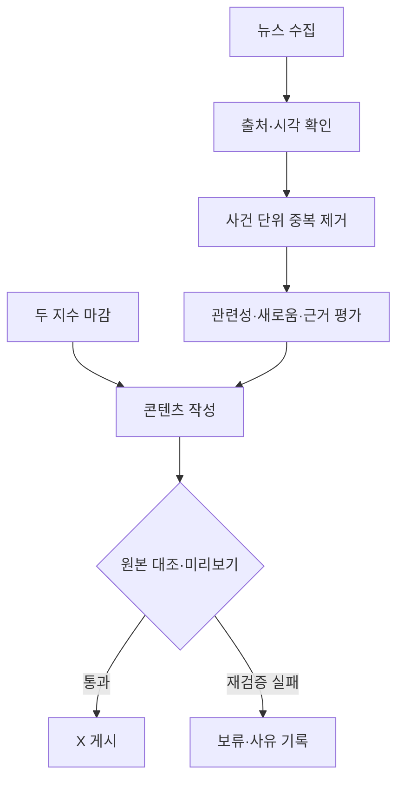
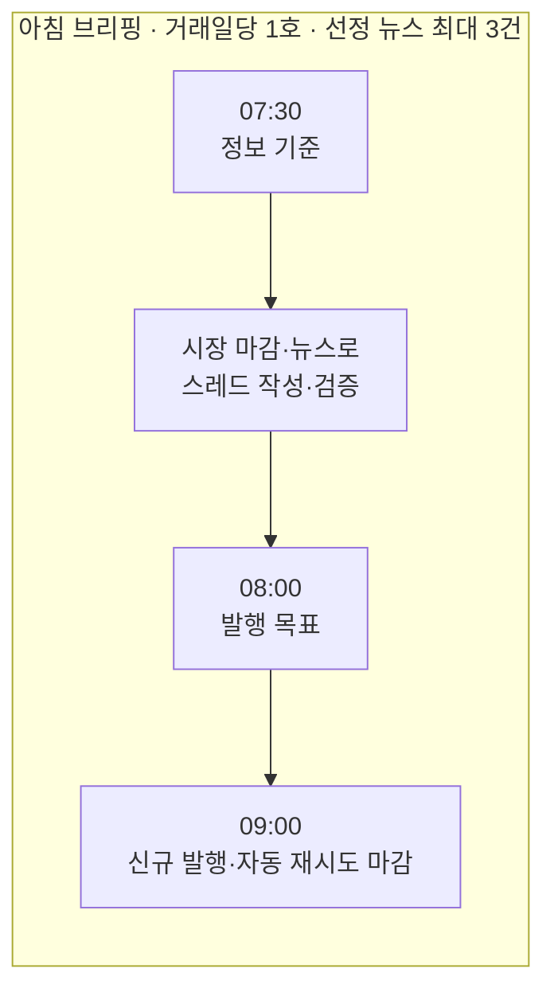
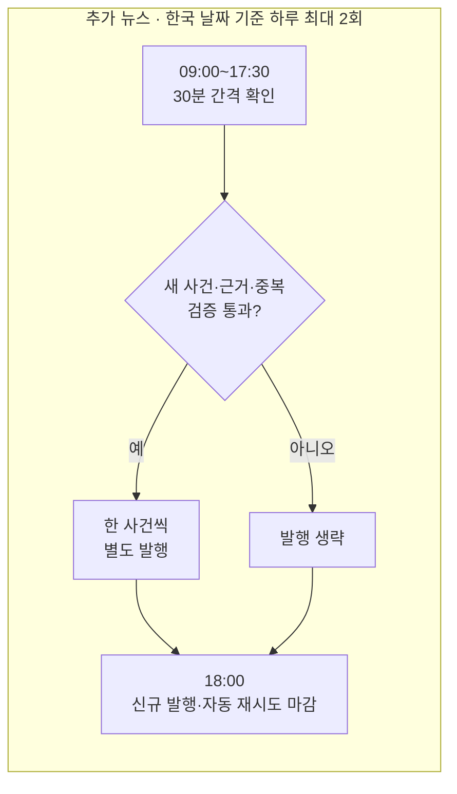

# 2주차 발표 | XFolio 미국 시장 브리핑 에이전트

> 전날 미국 시장의 두 지수와 주요 뉴스를 한눈에 보는 X 브리핑

- 발표일: 2026-10-18 · 주제: 요구사항과 에이전트 구상
- 현재 상태: 요구사항·운영 정책 합의 완료 / 데이터 연동·자동 게시·실제 운영 검증 전

## ❶ 만들고 싶은 XFolio 에이전트의 모습

- **목표:** 최근 미국 거래일의 S&P500·나스닥100 마감과 관련 뉴스를 짧게 설명하는 아침 뉴스레터 형식의 X 에이전트
- **타겟층:** 두 지수에 관심 있는 개인 투자자, ISA에서 관련 ETF에 투자하는 독자
- **발행 구상:** 출근 전 아침 브리핑 1호, 낮에 새로운 주요 소식 별도 발행
- **선정 이유:** S&P500·나스닥100 관련 ETF 투자 경험에서 출발한 시장 정보 확인 수요. 초기에는 국내 상장 ETF의 운용사별 가격 게시를 구상했으나 조회 이슈로 두 지수 중심의 미국 시장 브리핑으로 변경
- **남은 확인:** 현행 지수·뉴스 제공처의 공개 게시 조건

## ❷ X에 게시할 정보

| 구분 | 게시 내용 | 게시 범위 |
| --- | --- | --- |
| 시장 정보 | 가장 최근 미국 거래일의 S&P500·나스닥100 종가와 전일 대비 등락률 | 미국 시장의 두 지수. (한국 시장 지수·환율·국내 ETF 개별 가격은 첫 버전 게시 대상에서 제외) |
| 아침 브리핑 뉴스 | 미국 시장 전체와 두 지수의 흐름을 이해하는 데 중요한 뉴스 **한 호당 최대 3건** | 특정 기업별 고정 배분 없음. 시장 관련성이 높은 개별 기업 뉴스 포함 가능 |
| 추가 뉴스 | 아침 브리핑 이후 확인된 새로운 주요 사건 | 아침 호와 별도 발행, **한국 날짜 기준 하루 최대 2회** |
| 핵심 정리 | 확인된 시장 변화와 주목할 이슈 2~3문장 | 사실·해석 구분. 가격 예측·매매 지시 제외 |

## ❸ 뉴스 정보를 정제·가공하는 과정

**1. 뉴스 수집**

- **제공처:** 공개 게시·요약 조건을 확인한 곳 1곳
- **아침 호 범위:** 직전 호의 정보 기준 시각 이후 ~ 이번 호의 한국 시간 **07:30**
- **최초 실행·장애 복구:** 최대 최근 7일 확인
- **기록:** 기사 링크·출처·발행 시각·수집 시각 구분

**2. 중복 제거**

- **판정 단위:** 동일 링크뿐 아니라 서로 다른 기사의 **같은 사건·이미 전한 동일 사실**도 한 건으로 묶기
- **게시 이력:** 아침 호와 추가 뉴스 사이의 반복 여부 확인
- **새 사실:** 기존 사건의 업데이트 후보로 분리
- **구현 전 결정:** 사건 식별 키와 자동 판정·시험 방법

**3. 중요도·신선도 평가 및 선정**

- **선정 기준:** 미국 시장·두 지수와의 관련성, 정보의 새로움, 원문 근거 확인 가능성
- **제외 기준:** 단순 인기순·기업별 고정 배분, 제목만 있고 본문이나 충분한 요약을 확인할 수 없는 기사
- **미정:** 중요도·신선도 점수와 임계값

**4. 콘텐츠화·검증**

- **작성:** 사건별 1~2문장 요약과 원문 링크, 지수 변화에 대한 AI 핵심 정리
- **대조:** 생성 문장별 근거 연결, 수치·날짜·링크의 원본 확인
- **오류 처리:** 근거 누락·모순 시 1회 재생성·재검증 → 재실패 시 게시 보류

**5. 게시 전 확인**

- **미리보기:** CLI에서 후보 글·근거·보류 이유 확인 및 시험 실행
- **사람 검토:** 시험 운영 기간에 결과 검토 병행
- **게시 정책:** 검증 통과 글의 자동 게시 계획. 매 게시물 사용자 승인 절차·화면 내 승인 버튼은 미정
- **실제 X 게시 시험:** 별도 승인 후 진행

**자료 부족 시 처리**

| 상황 | 처리 |
| --- | --- |
| 두 지수 중 하나의 유효한 마감 수치 누락 또는 뉴스 제공처 수집 실패 | 아침 호 보류 |
| 정상 수집 후 선정 뉴스 0건 | 선정 뉴스 0건임을 범위를 한정해 표시하고 나머지 검증 통과 시 아침 호 발행 |
| 추가 뉴스의 새 소식 또는 원문 근거 없음 | 추가 발행 생략 |

## ❹ X에 콘텐츠를 게시하는 방식

**발행 일정 · Asia/Seoul**

- **아침 운영일:** 새 미국 거래일 마감이 있을 때 최근 마감 거래일 기준 1호
- **추가 뉴스 운영일·한도:** 한국 날짜와 같은 날짜가 미국 거래일인 날, 한국 날짜 기준 최대 2회
- **횟수 구분:** 아침 호의 최대 3건은 한 스레드에 담는 선정 뉴스 수, 추가 뉴스 최대 2회는 별도 발행 횟수
- **실제 게시 조건:** 추가 뉴스의 관련성·근거·중복 검증 통과. 새 소식이 없으면 생략
- **실현 가능성 확인:** 제공처 갱신 시점과 예약 실행 환경을 통한 목표 시각 검증 필요
- **아침 호 형식:** `시장 마감 → 뉴스별 요약·원문 링크(최대 3건) → AI 핵심 정리` 순서의 연결된 X 스레드

**완성된 게시글 예시 — 수치·사건·링크 모두 가상**

아래는 아침 호에 뉴스 2건을 선정한 경우의 **스레드 4개 게시물**과, 그날 낮에 새로 확인한 소식의 **별도 게시물 1개**를 보여주는 형식 예시다. `example.com` 링크는 실제 원문이 아니다.

### 아침 브리핑 · 하나의 연결된 X 스레드

**게시물 1/4 · 시장 마감**

> 미국 시장 아침 브리핑 | 미국 10/15 마감
>
> S&P500 6,120.35 (+0.41%)
>
> 나스닥100 22,180.70 (+0.76%)
>
> 두 지수 모두 상승 마감했습니다. 주요 뉴스 2건과 핵심 정리를 이어서 전합니다.
>
> 자료 기준: 미국 10/15 종가 · 정보 기준: 10/16 07:30 KST
>
> 지수 출처: https://example.com/market-close

**게시물 2/4 · 뉴스 1**

> 오늘의 뉴스 1/2
>
> 미국 9월 소비자물가 상승률이 전월보다 둔화됐습니다. 물가 흐름을 확인할 수 있는 새 발표지만, 이 소식만으로 다음 금리 결정을 단정할 수는 없습니다.
>
> 원문: https://example.com/news/inflation

**게시물 3/4 · 뉴스 2**

> 오늘의 뉴스 2/2
>
> 대형 반도체 기업 A가 다음 분기 데이터센터 매출 전망을 높였습니다. 전망치 변경은 확인됐지만 실제 실적은 다음 발표에서 확인해야 합니다.
>
> 원문: https://example.com/news/chip-guidance

**게시물 4/4 · AI 핵심 정리**

> 핵심 정리
>
> 오늘은 두 지수가 함께 올랐고, 물가 발표와 반도체 기업의 전망 변경이 살펴볼 뉴스입니다. 두 뉴스가 지수 상승의 원인이라고 단정하기보다, 발표 내용과 이후 시장 흐름을 함께 확인할 필요가 있습니다.

### 추가 뉴스 · 아침 스레드와 별도 X 게시물

**10/16 11:30 KST · 추가 뉴스 1회차 예시**

> 추가 뉴스 | 10/16 11:30 KST
>
> 대형 기술기업 B가 연간 매출 전망을 낮췄습니다. 회사는 클라우드 사업 성장 둔화를 이유로 제시했으며, 두 지수에 미칠 영향은 아직 확인되지 않았습니다.
>
> 원문: https://example.com/news/company-b-outlook

추가 뉴스는 아침 스레드의 **5/5번 게시물이 아니라 별도 발행**이다. 이 예시의 아침 호는 뉴스 2건을 담았고, 낮의 추가 발행 한도 2회 중 1회를 사용한 모습이다. 실제 수치·기사와 X 글자 수를 검증한 뒤 게시물 개수와 분할 위치를 확정한다.

- **추가 뉴스 형식:** 한 사건 요약 → 주목할 의미 → 원문 링크
- **글 분할:** 실제 글자 수 검증 후 X 게시물 개수·분할 위치 결정. 브리핑 1호·추가 뉴스 1회의 발행 횟수와 개별 게시물 수 구분
- **게시 결과:** 미리보기·중복 검사 후 성공·실패·게시물 ID 기록. 스레드 중간 실패 시 자동 이어쓰기 중단 → 운영자의 CLI 이력 확인 → 명확한 미게시 부분만 수동 재개
- **성공 여부 불명·정정:** 확인 전 재게시 금지. 게시 후 오류 기록 및 운영자가 검토한 정정문 수동 연결 게시

## 이번 주 결정과 다음 작업

- **정한 것:** 독자, 두 지수와 미국 뉴스 중심 범위, 아침 호와 추가 뉴스의 발행 시간·횟수, 사건 단위 중복 제거 및 근거 검증 원칙, 월 총비용 3만 원 상한.
- **다음 조사:** 지수·뉴스 제공처의 공개 게시 조건, X 접근 권한·비용, 기사 샘플·글자 수, 예약 실행·저장·중복 판정 방법, 조회용 대시보드·CLI 복구 절차
- **개발 계획:** 5~6주차 주당 15시간·총 30시간 기준으로 아침 호·추가 뉴스 연결 → 7주차 미국 거래일 5일 이상 시험 → 8주차 조회 대시보드·운영 절차·시연 마무리. 완료 실적이 아닌 계획
- **남은 제약:** 두 지수의 무료 조회 경로 조사 완료, 정기 공개 게시 허용 제공처 미확보. 뉴스 제공처 선정 전. 이번 발표 준비 중 실제 외부 게시·비용 지출 없음

상세 기준: [시장 브리핑 설계서](../../docs/market_briefing_agent_design.md) · [주차별 일정](../../docs/weekly_schedule.md) · [미국 지수 데이터 조사](../../docs/research/us_index_data_research.md)
