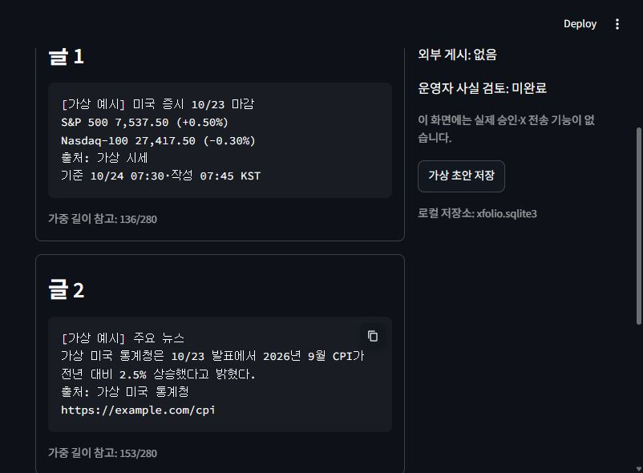

# 뉴스 수집과 아침 미리보기

- 작성일: 2026-10-24, Asia/Seoul
- 상태: 좁힌 질의 실제 시험·News Pipeline·가상 미리보기/SQLite 구현, 로컬 배포 결정 완료. 실뉴스 운영 적합성은 미충족
- 관련: [계획](../../plans/뉴스_수집.md) · [기존 실제 시험](뉴스_샘플과_요약_시험.md) · [운영 정책](../../../docs/운영_정책.md)

## 범위와 실행 경계

거시 검색량이 큰 문제는 먼저 질의 범위를 좁혀 해결 가능한지 확인한다. 기업 API를 따로 쓰면 거시138페이지 자체는 줄지 않고 제공처·권한·중복·비용 관리가 늘어난다. 두 제공처 도입은 이번에 확정하지 않는다.

실제 뉴스 시험은 Marketaux GET 최대12회, 요청 시작 최소3초 간격, 자동재시도0으로 제한한다. 이전과 같은10/23 07:30 KST 기준24시간 창을 우선 비교하고 필요하면 좁힌 질의의 추가 표본을 같은 예산에서 확보한다. 과거 창의 현재 검색은 실시간 운영 관측이나 기준 전 버전 증명이 아니다. 원문·발췌는 메모리에서만 판독하고 저장은 최소 메타데이터·수량·수집 상태·숫자 사용량 헤더로 제한한다. 402/429·통신/스키마 오류는 즉시 중단한다.

현재 공개 API 이용 문서로 외부AI·한국어 X 공개·근거/백업 보관 범위가 확인되지 않으면 해당 단계는 활성화하지 않는다. 문의 발송은 이번 요청에 포함하지 않는다. 내부 구현·시험은 직접 작성한 가상 자료를 쓰며 실기사 외부AI 전달·실제 X 게시를 수행하지 않는다.

## News Pipeline 계약

- UTC 시작·종료와 수집 완료 시각, query ID·검색식·도메인/티커·유사 기사 옵션을 고정한다. 시작/종료는 시간대 필수, 시작이 종료보다 앞서야 한다.
- 기사에는 provider·article_id·원문URL·출처·발행UTC·수집UTC를 남긴다. 제목/description/snippet은 실제 응답의 메모리 입력이다. CLI 결과·앱 DB에 실기사 텍스트를 자동 저장하지 않는다.
- 질의 전체 페이지를 끝까지 읽고 UUID·메타 일관성을 확인해야 complete다. 페이지/요청 상한·found 변화·중복 페이지·날짜 불명은 partial, HTTP/통신/스키마 실패는 failed다. 정의한 범위의 수집 성공과 전체 시장 커버리지는 구분한다.
- complete만 수집 진행을 전진시킬 수 있다. 이번 단계는 커서의 성공 가능 여부를 보고하며 실제 운영 커서·예약 작업은 만들지 않는다. complete0건과 partial/failed를 구분한다.
- 검색은 근거 충분성·사건 중복·중요도를 확정하지 않는다. 기사UUID 중복 제거와 같은 사건 판정은 별개다. 새 수치·누락 조건을 추정하지 않는다.

## 아침 미리보기 계약

- 기본 결과는 로컬 dry_run이며 외부 게시 함수·승인 버튼을 제공하지 않는다. 가상 예시임을 화면과 저장 결과에 표시한다.
- 첫 글은 같은 완료 미국 거래일의 S&P 500·Nasdaq-100 종가·등락률, 출처·정보 기준·작성 시각이다. 둘째 글은 충분한 근거가 확인된 뉴스1건의 주체·변화·기간/조건·출처·링크다.
- 정상 complete 후 적격 뉴스0건이면 그 범위의 선정 뉴스 없음 표시를 첫 글에 넣고1글로 만든다. partial/failed·필수 지수 누락/불일치·기준 후 처음 확보한 근거는 전체 보류한다.
- 지수 등락률은 Decimal·HALF_UP으로 계산/대조하고, 뉴스의 날짜·범위·단위·조건은 사용한 근거와 연결한다. 가상 자료의 확정 문장을 사용하며 이를 실제 AI 생성 품질로 집계하지 않는다.
- X 280가중 길이는 NFC·한글·URL을 확인한다. 공식 파서와 같은 이모지/URL 경계 처리를 검증하지 못하면 길이값은 참고로 표시하고 실제 게시 가능 승인으로 사용하지 않는다. 예시는 이모지 없이 완성해 확인한다.
- SQLite에는 이번 단계의 가상 초안·가상 근거·입력 버전·모드·보류 이유만 저장하고 같은 입력의 재실행은 중복 생성하지 않는다. 앱 DB·비밀키는 Git에서 제외한다. 실기사 보관은 권한 확인 뒤 별도 활성화한다.

## 완료 판정

좁힌 질의의 관측 결과와 한계, 공개 이용 범위의 확인/미확인, 외부 API 없는 기능 검사, 재현 가능한 CLI·미리보기·저장 결과를 기록한다. 공개 이용 조건이 미확인이면 개발 결과와 공개 운영 보류를 분리해서 보고한다.

## 좁힌 질의 실제 관측

2026-10-24 22:23:06~22:23:28 KST, [공통 검색식](../../../src/xfolio/news_queries.py)의4질의를 사용했다. 회사 목록 AAPL/MSFT/NVDA는 시험용이며 최종 관찰 목록은 아니다. 정책·지표는 미국 소재 표현/확정 행위와 Reuters/AP/CNBC 도메인, 기업은 실적/확정 변화 표현과 Reuters/보도자료 배포처로 좁혔다. 검색은 여전히 본문 전체 대상이므로 검색어가 반환 발췌에 있다는 보장은 없다.

| 범위 | 정책 | 미국 지표 | 기업 실적 | 기업 변화 |
| --- | --- | --- | --- | --- |
|10/23 07:30 KST 기준24시간+1분 | found1,1페이지 완료 |0건 완료 |0건 완료 |0건 완료 |
| 실행 시점 최근5일 첫 페이지 | found6 중3반환,부분 표본 | found1,완료 |0건 완료 |0건 완료 |

8GET 성공·5반환행·고유4기사,3초 요청 간격을 유지했다. 일일 잔여45→38·60초 잔여29→22를 관측했으며 당시 스냅샷이다. [최소 메타데이터 원본](../assets/news_samples/marketaux_focused_20261024.json)

보고 필드는 고정 아침 창의 `fixed_window_checkpoint_eligible=true`와 전체 부분 표본의 `checkpoint_advance=false`로 구분했다. 최초 보고의 전역 checkpoint 값이 고정 창만 뜻하던 혼동을 정정했으며 API 응답·요청·기사 메타데이터는 바꾸지 않았다. 원래 값과 정정 이유는 JSON의 `reporting_correction`에 남겼다. 서비스 커서는 쓰지 않았다.

22:43 KST 구현한 앱 수집기에도 같은 고정 아침 구간을 최대4GET·질의1페이지로 실행했다.4질의 complete·고유1기사,3초 간격·메타데이터만 저장·전체 진행 가능 판정을 확인했다. 텍스트 충분성 합격이나 실제 서비스 커서 전진은 아니다. 마지막 응답의 일일잔여34·60초잔여26은 당시 스냅샷이다. 이번 후속 작업은 실험8+앱4=12GET이며 추가 모델 호출은 없었다. [앱 수집기 실제 결과](../assets/news_samples/marketaux_pipeline_20261024.json)

고유4기사를 메모리에서 판독한 결과는 CNBC의 국부펀드 관계자 사진 캡션, 투자클럽 홍보, 뉴스레터 인사, 유럽 물가 항의 시위였다. 원하는 미국의 확정 정책·경제지표 변화에 대한 주체/수치/대상 기간/조건의 근거가 부족했다. 이 소수 표본에서 공급자 전체의 커버리지·정밀도를 산출하지 않는다. 기업0건도 뉴스 미지원이나 모든 실제 사건 부재의 증거가 아니다.

**판정:** 고정 창의 조회량은138페이지 추산에서4요청으로 줄었지만, 근거 충분성 문제는 해결하지 못했다. 좁힌 질의를 무료 운영에 최종 채택하지 않는다. 기업 API만 옮겨도 기존 거시 문제는 남으며,2곳 도입은 현재1곳 범위와 비용·사건 중복 관리의 변경이다. 현시점은 공식 미국 발표 자료 또는 다른 단일 제공처/분리 구조를 비교할 근거를 마련한 단계다. 새 제공처 가입·구독·연동을 수행하지 않았다.

## 구현과 실행 결과

- `news.py`·`news_models.py`:3초 간격·페이지/요청 상한·402/429·시각·UUID·응답 변화·보류·메타데이터 출력. 커서/예약/AI/기사 영속 저장은 연결하지 않았다.
- `compose.py`·`demo.py`: 가상 아침2글, complete0건1글, partial/failed와 기준 후 근거·지수 오류는 전체 보류. 선정문은 직접 작성한 고정 문장으로 AI 생성 결과가 아니다.
- `storage.py`: 가상 초안의 SQLite 저장·버전 중복 방지·재조회. `data/`는 Git 제외다. can_publish=True나 dry_run이 아닌 저장 입력을 재검증해 거부한다.
- `xfolio preview`·`news-check`, Streamlit 화면을 연결했다. `ready`는 검토용 가상 초안 상태이며 게시 승인이나 의미 정확성 판정이 아니다. 뉴스 검사는 ID·근거 부분 문자열·시각 대조이고 원문 함의는 운영자 검토 대상이다.
- 기본3시나리오·부분/실패·모순 상태·숫자/시간 오류·길이 초과·기준 후 근거·실기사 저장 차단·동일 버전 중복을 외부 API 없이 검사했다. 최신 전체 검사 수는 당일 기록을 따른다.

## 가상 게시글 예시

아래 지수·통계청·물가는 모두 직접 만든 가상 값이다. 글1은두 지수 마감, 글2는확인된 변화1건과 근거 링크다. 실제 게시 시각은 게시 성공 후 별도로 기록하며 아래는 작성 시각을 표시한다.

```text
[가상 예시] 미국 증시 10/23 마감
S&P 500 7,537.50 (+0.50%)
Nasdaq-100 27,417.50 (-0.30%)
출처: 가상 시세
기준 10/24 07:30·작성 07:45 KST
```

```text
[가상 예시] 주요 뉴스
가상 미국 통계청은 10/23 발표에서 2026년 9월 CPI가 전년 대비 2.5% 상승했다고 밝혔다.
출처: 가상 미국 통계청
https://example.com/cpi
```

가중 길이 참고값은136/153이다. 이모지·모든 URL 경계의 공식 파서 검증은 미완료이며 실제 게시 가능 판정으로 쓰지 않는다. 길이 초과 때 핵심 조건을 자르지 않고 해당 뉴스를 제외한다.



## 자동화·로컬 관리자 배포 결정

사용자가 현재 Windows PC에서만 접속하기로 선택했다. 관리자 화면은 `127.0.0.1:8501`의 Streamlit, 공통 저장소는 로컬 SQLite다. 이번 로컬 실행은 가상 미리보기와 저장 확인이며 제품의 로그인·승인·자동화 작업 등록 완료가 아니다.

자동화는 Windows 작업 스케줄러가 정해진 Python 워크플로를 실행한다. AI는 기사 관련성·선정 이유·한국어 요약·문장별 근거를 구조화해 반환하며 예약·예산·게시 권한을 바꾸지 않는다. Python의 수집/형식·사실/시각·중복·길이·한도 검사와 모드별 조건을 통과해야 다음 단계로 진행한다. 별도 자율 에이전트 프레임워크는 첫 버전에 추가하지 않는다.

아침 준비·기업 수집·게시 대기 처리·관리자 화면 시작을 구분하고 같은 SQLite의 중복/발행 상태를 공유한다. dry_run→reviewed→연속5거래일/장애 시험 후 auto 순서다. 실제 명령·제품 작업 등록은 각 파이프라인과 게시/복구 구현 뒤 연결하며, 현재 가상 화면을 자동 게시 에이전트 완료로 표시하지 않는다.
